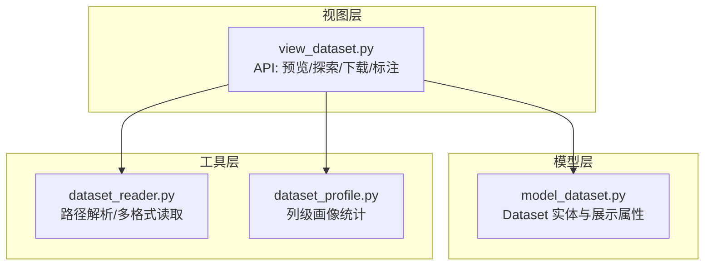
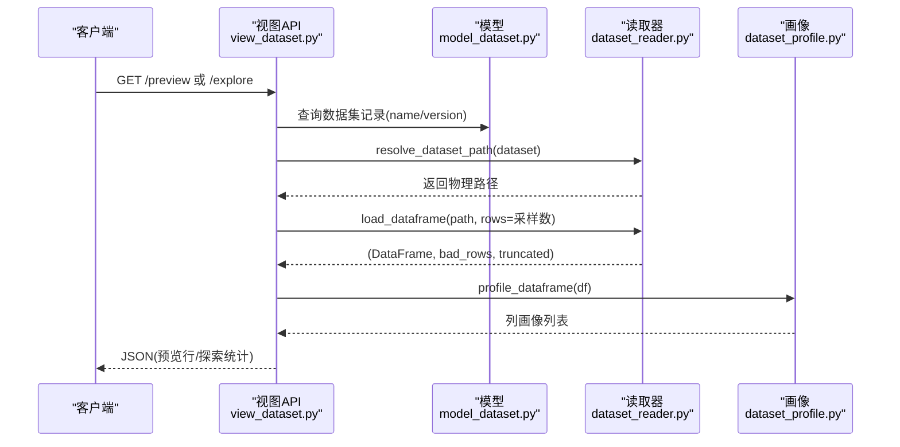
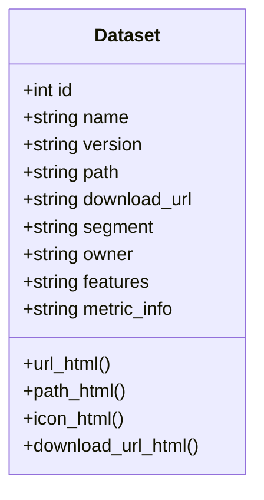
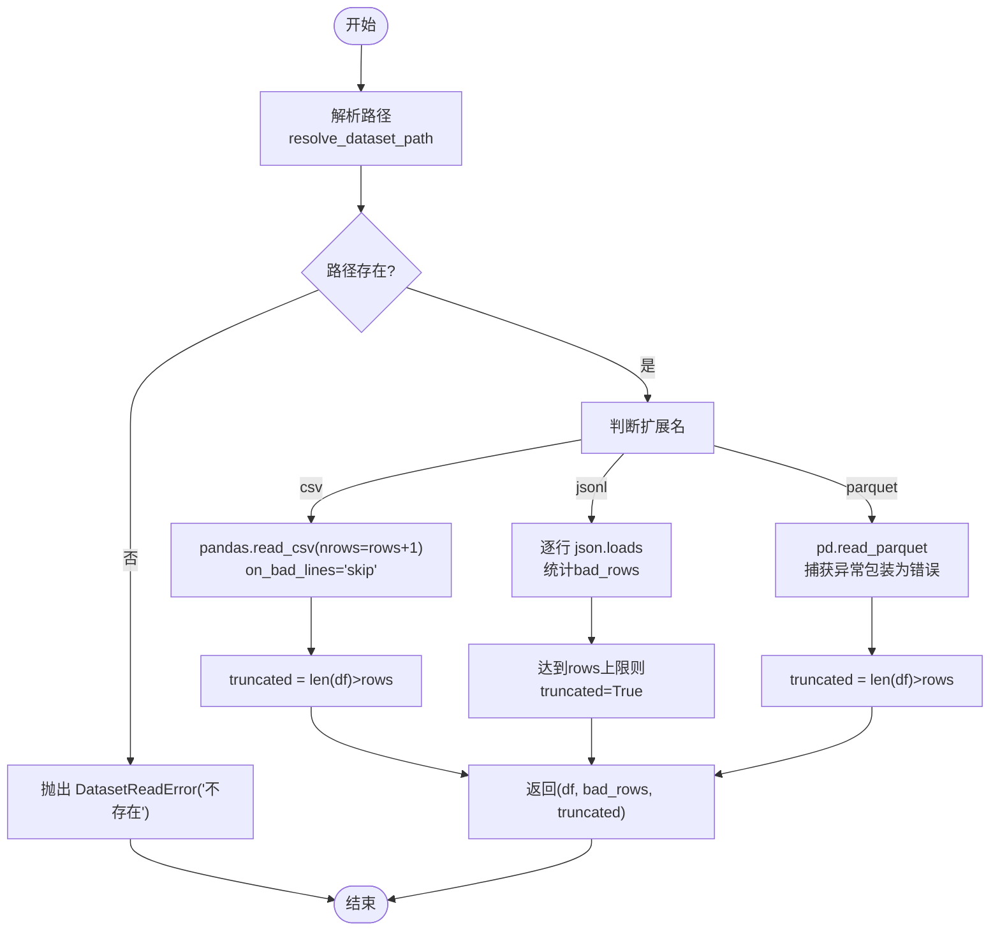
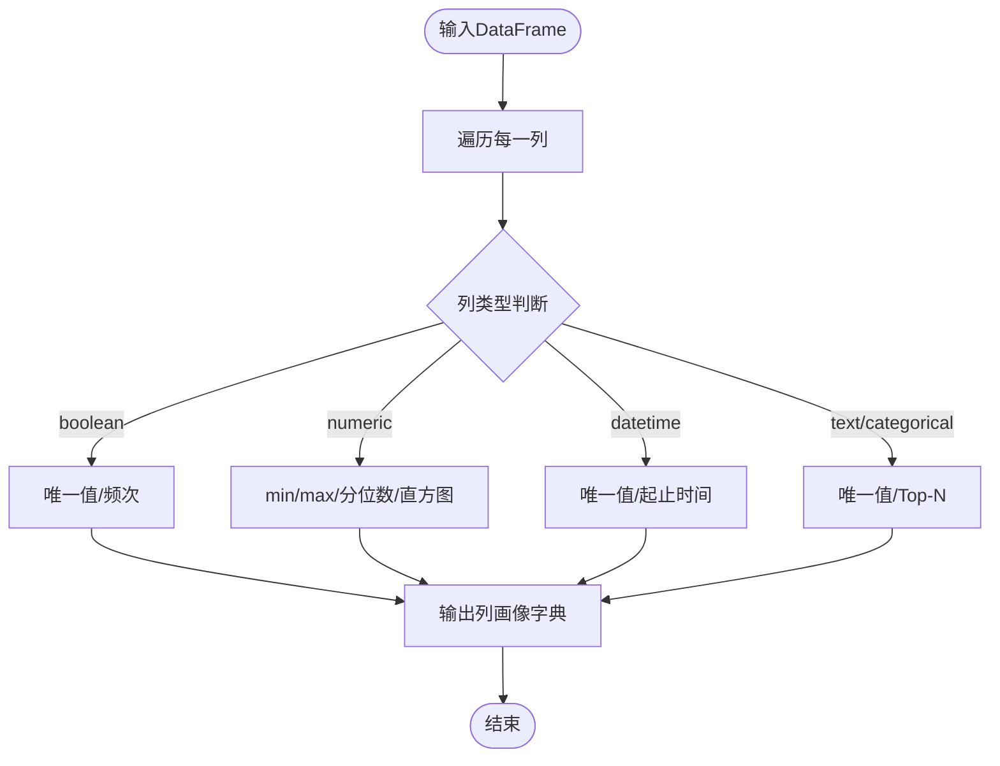
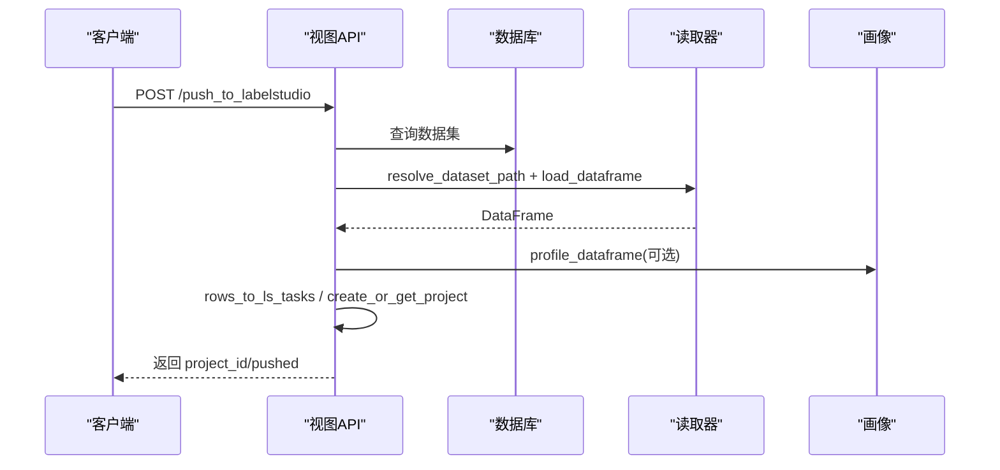
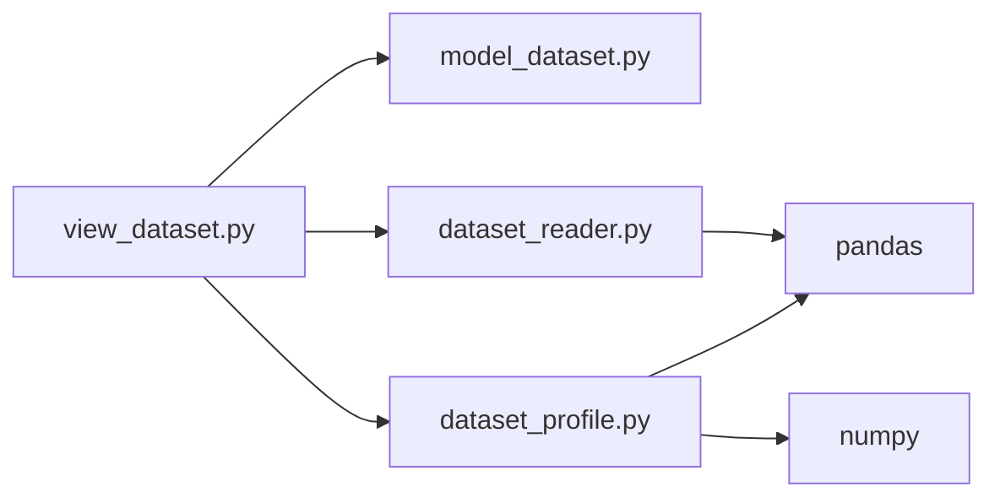
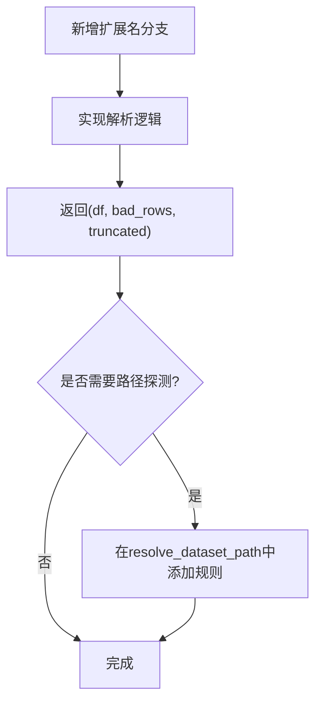
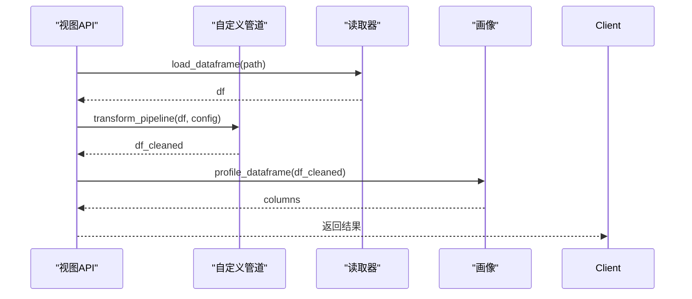

# 数据集管理

<cite>
**本文引用的文件**   
- [myapp/utils/dataset_reader.py](file://myapp/utils/dataset_reader.py)
- [myapp/utils/dataset_profile.py](file://myapp/utils/dataset_profile.py)
- [myapp/models/model_dataset.py](file://myapp/models/model_dataset.py)
- [myapp/views/view_dataset.py](file://myapp/views/view_dataset.py)
</cite>

## 目录
1. [简介](#简介)
2. [项目结构](#项目结构)
3. [核心组件](#核心组件)
4. [架构总览](#架构总览)
5. [详细组件分析](#详细组件分析)
6. [依赖关系分析](#依赖关系分析)
7. [性能与内存优化](#性能与内存优化)
8. [故障排查指南](#故障排查指南)
9. [结论](#结论)
10. [附录：扩展数据格式与处理管道](#附录扩展数据格式与处理管道)

## 简介
本文件面向“数据集管理”功能，系统性说明数据集的创建、上传、版本控制与生命周期管理；解释数据读取器对 CSV、JSONL、Parquet 等格式的自动识别与处理机制；描述数据画像（统计信息、质量检查、异常检测）的实现；并提供扩展新数据格式与自定义数据处理管道的实践指引。文档同时涵盖大数据集处理的优化策略、内存管理与并发访问控制要点。

## 项目结构
围绕数据集管理的代码主要分布在以下模块：
- 视图层 API：提供数据集预览、探索、下载、标注平台对接等接口
- 模型层：定义数据集实体字段、展示属性与权限相关逻辑
- 工具层：数据读取器与数据画像分析

**图示来源**
- [myapp/views/view_dataset.py:413-527](file://myapp/views/view_dataset.py#L413-L527)
- [myapp/models/model_dataset.py:17-58](file://myapp/models/model_dataset.py#L17-L58)
- [myapp/utils/dataset_reader.py:44-113](file://myapp/utils/dataset_reader.py#L44-L113)
- [myapp/utils/dataset_profile.py:22-73](file://myapp/utils/dataset_profile.py#L22-L73)

**章节来源**
- [myapp/views/view_dataset.py:48-101](file://myapp/views/view_dataset.py#L48-L101)
- [myapp/models/model_dataset.py:17-58](file://myapp/models/model_dataset.py#L17-L58)

## 核心组件
- 数据集模型 Dataset：承载数据集元数据（名称、版本、分区、存储路径、所有者、特征信息等），并提供用于前端展示的 HTML 辅助属性。
- 数据读取器 DatasetReadError/load_dataframe/resolve_dataset_path：负责根据数据集记录定位实际文件路径，并支持 CSV、JSONL、Parquet 三种格式的采样读取。
- 数据画像 profile_dataframe/_column_profile：对 DataFrame 进行逐列类型推断与统计摘要（缺失率、唯一值、数值分位数与直方图、文本 Top-N 等）。
- 视图 API：暴露预览、探索、下载、标注平台对接等能力，串联模型与工具层。

**章节来源**
- [myapp/models/model_dataset.py:17-58](file://myapp/models/model_dataset.py#L17-L58)
- [myapp/utils/dataset_reader.py:17-113](file://myapp/utils/dataset_reader.py#L17-L113)
- [myapp/utils/dataset_profile.py:1-73](file://myapp/utils/dataset_profile.py#L1-L73)
- [myapp/views/view_dataset.py:413-527](file://myapp/views/view_dataset.py#L413-L527)

## 架构总览
下图展示了从请求到数据画像输出的关键调用链：

**图示来源**
- [myapp/views/view_dataset.py:413-527](file://myapp/views/view_dataset.py#L413-L527)
- [myapp/utils/dataset_reader.py:44-113](file://myapp/utils/dataset_reader.py#L44-L113)
- [myapp/utils/dataset_profile.py:22-73](file://myapp/utils/dataset_profile.py#L22-L73)

## 详细组件分析

### 数据集模型（Dataset）
- 关键字段
  - name/version：数据集标识与版本
  - path/download_url：本地持久化路径或外部下载地址
  - segment：分区/分片信息（JSON 字符串）
  - features/metric_info/info：结构化元数据（如特征 schema、指标信息）
  - owner：责任人（支持通配符公开）
- 展示属性
  - url_html/path_html/icon_html/download_url_html：将 URL/路径渲染为可点击链接或图片标签，内部处理容器路径映射与静态资源前缀。

**图示来源**
- [myapp/models/model_dataset.py:17-58](file://myapp/models/model_dataset.py#L17-L58)
- [myapp/models/model_dataset.py:63-148](file://myapp/models/model_dataset.py#L63-L148)

**章节来源**
- [myapp/models/model_dataset.py:17-58](file://myapp/models/model_dataset.py#L17-L58)
- [myapp/models/model_dataset.py:63-148](file://myapp/models/model_dataset.py#L63-L148)

### 数据读取器（CSV/JSONL/Parquet）
- 路径解析 resolve_dataset_path
  - 优先使用 dataset.path 首个非空行；若以 /mnt/ 开头则替换为宿主工作区路径
  - 若 path 指向目录且存在 data.csv，则自动切换到 data.csv
  - 若为 LeRobot 布局（data/*.parquet），自动选择首个 parquet 分片
  - 否则回退到默认中心路径 /data/k8s/kubeflow/global/dataset/{name}/{version}/data.csv
- 采样读取 load_dataframe
  - CSV：pandas.read_csv(nrows=rows+1)，跳过坏行，返回最多 rows 行，并标记是否截断
  - JSONL：逐行解析，统计坏行数，返回 records 的扁平化 DataFrame
  - Parquet：直接读取，捕获引擎/IO/解析异常并包装为 DatasetReadError
  - 统一返回 (df, bad_rows, truncated)

**图示来源**
- [myapp/utils/dataset_reader.py:21-65](file://myapp/utils/dataset_reader.py#L21-L65)
- [myapp/utils/dataset_reader.py:68-113](file://myapp/utils/dataset_reader.py#L68-L113)

**章节来源**
- [myapp/utils/dataset_reader.py:17-113](file://myapp/utils/dataset_reader.py#L17-L113)

### 数据画像分析（profile_dataframe）
- 列类型推断与统计
  - boolean：唯一值计数、类别频次
  - numeric：缺失率、唯一值、min/max、分位数(p25/p50/p75)、直方图(HIST_BINS=20)
  - datetime：唯一值、最小/最大时间
  - categorical/text：唯一值、Top-N 值及其频次(TOP_N=20)
- 输出为列画像列表，便于前端可视化与质量检查

**图示来源**
- [myapp/utils/dataset_profile.py:9-19](file://myapp/utils/dataset_profile.py#L9-L19)
- [myapp/utils/dataset_profile.py:22-73](file://myapp/utils/dataset_profile.py#L22-L73)

**章节来源**
- [myapp/utils/dataset_profile.py:1-73](file://myapp/utils/dataset_profile.py#L1-L73)

### 视图 API（预览/探索/下载/标注）
- 预览 /preview/<dataset_name>[/<version>][/<segment>]
  - 解析参数，按 name/version 查询最新记录
  - 调用 resolve_dataset_path + load_dataframe(rows=50)
  - 将 DataFrame 转为行数组，处理 NaN/None 为空串
- 探索 /explore/<dataset_name>/<version>[/<segment>]
  - 返回 row_count/sampled_rows/truncated/bad_rows/columns
  - columns 由 profile_dataframe 生成
- 下载 /download/<dataset_id>[/<partition>]
  - 支持本地路径、外部 URL、对象存储（通过配置动态加载 store 模块）
  - 支持按 partition 返回对应分片地址
- 标注平台对接
  - push_to_labelstudio：读取数据集，转换为任务并推送至 Label Studio
  - import_from_labelstudio：从 LS 导出结果写回平台数据集中心，并登记 Dataset 记录

**图示来源**
- [myapp/views/view_dataset.py:529-556](file://myapp/views/view_dataset.py#L529-L556)

**章节来源**
- [myapp/views/view_dataset.py:413-527](file://myapp/views/view_dataset.py#L413-L527)
- [myapp/views/view_dataset.py:529-595](file://myapp/views/view_dataset.py#L529-L595)

## 依赖关系分析
- 视图层依赖模型层获取数据集元数据，依赖工具层完成数据读取与画像
- 读取器独立于 myapp 业务模块，便于单元测试与复用
- 画像模块仅依赖 pandas/numpy，纯函数式实现，无副作用

**图示来源**
- [myapp/views/view_dataset.py:32-44](file://myapp/views/view_dataset.py#L32-L44)
- [myapp/utils/dataset_reader.py:1-10](file://myapp/utils/dataset_reader.py#L1-L10)
- [myapp/utils/dataset_profile.py:1-6](file://myapp/utils/dataset_profile.py#L1-L6)

**章节来源**
- [myapp/views/view_dataset.py:32-44](file://myapp/views/view_dataset.py#L32-L44)
- [myapp/utils/dataset_reader.py:1-10](file://myapp/utils/dataset_reader.py#L1-L10)
- [myapp/utils/dataset_profile.py:1-6](file://myapp/utils/dataset_profile.py#L1-L6)

## 性能与内存优化
- 采样读取
  - CSV 使用 nrows=rows+1 判定截断，避免全量加载
  - JSONL 流式逐行解析，达到 rows 即停止
  - Parquet 直接读取后切片 head(rows)
- 内存控制
  - 所有对外接口均限制采样行数（预览固定 50，探索默认 SAMPLE_ROWS）
  - 画像计算在采样后的 DataFrame 上进行，降低开销
- 并发与锁
  - 当前读取器未引入显式并发控制；建议在批量探索场景下结合 Celery/线程池限流
  - 下载接口支持对象存储直链，减少服务端 IO 压力
- I/O 优化
  - 优先使用 Parquet 列式存储，提升读取效率
  - 对大目录使用 glob 递归匹配时注意路径转义，避免无效扫描

[本节为通用指导，不直接分析具体文件]

## 故障排查指南
- 数据集文件不存在
  - 现象：预览/探索报错“数据集文件不存在”
  - 排查：确认 dataset.path 是否存在；若为 /mnt/ 前缀，检查宿主路径映射是否正确
- 格式不支持
  - 现象：报错“暂不支持该格式探索”
  - 排查：确认文件扩展名为 .csv/.jsonl/.parquet；如需新增格式，参考附录扩展
- Parquet 读取失败
  - 现象：包装异常“parquet 读取失败(...)”
  - 排查：检查 pyarrow 引擎可用性、文件完整性、编码问题
- 权限不足
  - 现象：下载接口返回 401
  - 排查：确认 dataset.owner 包含当前用户或为 *

**章节来源**
- [myapp/utils/dataset_reader.py:63-65](file://myapp/utils/dataset_reader.py#L63-L65)
- [myapp/utils/dataset_reader.py:103-113](file://myapp/utils/dataset_reader.py#L103-L113)
- [myapp/views/view_dataset.py:353-411](file://myapp/views/view_dataset.py#L353-L411)

## 结论
本系统通过清晰的职责分层实现了数据集的创建、版本化、预览与探索能力。读取器对主流表格/序列化格式提供一致的采样读取接口，画像模块提供轻量但实用的列级统计。配合视图层的下载与标注平台对接，形成完整的数据集生命周期闭环。后续可在保持读取器解耦的前提下，扩展更多格式与处理管道，并结合异步任务与缓存进一步提升大规模数据集的处理体验。

[本节为总结性内容，不直接分析具体文件]

## 附录：扩展数据格式与处理管道

### 扩展新的数据格式支持
目标：在不改动视图层的前提下，新增一种数据格式（例如 .tsv 或 .avro）的自动识别与读取。

步骤建议：
- 在读取器中新增分支
  - 在 load_dataframe 中增加对新扩展名的判断分支
  - 实现对应的解析逻辑，返回 (df, bad_rows, truncated)
  - 若需要特殊错误提示，抛出 DatasetReadError
- 路径解析增强（可选）
  - 若新格式采用特定目录布局（如 data.tsv 或 data.avro），在 resolve_dataset_path 中增加相应探测逻辑
- 测试覆盖
  - 针对新格式编写单测，覆盖正常、坏行、空文件、超大文件截断等场景

**图示来源**
- [myapp/utils/dataset_reader.py:68-113](file://myapp/utils/dataset_reader.py#L68-L113)
- [myapp/utils/dataset_reader.py:44-65](file://myapp/utils/dataset_reader.py#L44-L65)

**章节来源**
- [myapp/utils/dataset_reader.py:44-113](file://myapp/utils/dataset_reader.py#L44-L113)

### 自定义数据处理管道
目标：在探索/预览流程中插入自定义清洗、转换或特征工程步骤。

建议方案：
- 在视图层封装一个可插拔的 transform_pipeline(df, config) -> df
- 将 pipeline 配置存入 dataset.features 或 dataset.expand 中
- 在 explore/preview 中按需调用 transform_pipeline，再进入画像计算

**图示来源**
- [myapp/views/view_dataset.py:413-527](file://myapp/views/view_dataset.py#L413-L527)
- [myapp/utils/dataset_reader.py:68-113](file://myapp/utils/dataset_reader.py#L68-L113)
- [myapp/utils/dataset_profile.py:22-73](file://myapp/utils/dataset_profile.py#L22-L73)

**章节来源**
- [myapp/views/view_dataset.py:413-527](file://myapp/views/view_dataset.py#L413-L527)