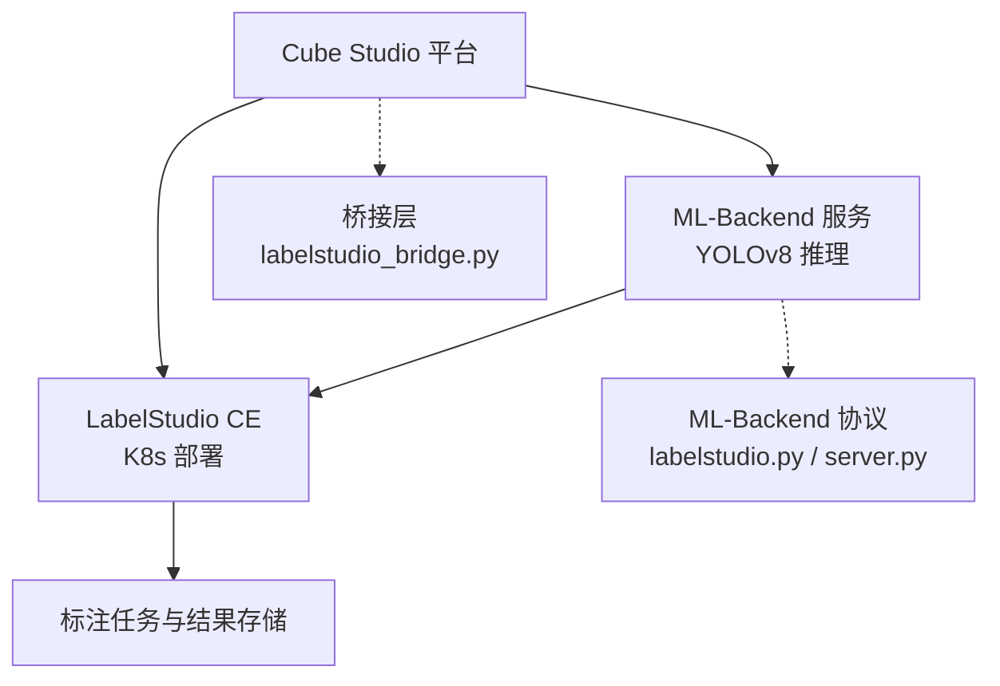
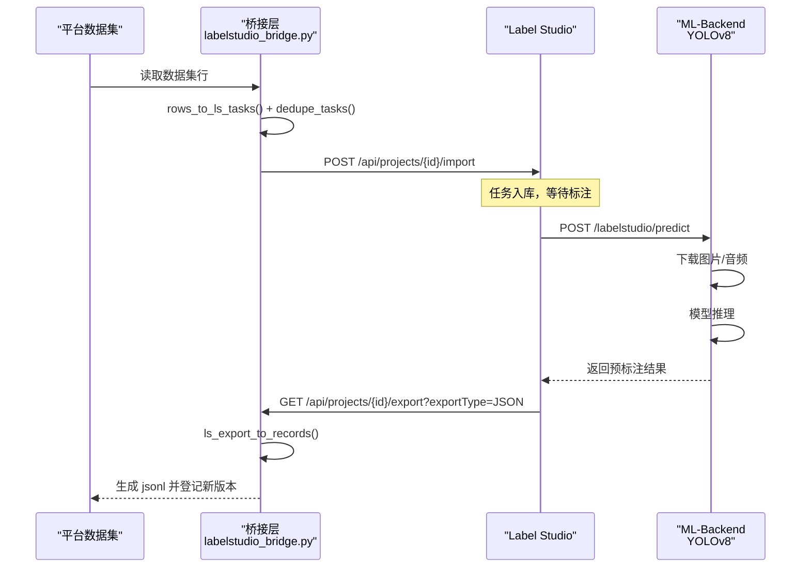
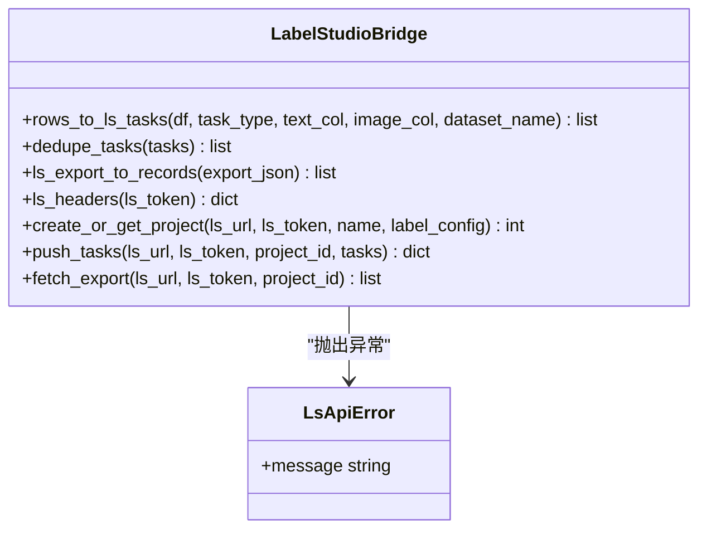
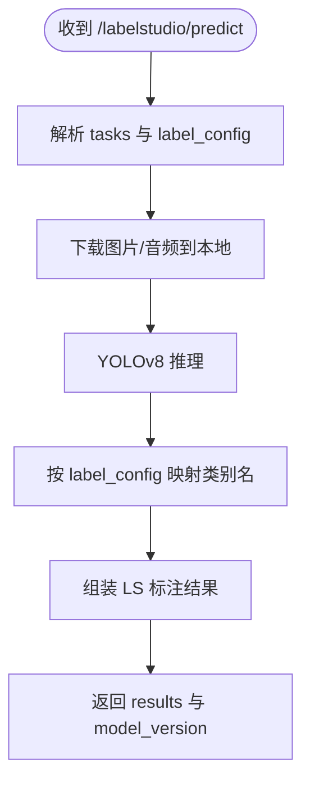
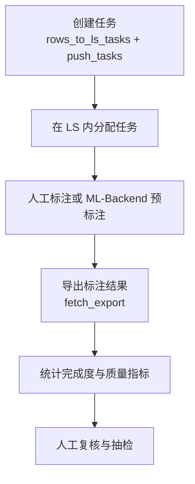
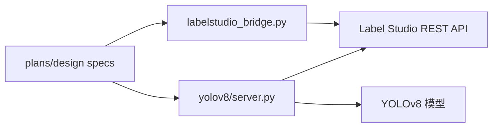

# 标注平台集成

<cite>
**本文引用的文件**   
- [myapp/utils/labelstudio_bridge.py](file://myapp/utils/labelstudio_bridge.py)
- [job-template/job/yolov8/labelstudio.py](file://job-template/job/yolov8/labelstudio.py)
- [job-template/job/yolov8/server.py](file://job-template/job/yolov8/server.py)
- [docs/superpowers/plans/2026-11-07-labelstudio-integration.md](file://docs/superpowers/plans/2026-11-07-labelstudio-integration.md)
- [docs/superpowers/specs/2026-11-07-labelstudio-integration-design.md](file://docs/superpowers/specs/2026-11-07-labelstudio-integration-design.md)
</cite>

## 目录
1. [引言](#引言)
2. [项目结构](#项目结构)
3. [核心组件](#核心组件)
4. [架构总览](#架构总览)
5. [详细组件分析](#详细组件分析)
6. [依赖关系分析](#依赖关系分析)
7. [性能与批量处理优化](#性能与批量处理优化)
8. [安全、隐私与合规](#安全隐私与合规)
9. [故障排查指南](#故障排查指南)
10. [结论](#结论)
11. [附录：扩展新的标注工具集成](#附录扩展新的标注工具集成)

## 引言
本文件面向希望在 Cube Studio 中集成 Label Studio 等标注平台的工程师与数据团队，系统性说明以下能力：
- 数据集到标注任务的同步机制
- 标注结果导入与质量校验策略
- 自动化标注（预标注模型）与人工审核流程
- 任务创建、分配与进度跟踪思路
- 扩展新标注工具的代码模式与自定义工作流设计
- 数据安全、隐私保护与批量处理优化建议

当前仓库已实现社区版 Label Studio 的桥接层与 ML-Backend 协议示例，并配套了实施计划与设计文档。本文以现有代码为依据进行解读，并在“附录”给出可扩展的新工具集成范式。

## 项目结构
围绕标注平台集成的关键代码与文档分布如下：
- 桥接层：`myapp/utils/labelstudio_bridge.py`，提供任务转换、幂等去重、导出解析及 Label Studio REST 客户端函数。
- 自动化标注示例：`job-template/job/yolov8/labelstudio.py` 与 `server.py`，实现 Label Studio ML-Backend 协议，对接 YOLOv8 目标检测模型。
- 设计与计划：`docs/superpowers/specs/2026-11-07-labelstudio-integration-design.md` 与 `docs/superpowers/plans/2026-11-07-labelstudio-integration.md`，明确 v1 范围、接口契约、部署约束与测试方案。

图表来源
- [docs/superpowers/specs/2026-11-07-labelstudio-integration-design.md:34-77](file://docs/superpowers/specs/2026-11-07-labelstudio-integration-design.md#L34-L77)
- [myapp/utils/labelstudio_bridge.py:1-113](file://myapp/utils/labelstudio_bridge.py#L1-L113)
- [job-template/job/yolov8/server.py:276-355](file://job-template/job/yolov8/server.py#L276-L355)

章节来源
- [docs/superpowers/specs/2026-11-07-labelstudio-integration-design.md:1-33](file://docs/superpowers/specs/2026-11-07-labelstudio-integration-design.md#L1-L33)
- [docs/superpowers/plans/2026-11-07-labelstudio-integration.md:1-26](file://docs/superpowers/plans/2026-11-07-labelstudio-integration.md#L1-L26)

## 核心组件
本节聚焦三个关键实现点：
- 桥接层纯函数与 REST 客户端：负责数据集→LS 任务转换、去重、导出解析与 LS API 调用封装。
- ML-Backend 协议实现：为 Label Studio 提供预标注能力，支持图像下载、模型推理与结果回写。
- 设计与计划约束：明确 v1 能力边界、接口契约、错误处理与测试策略。

章节来源
- [myapp/utils/labelstudio_bridge.py:1-113](file://myapp/utils/labelstudio_bridge.py#L1-L113)
- [job-template/job/yolov8/labelstudio.py:1-107](file://job-template/job/yolov8/labelstudio.py#L1-L107)
- [job-template/job/yolov8/server.py:276-355](file://job-template/job/yolov8/server.py#L276-L355)
- [docs/superpowers/specs/2026-11-07-labelstudio-integration-design.md:34-105](file://docs/superpowers/specs/2026-11-07-labelstudio-integration-design.md#L34-L105)

## 架构总览
端到端数据流如下：
- 推送阶段：平台侧读取数据集 → 转换为 LS 任务 → 通过 REST 导入到 LS 项目。
- 标注阶段：人工在 LS 标注；或启用 ML-Backend 自动预标注。
- 回存阶段：从 LS 导出 JSON → 解析为记录 → 落盘为 jsonl → 登记为新版本数据集。

图表来源
- [myapp/utils/labelstudio_bridge.py:9-57](file://myapp/utils/labelstudio_bridge.py#L9-L57)
- [myapp/utils/labelstudio_bridge.py:94-112](file://myapp/utils/labelstudio_bridge.py#L94-L112)
- [job-template/job/yolov8/server.py:276-344](file://job-template/job/yolov8/server.py#L276-L344)

## 详细组件分析

### 桥接层：Label Studio 任务转换与 REST 客户端
职责与关键点：
- 任务类型白名单：仅支持文本分类与图像分类两类模板。
- 任务构造：每行数据映射为 LS 任务，注入 meta（dataset、row_idx）。
- 幂等去重：基于 (meta.dataset, meta.row_idx) 去重，避免重复导入。
- 导出解析：将 LS 导出的 JSON 转为记录，无标注保留空 label，多标注取首个。
- REST 封装：提供 headers、项目复用/创建、任务导入、导出拉取等函数，统一异常 LsApiError。

图表来源
- [myapp/utils/labelstudio_bridge.py:9-57](file://myapp/utils/labelstudio_bridge.py#L9-L57)
- [myapp/utils/labelstudio_bridge.py:60-112](file://myapp/utils/labelstudio_bridge.py#L60-L112)

章节来源
- [myapp/utils/labelstudio_bridge.py:1-113](file://myapp/utils/labelstudio_bridge.py#L1-L113)

### 自动化标注：ML-Backend 协议与 YOLOv8 预标注
职责与关键点：
- 协议入口：`/labelstudio/setup`、`/labelstudio/health`、`/labelstudio/predict`。
- 资源下载：根据 URL 规则下载图片/音频到本地，兼容 LS 上传路径前缀替换。
- 模型推理：YOLOv8 输出框坐标、类别、置信度，并按 LS 标签配置映射类别名。
- 结果回写：按 LS 标注格式组装矩形框标注结果，附带 score 与 model_version。

图表来源
- [job-template/job/yolov8/server.py:276-344](file://job-template/job/yolov8/server.py#L276-L344)
- [job-template/job/yolov8/labelstudio.py:22-106](file://job-template/job/yolov8/labelstudio.py#L22-L106)

章节来源
- [job-template/job/yolov8/server.py:276-355](file://job-template/job/yolov8/server.py#L276-L355)
- [job-template/job/yolov8/labelstudio.py:1-107](file://job-template/job/yolov8/labelstudio.py#L1-L107)

### 任务创建、分配与进度跟踪机制
当前仓库未内置完整的任务分配与进度跟踪 UI，但可通过以下机制组合实现：
- 任务创建：通过桥接层的 `rows_to_ls_tasks` 与 `push_tasks` 批量导入任务。
- 任务分配：在 Label Studio 内按人员或队列分配（CE 功能有限，可结合外部调度）。
- 进度跟踪：通过 `fetch_export` 拉取标注结果，统计完成数量与未完成数量，计算完成度。
- 质量控制：导出后人工复核，结合完成度统计与抽样质检。

图表来源
- [myapp/utils/labelstudio_bridge.py:9-57](file://myapp/utils/labelstudio_bridge.py#L9-L57)
- [myapp/utils/labelstudio_bridge.py:105-112](file://myapp/utils/labelstudio_bridge.py#L105-L112)

章节来源
- [docs/superpowers/specs/2026-11-07-labelstudio-integration-design.md:44-77](file://docs/superpowers/specs/2026-11-07-labelstudio-integration-design.md#L44-L77)

## 依赖关系分析
组件间依赖关系如下：
- 桥接层不依赖 myapp 内部模块，保持纯函数与独立可测性。
- ML-Backend 依赖 YOLOv8 与 FastAPI，遵循 Label Studio ML-Backend 协议。
- 设计与计划文档约束 v1 能力边界与接口契约。

图表来源
- [myapp/utils/labelstudio_bridge.py:1-3](file://myapp/utils/labelstudio_bridge.py#L1-L3)
- [job-template/job/yolov8/server.py:14-16](file://job-template/job/yolov8/server.py#L14-L16)
- [docs/superpowers/specs/2026-11-07-labelstudio-integration-design.md:1-18](file://docs/superpowers/specs/2026-11-07-labelstudio-integration-design.md#L1-L18)

章节来源
- [myapp/utils/labelstudio_bridge.py:1-113](file://myapp/utils/labelstudio_bridge.py#L1-L113)
- [job-template/job/yolov8/server.py:1-60](file://job-template/job/yolov8/server.py#L1-L60)
- [docs/superpowers/specs/2026-11-07-labelstudio-integration-design.md:1-33](file://docs/superpowers/specs/2026-11-07-labelstudio-integration-design.md#L1-L33)

## 性能与批量处理优化
- 批量导入：使用 `push_tasks` 一次性导入去重后的任务列表，减少网络往返。
- 幂等去重：基于 meta 键去重，避免重复任务导致的数据膨胀与性能损耗。
- 导出解析：`ls_export_to_records` 线性扫描导出 JSON，时间复杂度 O(n)，适合大规模标注结果处理。
- 模型推理：YOLOv8 推理可结合 GPU 加速（环境变量控制），并对输入图片进行缓存与复用。

章节来源
- [myapp/utils/labelstudio_bridge.py:25-34](file://myapp/utils/labelstudio_bridge.py#L25-L34)
- [myapp/utils/labelstudio_bridge.py:45-57](file://myapp/utils/labelstudio_bridge.py#L45-L57)
- [job-template/job/yolov8/server.py:41-57](file://job-template/job/yolov8/server.py#L41-L57)

## 安全、隐私与合规
- Token 管理：优先使用请求参数传入 `ls_token`，缺省回落到服务端配置；生产环境建议使用 secret 注入。
- 数据最小化：图片任务 v1 仅传引用 URL/路径，不上传文件本体，降低数据外发风险。
- 访问控制：平台菜单外链至 `/labelstudio/`，由平台 SSO 拦截入口，LS 内为独立账号（CE 限制）。
- 审计与日志：REST 调用失败时抛出 `LsApiError`，包含状态码与响应摘要，便于审计与排障。

章节来源
- [docs/superpowers/plans/2026-11-07-labelstudio-integration.md:13-26](file://docs/superpowers/plans/2026-11-07-labelstudio-integration.md#L13-L26)
- [myapp/utils/labelstudio_bridge.py:60-75](file://myapp/utils/labelstudio_bridge.py#L60-L75)

## 故障排查指南
常见问题与定位方法：
- LS 不可达或 token 无效：检查 `ls_url` 与 `ls_token`，确认网络连通性与权限。
- 任务类型不支持：仅支持 `text_classification` 与 `image_classification`，其他类型会抛出 ValueError。
- 同名项目复用：若 LS 项目已存在同名项目，直接复用其 ID，避免重复创建。
- 导出结果为空：确认 LS 项目是否有任务与标注，必要时重新触发标注或预标注。

章节来源
- [myapp/utils/labelstudio_bridge.py:10-11](file://myapp/utils/labelstudio_bridge.py#L10-L11)
- [myapp/utils/labelstudio_bridge.py:77-91](file://myapp/utils/labelstudio_bridge.py#L77-L91)
- [myapp/utils/labelstudio_bridge.py:105-112](file://myapp/utils/labelstudio_bridge.py#L105-L112)

## 结论
当前仓库已实现社区版 Label Studio 的基础集成能力，包括任务同步、标注结果导入、ML-Backend 预标注协议与相关设计与计划文档。后续可扩展更多标注工具与工作流，同时强化任务分配、进度跟踪与质量控制能力。

## 附录：扩展新的标注工具集成
以下提供扩展新标注工具（如 CVAT、Doccano 等）的代码模式与自定义工作流设计：

### 扩展步骤
1. 新建桥接模块：仿照 `labelstudio_bridge.py`，定义任务转换、去重、导出解析与 REST 客户端函数。
2. 定义协议适配层：若目标工具支持 ML-Backend 类似协议，新增适配类与方法（参考 `labelstudio.py`）。
3. 暴露 API：在平台侧新增 API 路由，调用桥接模块完成数据同步与结果回存。
4. 配置与部署：为目标工具提供 K8s 部署配置与服务发现，确保与平台路由对齐。

### 自定义工作流设计
- 任务创建：通过桥接模块将数据集转换为目标工具的任务格式。
- 任务分配：结合外部调度系统或目标工具内置分配机制。
- 进度跟踪：定期拉取标注结果，统计完成度与质量指标。
- 质量控制：引入抽样质检、交叉验证与人工复核环节。

章节来源
- [myapp/utils/labelstudio_bridge.py:1-113](file://myapp/utils/labelstudio_bridge.py#L1-L113)
- [job-template/job/yolov8/labelstudio.py:1-107](file://job-template/job/yolov8/labelstudio.py#L1-L107)