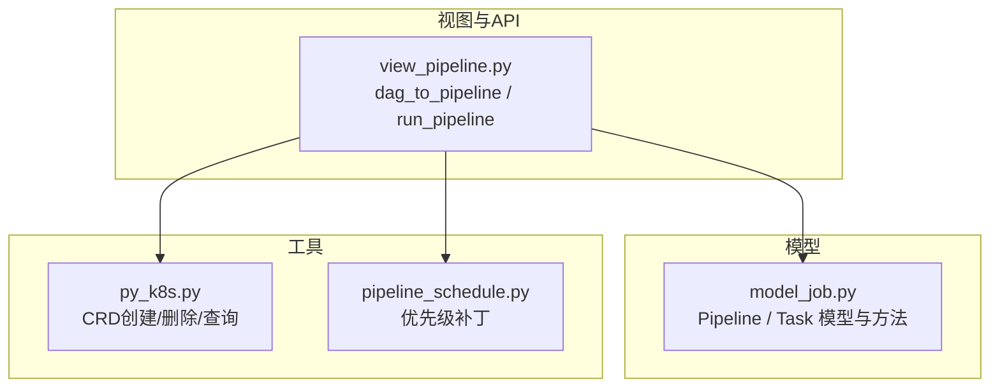
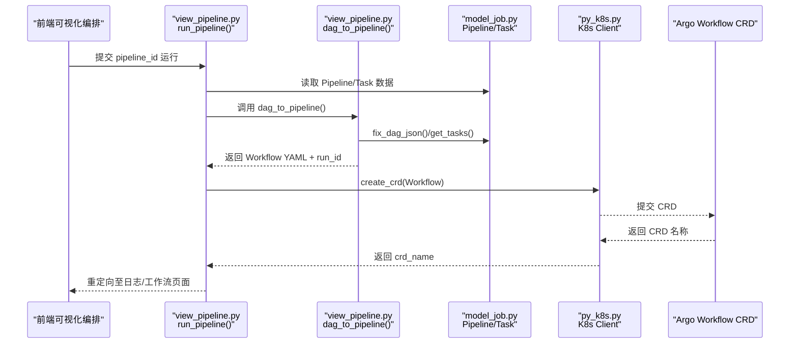
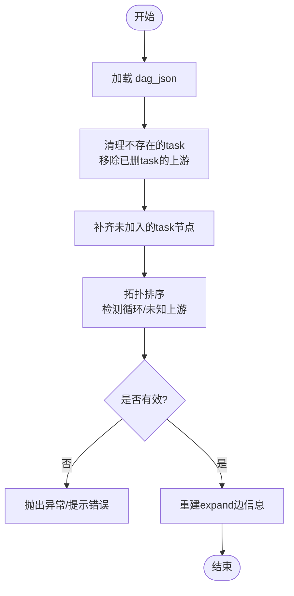
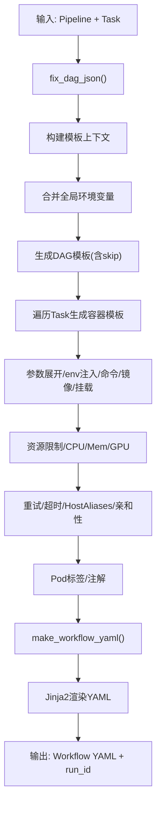
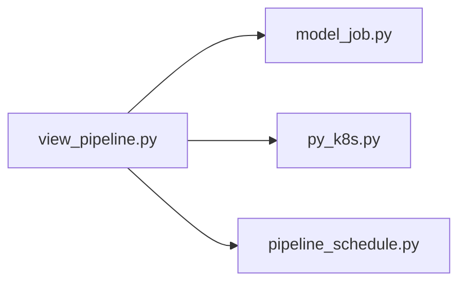

# Pipeline可视化编排

<cite>
**本文引用的文件**   
- [view_pipeline.py](file://myapp/views/view_pipeline.py)
- [model_job.py](file://myapp/models/model_job.py)
- [py_k8s.py](file://myapp/utils/py/py_k8s.py)
- [pipeline_schedule.py](file://myapp/utils/py/pipeline_schedule.py)
</cite>

## 目录
1. [引言](#引言)
2. [项目结构](#项目结构)
3. [核心组件](#核心组件)
4. [架构总览](#架构总览)
5. [详细组件分析](#详细组件分析)
6. [依赖关系分析](#依赖关系分析)
7. [性能与调度特性](#性能与调度特性)
8. [故障排查指南](#故障排查指南)
9. [结论](#结论)
10. [附录：扩展任务类型与自定义编排](#附录扩展任务类型与自定义编排)

## 引言
本文件面向“Pipeline可视化编排”能力，系统性解析 DAG（有向无环图）任务编排机制、节点配置与连线逻辑；深入说明 dag_to_pipeline 如何将可视化编排转换为 Argo Workflow YAML，涵盖模板渲染、环境变量注入、资源分配、镜像拉取策略、优先级调度等关键流程。同时提供复杂多阶段训练流程的配置思路与示例路径，并总结任务调度策略、并行执行控制与错误处理机制，帮助读者快速上手与二次开发。

## 项目结构
围绕 Pipeline 可视化编排的核心代码主要分布在以下模块：
- 视图与API层：负责接收前端编排数据、校验DAG、生成Workflow YAML并触发运行
- 模型层：定义 Pipeline、Task 等实体及其辅助方法（如 fix_dag_json、fix_expand）
- 工具层：K8s/Argo CRD操作、优先级补丁、调度相关逻辑

图示来源
- [view_pipeline.py:80-127](file://myapp/views/view_pipeline.py#L80-L127)
- [model_job.py:174-206](file://myapp/models/model_job.py#L174-L206)
- [model_job.py:523-553](file://myapp/models/model_job.py#L523-L553)
- [py_k8s.py](file://myapp/utils/py/py_k8s.py)
- [pipeline_schedule.py](file://myapp/utils/py/pipeline_schedule.py)

章节来源
- [view_pipeline.py:80-127](file://myapp/views/view_pipeline.py#L80-L127)
- [model_job.py:174-206](file://myapp/models/model_job.py#L174-L206)
- [model_job.py:523-553](file://myapp/models/model_job.py#L523-L553)

## 核心组件
- Pipeline 模型：保存流水线元信息、DAG JSON、全局环境变量、调度策略、并发数、优先级等
- Task 模型：保存每个节点的模板、参数、命令、挂载、资源、超时重试、跳过标记等
- dag_to_pipeline：将 Pipeline 的 DAG 与 Task 配置转换为 Argo Workflow YAML
- make_workflow_yaml：组装 Workflow CRD 基础结构与模板集合
- run_pipeline：调用 K8s API 提交 Workflow CRD 到集群

章节来源
- [model_job.py:174-206](file://myapp/models/model_job.py#L174-L206)
- [model_job.py:523-553](file://myapp/models/model_job.py#L523-L553)
- [view_pipeline.py:132-540](file://myapp/views/view_pipeline.py#L132-L540)
- [view_pipeline.py:80-127](file://myapp/views/view_pipeline.py#L80-L127)
- [view_pipeline.py:544-563](file://myapp/views/view_pipeline.py#L544-L563)

## 架构总览
下图展示从“可视化编排”到“Argo Workflow 执行”的整体流程：

图示来源
- [view_pipeline.py:1094-1151](file://myapp/views/view_pipeline.py#L1094-L1151)
- [view_pipeline.py:132-540](file://myapp/views/view_pipeline.py#L132-L540)
- [model_job.py:335-390](file://myapp/models/model_job.py#L335-L390)
- [model_job.py:296-297](file://myapp/models/model_job.py#L296-L297)
- [view_pipeline.py:544-563](file://myapp/views/view_pipeline.py#L544-L563)

## 详细组件分析

### DAG 任务编排与依赖关系
- DAG 数据结构：以 task_name 为键，包含 upstream 列表表示上游依赖
- 自动修复与排序：
  - fix_dag_json：清理不存在的任务、补齐缺失节点、移除已删任务的上游引用
  - order_by_upstream：拓扑排序，检测循环或未知上游
- 前端连线映射：fix_expand 根据 DAG 重建 expand 中的边信息，供可视化使用

图示来源
- [model_job.py:335-390](file://myapp/models/model_job.py#L335-L390)
- [model_job.py:419-497](file://myapp/models/model_job.py#L419-L497)
- [view_pipeline.py:781-833](file://myapp/views/view_pipeline.py#L781-L833)

章节来源
- [model_job.py:335-390](file://myapp/models/model_job.py#L335-L390)
- [model_job.py:419-497](file://myapp/models/model_job.py#L419-L497)
- [view_pipeline.py:781-833](file://myapp/views/view_pipeline.py#L781-L833)

### dag_to_pipeline 转换过程
该函数完成以下关键步骤：
- 读取并修正 DAG：fix_dag_json，确保与数据库 Task 一致
- 构建模板变量上下文：creator、runner、datetime、uuid、pipeline_id/name、cluster_name 等
- 全局环境变量注入：合并系统级 GLOBAL_ENV 与 pipeline.global_env，支持在任务参数中引用
- 生成 DAG 模板：为每个 task 生成 name/template/dependencies，支持 skip 条件
- 生成容器模板：
  - 参数展开：按类型处理 bool/dict/list/字符串等
  - 环境变量：任务模板 env + 全局 env + 运行时固定变量（KFJ_*、K8S_*）
  - 启动命令：优先使用 task.command，否则 job_template.entrypoint
  - 镜像与仓库密钥：images 覆盖、hubsecret 聚合
  - 存储挂载：volume_mount -> k8s volumes/volumeMounts
  - 节点选择器与亲和性：nodeSelector、podAntiAffinity
  - 资源限制：CPU/Memory/GPU，支持 requests/limits 分离
  - 重试与超时：retryStrategy.limit、activeDeadlineSeconds
  - HostAliases：支持 host 别名
  - Pod 标签与注解：pipeline/task/run 相关信息
- 最终组装 Workflow CRD：make_workflow_yaml 设置 entrypoint、templates、parallelism、imagePullSecrets、优先级补丁等
- 模板渲染：对生成的 YAML 进行 Jinja2 渲染，保留部分变量透传到 Argo

图示来源
- [view_pipeline.py:132-540](file://myapp/views/view_pipeline.py#L132-L540)
- [view_pipeline.py:80-127](file://myapp/views/view_pipeline.py#L80-L127)

章节来源
- [view_pipeline.py:132-540](file://myapp/views/view_pipeline.py#L132-L540)
- [view_pipeline.py:80-127](file://myapp/views/view_pipeline.py#L80-L127)

### 模板渲染与环境变量注入
- 模板变量：creator、runner、datetime、uuid、pipeline_id、pipeline_name、cluster_name 等
- 全局环境变量：
  - 系统级：GLOBAL_ENV（来自配置）
  - 流水线级：pipeline.global_env（每行 key=value，支持变量占位符）
- 运行时固定变量：
  - KFJ_TASK_ID/KFJ_TASK_NAME/KFJ_TASK_NODE_SELECTOR/KFJ_TASK_VOLUME_MOUNT/KFJ_TASK_IMAGES/KFJ_TASK_RESOURCE_CPU/KFJ_TASK_RESOURCE_MEMORY/KFJ_TASK_RESOURCE_GPU/KFJ_TASK_PROJECT_NAME/USERNAME/IMAGE_PULL_POLICY/HUBSECRET
  - K8S_NODE_NAME/K8S_POD_IP/K8S_HOST_IP/K8S_POD_NAME（通过 fieldRef 注入）

章节来源
- [view_pipeline.py:156-184](file://myapp/views/view_pipeline.py#L156-L184)
- [view_pipeline.py:231-259](file://myapp/views/view_pipeline.py#L231-L259)
- [view_pipeline.py:460-496](file://myapp/views/view_pipeline.py#L460-L496)

### 资源分配与镜像拉取策略
- CPU/Memory：支持 requests/limits 分离（形如 "2~4G"）
- GPU：整卡占用时设置 requests/limits 为整数；若未申请GPU则注入 NVIDIA_VISIBLE_DEVICES=none
- 镜像拉取策略：IMAGE_PULL_POLICY 默认 Always，可通过配置覆盖
- 镜像仓库密钥：聚合用户仓库与全局 HUBSECRET，写入 imagePullSecrets

章节来源
- [view_pipeline.py:336-373](file://myapp/views/view_pipeline.py#L336-L373)
- [view_pipeline.py:501-515](file://myapp/views/view_pipeline.py#L501-L515)
- [view_pipeline.py:420-420](file://myapp/views/view_pipeline.py#L420-L420)

### 任务调度策略与并行控制
- 并行度：pipeline.parallelism 控制同一实例内可同时运行的 task 数量
- 优先级：priority_spec_patch 双闸门注入 spec.priority 与 templateDefaults.priorityClassName（需配置 PIPELINE_PRIORITY_CLASS）
- 调度类型：once/crontab，cron_time 格式校验
- 最大活跃实例：max_active_runs/expired_limit 控制实例生命周期

章节来源
- [view_pipeline.py:115-115](file://myapp/views/view_pipeline.py#L115-L115)
- [view_pipeline.py:123-126](file://myapp/views/view_pipeline.py#L123-L126)
- [view_pipeline.py:665-672](file://myapp/views/view_pipeline.py#L665-L672)
- [view_pipeline.py:685-696](file://myapp/views/view_pipeline.py#L685-L696)
- [model_job.py:186-202](file://myapp/models/model_job.py#L186-L202)

### 错误处理与重试机制
- DAG 校验：order_by_upstream 检测循环或未知上游，抛出异常
- 任务重试：retryStrategy.limit 基于 task.retry
- 超时控制：activeDeadlineSeconds 基于 task.timeout
- 运行前清理：删除历史 workflow 与 pod，避免冲突
- 权限校验：仅管理员或创建者可运行

章节来源
- [view_pipeline.py:791-822](file://myapp/views/view_pipeline.py#L791-L822)
- [view_pipeline.py:447-449](file://myapp/views/view_pipeline.py#L447-L449)
- [view_pipeline.py:457-457](file://myapp/views/view_pipeline.py#L457-L457)
- [view_pipeline.py:1094-1151](file://myapp/views/view_pipeline.py#L1094-L1151)
- [view_pipeline.py:1039-1060](file://myapp/views/view_pipeline.py#L1039-L1060)

## 依赖关系分析
- view_pipeline.py 依赖 model_job.py 的 Pipeline/Task 模型与辅助方法
- view_pipeline.py 依赖 py_k8s.py 进行 CRD 的增删查
- view_pipeline.py 依赖 pipeline_schedule.py 进行优先级补丁注入

图示来源
- [view_pipeline.py:132-540](file://myapp/views/view_pipeline.py#L132-L540)
- [model_job.py:174-206](file://myapp/models/model_job.py#L174-L206)
- [model_job.py:523-553](file://myapp/models/model_job.py#L523-L553)
- [py_k8s.py](file://myapp/utils/py/py_k8s.py)
- [pipeline_schedule.py](file://myapp/utils/py/pipeline_schedule.py)

章节来源
- [view_pipeline.py:132-540](file://myapp/views/view_pipeline.py#L132-L540)
- [model_job.py:174-206](file://myapp/models/model_job.py#L174-L206)
- [model_job.py:523-553](file://myapp/models/model_job.py#L523-L553)

## 性能与调度特性
- 并行执行：通过 pipeline.parallelism 控制任务并发，提升吞吐
- 优先级调度：结合集群 PriorityClass 与 PIPELINE_PRIORITY_CLASS 映射，实现高优任务抢占
- 资源隔离：通过 nodeSelector、affinity、podAntiAffinity 降低干扰
- 镜像优化：合理设置 IMAGE_PULL_POLICY 与 HUBSECRET，减少拉取延迟
- 清理策略：TTL 策略与过期实例清理，避免资源堆积

[本节为通用指导，无需具体文件分析]

## 故障排查指南
- DAG 存在循环或未知上游：检查 fix_dag_json/order_by_upstream 的输出与日志
- 任务未执行：确认 task.skip 是否为 true，或 dependencies 是否正确
- 资源不足：检查 CPU/Memory/GPU 请求与限制是否合理，节点选择器是否匹配
- 镜像拉取失败：确认 HUBSECRET 与 imagePullSecrets 配置正确
- 运行权限不足：确认当前用户为管理员或任务流创建者

章节来源
- [view_pipeline.py:791-822](file://myapp/views/view_pipeline.py#L791-L822)
- [view_pipeline.py:390-395](file://myapp/views/view_pipeline.py#L390-L395)
- [view_pipeline.py:336-373](file://myapp/views/view_pipeline.py#L336-L373)
- [view_pipeline.py:501-515](file://myapp/views/view_pipeline.py#L501-L515)
- [view_pipeline.py:1039-1060](file://myapp/views/view_pipeline.py#L1039-L1060)

## 结论
本方案通过可视化编排与后端 dag_to_pipeline 转换，实现了从 DAG 到 Argo Workflow 的完整链路。其核心优势包括：灵活的依赖定义、丰富的环境变量注入、精细的资源与调度控制、完善的错误处理与重试机制。借助 Pipeline 与 Task 模型的扩展点，用户可以轻松定制新任务类型与编排逻辑，满足复杂的多阶段训练与数据处理场景。

[本节为总结性内容，无需具体文件分析]

## 附录：扩展任务类型与自定义编排
- 新增任务类型：
  - 在 Job_Template 中定义新的模板（镜像、入口命令、默认参数）
  - 在 Task 模型中增加必要字段（如 command、args、volume_mount 等）
  - 在 dag_to_pipeline 中针对新模板类型添加特殊处理逻辑（例如 CUSTOMIZE_JOB）
- 自定义编排逻辑：
  - 扩展 fix_dag_json/fix_expand 以支持新的连线规则或布局算法
  - 在 make_container_template 中注入新的环境变量或资源约束
  - 通过 priority_spec_patch 扩展优先级策略

章节来源
- [view_pipeline.py:299-302](file://myapp/views/view_pipeline.py#L299-L302)
- [model_job.py:523-553](file://myapp/models/model_job.py#L523-L553)
- [view_pipeline.py:132-540](file://myapp/views/view_pipeline.py#L132-L540)
- [pipeline_schedule.py](file://myapp/utils/py/pipeline_schedule.py)