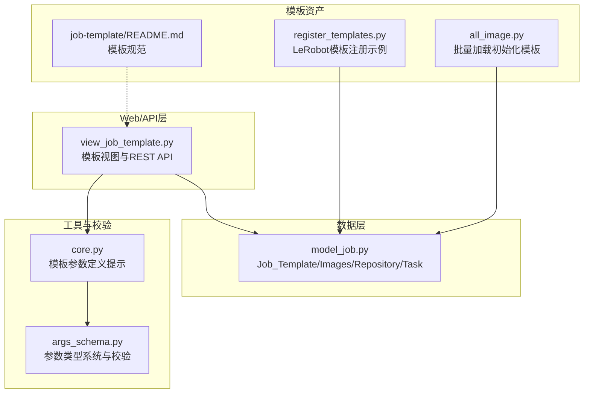
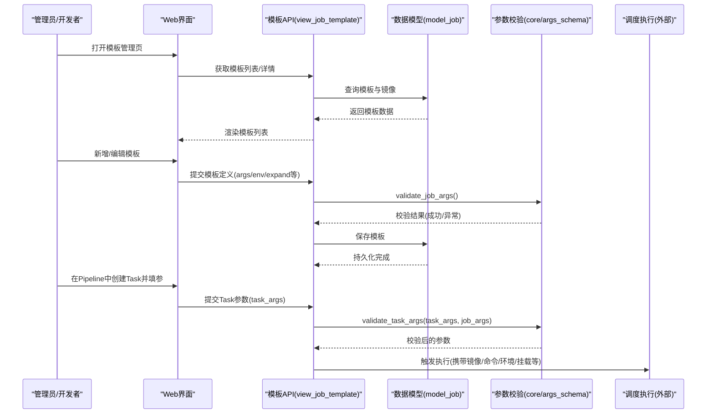
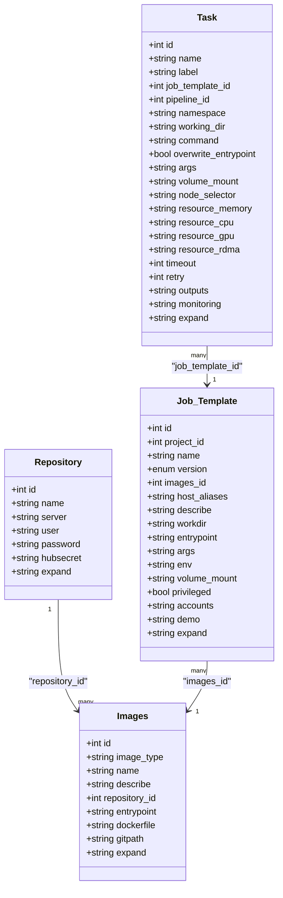
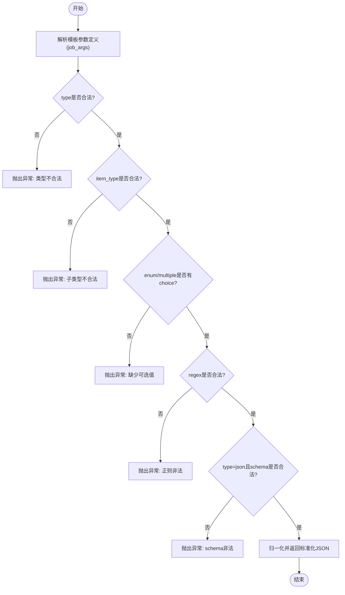
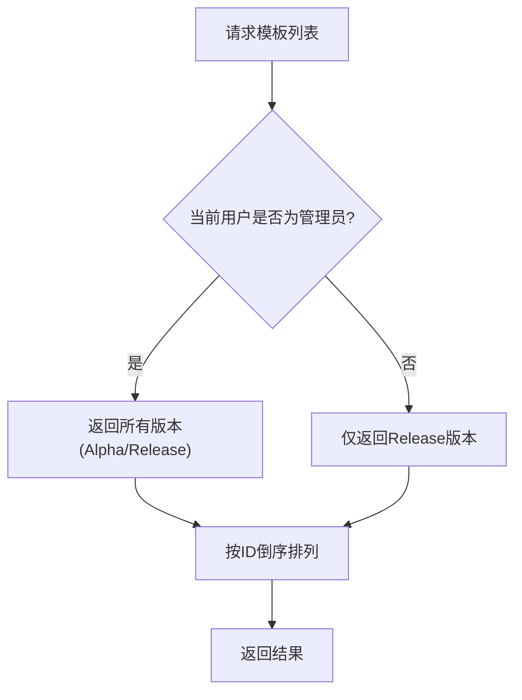
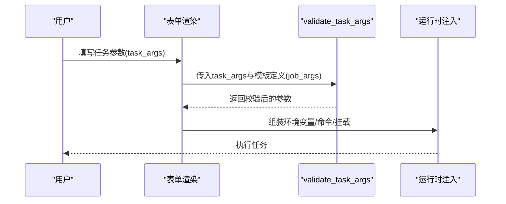
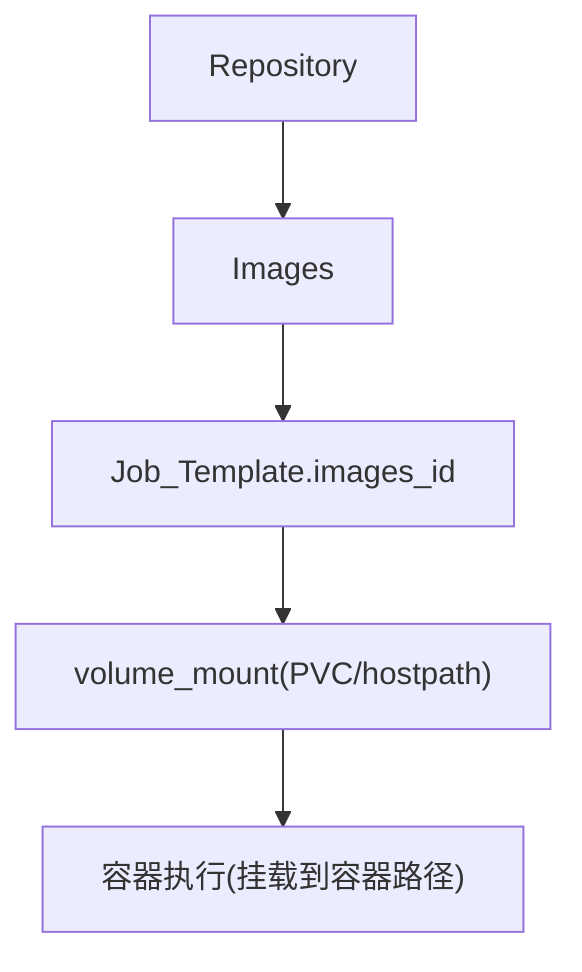
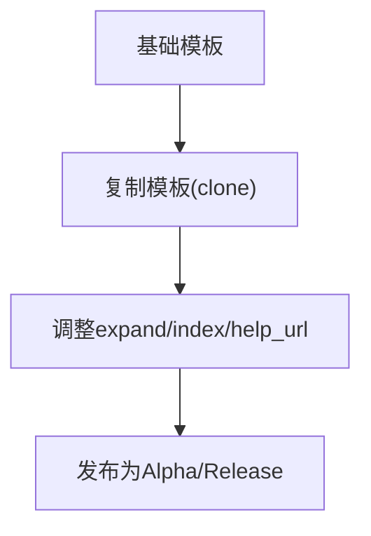
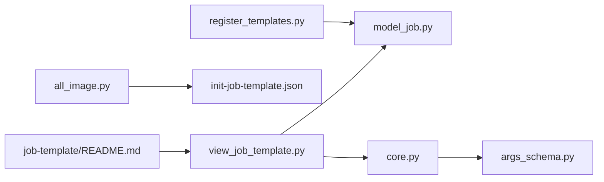

# 任务模板系统

<cite>
**本文引用的文件**   
- [myapp/views/view_job_template.py](file://myapp/views/view_job_template.py)
- [myapp/models/model_job.py](file://myapp/models/model_job.py)
- [myapp/utils/core.py](file://myapp/utils/core.py)
- [myapp/utils/py/args_schema.py](file://myapp/utils/py/args_schema.py)
- [job-template/README.md](file://job-template/README.md)
- [images/lerobot/register_templates.py](file://images/lerobot/register_templates.py)
- [install/kubernetes/all_image.py](file://install/kubernetes/all_image.py)
</cite>

## 目录
1. [简介](#简介)
2. [项目结构](#项目结构)
3. [核心组件](#核心组件)
4. [架构总览](#架构总览)
5. [详细组件分析](#详细组件分析)
6. [依赖关系分析](#依赖关系分析)
7. [性能与扩展性](#性能与扩展性)
8. [故障排查指南](#故障排查指南)
9. [结论](#结论)
10. [附录：模板创建示例与最佳实践](#附录模板创建示例与最佳实践)

## 简介
本文件系统性阐述 CubeStudio 的任务模板（Job Template）体系，覆盖模板定义结构、参数化配置与环境变量管理、镜像与挂载策略、版本控制与权限模型，以及动态参数替换与校验机制。文档同时给出面向 PyTorch、TensorFlow、Ray 等训练框架的模板设计思路与落地步骤，并说明如何开发自定义任务模板与集成第三方训练框架。

## 项目结构
任务模板相关代码主要分布在以下位置：
- 视图与API：负责模板的增删改查、表单校验、权限过滤与排序展示
- 数据模型：定义 Job_Template、Images、Repository、Task 等实体及其关系
- 参数类型系统：统一的参数定义与校验逻辑，支持多种类型与子类型
- 模板注册与初始化：提供批量初始化脚本与示例模板注册入口
- 模板规范与示例：job-template 目录下包含模板构建规范与多个框架示例

**图表来源**
- [myapp/views/view_job_template.py:1-358](file://myapp/views/view_job_template.py#L1-L358)
- [myapp/models/model_job.py:97-171](file://myapp/models/model_job.py#L97-L171)
- [myapp/utils/core.py:498-588](file://myapp/utils/core.py#L498-L588)
- [myapp/utils/py/args_schema.py:1-290](file://myapp/utils/py/args_schema.py#L1-L290)
- [job-template/README.md:1-71](file://job-template/README.md#L1-L71)
- [images/lerobot/register_templates.py:1-120](file://images/lerobot/register_templates.py#L1-L120)
- [install/kubernetes/all_image.py:120-130](file://install/kubernetes/all_image.py#L120-L130)

**章节来源**
- [myapp/views/view_job_template.py:1-358](file://myapp/views/view_job_template.py#L1-L358)
- [myapp/models/model_job.py:97-171](file://myapp/models/model_job.py#L97-L171)
- [job-template/README.md:1-71](file://job-template/README.md#L1-L71)

## 核心组件
- 模板数据模型 Job_Template：承载模板元信息、镜像关联、环境变量、工作目录、入口命令、参数定义、挂载、权限账号、特权模式与扩展字段
- 镜像与仓库 Images/Repository：统一管理镜像地址、仓库凭证与Dockerfile/Git路径
- 任务 Task：基于模板实例化的具体任务，可覆盖入口命令、参数、资源配额、超时重试、输出映射等
- 参数类型系统：统一约束模板参数定义与运行时参数值校验，支持多类型、子类型、正则、JSON Schema、选择器等

**章节来源**
- [myapp/models/model_job.py:97-171](file://myapp/models/model_job.py#L97-L171)
- [myapp/models/model_job.py:523-624](file://myapp/models/model_job.py#L523-L624)
- [myapp/utils/py/args_schema.py:1-290](file://myapp/utils/py/args_schema.py#L1-L290)

## 架构总览
任务模板从“定义—校验—实例化—执行”形成闭环：
- 定义：通过 Web/API 或批量初始化脚本注册模板，填写镜像、环境变量、参数定义与扩展字段
- 校验：后端对模板参数定义进行严格校验（类型、必填、范围、正则、JSON Schema、选择器等）
- 实例化：在编排 Pipeline 时，用户为 Task 填充参数，系统依据模板定义再次校验并生成最终参数
- 执行：根据模板与 Task 的配置生成容器运行参数（镜像、命令、环境变量、挂载、账号、特权等），由调度系统执行

**图表来源**
- [myapp/views/view_job_template.py:190-241](file://myapp/views/view_job_template.py#L190-L241)
- [myapp/utils/core.py:498-588](file://myapp/utils/core.py#L498-L588)
- [myapp/utils/py/args_schema.py:76-140](file://myapp/utils/py/args_schema.py#L76-L140)
- [myapp/utils/py/args_schema.py:181-290](file://myapp/utils/py/args_schema.py#L181-L290)

## 详细组件分析

### 模板数据模型与关系
- Job_Template 字段要点
  - 基础信息：name、version、describe、project_id
  - 运行环境：images_id（关联 Images）、workdir、entrypoint、env、host_aliases
  - 资源与安全：privileged、accounts、volume_mount
  - 参数与演示：args（参数定义 JSON）、demo（示例参数 JSON）、expand（扩展字段）
- Images/Repository
  - Repository：仓库地址、用户名、密码、K8s Secret 名
  - Images：镜像名称、描述、仓库关联、入口点、Dockerfile、Git路径
- Task
  - 继承模板能力并可覆盖：command、working_dir、args、volume_mount、node_selector、资源配额、超时重试、outputs、monitoring、expand

**图表来源**
- [myapp/models/model_job.py:35-71](file://myapp/models/model_job.py#L35-L71)
- [myapp/models/model_job.py:97-171](file://myapp/models/model_job.py#L97-L171)
- [myapp/models/model_job.py:523-624](file://myapp/models/model_job.py#L523-L624)

**章节来源**
- [myapp/models/model_job.py:35-71](file://myapp/models/model_job.py#L35-L71)
- [myapp/models/model_job.py:97-171](file://myapp/models/model_job.py#L97-L171)
- [myapp/models/model_job.py:523-624](file://myapp/models/model_job.py#L523-L624)

### 模板参数类型系统与校验
- 参数定义（job_args）
  - 分组组织：以组为单位组织参数，便于前端展示
  - 类型系统：支持 int、bool、str、text、enum、float、multiple、dict、list、file、json
  - 子类型：select-input、select2、workdir、image、project、python、java、json、sql
  - 校验规则：必填、可选值、取值范围、正则表达式、JSON Schema、选择器接口
- 参数值校验（task_args）
  - 类型转换与归一化：字符串去空格、布尔解析、数值转换、JSON 解析
  - 特殊类型处理：enum/multiple 枚举校验、dict/list 子项校验、list 逗号分隔契约
  - 向后兼容：未知 type 降级为 str；保持 list 值为逗号分隔字符串

**图表来源**
- [myapp/utils/py/args_schema.py:76-140](file://myapp/utils/py/args_schema.py#L76-L140)

**章节来源**
- [myapp/utils/py/args_schema.py:1-290](file://myapp/utils/py/args_schema.py#L1-L290)
- [myapp/utils/core.py:498-588](file://myapp/utils/core.py#L498-L588)

### 模板版本控制与权限管理
- 版本控制
  - 版本枚举：Alpha、Release
  - 列表过滤：非管理员仅可见 Release 版本；管理员可见全部并按 ID 倒序
- 权限控制
  - 编辑/删除权限：仅管理员或模板创建者可编辑/删除
  - 添加/删除权限：仅管理员可添加/删除模板
  - 帮助链接：expand.help_url 支持相对路径，自动拼接 GIT_URL

**图表来源**
- [myapp/views/view_job_template.py:43-51](file://myapp/views/view_job_template.py#L43-L51)
- [myapp/views/view_job_template.py:244-253](file://myapp/views/view_job_template.py#L244-L253)
- [myapp/views/view_job_template.py:318-323](file://myapp/views/view_job_template.py#L318-L323)
- [myapp/views/view_job_template.py:308-316](file://myapp/views/view_job_template.py#L308-L316)

**章节来源**
- [myapp/views/view_job_template.py:43-51](file://myapp/views/view_job_template.py#L43-L51)
- [myapp/views/view_job_template.py:244-253](file://myapp/views/view_job_template.py#L244-L253)
- [myapp/views/view_job_template.py:318-323](file://myapp/views/view_job_template.py#L318-L323)
- [myapp/views/view_job_template.py:308-316](file://myapp/views/view_job_template.py#L308-L316)

### 环境变量管理与动态参数替换
- 环境变量(env)
  - 每行一个键值对，支持模板变量（如 {{creator}}）
  - 预置默认环境变量，可在模板级别统一注入
- 动态参数替换
  - 参数定义(args)在前端渲染为结构化表单
  - 运行时参数(task_args)经 validate_task_args 校验后注入到执行上下文
  - 工作目录、启动命令、挂载等均可结合模板变量与用户输入组合

**图表来源**
- [myapp/views/view_job_template.py:198-241](file://myapp/views/view_job_template.py#L198-L241)
- [myapp/utils/py/args_schema.py:181-290](file://myapp/utils/py/args_schema.py#L181-L290)

**章节来源**
- [myapp/views/view_job_template.py:198-241](file://myapp/views/view_job_template.py#L198-L241)
- [myapp/utils/py/args_schema.py:181-290](file://myapp/utils/py/args_schema.py#L181-L290)

### 镜像管理与挂载策略
- 镜像管理
  - 通过 Images/Repository 集中管理镜像地址与仓库凭证
  - 模板通过 images_id 关联镜像，支持指定 entrypoint、dockerfile、gitpath
- 挂载策略
  - volume_mount：模板级强制挂载，支持 PVC 与 hostpath 两种形式
  - Task 可覆盖挂载路径，结合 {{creator}} 等变量实现个人目录隔离

**图表来源**
- [myapp/models/model_job.py:35-71](file://myapp/models/model_job.py#L35-L71)
- [myapp/models/model_job.py:97-171](file://myapp/models/model_job.py#L97-L171)

**章节来源**
- [myapp/models/model_job.py:35-71](file://myapp/models/model_job.py#L35-L71)
- [myapp/models/model_job.py:97-171](file://myapp/models/model_job.py#L97-L171)

### 模板继承机制与扩展字段
- 模板继承
  - 当前未实现显式“父模板”继承语法，但可通过 expand.rec_job_template 推荐复用
  - 通过复制功能快速克隆模板，再微调参数与环境
- 扩展字段(expand)
  - index：模板展示顺序号
  - help_url：帮助文档地址（支持相对路径，自动拼接 GIT_URL）
  - HostNetwork：启用主机网络监听（用于某些大数据组件）

**图表来源**
- [myapp/views/view_job_template.py:289-305](file://myapp/views/view_job_template.py#L289-L305)
- [myapp/views/view_job_template.py:308-316](file://myapp/views/view_job_template.py#L308-L316)

**章节来源**
- [myapp/views/view_job_template.py:289-305](file://myapp/views/view_job_template.py#L289-L305)
- [myapp/views/view_job_template.py:308-316](file://myapp/views/view_job_template.py#L308-L316)

## 依赖关系分析
- 视图层依赖
  - view_job_template.py 依赖 model_job.py 的数据模型与 core/args_schema.py 的参数校验
- 初始化与批量注册
  - all_image.py 加载 init-job-template.json 批量注册模板
  - register_templates.py 提供 LeRobot 系列模板的注册示例
- 模板规范
  - job-template/README.md 明确模板目录结构与构建流程

**图表来源**
- [myapp/views/view_job_template.py:1-358](file://myapp/views/view_job_template.py#L1-L358)
- [myapp/models/model_job.py:97-171](file://myapp/models/model_job.py#L97-L171)
- [myapp/utils/core.py:498-588](file://myapp/utils/core.py#L498-L588)
- [myapp/utils/py/args_schema.py:1-290](file://myapp/utils/py/args_schema.py#L1-L290)
- [install/kubernetes/all_image.py:120-130](file://install/kubernetes/all_image.py#L120-L130)
- [images/lerobot/register_templates.py:1-120](file://images/lerobot/register_templates.py#L1-L120)
- [job-template/README.md:1-71](file://job-template/README.md#L1-L71)

**章节来源**
- [install/kubernetes/all_image.py:120-130](file://install/kubernetes/all_image.py#L120-L130)
- [images/lerobot/register_templates.py:1-120](file://images/lerobot/register_templates.py#L1-L120)
- [job-template/README.md:1-71](file://job-template/README.md#L1-L71)

## 性能与扩展性
- 参数校验性能
  - validate_job_args/validate_task_args 采用轻量级 Python 标准库实现，避免重型依赖
  - 对 list 类型使用逗号分隔字符串归一化，减少序列化开销
- 可扩展性
  - 参数类型系统支持新增 type/item_type，并通过 ARGS_TYPES/ARGS_ITEM_TYPES 注册
  - JSON Schema 子集支持 object/array/string/number/integer/boolean，便于复杂参数结构校验
- 建议
  - 将常用参数抽取为公共模板，通过 expand.rec_job_template 推荐复用
  - 合理设置 index 提升模板在界面的可读性与查找效率

[本节为通用指导，不直接分析具体文件]

## 故障排查指南
- 常见错误
  - JSON 格式非法：检查 args/demo/expand 是否为合法 JSON
  - 参数类型不匹配：确认 type/item_type 是否在允许列表中
  - 正则表达式非法：检查 regex 语法是否正确
  - JSON Schema 不合法：检查 schema.type/properties/required/items/enum 是否符合子集规范
  - 选择器接口无效：choice_url 必须以 / 开头且为站内接口
- 定位方法
  - 查看模板编辑页面的校验提示
  - 使用 API 调试接口验证参数定义与参数值
  - 检查环境变量与挂载配置是否与目标集群一致

**章节来源**
- [myapp/utils/core.py:571-577](file://myapp/utils/core.py#L571-L577)
- [myapp/utils/py/args_schema.py:53-66](file://myapp/utils/py/args_schema.py#L53-L66)
- [myapp/utils/py/args_schema.py:100-133](file://myapp/utils/py/args_schema.py#L100-L133)
- [myapp/utils/py/args_schema.py:159-179](file://myapp/utils/py/args_schema.py#L159-L179)

## 结论
CubeStudio 的任务模板系统通过标准化的数据模型、严格的参数类型系统与灵活的扩展字段，实现了模板的可维护性、可复用性与安全性。结合镜像与挂载管理、版本与权限控制，能够支撑多框架训练任务的统一编排与高效交付。建议在团队内建立模板治理规范，持续沉淀高质量模板，并通过自动化脚本批量注册与维护。

[本节为总结性内容，不直接分析具体文件]

## 附录：模板创建示例与最佳实践

### 模板创建流程
- 编写代码并打包镜像，推送到远程仓库
- 在平台注册仓库与镜像
- 在“训练->任务模板”中添加模板，填写镜像、环境变量、参数定义与扩展字段
- 发布为 Alpha 或 Release 版本

**章节来源**
- [job-template/README.md:1-71](file://job-template/README.md#L1-L71)

### 面向不同训练框架的模板设计要点
- PyTorch
  - 镜像：选择含 CUDA/cuDNN 的基础镜像
  - 入口命令：python train.py --config ...
  - 参数：学习率、批次大小、数据集路径、输出目录
  - 挂载：PVC 挂载数据集与输出
- TensorFlow
  - 镜像：选择 tf-serving/tf-base 镜像
  - 入口命令：python train_tf.py --epochs ...
  - 参数：模型类型、优化器、评估指标
  - 监控：开启 TensorBoard 日志输出
- Ray
  - 镜像：ray/ray:latest
  - 入口命令：ray start --head --include-dashboard=false
  - 参数：worker 数量、GPU 资源、作业脚本路径
  - 扩展：HostNetwork 用于内部通信（视集群策略而定）

[本节为概念性指导，不直接分析具体文件]

### 批量注册与示例
- 批量初始化
  - 通过 install/kubernetes/all_image.py 加载 init-job-template.json 批量注册模板
- LeRobot 模板示例
  - images/lerobot/register_templates.py 展示了导入、训练、评测三类模板的注册方式

**章节来源**
- [install/kubernetes/all_image.py:120-130](file://install/kubernetes/all_image.py#L120-L130)
- [images/lerobot/register_templates.py:1-120](file://images/lerobot/register_templates.py#L1-L120)

### 最佳实践
- 模板命名与描述清晰，便于检索与理解
- 合理使用版本控制，Alpha 测试后发布 Release
- 参数定义详尽，提供默认值与占位符提示
- 环境变量集中管理，敏感信息通过 K8s Secret 注入
- 挂载路径规范化，结合 {{creator}} 实现个人目录隔离
- 扩展字段记录帮助文档与展示顺序，提升用户体验

[本节为通用指导，不直接分析具体文件]