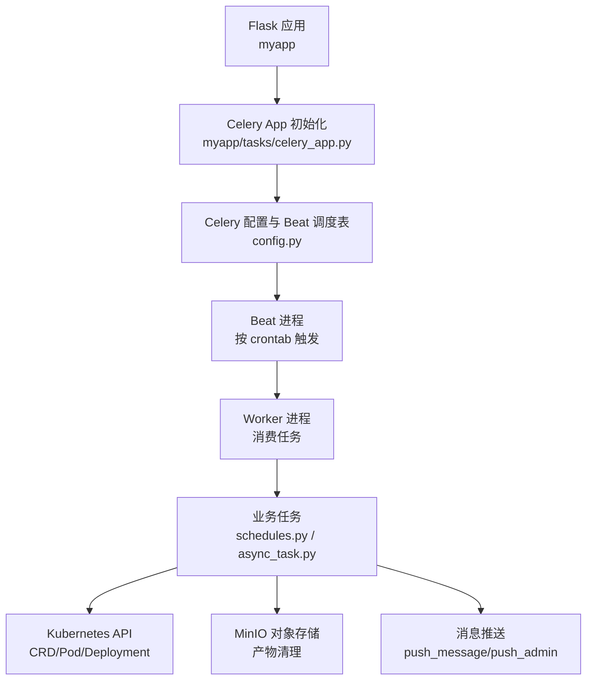
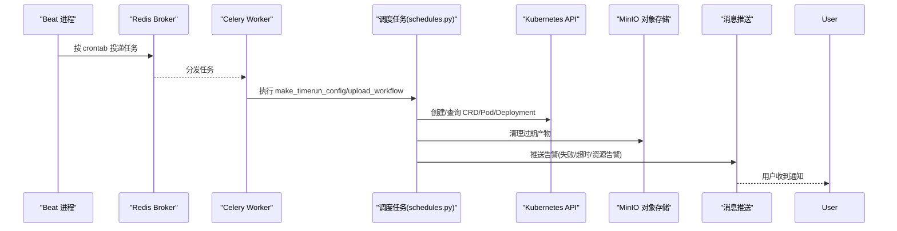
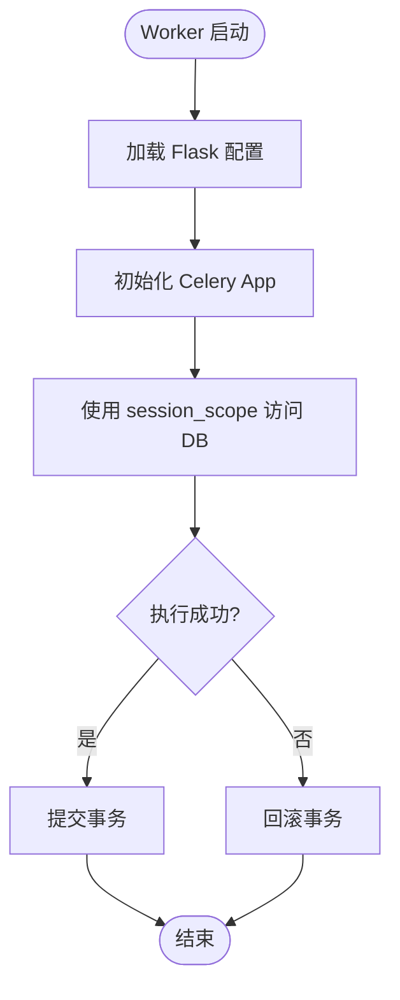
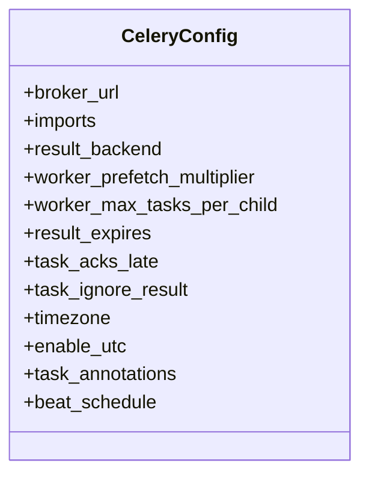
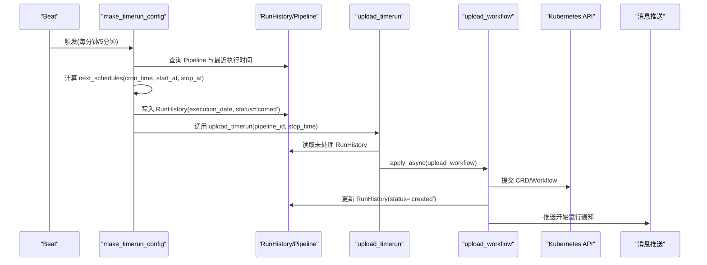
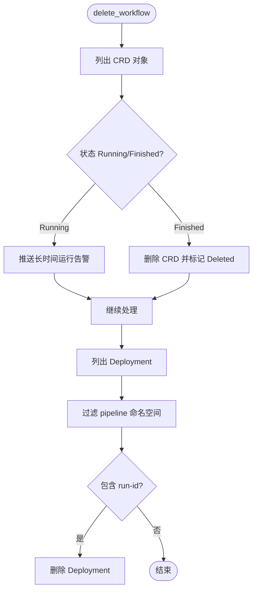
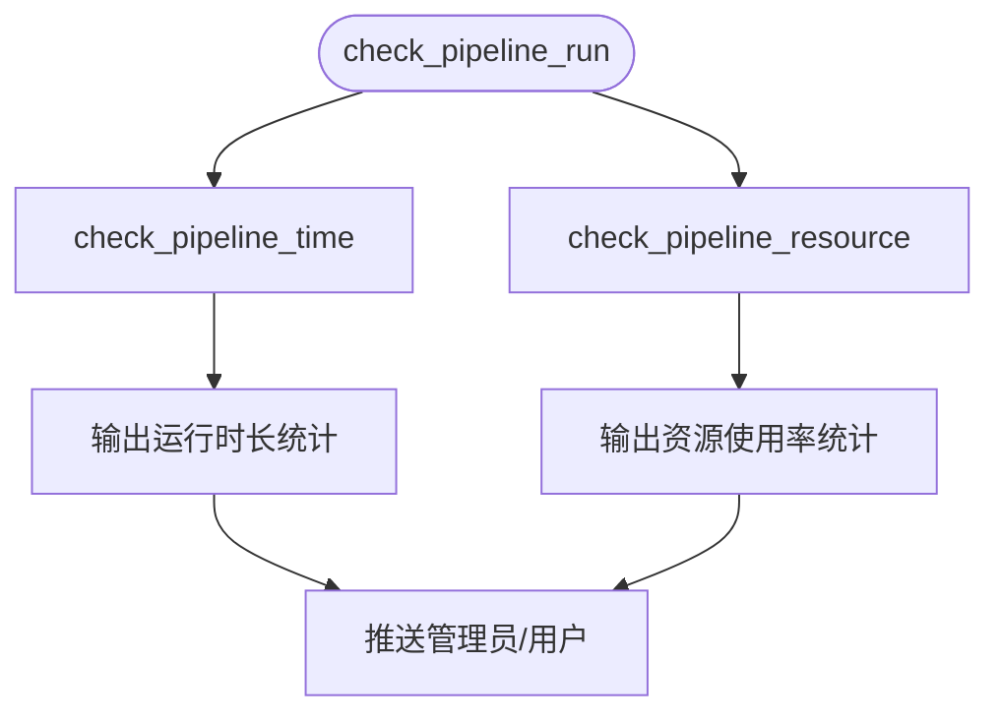
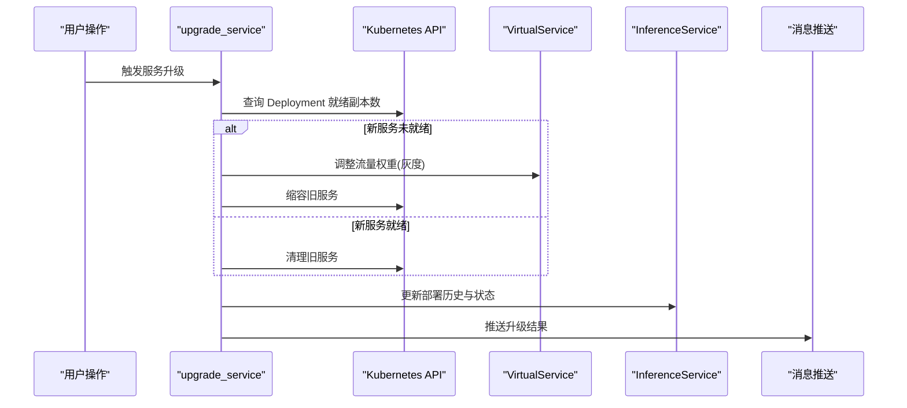
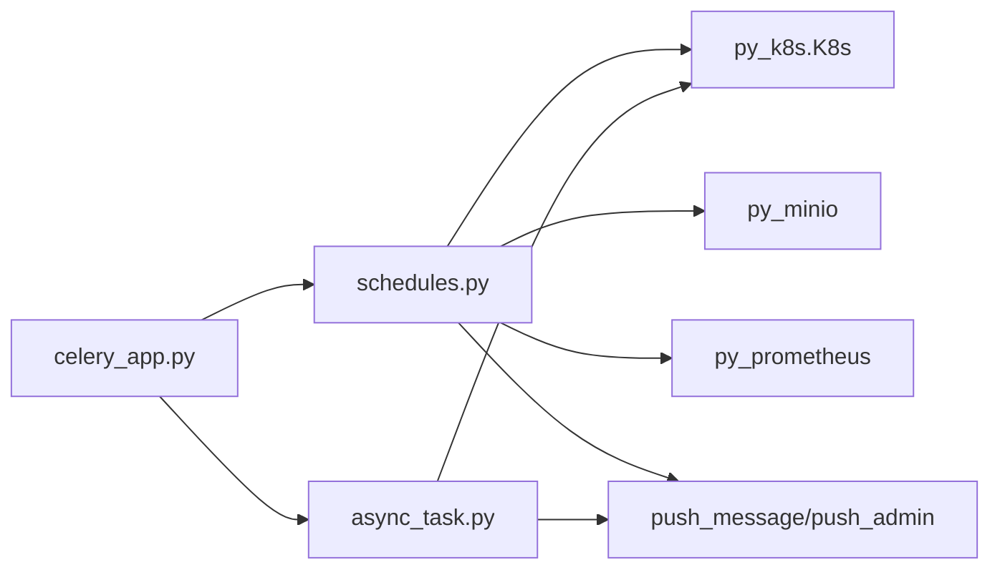

# 任务调度与监控

<cite>
**本文引用的文件**   
- [myapp/tasks/celery_app.py](file://myapp/tasks/celery_app.py)
- [myapp/utils/celery.py](file://myapp/utils/celery.py)
- [install/kubernetes/cube/overlays/config/config.py](file://install/kubernetes/cube/overlays/config/config.py)
- [myapp/tasks/schedules.py](file://myapp/tasks/schedules.py)
- [myapp/tasks/async_task.py](file://myapp/tasks/async_task.py)
</cite>

## 目录
1. [简介](#简介)
2. [项目结构](#项目结构)
3. [核心组件](#核心组件)
4. [架构总览](#架构总览)
5. [详细组件分析](#详细组件分析)
6. [依赖关系分析](#依赖关系分析)
7. [性能与可靠性](#性能与可靠性)
8. [故障排查指南](#故障排查指南)
9. [结论](#结论)
10. [附录：配置与扩展示例](#附录配置与扩展示例)

## 简介
本文件面向 Cube Studio 的任务调度与监控体系，聚焦 Celery 定时任务调度机制、Cron 表达式配置、任务队列管理与优先级调度策略；并详细说明工作流状态跟踪、执行日志收集与告警通知机制。文档同时覆盖任务重试策略、超时处理与资源清理，并提供实际代码路径与扩展建议，帮助读者快速掌握如何设置周期性任务、依赖任务与条件触发，以及如何扩展自定义调度器与监控指标采集。

## 项目结构
本项目中，Celery 相关能力主要分布在以下模块：
- 应用初始化与 Celery App 装配：[myapp/tasks/celery_app.py](file://myapp/tasks/celery_app.py)
- 数据库会话封装（Celery Worker 安全）：[myapp/utils/celery.py](file://myapp/utils/celery.py)
- 全局 Celery 配置与 Beat 调度表：[install/kubernetes/cube/overlays/config/config.py](file://install/kubernetes/cube/overlays/config/config.py)
- 业务定时任务与调度逻辑：[myapp/tasks/schedules.py](file://myapp/tasks/schedules.py)
- 异步任务实现（镜像构建检查、服务升级、数据集更新等）：[myapp/tasks/async_task.py](file://myapp/tasks/async_task.py)

**图示来源**
- [myapp/tasks/celery_app.py:1-18](file://myapp/tasks/celery_app.py#L1-L18)
- [install/kubernetes/cube/overlays/config/config.py:379-541](file://install/kubernetes/cube/overlays/config/config.py#L379-L541)
- [myapp/tasks/schedules.py:387-656](file://myapp/tasks/schedules.py#L387-L656)
- [myapp/tasks/async_task.py:27-368](file://myapp/tasks/async_task.py#L27-L368)

**章节来源**
- [myapp/tasks/celery_app.py:1-18](file://myapp/tasks/celery_app.py#L1-L18)
- [install/kubernetes/cube/overlays/config/config.py:379-541](file://install/kubernetes/cube/overlays/config/config.py#L379-L541)

## 核心组件
- Celery App 装配：通过 Flask 应用配置加载 Celery 实例，统一挂载所有任务。
- 数据库会话封装：在 Celery Worker 中使用 NullPool 避免进程 fork 导致的连接问题，提供事务性上下文。
- 全局配置：定义 broker/result_backend、worker 并发、任务注解（限流、软超时、过期时间、重试次数）、Beat 调度表。
- 调度任务：负责生成定时运行计划、上传工作流、清理资源、监控运行时长与资源使用率、推送告警。
- 异步任务：镜像构建检查、Notebook 保存、推理服务滚动升级、数据集同步、K8s 资源缓存等。

**章节来源**
- [myapp/tasks/celery_app.py:1-18](file://myapp/tasks/celery_app.py#L1-L18)
- [myapp/utils/celery.py:1-36](file://myapp/utils/celery.py#L1-L36)
- [install/kubernetes/cube/overlays/config/config.py:379-541](file://install/kubernetes/cube/overlays/config/config.py#L379-L541)
- [myapp/tasks/schedules.py:387-656](file://myapp/tasks/schedules.py#L387-L656)
- [myapp/tasks/async_task.py:27-368](file://myapp/tasks/async_task.py#L27-L368)

## 架构总览
Celery 在本项目中承担“定时调度 + 异步任务”的双重职责：
- Beat 根据 config.py 中的 beat_schedule 以 Cron 表达式触发调度任务。
- Worker 消费任务，执行业务逻辑（如生成 Pipeline YAML、提交 CRD、清理 Pod/Deployment、统计资源使用率）。
- 任务间通过 Redis 作为 Broker 和结果后端进行通信与状态管理。
- 任务执行过程中访问 K8s API 与 MinIO 对象存储，并通过 push_message/push_admin 发送告警。

**图示来源**
- [install/kubernetes/cube/overlays/config/config.py:492-541](file://install/kubernetes/cube/overlays/config/config.py#L492-L541)
- [myapp/tasks/schedules.py:387-656](file://myapp/tasks/schedules.py#L387-L656)

## 详细组件分析

### Celery 应用与数据库会话
- Celery App 从 Flask 应用中获取配置并初始化，确保所有任务统一挂载到该 App。
- session_scope 为 Celery Worker 提供安全的数据库会话上下文，使用 NullPool 避免多进程共享连接导致的问题，并在异常时回滚事务。

**图示来源**
- [myapp/tasks/celery_app.py:1-18](file://myapp/tasks/celery_app.py#L1-L18)
- [myapp/utils/celery.py:1-36](file://myapp/utils/celery.py#L1-L36)

**章节来源**
- [myapp/tasks/celery_app.py:1-18](file://myapp/tasks/celery_app.py#L1-L18)
- [myapp/utils/celery.py:1-36](file://myapp/utils/celery.py#L1-L36)

### 全局配置与 Beat 调度表
- Broker 与结果后端均指向 Redis，支持密码与端口配置。
- worker_prefetch_multiplier、worker_max_tasks_per_child、result_expires、task_acks_late、task_ignore_result 等参数控制 Worker 行为与任务生命周期。
- task_annotations 对关键任务设置 rate_limit、soft_time_limit、expires、max_retries 等限制。
- beat_schedule 定义了多个定时任务，例如：
  - 每小时删除旧 Workflow
  - 每 5 分钟生成定时任务的 YAML 配置
  - 每日凌晨清理旧数据
  - 定时检查 Pipeline 运行时长与资源使用率
  - 定时清理 Debug 的 Pod 与服务
  - 定时推送 GPU 使用情况与低利用率 Pod 告警
  - 定时检测终止态 Pod

**图示来源**
- [install/kubernetes/cube/overlays/config/config.py:379-541](file://install/kubernetes/cube/overlays/config/config.py#L379-L541)

**章节来源**
- [install/kubernetes/cube/overlays/config/config.py:379-541](file://install/kubernetes/cube/overlays/config/config.py#L379-L541)

### 定时任务调度流程（Pipeline 定时运行）
- make_timerun_config：扫描所有 schedule_type=crontab 的 Pipeline，基于 cron_time 计算未来 5 分钟内需要触发的时间点，生成 RunHistory 记录并调用 upload_timerun。
- upload_timerun：根据 depends_on_past/expired_limit/max_active_runs 等策略决定哪些 RunHistory 可以提交，调用 upload_workflow。
- upload_workflow：将 Pipeline 转换为 DAG JSON，提交到 K8s 创建 CRD，更新 RunHistory 状态，并推送通知。

**图示来源**
- [myapp/tasks/schedules.py:387-656](file://myapp/tasks/schedules.py#L387-L656)

**章节来源**
- [myapp/tasks/schedules.py:387-656](file://myapp/tasks/schedules.py#L387-L656)

### 工作流状态跟踪与资源清理
- delete_workflow：遍历 CRD 类型（workflow/tfjob/pytorchjob/xgbjob/mpijob/vcjob/sparkjob/paddlejob/mxjob），根据标签 run-id 关联 Workflow，若 Workflow 已删除或完成则删除对应 CRD；同时清理 Deployment。
- delete_debug_docker：清理调试与测试相关的 Pod、InferenceService 与 Service，并将状态置为 offline。
- delete_old_data：定期清理本地临时目录、日志、Workflow 与 RunHistory 历史。

**图示来源**
- [myapp/tasks/schedules.py:133-179](file://myapp/tasks/schedules.py#L133-L179)

**章节来源**
- [myapp/tasks/schedules.py:133-179](file://myapp/tasks/schedules.py#L133-L179)
- [myapp/tasks/schedules.py:220-321](file://myapp/tasks/schedules.py#L220-L321)
- [myapp/tasks/schedules.py:686-730](file://myapp/tasks/schedules.py#L686-L730)

### 监控与告警
- check_pipeline_run：聚合 check_pipeline_time 与 check_pipeline_resource，输出 Pipeline 运行时长与资源使用率信息。
- watch_gpu：统计集群 GPU 使用量并推送管理员。
- watch_pod_utilization：结合 Prometheus 指标，识别 CPU/GPU 低利用率 Pod 并告警。
- check_pod_terminating：查询 Dashboard 接口获取终止态 Pod，推送强制删除建议。

**图示来源**
- [myapp/tasks/schedules.py:754-878](file://myapp/tasks/schedules.py#L754-L878)
- [myapp/tasks/schedules.py:949-1005](file://myapp/tasks/schedules.py#L949-L1005)
- [myapp/tasks/schedules.py:1209-1235](file://myapp/tasks/schedules.py#L1209-L1235)

**章节来源**
- [myapp/tasks/schedules.py:754-878](file://myapp/tasks/schedules.py#L754-L878)
- [myapp/tasks/schedules.py:949-1005](file://myapp/tasks/schedules.py#L949-L1005)
- [myapp/tasks/schedules.py:1209-1235](file://myapp/tasks/schedules.py#L1209-L1235)

### 异步任务与资源清理
- check_docker_commit/check_notebook_commit：轮询 Pod 状态，成功后更新镜像信息，失败则推送告警。
- upgrade_service：滚动升级推理服务，动态调整 VirtualService 权重，缩容旧版本并清理旧服务。
- update_dataset：拉取远程数据集或复制本地数据到指定目录。
- get_k8s_resource：缓存 K8s 节点与 Pod 列表，减少频繁 API 调用。

**图示来源**
- [myapp/tasks/async_task.py:99-284](file://myapp/tasks/async_task.py#L99-L284)

**章节来源**
- [myapp/tasks/async_task.py:27-98](file://myapp/tasks/async_task.py#L27-L98)
- [myapp/tasks/async_task.py:99-284](file://myapp/tasks/async_task.py#L99-L284)
- [myapp/tasks/async_task.py:287-368](file://myapp/tasks/async_task.py#L287-L368)

## 依赖关系分析
- Celery App 依赖 Flask 应用配置，任务定义位于 myapp.tasks 包下。
- schedules.py 与 async_task.py 通过 celery_app.task 装饰器注册任务。
- 任务执行过程中依赖：
  - Kubernetes API（py_k8s.K8s）
  - MinIO 对象存储（py_minio）
  - Prometheus 指标（py_prometheus）
  - 消息推送（project.push_message/push_admin）
  - 数据库会话（utils.celery.session_scope）

**图示来源**
- [myapp/tasks/celery_app.py:1-18](file://myapp/tasks/celery_app.py#L1-L18)
- [myapp/tasks/schedules.py:1-37](file://myapp/tasks/schedules.py#L1-L37)
- [myapp/tasks/async_task.py:1-24](file://myapp/tasks/async_task.py#L1-L24)

**章节来源**
- [myapp/tasks/celery_app.py:1-18](file://myapp/tasks/celery_app.py#L1-L18)
- [myapp/tasks/schedules.py:1-37](file://myapp/tasks/schedules.py#L1-L37)
- [myapp/tasks/async_task.py:1-24](file://myapp/tasks/async_task.py#L1-L24)

## 性能与可靠性
- 任务限流与超时：
  - 通过 task_annotations 对关键任务设置 rate_limit、soft_time_limit、expires、max_retries。
  - 例如 task.make_timerun_config 设置为每分钟一次、软超时 300 秒、过期 300 秒、不重试。
- 任务确认策略：
  - task_acks_late=True 与 task_acks_on_failure_or_timeout=True 保证任务在失败或超时时也能正确确认，避免重复执行。
- Worker 并发与生命周期：
  - worker_prefetch_multiplier=10 提高批量取任务效率；worker_max_tasks_per_child=12000 延长 Worker 生命周期。
- 结果存储与忽略：
  - result_expires=3600 控制结果过期；task_ignore_result=True 降低结果存储开销。
- 资源清理：
  - 定期清理过期 CRD、Deployment、Pod、MinIO 产物与数据库记录，防止资源泄漏与数据膨胀。

**章节来源**
- [install/kubernetes/cube/overlays/config/config.py:379-541](file://install/kubernetes/cube/overlays/config/config.py#L379-L541)
- [myapp/tasks/schedules.py:532-586](file://myapp/tasks/schedules.py#L532-L586)
- [myapp/tasks/schedules.py:686-730](file://myapp/tasks/schedules.py#L686-L730)

## 故障排查指南
- 任务未触发：
  - 检查 Beat 是否正常运行，确认 beat_schedule 中任务名与任务函数名一致。
  - 查看 Redis Broker 是否正常，确认 broker_url 配置无误。
- 任务执行超时：
  - 检查 soft_time_limit 与 expires 配置，必要时调大超时时间。
  - 查看任务日志，定位具体耗时步骤（K8s API 调用、MinIO 操作）。
- 资源泄漏：
  - 确认 delete_workflow/delete_debug_docker/delete_old_data 是否按计划执行。
  - 检查 MinIO 产物清理逻辑是否正确（remove_object_prefix）。
- 告警未送达：
  - 检查 push_message/push_admin 配置与外部通知通道可用性。
  - 查看任务中异常捕获与日志输出，确认错误堆栈。

**章节来源**
- [install/kubernetes/cube/overlays/config/config.py:492-541](file://install/kubernetes/cube/overlays/config/config.py#L492-L541)
- [myapp/tasks/schedules.py:133-179](file://myapp/tasks/schedules.py#L133-L179)
- [myapp/tasks/schedules.py:220-321](file://myapp/tasks/schedules.py#L220-L321)
- [myapp/tasks/schedules.py:686-730](file://myapp/tasks/schedules.py#L686-L730)

## 结论
本项目通过 Celery 实现了完善的定时任务调度与异步任务处理能力，结合 Kubernetes CRD 与 MinIO 对象存储，形成了从任务生成、执行、状态跟踪到资源清理与告警通知的完整闭环。通过合理的任务限流、超时与重试策略，以及定期的资源清理与监控告警，系统具备良好的可扩展性与稳定性。

## 附录：配置与扩展示例

### Cron 表达式配置示例
- 每小时执行：'schedule': crontab(minute='0', hour='*')
- 每 5 分钟执行：'schedule': crontab(minute='*/5')
- 每天凌晨 1 点执行：'schedule': crontab(minute='1', hour='1')
- 工作日 8-23 点每 2 小时执行：'schedule': crontab(minute='10', hour='8-23/2')

参考路径：[install/kubernetes/cube/overlays/config/config.py:492-541](file://install/kubernetes/cube/overlays/config/config.py#L492-L541)

### 周期性任务示例
- 定时生成 Pipeline 定时运行计划：task.make_timerun_config
- 定时上传工作流：task.upload_workflow
- 定时清理旧数据：task.delete_old_data

参考路径：[myapp/tasks/schedules.py:387-656](file://myapp/tasks/schedules.py#L387-L656)

### 依赖任务与条件触发
- 依赖前序任务状态：depends_on_past 控制是否等待前一个 RunHistory 完成。
- 并发限制：max_active_runs 控制同时运行的 Workflow 数量。
- 过期清理：expired_limit 控制保留最新 N 个 RunHistory，并清理过期实例。

参考路径：[myapp/tasks/schedules.py:470-606](file://myapp/tasks/schedules.py#L470-L606)

### 任务重试策略与超时处理
- 通过 task_annotations 设置 max_retries、soft_time_limit、expires。
- 任务失败或超时时自动确认，避免重复执行。

参考路径：[install/kubernetes/cube/overlays/config/config.py:418-490](file://install/kubernetes/cube/overlays/config/config.py#L418-L490)

### 资源清理
- 清理 CRD 与 Deployment：delete_workflow
- 清理 Debug 与测试 Pod：delete_debug_docker
- 清理本地临时目录与数据库记录：delete_old_data

参考路径：[myapp/tasks/schedules.py:133-179](file://myapp/tasks/schedules.py#L133-L179)
[myapp/tasks/schedules.py:220-321](file://myapp/tasks/schedules.py#L220-L321)
[myapp/tasks/schedules.py:686-730](file://myapp/tasks/schedules.py#L686-L730)

### 扩展自定义调度器与监控指标
- 自定义调度器：在 beat_schedule 中添加新的任务条目，指向自定义任务函数。
- 监控指标采集：在 watch_pod_utilization 中集成 Prometheus 指标，扩展更多资源维度（如网络 IO、磁盘 IO）。
- 告警通知：复用 push_message/push_admin，扩展企业微信、钉钉、邮件等渠道。

参考路径：[install/kubernetes/cube/overlays/config/config.py:492-541](file://install/kubernetes/cube/overlays/config/config.py#L492-L541)
[myapp/tasks/schedules.py:974-1005](file://myapp/tasks/schedules.py#L974-L1005)