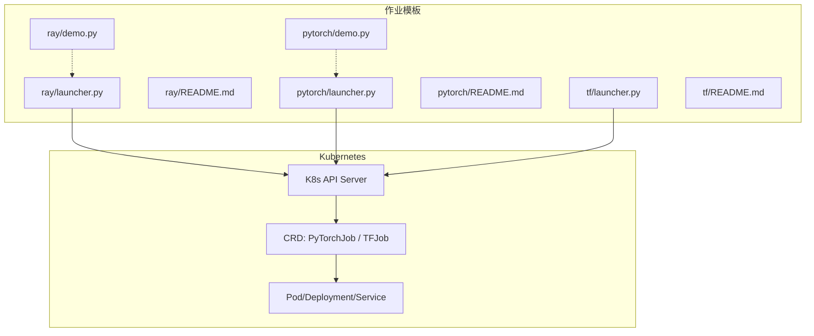
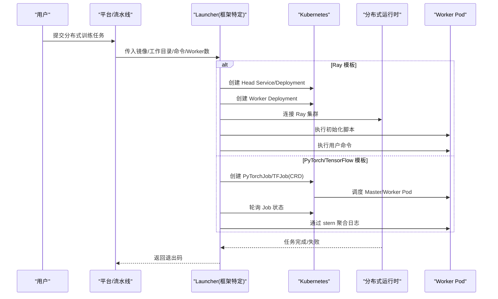
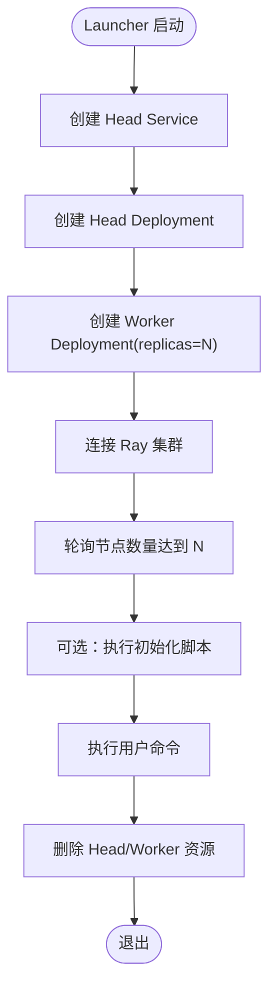
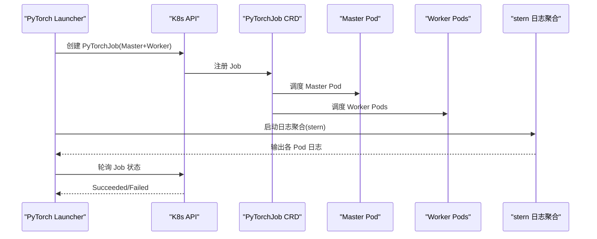
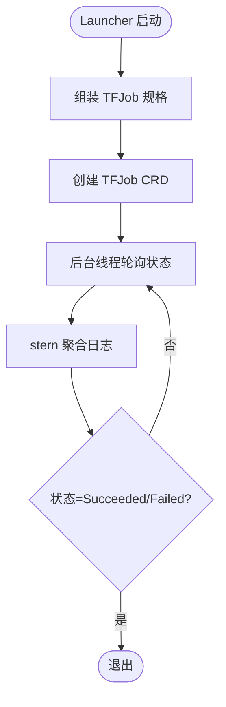
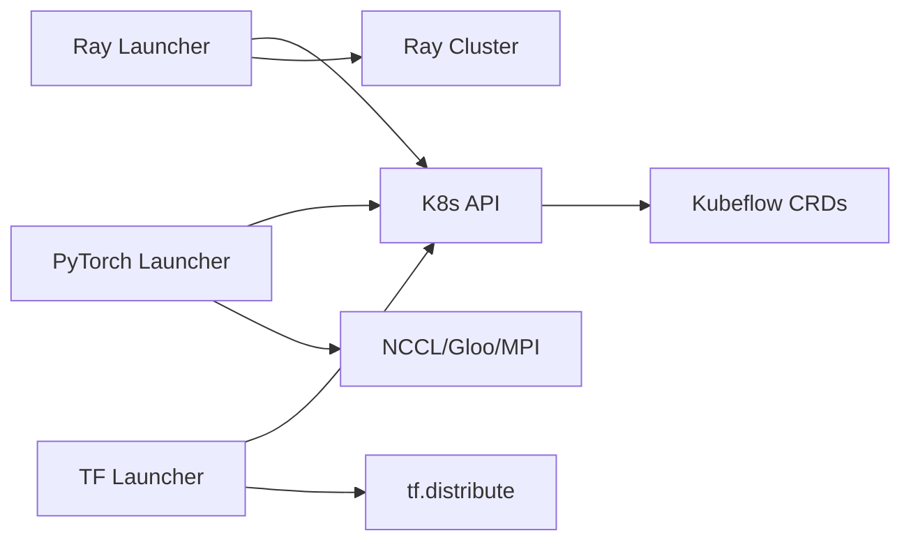
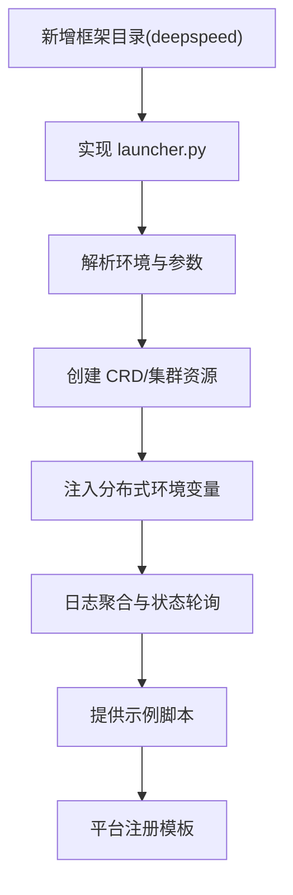

# 分布式训练支持

<cite>
**本文引用的文件**   
- [launcher.py（Ray）](file://job-template/job/ray/launcher.py)
- [demo.py（Ray）](file://job-template/job/ray/demo.py)
- [README.md（Ray）](file://job-template/job/ray/README.md)
- [launcher.py（PyTorch）](file://job-template/job/pytorch/launcher.py)
- [demo.py（PyTorch）](file://job-template/job/pytorch/demo.py)
- [README.md（PyTorch）](file://job-template/job/pytorch/README.md)
- [launcher.py（TensorFlow）](file://job-template/job/tf/launcher.py)
- [README.md（TensorFlow）](file://job-template/job/tf/README.md)
</cite>

## 目录
1. [引言](#引言)
2. [项目结构](#项目结构)
3. [核心组件](#核心组件)
4. [架构总览](#架构总览)
5. [详细组件分析](#详细组件分析)
6. [依赖关系分析](#依赖关系分析)
7. [性能与资源策略](#性能与资源策略)
8. [故障恢复与监控](#故障恢复与监控)
9. [扩展指南：新增训练框架](#扩展指南新增训练框架)
10. [结论](#结论)

## 引言
本文件面向在 Kubernetes 上运行大规模分布式训练的工程师与平台使用者，系统性梳理 CubeStudio 中已实现的分布式训练支持，包括：
- 多进程/多节点训练架构
- 数据并行、模型并行与流水线并行的适配思路
- Ray、PyTorch DDP、TensorFlow 分布式等框架的集成方案
- Worker 节点、参数服务器与通信后端的配置要点
- 资源分配策略、故障恢复机制与性能监控
- 扩展现有分布式支持与新增训练框架的实践路径

## 项目结构
仓库中与分布式训练直接相关的代码集中在 job-template/job 目录下，按框架划分：
- ray：基于 Ray 的多机任务模板，包含集群编排与示例
- pytorch：基于 Kubeflow PyTorchJob 的分布式训练模板与示例
- tf：基于 Kubeflow TFJob 的分布式训练模板

图表来源
- [launcher.py（Ray）:1-538](file://job-template/job/ray/launcher.py#L1-L538)
- [launcher.py（PyTorch）:1-401](file://job-template/job/pytorch/launcher.py#L1-L401)
- [launcher.py（TensorFlow）:1-348](file://job-template/job/tf/launcher.py#L1-L348)

章节来源
- [launcher.py（Ray）:1-538](file://job-template/job/ray/launcher.py#L1-L538)
- [launcher.py（PyTorch）:1-401](file://job-template/job/pytorch/launcher.py#L1-L401)
- [launcher.py（TensorFlow）:1-348](file://job-template/job/tf/launcher.py#L1-L348)

## 核心组件
- Ray 分布式模板
  - 通过 launcher.py 动态创建 Head Service/Deployment 与 Worker Deployment，启动 Ray 集群；用户代码通过环境变量 RAY_HOST 连接集群。
  - demo.py 展示 @ray.remote 远程函数与 ray.get 结果收集。
- PyTorch 分布式模板
  - 通过 launcher.py 创建 Kubeflow PyTorchJob（Master + Worker），使用 torch.distributed 与 NCCL/Gloo/MPI 后端进行数据并行训练。
  - demo.py 提供基于 DDP 的训练样例。
- TensorFlow 分布式模板
  - 通过 launcher.py 创建 Kubeflow TFJob（Worker 模式），配合 tf.distribute 实现多 Worker 训练。

章节来源
- [launcher.py（Ray）:1-538](file://job-template/job/ray/launcher.py#L1-L538)
- [demo.py（Ray）:1-31](file://job-template/job/ray/demo.py#L1-L31)
- [launcher.py（PyTorch）:1-401](file://job-template/job/pytorch/launcher.py#L1-L401)
- [demo.py（PyTorch）:1-184](file://job-template/job/pytorch/demo.py#L1-L184)
- [launcher.py（TensorFlow）:1-348](file://job-template/job/tf/launcher.py#L1-L348)

## 架构总览
整体流程：用户在平台选择分布式训练模板，提交任务后由 Launcher 负责：
- 解析环境与资源参数
- 创建或连接分布式运行时（Ray 集群或 Kubeflow Job）
- 执行用户命令并跟踪日志与状态
- 清理资源并返回退出码

图表来源
- [launcher.py（Ray）:418-535](file://job-template/job/ray/launcher.py#L418-L535)
- [launcher.py（PyTorch）:347-398](file://job-template/job/pytorch/launcher.py#L347-L398)
- [launcher.py（TensorFlow）:295-345](file://job-template/job/tf/launcher.py#L295-L345)

## 详细组件分析

### Ray 分布式训练
- 集群编排
  - 创建 Head Service（暴露客户端 10001、Dashboard 8265、Redis 6379）。
  - 创建 Head Deployment（启动 ray start --head --port=6379 --num-cpus=$MY_CPU_REQUEST）。
  - 创建 Worker Deployment（启动 ray start --address=<head>:6379 --num-cpus=$MY_CPU_REQUEST）。
  - 等待所有 Worker 加入集群，再执行用户命令。
- 用户代码接入
  - 通过环境变量 RAY_HOST 获取 Head 服务名，使用 ray.util.connect("<RAY_HOST>:10001") 连接集群。
  - 使用 @ray.remote 定义远程函数，ray.get 收集结果。

图表来源
- [launcher.py（Ray）:66-399](file://job-template/job/ray/launcher.py#L66-L399)
- [launcher.py（Ray）:403-487](file://job-template/job/ray/launcher.py#L403-L487)
- [launcher.py（Ray）:490-535](file://job-template/job/ray/launcher.py#L490-L535)

章节来源
- [launcher.py（Ray）:1-538](file://job-template/job/ray/launcher.py#L1-L538)
- [demo.py（Ray）:1-31](file://job-template/job/ray/demo.py#L1-L31)
- [README.md（Ray）:1-154](file://job-template/job/ray/README.md#L1-L154)

### PyTorch 分布式训练（DDP）
- 集群编排
  - 通过 Kubeflow PyTorchJob CRD 创建 Master（replicas=1）与 Worker（replicas=N-1）。
  - 容器内注入 NCCL_DEBUG、GPU_NUM 等环境变量，便于调试与 GPU 识别。
  - 使用 stern 实时聚合各 Pod 日志，后台线程轮询 Job 状态直至 Succeeded/Failed。
- 用户代码接入
  - 根据 WORLD_SIZE 与 RANK 初始化 dist.init_process_group，并使用 DistributedDataParallel 封装模型。
  - 使用 DistributedSampler 对数据集分片，确保每个 rank 读取独立样本。

图表来源
- [launcher.py（PyTorch）:174-339](file://job-template/job/pytorch/launcher.py#L174-L339)
- [launcher.py（PyTorch）:347-398](file://job-template/job/pytorch/launcher.py#L347-L398)
- [demo.py（PyTorch）:88-169](file://job-template/job/pytorch/demo.py#L88-L169)

章节来源
- [launcher.py（PyTorch）:1-401](file://job-template/job/pytorch/launcher.py#L1-L401)
- [demo.py（PyTorch）:1-184](file://job-template/job/pytorch/demo.py#L1-L184)
- [README.md（PyTorch）:1-146](file://job-template/job/pytorch/README.md#L1-L146)

### TensorFlow 分布式训练
- 集群编排
  - 通过 Kubeflow TFJob CRD 创建 Worker（无 PS/Chief），适用于 tf.distribute 多 Worker 场景。
  - 容器名固定为 tensorflow，满足 TFJob 规范。
  - 同样通过 stern 聚合日志，后台线程轮询 Job 状态。
- 用户代码接入
  - 使用 tf.distribute 策略（如 MirroredStrategy/ParameterServerStrategy）编写多 Worker 训练逻辑。

图表来源
- [launcher.py（TensorFlow）:162-291](file://job-template/job/tf/launcher.py#L162-L291)
- [launcher.py（TensorFlow）:295-345](file://job-template/job/tf/launcher.py#L295-L345)

章节来源
- [launcher.py（TensorFlow）:1-348](file://job-template/job/tf/launcher.py#L1-L348)
- [README.md（TensorFlow）:1-181](file://job-template/job/tf/README.md#L1-L181)

## 依赖关系分析
- 外部依赖
  - Kubernetes API：用于创建 Service/Deployment/CRD 与查询资源状态。
  - Kubeflow Training Operator：提供 PyTorchJob/TFJob CRD 与控制器。
  - Ray Cluster：Head/Worker 通过 Redis 与 gRPC 通信。
  - NCCL/Gloo/MPI：PyTorch 分布式通信后端。
- 内部耦合
  - 三个 launcher.py 均依赖统一的环境变量约定（KFJ_*）与存储挂载规则。
  - 日志聚合统一采用 stern，状态轮询逻辑相似。

图表来源
- [launcher.py（Ray）:1-538](file://job-template/job/ray/launcher.py#L1-L538)
- [launcher.py（PyTorch）:1-401](file://job-template/job/pytorch/launcher.py#L1-L401)
- [launcher.py（TensorFlow）:1-348](file://job-template/job/tf/launcher.py#L1-L348)

章节来源
- [launcher.py（Ray）:1-538](file://job-template/job/ray/launcher.py#L1-L538)
- [launcher.py（PyTorch）:1-401](file://job-template/job/pytorch/launcher.py#L1-L401)
- [launcher.py（TensorFlow）:1-348](file://job-template/job/tf/launcher.py#L1-L348)

## 性能与资源策略
- 资源分配
  - CPU/内存：通过 KFJ_TASK_RESOURCE_CPU/KFJ_TASK_RESOURCE_MEMORY 设置 requests/limits。
  - GPU：若配置 KFJ_TASK_RESOURCE_GPU，则申请对应 GPU；未配置时禁用 NVIDIA_VISIBLE_DEVICES；特殊值 -1 启用 privileged 容器以共享 GPU。
  - RDMA：当配置 RDMA_RESOURCE_NAME/RDMA_RESOURCE 时，添加 IPC_LOCK 能力并申请相应资源。
- 调度策略
  - 节点选择：KFJ_TASK_NODE_SELECTOR 控制亲和性；若有 GPU 类型信息则写入节点标签。
  - Pod 反亲和：尽量将同一任务的 Pod 打散到不同节点，提升容错与吞吐。
- 数据与 IO
  - 数据加载：建议开启多进程并行读取、prefetch、pin_memory 等优化。
  - 频繁 IO：减少 checkpoint/日志打印频率，避免阻塞 GPU。
- 监控与诊断
  - 使用 stern 聚合日志；通过 nvidia-smi/gpustat 观察 GPU 利用率。
  - 平台监控按钮可查看资源使用率，必要时调整资源配置。

章节来源
- [launcher.py（Ray）:51-64](file://job-template/job/ray/launcher.py#L51-L64)
- [launcher.py（Ray）:226-241](file://job-template/job/ray/launcher.py#L226-L241)
- [launcher.py（Ray）:362-397](file://job-template/job/ray/launcher.py#L362-L397)
- [launcher.py（PyTorch）:256-303](file://job-template/job/pytorch/launcher.py#L256-L303)
- [launcher.py（TensorFlow）:223-258](file://job-template/job/tf/launcher.py#L223-L258)
- [README.md（PyTorch）:66-103](file://job-template/job/pytorch/README.md#L66-L103)

## 故障恢复与监控
- 状态轮询
  - PyTorch/TF 模板通过后台线程轮询 CRD 状态，直到 Succeeded/Failed。
  - Ray 模板通过 ray.cluster_resources() 轮询节点数，确保集群就绪。
- 日志聚合
  - 使用 stern 实时聚合各 Pod 日志，避免长时间运行导致进程崩溃。
- 错误处理
  - Ray 模板在异常时尝试清理 Head/Worker 资源，防止残留。
  - PyTorch/TF 模板在 Job 结束时检查状态，非成功则退出码 1。
- 超时与重试
  - backoffLimit 控制重试次数；cleanPodPolicy=None 保留 Pod 便于排查。

章节来源
- [launcher.py（Ray）:403-487](file://job-template/job/ray/launcher.py#L403-L487)
- [launcher.py（PyTorch）:112-170](file://job-template/job/pytorch/launcher.py#L112-L170)
- [launcher.py（PyTorch）:347-398](file://job-template/job/pytorch/launcher.py#L347-L398)
- [launcher.py（TensorFlow）:112-157](file://job-template/job/tf/launcher.py#L112-L157)
- [launcher.py（TensorFlow）:295-345](file://job-template/job/tf/launcher.py#L295-L345)

## 扩展指南：新增训练框架
目标：新增一个分布式训练框架（例如 DeepSpeed、Megatron、ColossalAI 等），复用现有模板模式。

步骤概览
- 新建模板目录
  - 在 job-template/job 下新增框架目录（如 deepspeed），包含 launcher.py、README.md、示例脚本。
- 实现 launcher.py
  - 解析环境变量（KFJ_*）与命令行参数（working_dir、command、num_worker、image）。
  - 创建对应的 CRD 或集群资源（参考 PyTorch/TF 模板的 CRD 创建方式，或 Ray 模板的 Head/Worker 编排方式）。
  - 注入必要环境变量（如 NCCL_DEBUG、GPU_NUM、WORLD_SIZE、RANK 等）。
  - 实现日志聚合（stern）与状态轮询（Succeeded/Failed）。
- 提供示例脚本
  - 给出最小可运行的分布式训练示例，展示如何初始化分布式环境、加载数据、训练与保存模型。
- 注册模板
  - 在平台“训练 → 任务模板”中注册新模板，配置镜像、账号、环境变量与 args schema。

关键实现要点
- 资源与调度
  - 复用 KFJ_TASK_RESOURCE_CPU/MEMORY/GPU 与 KFJ_TASK_NODE_SELECTOR。
  - 合理设置 podAntiAffinity 与 securityContext（如 RDMA 需要 IPC_LOCK）。
- 通信后端
  - 根据框架选择合适的后端（NCCL、Gloo、MPI、Horovod 等），并通过环境变量注入。
- 故障恢复
  - 实现异常清理（删除 Head/Worker 或 CRD），避免资源泄漏。
  - 提供合理的 backoffLimit 与 cleanPodPolicy。

图表来源
- [launcher.py（PyTorch）:174-339](file://job-template/job/pytorch/launcher.py#L174-L339)
- [launcher.py（TensorFlow）:162-291](file://job-template/job/tf/launcher.py#L162-L291)
- [launcher.py（Ray）:66-399](file://job-template/job/ray/launcher.py#L66-L399)

章节来源
- [launcher.py（PyTorch）:1-401](file://job-template/job/pytorch/launcher.py#L1-L401)
- [launcher.py（TensorFlow）:1-348](file://job-template/job/tf/launcher.py#L1-L348)
- [launcher.py（Ray）:1-538](file://job-template/job/ray/launcher.py#L1-L538)

## 结论
CubeStudio 的分布式训练支持通过统一的 Launcher 模式，抽象了底层集群编排与资源管理，使 Ray、PyTorch DDP、TensorFlow 分布式等框架能够以一致的方式在 Kubernetes 上运行。结合完善的资源分配、故障恢复与监控机制，用户可以专注于训练逻辑本身，而无需关心复杂的集群运维细节。未来可通过新增模板快速扩展更多训练框架，进一步提升平台的灵活性与生态兼容性。