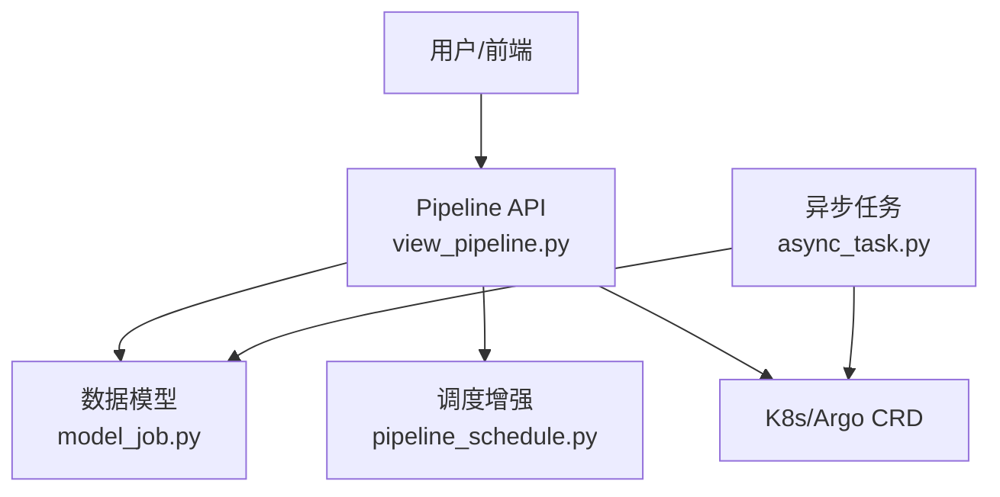
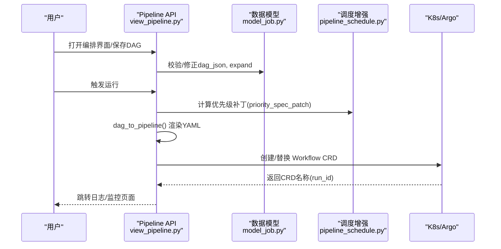
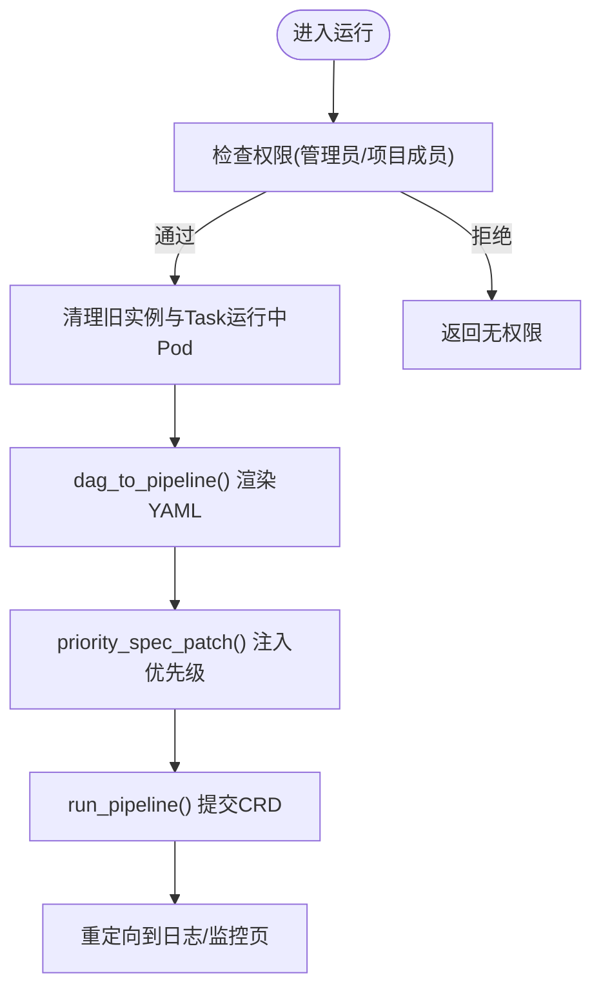
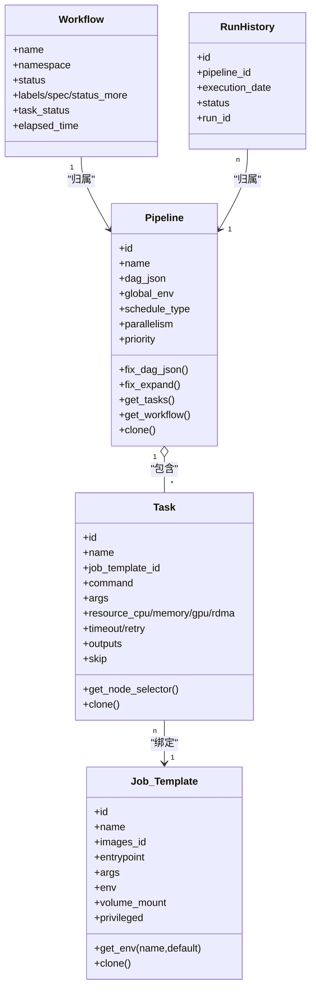
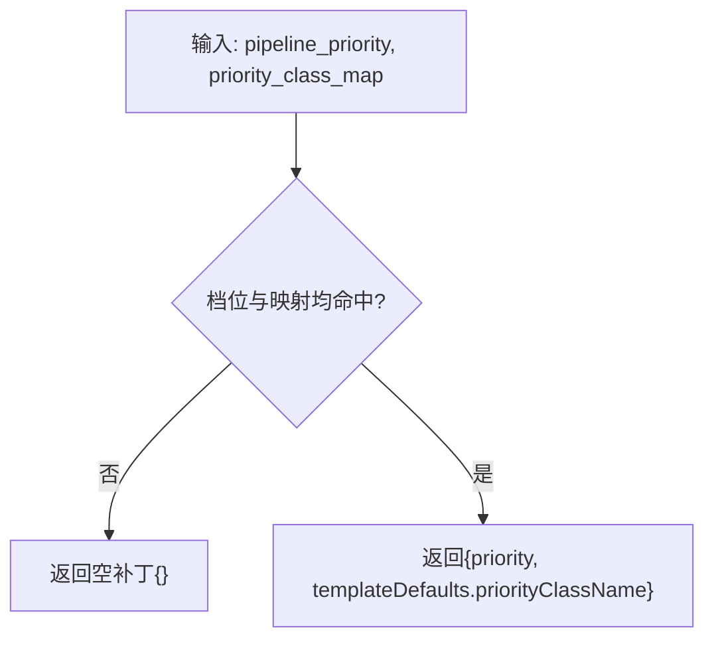
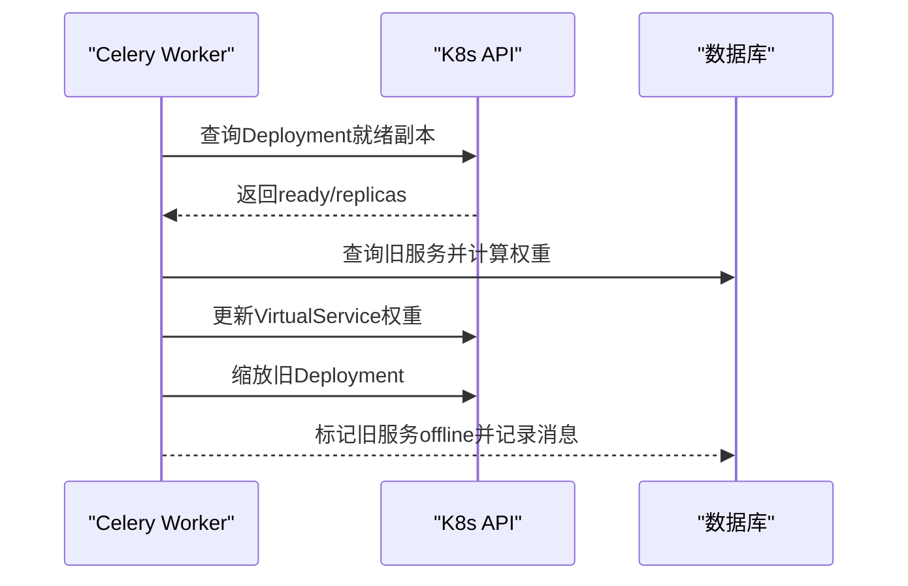
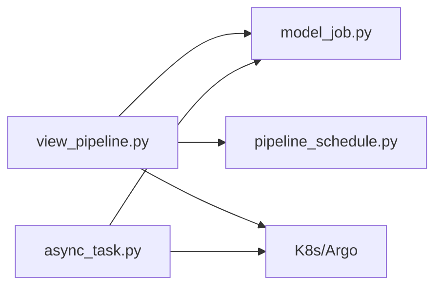

# 模型训练与Pipeline编排

<cite>
**本文引用的文件**   
- [README.md](file://README.md)
- [view_pipeline.py](file://myapp/views/view_pipeline.py)
- [model_job.py](file://myapp/models/model_job.py)
- [pipeline_schedule.py](file://myapp/utils/py/pipeline_schedule.py)
- [async_task.py](file://myapp/tasks/async_task.py)
</cite>

## 目录
1. [引言](#引言)
2. [项目结构](#项目结构)
3. [核心组件](#核心组件)
4. [架构总览](#架构总览)
5. [详细组件分析](#详细组件分析)
6. [依赖关系分析](#依赖关系分析)
7. [性能与优化](#性能与优化)
8. [故障排查指南](#故障排查指南)
9. [结论](#结论)
10. [附录：示例与扩展](#附录示例与扩展)

## 引言
本文件面向“模型训练与 Pipeline 编排”主题，系统性梳理可视化任务流编排、任务模板系统、分布式训练支持、超参搜索、定时调度与任务监控的实现方式。文档基于仓库中的后端视图、数据模型、调度增强逻辑与异步任务实现进行深度解析，并提供架构图、流程图与代码级引用路径，帮助读者快速上手并扩展新的任务类型与训练框架。

## 项目结构
围绕模型训练与 Pipeline 编排的关键代码主要分布在以下模块：
- 视图层（API 与页面路由）：负责 Pipeline 的创建、编辑、运行、调试与监控入口
- 数据模型层：定义 Pipeline、Task、Job_Template、Workflow、RunHistory 等实体
- 调度增强逻辑：提供优先级注入与过期实例清理策略
- 异步任务：支撑服务升级、资源拉取、数据集更新等后台作业

**图表来源**
- [view_pipeline.py:80-127](file://myapp/views/view_pipeline.py#L80-L127)
- [model_job.py:97-121](file://myapp/models/model_job.py#L97-L121)
- [pipeline_schedule.py:16-32](file://myapp/utils/py/pipeline_schedule.py#L16-L32)
- [async_task.py:99-284](file://myapp/tasks/async_task.py#L99-L284)

**章节来源**
- [README.md:145-163](file://README.md#L145-L163)
- [README.md:262-330](file://README.md#L262-L330)

## 核心组件
- Pipeline（任务流）：描述 DAG 上下游关系、全局环境变量、调度策略、并发与优先级等
- Task（任务节点）：绑定 Job_Template，配置镜像、命令、参数、资源、挂载、超时重试等
- Job_Template（任务模板）：封装可复用的执行环境、默认参数与环境变量
- Workflow（工作流实例）：Argo Workflow 在平台的映射，记录状态、标签与详情
- RunHistory（运行历史）：定时调度的执行记录，用于保留策略与审计

关键职责与交互：
- view_pipeline.py 将 Pipeline DAG 渲染为 Argo Workflow YAML，并通过 K8s CRD 提交执行
- model_job.py 提供 Pipeline/Task/Template 的数据结构与校验、排序、克隆等方法
- pipeline_schedule.py 提供优先级双注入与过期实例清理决策
- async_task.py 提供后台任务能力（如服务滚动升级、资源缓存等）

**章节来源**
- [model_job.py:97-121](file://myapp/models/model_job.py#L97-L121)
- [model_job.py:174-206](file://myapp/models/model_job.py#L174-L206)
- [model_job.py:523-553](file://myapp/models/model_job.py#L523-L553)
- [model_job.py:628-645](file://myapp/models/model_job.py#L628-L645)
- [model_job.py:732-786](file://myapp/models/model_job.py#L732-L786)

## 架构总览
平台以 Kubernetes 为底座，通过 Argo Workflow 作为任务编排引擎；Pipeline 由 Web 界面拖拽生成 DAG，后端将其编译为 Workflow YAML 并提交至集群。任务运行时 Pod 携带丰富的上下文环境变量（如任务 ID、命名空间、GPU/CPU/Memory 配额、项目名、用户名等），便于日志追踪与监控。

**图表来源**
- [view_pipeline.py:80-127](file://myapp/views/view_pipeline.py#L80-L127)
- [view_pipeline.py:132-540](file://myapp/views/view_pipeline.py#L132-L540)
- [view_pipeline.py:544-563](file://myapp/views/view_pipeline.py#L544-L563)
- [pipeline_schedule.py:16-32](file://myapp/utils/py/pipeline_schedule.py#L16-L32)

**章节来源**
- [README.md:262-330](file://README.md#L262-L330)

## 详细组件分析

### Pipeline 视图与运行流程
- 核心函数
  - make_workflow_yaml：组装 Argo Workflow 元信息、TTL、归档、并行度、镜像拉取密钥等
  - dag_to_pipeline：读取 Pipeline.dag_json，构建 DAG 模板与容器模板，注入环境变量、资源限制、卷挂载、重试策略、超时、Pod 亲和性等
  - run_pipeline：根据 cluster 与 CRD_INFO 创建或替换 Workflow CRD，持久化 pipeline_argo_id/run_id
- 权限与校验
  - check_pipeline_perms：仅管理员或项目成员可运行
  - pre_add/pre_update：校验 crontab 格式、global_env 合法性、expand JSON 等
- 生命周期管理
  - pre_delete：标记废弃、清理绑定的 Workflow CRD、删除关联 Task 与运行实例
  - delete_bind_crd：按 run-id 区分手动与定时任务发起的实例，避免误删

**图表来源**
- [view_pipeline.py:1039-1060](file://myapp/views/view_pipeline.py#L1039-L1060)
- [view_pipeline.py:1094-1151](file://myapp/views/view_pipeline.py#L1094-L1151)
- [view_pipeline.py:132-540](file://myapp/views/view_pipeline.py#L132-L540)
- [view_pipeline.py:544-563](file://myapp/views/view_pipeline.py#L544-L563)
- [pipeline_schedule.py:16-32](file://myapp/utils/py/pipeline_schedule.py#L16-L32)

**章节来源**
- [view_pipeline.py:80-127](file://myapp/views/view_pipeline.py#L80-L127)
- [view_pipeline.py:132-540](file://myapp/views/view_pipeline.py#L132-L540)
- [view_pipeline.py:544-563](file://myapp/views/view_pipeline.py#L544-L563)
- [view_pipeline.py:1039-1060](file://myapp/views/view_pipeline.py#L1039-L1060)
- [view_pipeline.py:1094-1151](file://myapp/views/view_pipeline.py#L1094-L1151)

### 数据模型与模板系统
- Job_Template：定义镜像、入口点、默认参数与环境变量、是否特权模式、强制挂载等
- Pipeline：存储 DAG、全局环境变量、调度类型、并发数、优先级、告警配置等
- Task：绑定模板，配置命令、参数、资源（CPU/GPU/RDMA）、超时重试、输出产物、跳过标志等
- Workflow/RunHistory：记录工作流实例与定时调度历史，提供状态与耗时统计

**图表来源**
- [model_job.py:97-121](file://myapp/models/model_job.py#L97-L121)
- [model_job.py:174-206](file://myapp/models/model_job.py#L174-L206)
- [model_job.py:523-553](file://myapp/models/model_job.py#L523-L553)
- [model_job.py:628-645](file://myapp/models/model_job.py#L628-L645)
- [model_job.py:732-786](file://myapp/models/model_job.py#L732-L786)

**章节来源**
- [model_job.py:97-121](file://myapp/models/model_job.py#L97-L121)
- [model_job.py:174-206](file://myapp/models/model_job.py#L174-L206)
- [model_job.py:523-553](file://myapp/models/model_job.py#L523-L553)
- [model_job.py:628-645](file://myapp/models/model_job.py#L628-L645)
- [model_job.py:732-786](file://myapp/models/model_job.py#L732-L786)

### 调度增强与优先级注入
- priority_spec_patch：根据 Pipeline.priority 与配置映射表，向 Workflow spec 注入 spec.priority 与 templateDefaults.priorityClassName，实现“提交排序 + Pod 级调度”的双闸门控制
- expired_run_ids_to_delete：对 RunHistory 按 execution_date 降序保留最新 N 条，更早且终态的记录可安全删除

**图表来源**
- [pipeline_schedule.py:16-32](file://myapp/utils/py/pipeline_schedule.py#L16-L32)

**章节来源**
- [pipeline_schedule.py:1-50](file://myapp/utils/py/pipeline_schedule.py#L1-L50)

### 异步任务与后台作业
- upgrade_service：推理服务的滚动升级与流量切换，逐步缩容旧版本并通知用户
- get_k8s_resource：缓存集群 Pod/Node 列表，降低频繁查询开销
- update_dataset：数据集备份与同步

**图表来源**
- [async_task.py:99-284](file://myapp/tasks/async_task.py#L99-L284)
- [async_task.py:339-368](file://myapp/tasks/async_task.py#L339-L368)

**章节来源**
- [async_task.py:99-284](file://myapp/tasks/async_task.py#L99-L284)
- [async_task.py:339-368](file://myapp/tasks/async_task.py#L339-L368)

## 依赖关系分析
- view_pipeline.py 依赖 model_job.py 获取 Pipeline/Task/Template 数据与校验方法
- view_pipeline.py 调用 pipeline_schedule.py 完成优先级补丁
- view_pipeline.py 通过 py_k8s 与 K8s/Argo 交互，创建/删除 CRD
- async_task.py 独立于 Pipeline 视图，但同样依赖 K8s API 与数据库

**图表来源**
- [view_pipeline.py:80-127](file://myapp/views/view_pipeline.py#L80-L127)
- [view_pipeline.py:132-540](file://myapp/views/view_pipeline.py#L132-L540)
- [pipeline_schedule.py:16-32](file://myapp/utils/py/pipeline_schedule.py#L16-L32)
- [async_task.py:99-284](file://myapp/tasks/async_task.py#L99-L284)

**章节来源**
- [view_pipeline.py:80-127](file://myapp/views/view_pipeline.py#L80-L127)
- [view_pipeline.py:132-540](file://myapp/views/view_pipeline.py#L132-L540)
- [pipeline_schedule.py:16-32](file://myapp/utils/py/pipeline_schedule.py#L16-L32)
- [async_task.py:99-284](file://myapp/tasks/async_task.py#L99-L284)

## 性能与优化
- 并行与并发
  - Pipeline.parallelism 控制单实例内同时运行的 Task 数量
  - Pipeline.max_active_runs 控制同一 Pipeline 可同时运行的实例数
- 优先级与调度
  - 通过 PIPELINE_PRIORITY_CLASS 映射与 priority_spec_patch 实现提交排序与 Pod 级调度优先级
- 资源隔离与亲和性
  - 自动添加 podAntiAffinity，尽量分散同 Pipeline 的 Pod 到不同节点
  - 支持 nodeSelector/nodeAffinity 与 hostAliases
- 重试与超时
  - Task.retry 与 activeDeadlineSeconds 控制失败重试与超时终止
- 缓存与监控
  - get_k8s_resource 缓存 Pod/Node 列表，减少 API 压力
  - 提供 Grafana 监控链接与任务耗时统计

**章节来源**
- [view_pipeline.py:396-458](file://myapp/views/view_pipeline.py#L396-L458)
- [view_pipeline.py:587-679](file://myapp/views/view_pipeline.py#L587-L679)
- [pipeline_schedule.py:16-32](file://myapp/utils/py/pipeline_schedule.py#L16-L32)
- [async_task.py:339-368](file://myapp/tasks/async_task.py#L339-L368)

## 故障排查指南
- 权限问题
  - 非管理员或非项目成员无法运行 Pipeline，会返回无权限提示
- DAG 校验失败
  - 存在循环依赖或缺失上游时，pre_add/pre_update 会抛出异常并提示
- Crontab 格式错误
  - schedule_type=crontab 时，cron_time 必须匹配标准表达式
- 实例清理
  - 删除 Pipeline 时会清理绑定的 Workflow CRD 与 Task 运行中 Pod；手动运行产生的实例会被优先清理，定时任务产生的实例受保护
- 服务升级异常
  - 滚动升级过程中若 Deployment 未就绪或 VirtualService 更新失败，会推送通知并回滚/缩容旧服务

**章节来源**
- [view_pipeline.py:1039-1060](file://myapp/views/view_pipeline.py#L1039-L1060)
- [view_pipeline.py:800-833](file://myapp/views/view_pipeline.py#L800-L833)
- [view_pipeline.py:866-923](file://myapp/views/view_pipeline.py#L866-L923)
- [view_pipeline.py:934-980](file://myapp/views/view_pipeline.py#L934-L980)
- [async_task.py:99-284](file://myapp/tasks/async_task.py#L99-L284)

## 结论
该方案以 Pipeline DAG 为核心，结合 Argo Workflow 实现可视化任务编排；通过 Job_Template 沉淀可复用能力，配合优先级注入与并发控制提升调度效率；异步任务支撑服务滚动升级与资源缓存，形成完整的训练与运维闭环。对于分布式训练与超参搜索，平台提供了标准化接入点与丰富的算子生态，便于扩展新的训练框架与任务类型。

## 附录：示例与扩展

### Pipeline 配置要点（参考字段）
- 基本信息：name、describe、project、namespace
- 调度：schedule_type（once/crontab）、cron_time、depends_on_past、max_active_runs、expired_limit
- 运行：parallelism、global_env、alert_status、alert_user
- 高级：priority（high/mid/low）、parameter（后端扩展）、expand（前端布局）

**章节来源**
- [view_pipeline.py:587-723](file://myapp/views/view_pipeline.py#L587-L723)
- [model_job.py:174-206](file://myapp/models/model_job.py#L174-L206)

### 自定义算子开发步骤
- 准备镜像与入口点：在 Images/Repository 中注册镜像与仓库秘钥
- 定义 Job_Template：设置 entrypoint、args、env、volume_mount、privileged 等
- 编写 Task：选择模板、配置 command/args、资源配额、超时重试、输出产物
- 编排 Pipeline：在 DAG 中连接上下游，设置全局环境变量与并发/优先级
- 运行与监控：触发运行后查看日志、Pod 与 Grafana 监控

**章节来源**
- [model_job.py:97-121](file://myapp/models/model_job.py#L97-L121)
- [model_job.py:523-553](file://myapp/models/model_job.py#L523-L553)
- [view_pipeline.py:132-540](file://myapp/views/view_pipeline.py#L132-L540)

### 分布式训练框架集成
- 通过 Job_Template 封装分布式训练脚本与启动命令（如 PyTorch/TensorFlow/Horovod/DeepSpeed 等）
- 在 Task 中指定 GPU/RDMA 资源与节点选择器，确保多机多卡正确调度
- 使用 Pipeline 的 parallelism 与 Task 的 retry/timeout 保障大规模训练稳定性

**章节来源**
- [model_job.py:523-553](file://myapp/models/model_job.py#L523-L553)
- [view_pipeline.py:336-395](file://myapp/views/view_pipeline.py#L336-L395)

### 超参搜索与定时调度
- 超参搜索：通过 NNI 或类似框架，在 Task 中上报中间/最终指标，接收超参输入
- 定时调度：设置 schedule_type=crontab 与 cron_time，平台会生成 RunHistory 并按 expired_limit 清理历史

**章节来源**
- [README.md:325-340](file://README.md#L325-L340)
- [model_job.py:628-645](file://myapp/models/model_job.py#L628-L645)
- [pipeline_schedule.py:35-49](file://myapp/utils/py/pipeline_schedule.py#L35-L49)