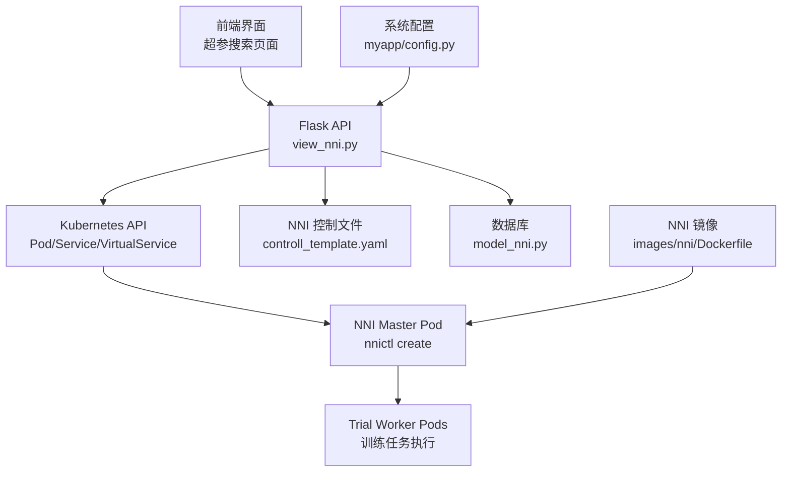
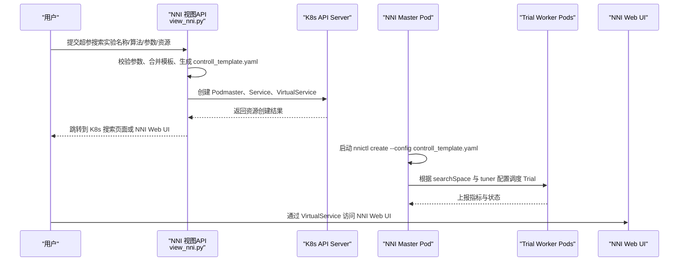
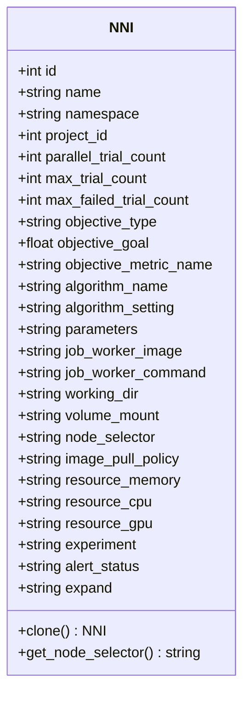
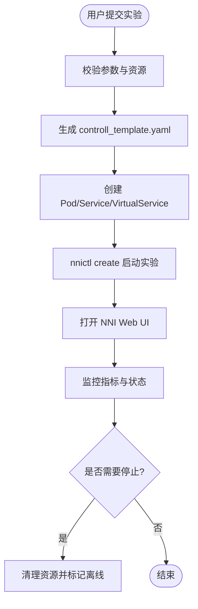
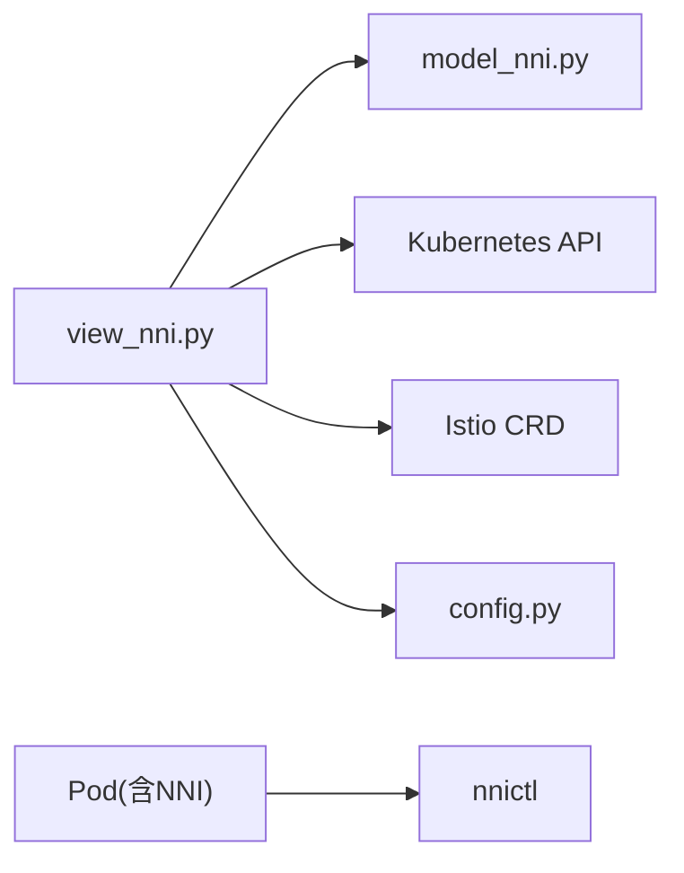

# 超参搜索与优化

<cite>
**本文引用的文件**   
- [view_nni.py](file://myapp/views/view_nni.py)
- [model_nni.py](file://myapp/models/model_nni.py)
- [Dockerfile](file://images/nni/Dockerfile)
- [config.py](file://myapp/config.py)
</cite>

## 目录
1. [简介](#简介)
2. [项目结构](#项目结构)
3. [核心组件](#核心组件)
4. [架构总览](#架构总览)
5. [详细组件分析](#详细组件分析)
6. [依赖关系分析](#依赖关系分析)
7. [性能与并行特性](#性能与并行特性)
8. [故障排查指南](#故障排查指南)
9. [结论](#结论)
10. [附录：示例与最佳实践](#附录示例与最佳实践)

## 简介
本文件面向在 CubeStudio 中开展 NNI（Neural Network Intelligence）超参数搜索与优化的工程师，系统性说明以下主题：
- NNI 集成方案：实验管理、调度、资源隔离、Web UI 访问
- 搜索算法配置：贝叶斯优化、随机搜索、网格搜索等策略的选择与参数化
- 实验管理与结果分析：指标定义、目标函数、运行状态、日志与可视化入口
- 资源限制与并行搜索：CPU/GPU/内存配额、并行试验数、最大失败次数
- 自定义扩展：如何自定义搜索算法、集成其他优化工具

本仓库通过后端视图与模型层对接 K8s 集群，动态生成 NNI 控制配置文件并启动 Pod，同时创建 Service 与 Istio VirtualService 暴露 NNI Web UI。

## 项目结构
围绕 NNI 超参搜索的关键代码分布如下：
- 视图与 API：负责表单校验、K8s 资源编排、NNI 控制文件生成、UI 路由
- 数据模型：持久化 NNI 实验配置、状态与元信息
- 镜像构建：包含 NNI 运行时环境
- 配置项：默认镜像、工作区路径、菜单跳转等

图表来源
- [view_nni.py:339-513](file://myapp/views/view_nni.py#L339-L513)
- [model_nni.py:25-63](file://myapp/models/model_nni.py#L25-L63)
- [Dockerfile:1-33](file://images/nni/Dockerfile#L1-L33)
- [config.py:720-727](file://myapp/config.py#L720-L727)

章节来源
- [view_nni.py:1-770](file://myapp/views/view_nni.py#L1-L770)
- [model_nni.py:1-150](file://myapp/models/model_nni.py#L1-L150)
- [Dockerfile:1-33](file://images/nni/Dockerfile#L1-L33)
- [config.py:720-862](file://myapp/config.py#L720-L862)

## 核心组件
- NNI 数据模型（NNI）
  - 存储实验名称、命名空间、并行度、最大试验数、目标类型与指标名、搜索算法及配置、超参空间 JSON、执行镜像与命令、工作目录、挂载、节点选择器、资源配额、告警状态、扩展字段等。
- NNI 视图与 API（NNI_ModelView_Base / NNI_ModelView_Api）
  - 提供增删改查、运行/停止、查看日志、打开 Web UI 等接口；负责将用户输入转换为 K8s Pod/Service/VirtualService 以及 NNI 控制 YAML。
- NNI 镜像
  - 基于 GPU 基础镜像安装 NNI 及其依赖，提供 nnictl 命令行工具。
- 系统配置
  - 默认 NNI 镜像地址、工作区路径、菜单跳转 URL 等。

章节来源
- [model_nni.py:25-63](file://myapp/models/model_nni.py#L25-L63)
- [view_nni.py:66-315](file://myapp/views/view_nni.py#L66-L315)
- [Dockerfile:1-33](file://images/nni/Dockerfile#L1-L33)
- [config.py:720-727](file://myapp/config.py#L720-L727)

## 架构总览
下图展示从用户操作到 NNI 实验运行的端到端流程。

图表来源
- [view_nni.py:339-513](file://myapp/views/view_nni.py#L339-L513)
- [view_nni.py:541-603](file://myapp/views/view_nni.py#L541-L603)
- [view_nni.py:649-665](file://myapp/views/view_nni.py#L649-L665)

## 详细组件分析

### 数据模型：NNI
- 关键字段
  - 实验标识：name、namespace、project_id
  - 搜索控制：parallel_trial_count、max_trial_count、max_failed_trial_count、objective_type、objective_goal、objective_metric_name、objective_additional_metric_names
  - 算法与参数：algorithm_name、algorithm_setting、parameters（JSON）
  - 执行环境：job_worker_image、job_worker_command、working_dir、volume_mount、node_selector、image_pull_policy
  - 资源配额：resource_memory、resource_cpu、resource_gpu
  - 状态与扩展：experiment、alert_status、expand
- 行为
  - 克隆：支持复制已有实验配置
  - 节点选择器：结合项目与 GPU 需求计算节点选择器
  - 展示属性：run/log/describe_url 等便捷链接

图表来源
- [model_nni.py:25-63](file://myapp/models/model_nni.py#L25-L63)
- [model_nni.py:116-147](file://myapp/models/model_nni.py#L116-L147)

章节来源
- [model_nni.py:25-147](file://myapp/models/model_nni.py#L25-L147)

### 视图与 API：NNI_ModelView_Base / NNI_ModelView_Api
- 表单与字段
  - 搜索算法下拉：TPE、Random、Anneal、Evolution、SMAC、BatchTuner、GridSearch、Hyperband、NetworkMorphism、MetisTuner、BOHB、GPTuner、PPOTuner、PBTTuner
  - 超参示例：提供标准 JSON 示例，整型/浮点需以字符串形式声明
  - 资源与镜像：CPU/GPU/内存、镜像拉取策略、工作目录、挂载、节点选择器
  - 目标与指标：最大化/最小化、目标门限、主指标名、附加指标名
- 关键方法
  - make_nnijob：组装 master Pod 的 spec，注入环境变量、卷挂载、资源配额、GPU 分配
  - deploy_nni_service：创建 Pod、Service、Istio VirtualService，暴露 NNI Web UI
  - run：生成 controll_template.yaml（searchSpace/tuner/trialCommand 等），写入工作目录，触发部署
  - stop：标记离线并清理资源
  - log_task/web_task：跳转到 Pod 日志与 NNI Web UI
  - pre_add/pre_update：参数校验、资源校验、模板合并
- 权限与过滤
  - 仅创建者与管理员可编辑/删除
  - 按项目维度过滤列表

图表来源
- [view_nni.py:339-513](file://myapp/views/view_nni.py#L339-L513)
- [view_nni.py:541-603](file://myapp/views/view_nni.py#L541-L603)
- [view_nni.py:636-665](file://myapp/views/view_nni.py#L636-L665)
- [view_nni.py:700-727](file://myapp/views/view_nni.py#L700-L727)

章节来源
- [view_nni.py:66-315](file://myapp/views/view_nni.py#L66-L315)
- [view_nni.py:339-513](file://myapp/views/view_nni.py#L339-L513)
- [view_nni.py:541-603](file://myapp/views/view_nni.py#L541-L603)
- [view_nni.py:636-665](file://myapp/views/view_nni.py#L636-L665)
- [view_nni.py:700-727](file://myapp/views/view_nni.py#L700-L727)

### NNI 镜像与环境
- 基础镜像：Ubuntu + CUDA + Python 3.9
- 安装内容：Node.js、yarn、NNI、AzureML SDK、pysnooper 等
- 启动方式：nnictl create --config ... --port 8888 --url_prefix nni/<experiment>

章节来源
- [Dockerfile:1-33](file://images/nni/Dockerfile#L1-L33)

### 配置项
- NNI_IMAGES：默认 NNI 镜像地址
- WORKSPACE_HOST_PATH：工作区根路径，自动为用户创建个人目录
- MODEL_URLS.nni：NNI 前端入口 URL

章节来源
- [config.py:720-727](file://myapp/config.py#L720-L727)
- [config.py:812-833](file://myapp/config.py#L812-L833)

## 依赖关系分析
- 视图依赖
  - Flask AppBuilder 视图基类、SQLAInterface、K8s 客户端、Istio CRD 操作
  - 系统配置（NNI_IMAGES、WORKSPACE_HOST_PATH、MODEL_URLS）
- 模型依赖
  - Project 关联、审计混入、序列化/反序列化
- 外部依赖
  - Kubernetes API（Pod/Service/NetworkPolicy）
  - Istio VirtualService（CRD）
  - NNI 运行时（nnictl）

图表来源
- [view_nni.py:1-45](file://myapp/views/view_nni.py#L1-L45)
- [view_nni.py:339-513](file://myapp/views/view_nni.py#L339-L513)
- [model_nni.py:1-21](file://myapp/models/model_nni.py#L1-L21)
- [config.py:720-727](file://myapp/config.py#L720-L727)

章节来源
- [view_nni.py:1-45](file://myapp/views/view_nni.py#L1-L45)
- [model_nni.py:1-21](file://myapp/models/model_nni.py#L1-L21)
- [config.py:720-727](file://myapp/config.py#L720-L727)

## 性能与并行特性
- 并行试验数：由 parallel_trial_count 控制，影响同时运行的 Trial 数量
- 资源配额：每个 Trial 的 CPU/GPU/内存通过 resource_cpu/resource_gpu/resource_memory 设置
- 最大失败次数：max_failed_trial_count 用于提前终止不稳定或频繁失败的实验
- 最大时长与次数：max_exec_duration 与 max_trial_count 限制实验生命周期
- 建议
  - 合理设置并行度，避免集群资源争用
  - 对 GPU 密集型任务，明确指定 GPU 型号与数量
  - 使用 GridSearch 进行穷举时，注意组合爆炸风险，优先采用 Random/TPE 探索

章节来源
- [model_nni.py:36-44](file://myapp/models/model_nni.py#L36-L44)
- [view_nni.py:118-154](file://myapp/views/view_nni.py#L118-L154)
- [view_nni.py:233-253](file://myapp/views/view_nni.py#L233-L253)

## 故障排查指南
- 无法访问 NNI Web UI
  - 检查 VirtualService 是否创建成功，确认 host 与端口映射
  - 确认 Service 与 Pod 标签匹配
- 实验未启动或立即退出
  - 查看 master Pod 日志，确认 nnictl create 是否成功
  - 检查工作目录与 controll_template.yaml 是否正确写入
- 指标未上报
  - 确认 trial 代码正确调用 NNI SDK 上报指标
  - 核对 objective_metric_name 与代码上报键一致
- 资源不足或 OOM
  - 调整 resource_memory/resource_cpu/resource_gpu
  - 降低 parallel_trial_count

章节来源
- [view_nni.py:438-513](file://myapp/views/view_nni.py#L438-L513)
- [view_nni.py:636-665](file://myapp/views/view_nni.py#L636-L665)

## 结论
CubeStudio 通过视图层与模型层协同，将 NNI 超参搜索能力无缝嵌入平台：
- 用户仅需填写搜索算法、超参空间、目标指标与资源配额，即可一键启动分布式实验
- 平台自动生成 NNI 控制文件并编排 K8s 资源，提供 Web UI 可视化监控
- 支持多种搜索策略，便于在不同场景下平衡探索效率与收敛质量

## 附录：示例与最佳实践

### 搜索算法与策略
- 贝叶斯优化（TPE）
  - 适用场景：连续/离散混合空间，样本有限，追求高效收敛
  - 配置要点：optimize_mode 与 objective_type 保持一致
- 随机搜索（Random）
  - 适用场景：高维空间快速探索，鲁棒性强
- 网格搜索（GridSearch）
  - 适用场景：参数空间较小且需要穷举对比
- 其他策略
  - Anneal/Evolution/SMAC/BatchTuner/Hyperband/MetisTuner/BOHB/GPTuner/PPOTuner/PBTTuner

章节来源
- [view_nni.py:169-193](file://myapp/views/view_nni.py#L169-L193)
- [view_nni.py:568-574](file://myapp/views/view_nni.py#L568-L574)

### 定义搜索空间与评估指标
- 搜索空间
  - 以 JSON 形式定义，所有整型/浮点型以字符串表示
  - 参考“超参数示例”字段提示
- 评估指标
  - objective_metric_name：主指标名，必须与训练代码上报键一致
  - objective_additional_metric_names：附加指标名，逗号分隔
  - objective_type：maximize/minimize
  - objective_goal：目标门限，达到后可提前终止

章节来源
- [view_nni.py:139-167](file://myapp/views/view_nni.py#L139-L167)
- [view_nni.py:201-205](file://myapp/views/view_nni.py#L201-L205)

### 资源限制与并行搜索
- 资源限制
  - resource_memory：如 1G、20G
  - resource_cpu：如 2
  - resource_gpu：如 2 或 1(V100)
- 并行搜索
  - parallel_trial_count：同时运行的 Trial 数量
  - max_trial_count：最大试验总数
  - max_failed_trial_count：最大失败次数

章节来源
- [view_nni.py:118-154](file://myapp/views/view_nni.py#L118-L154)
- [view_nni.py:233-253](file://myapp/views/view_nni.py#L233-L253)

### 实验调度与结果可视化
- 实验调度
  - 点击“运行”后，平台生成 controll_template.yaml 并启动 NNI Master Pod
  - Master 根据 searchSpace 与 tuner 配置调度 Trial Worker
- 结果可视化
  - 通过 VirtualService 暴露 NNI Web UI，可在浏览器中查看指标曲线、参数重要性、Top-K 参数等
  - 提供“容器”“日志”快捷入口

章节来源
- [view_nni.py:541-603](file://myapp/views/view_nni.py#L541-L603)
- [view_nni.py:649-665](file://myapp/views/view_nni.py#L649-L665)

### 自定义搜索算法与集成其他优化工具
- 自定义搜索算法
  - 在 NNI 镜像中安装自定义算法包，并在 algorithm_setting 中传入算法类路径与参数
  - 确保算法实现遵循 NNI Tuner 接口规范
- 集成其他优化工具
  - 在 trial 代码中直接调用第三方优化库（如 Optuna、Ray Tune），并通过 NNI 上报指标
  - 保持 objective_metric_name 与第三方库上报键一致

章节来源
- [Dockerfile:1-33](file://images/nni/Dockerfile#L1-L33)
- [view_nni.py:194-199](file://myapp/views/view_nni.py#L194-L199)