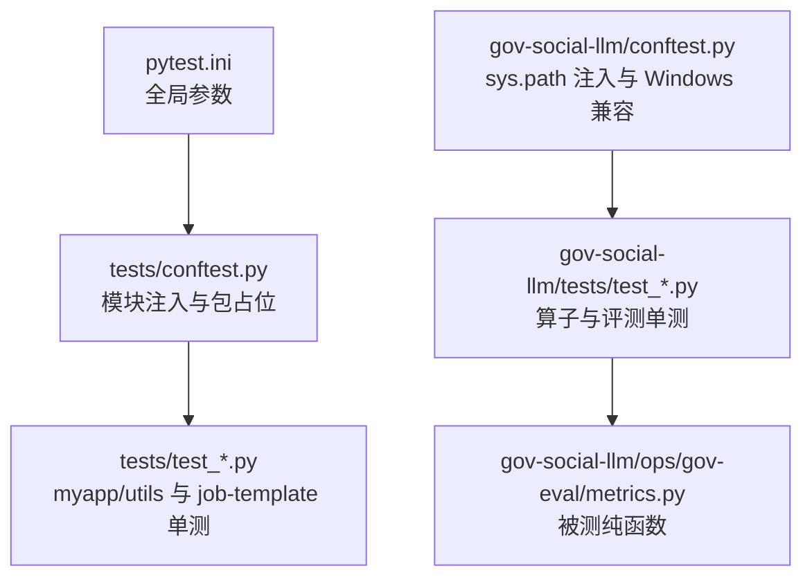
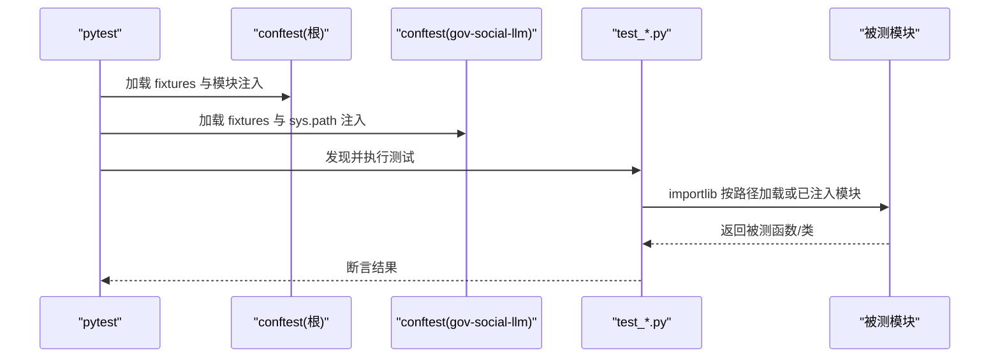
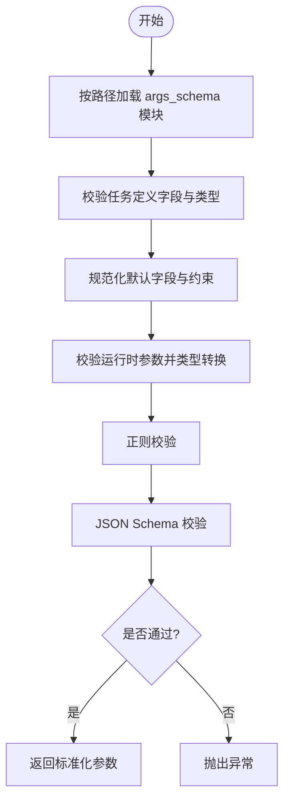
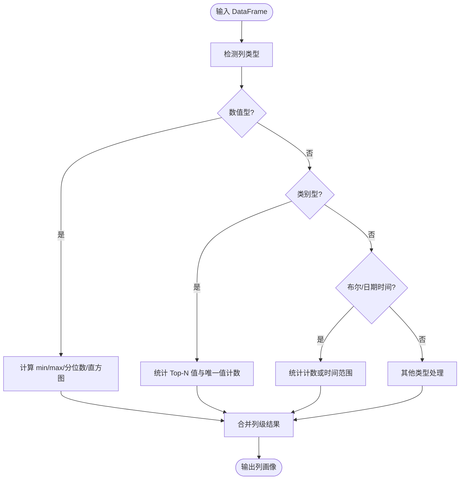
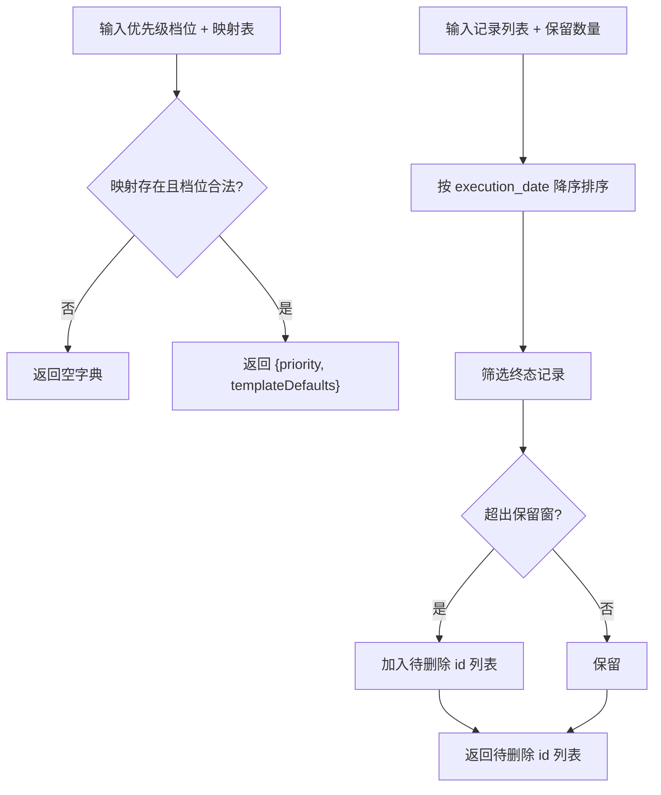
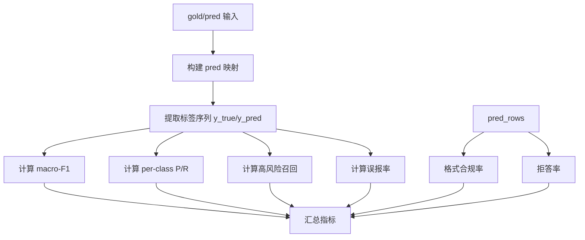
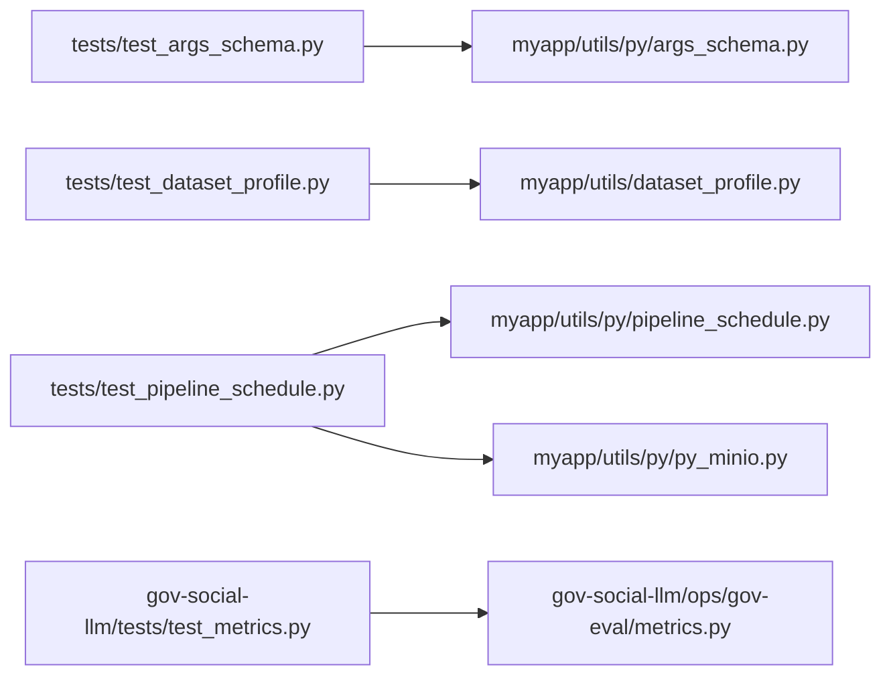

# 测试策略

<cite>
**本文引用的文件**   
- [pytest.ini](file://pytest.ini)
- [tests/conftest.py](file://tests/conftest.py)
- [tests/test_args_schema.py](file://tests/test_args_schema.py)
- [tests/test_dataset_profile.py](file://tests/test_dataset_profile.py)
- [tests/test_pipeline_schedule.py](file://tests/test_pipeline_schedule.py)
- [gov-social-llm/conftest.py](file://gov-social-llm/conftest.py)
- [gov-social-llm/tests/test_metrics.py](file://gov-social-llm/tests/test_metrics.py)
- [gov-social-llm/ops/gov-eval/metrics.py](file://gov-social-llm/ops/gov-eval/metrics.py)
</cite>

## 目录
1. [引言](#引言)
2. [项目结构](#项目结构)
3. [核心组件](#核心组件)
4. [架构总览](#架构总览)
5. [详细组件分析](#详细组件分析)
6. [依赖关系分析](#依赖关系分析)
7. [性能与稳定性考量](#性能与稳定性考量)
8. [故障排查指南](#故障排查指南)
9. [结论](#结论)
10. [附录：最佳实践清单](#附录最佳实践清单)

## 引言
本文件面向 CubeStudio 项目的测试体系建设，覆盖单元测试、集成测试与端到端测试的完整策略。重点说明：
- 测试环境搭建与隔离
- 测试数据管理
- 测试用例编写规范与示例
- 覆盖率统计与持续集成建议
- 性能测试与自动化测试策略

本项目采用 pytest 作为统一测试框架，根目录与 gov-social-llm 子模块分别维护各自的 conftest 与测试集，通过“按路径加载被测模块”的方式避免启动真实 Flask 应用，从而在本地无数据库等外部依赖时也能运行单测。

## 项目结构
仓库中与测试直接相关的核心位置如下：
- 根目录 pytest 配置与通用夹具
- myapp/utils 下工具模块的单测
- job-template/job 下 lerobot 相关命令与指标解析的单测
- gov-social-llm 子模块的算子与评测脚本测试

图示来源
- [pytest.ini:1-5](file://pytest.ini#L1-L5)
- [tests/conftest.py:1-52](file://tests/conftest.py#L1-L52)
- [gov-social-llm/conftest.py:1-28](file://gov-social-llm/conftest.py#L1-L28)
- [gov-social-llm/ops/gov-eval/metrics.py:1-130](file://gov-social-llm/ops/gov-eval/metrics.py#L1-L130)

章节来源
- [pytest.ini:1-5](file://pytest.ini#L1-L5)
- [tests/conftest.py:1-52](file://tests/conftest.py#L1-L52)
- [gov-social-llm/conftest.py:1-28](file://gov-social-llm/conftest.py#L1-L28)

## 核心组件
- 测试运行器与全局配置
  - pytest.ini：设置临时目录到项目本地，规避 Windows 符号链接清理权限问题。
- 根级测试夹具
  - tests/conftest.py：通过 importlib 按路径加载被测模块，并 stub 掉 myapp.* 包，避免触发 Flask 应用初始化；同时为多个 utils 与 job-template 模块提供可测试入口。
- 子模块夹具
  - gov-social-llm/conftest.py：将 ops 与 scripts 目录加入 sys.path，使测试可直接 import 算子；提供 autouse fixture 清理只读文件，提升 Windows 兼容性。
- 典型单测
  - test_args_schema.py：任务模板参数类型系统校验与转换。
  - test_dataset_profile.py：数据集列级统计与直方图生成。
  - test_pipeline_schedule.py：流水线优先级补丁与过期记录清理逻辑，以及 MinIO 前缀对象批量删除封装。
  - gov-social-llm/tests/test_metrics.py：评测指标（macro-F1、高风险召回、拒答率、格式合规）断言。

章节来源
- [pytest.ini:1-5](file://pytest.ini#L1-L5)
- [tests/conftest.py:1-52](file://tests/conftest.py#L1-L52)
- [gov-social-llm/conftest.py:1-28](file://gov-social-llm/conftest.py#L1-L28)
- [tests/test_args_schema.py:1-187](file://tests/test_args_schema.py#L1-L187)
- [tests/test_dataset_profile.py:1-65](file://tests/test_dataset_profile.py#L1-L65)
- [tests/test_pipeline_schedule.py:1-175](file://tests/test_pipeline_schedule.py#L1-L175)
- [gov-social-llm/tests/test_metrics.py:1-28](file://gov-social-llm/tests/test_metrics.py#L1-L28)

## 架构总览
下图展示测试执行的关键流程：pytest 启动 → 加载 conftest → 按需加载被测模块 → 执行断言。该设计确保测试不依赖真实数据库、网络与外部服务。

图示来源
- [tests/conftest.py:1-52](file://tests/conftest.py#L1-L52)
- [gov-social-llm/conftest.py:1-28](file://gov-social-llm/conftest.py#L1-L28)

## 详细组件分析

### 参数类型系统与校验（args_schema）
- 目标：验证任务模板参数的类型定义、默认值、正则约束、JSON Schema 校验与向后兼容。
- 关键能力
  - 新增字段补齐（tip、regex、schema、choice_url）
  - 类型集合覆盖（int、float、list、bool、json）
  - 子类型覆盖（select-input、select2、workdir、image、project）
  - 运行时参数校验与类型转换（字符串转 int/float/bool/list/json）
  - 未知类型降级为 str 的安全兜底
- 测试要点
  - 正向：字段补齐、类型转换、正则匹配、JSON Schema 校验
  - 反向：非法正则、非法 choice_url、缺失必填项、非法 JSON Schema、未知类型
- 复杂度与边界
  - 时间复杂度近似 O(n)（n 为参数个数），空间复杂度 O(1)
  - 边界：空输入、布尔字符串、列表逗号拼接、JSON 必填字段缺失

图示来源
- [tests/test_args_schema.py:1-187](file://tests/test_args_schema.py#L1-L187)

章节来源
- [tests/test_args_schema.py:1-187](file://tests/test_args_schema.py#L1-L187)

### 数据集列级画像（dataset_profile）
- 目标：对 DataFrame 进行列级统计，包括数值型、类别型、布尔型、日期时间型，输出 null_rate、分位数、直方图、Top-N 值等。
- 关键能力
  - 自动识别列类型
  - 计算缺失率、唯一值计数、Top-N 频次
  - 数值列的分位数与直方图
  - 日期时间列的最小/最大时间
- 测试要点
  - 数值列：null_rate、min/max、分位数、直方图桶数与总和
  - 类别列：Top-N 限制为 20
  - 布尔/日期时间：类型判定与极值
  - 全空列与空表：健壮性

图示来源
- [tests/test_dataset_profile.py:1-65](file://tests/test_dataset_profile.py#L1-L65)

章节来源
- [tests/test_dataset_profile.py:1-65](file://tests/test_dataset_profile.py#L1-L65)

### 流水线调度与优先级（pipeline_schedule）
- 目标：实现流水线优先级补丁注入与过期 RunHistory 清理决策，并提供 MinIO 前缀对象批量删除封装。
- 关键能力
  - priority_spec_patch：根据优先级档位映射注入 priority 与 templateDefaults.priorityClassName
  - expired_run_ids_to_delete：基于 execution_date 排序，仅删除超出保留窗且处于终态的记录
  - remove_object_prefix：列出对象并逐个删除，收集错误但不中断整体流程
- 测试要点
  - 优先级映射为空或未知档位时返回空字典
  - 低优先级对应 priority=0
  - 过期清理：仅删除终态，非终态保留；缺字段容错
  - MinIO：列举失败吞掉错误；单个删除失败记录错误；成功计数正确

图示来源
- [tests/test_pipeline_schedule.py:1-175](file://tests/test_pipeline_schedule.py#L1-L175)

章节来源
- [tests/test_pipeline_schedule.py:1-175](file://tests/test_pipeline_schedule.py#L1-L175)

### 评测指标（metrics）
- 目标：实现纯函数的评测指标计算，包括 macro-F1、高精度召回、拒答率、格式合规率与汇总评分。
- 关键能力
  - parse_output：剥离围栏后解析 JSON
  - load_jsonl：读取 JSONL 数据
  - macro_f1：多分类宏平均 F1
  - precision_recall：单类精确率与召回率
  - high_risk_recall：高风险样本召回率
  - format_compliance：非拒答行中符合 JSON Schema 的比例
  - refusal_rate：拒答比例
  - score_all：汇总指标字典
- 测试要点
  - 完美预测与偏斜分布下的 macro-F1
  - 高风险召回与误报率
  - 格式合规与拒答率

图示来源
- [gov-social-llm/ops/gov-eval/metrics.py:1-130](file://gov-social-llm/ops/gov-eval/metrics.py#L1-L130)
- [gov-social-llm/tests/test_metrics.py:1-28](file://gov-social-llm/tests/test_metrics.py#L1-L28)

章节来源
- [gov-social-llm/ops/gov-eval/metrics.py:1-130](file://gov-social-llm/ops/gov-eval/metrics.py#L1-L130)
- [gov-social-llm/tests/test_metrics.py:1-28](file://gov-social-llm/tests/test_metrics.py#L1-L28)

## 依赖关系分析
- 测试与源码耦合
  - tests/conftest.py 通过 importlib 直接加载 myapp/utils 与 job-template 下的模块，降低对 myapp 包的强依赖，避免启动 Flask 应用。
  - gov-social-llm/conftest.py 将 ops 与 scripts 目录加入 sys.path，使测试可直接 import 算子。
- 外部依赖
  - metrics 使用 jsonschema 做 JSON Schema 校验；测试通过纯函数断言，无需真实存储或网络。
  - pipeline_schedule 中的 MinIO 操作通过 FakeMinioClient 模拟，避免真实对象存储。

图示来源
- [tests/test_args_schema.py:1-187](file://tests/test_args_schema.py#L1-L187)
- [tests/test_dataset_profile.py:1-65](file://tests/test_dataset_profile.py#L1-L65)
- [tests/test_pipeline_schedule.py:1-175](file://tests/test_pipeline_schedule.py#L1-L175)
- [gov-social-llm/tests/test_metrics.py:1-28](file://gov-social-llm/tests/test_metrics.py#L1-L28)
- [gov-social-llm/ops/gov-eval/metrics.py:1-130](file://gov-social-llm/ops/gov-eval/metrics.py#L1-L130)

章节来源
- [tests/conftest.py:1-52](file://tests/conftest.py#L1-L52)
- [gov-social-llm/conftest.py:1-28](file://gov-social-llm/conftest.py#L1-L28)

## 性能与稳定性考量
- 测试执行效率
  - 使用 importlib 按需加载被测模块，避免启动完整应用，缩短测试启动时间。
  - 使用内存中的 FakeMinioClient 与固定输入数据，减少 I/O 与网络开销。
- 稳定性保障
  - 对未知类型、缺失字段、非法正则等进行防御式编程与断言，保证鲁棒性。
  - Windows 兼容：conftest 清理只读文件与设置本地临时目录，避免权限错误导致测试不稳定。
- 可扩展性
  - 通过 conftest 集中管理模块注入与路径配置，新增被测模块只需在 conftest 注册即可被测试发现。

[本节为通用指导，不直接分析具体文件]

## 故障排查指南
- 无法导入被测模块
  - 检查 tests/conftest.py 是否已将目标模块路径注册为 _load_module 调用。
  - 确认模块路径与文件名一致，且未被 .gitignore 排除。
- Windows 下临时目录清理失败
  - 确认 pytest.ini 已设置 addopts = --basetemp=.pytest-tmp。
  - 检查 gov-social-llm/conftest.py 的 autouse fixture 是否正确解除只读位。
- 外部依赖未安装
  - 如 jsonschema 缺失会导致 metrics 功能报错，需在测试环境安装相应依赖。
- 测试数据异常
  - 对于 dataset_profile 与 metrics 测试，确保输入数据符合预期类型与结构。

章节来源
- [pytest.ini:1-5](file://pytest.ini#L1-L5)
- [tests/conftest.py:1-52](file://tests/conftest.py#L1-L52)
- [gov-social-llm/conftest.py:1-28](file://gov-social-llm/conftest.py#L1-L28)

## 结论
本项目测试体系以 pytest 为核心，通过 conftest 集中管理模块注入与环境准备，结合 importlib 按需加载被测模块，实现了高内聚、低耦合的单元测试。针对业务关键路径（参数校验、数据集画像、流水线调度、评测指标）提供了完备的测试覆盖，并通过 Mock 与固定数据确保测试稳定与可重复。建议在后续迭代中继续遵循“纯函数优先、外部依赖最小化、断言明确”的原则，逐步完善集成测试与端到端测试，形成从单元到系统的完整质量保障闭环。

[本节为总结性内容，不直接分析具体文件]

## 附录：最佳实践清单
- 测试环境搭建
  - 使用 pytest.ini 指定本地临时目录，避免权限问题。
  - 在 conftest 中集中注入 sys.path 与模块加载逻辑。
- 测试数据管理
  - 使用 fixtures 与固定输入数据，避免随机性与外部依赖。
  - 对复杂数据结构（JSON/JSONL）提供最小可复现样例。
- 测试用例编写规范
  - 每个用例聚焦单一职责，命名清晰表达意图。
  - 正向与反向用例并重，覆盖边界与异常分支。
  - 对外部依赖使用 Mock/Fake 替代真实服务。
- 覆盖率统计与持续集成
  - 建议使用 pytest-cov 生成覆盖率报告，并在 CI 中阻断覆盖率下降。
  - 将测试拆分为快速单测与慢速集成测试，CI 并行执行以提升反馈速度。
- 性能测试与自动化测试
  - 对热点路径（如指标计算、数据画像）增加基准测试，监控回归。
  - 将自动化测试纳入代码提交钩子与 CI 流水线，确保质量门禁。

[本节为通用指导，不直接分析具体文件]