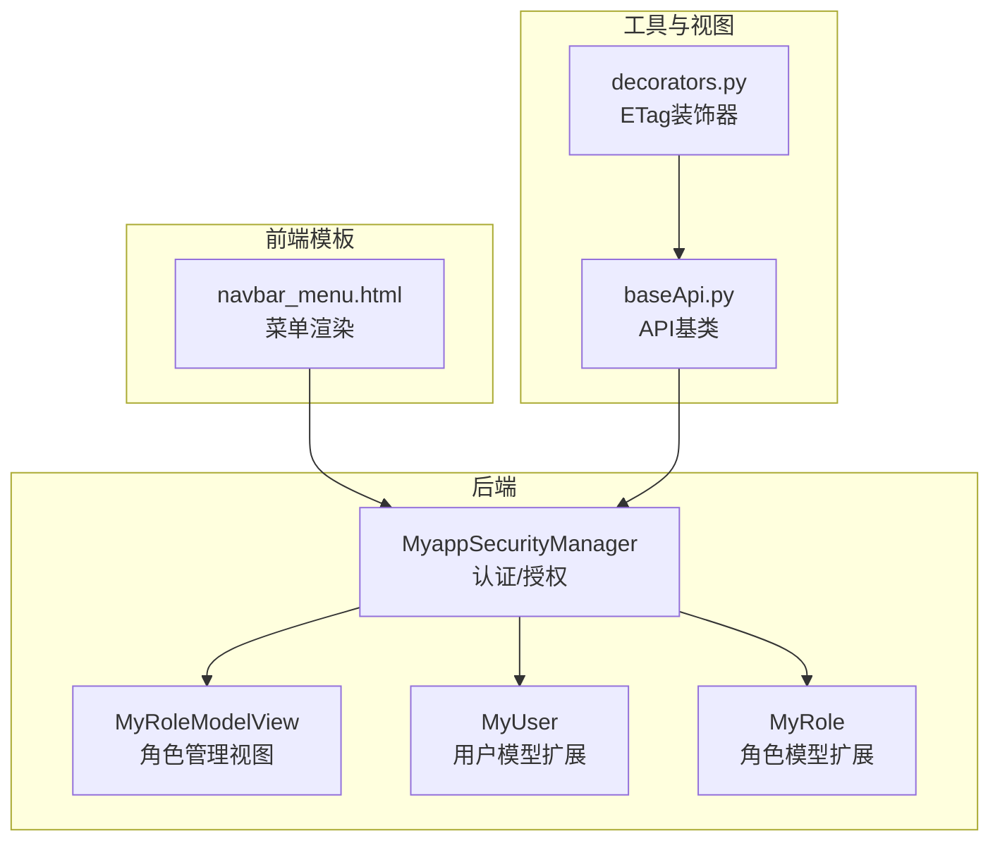
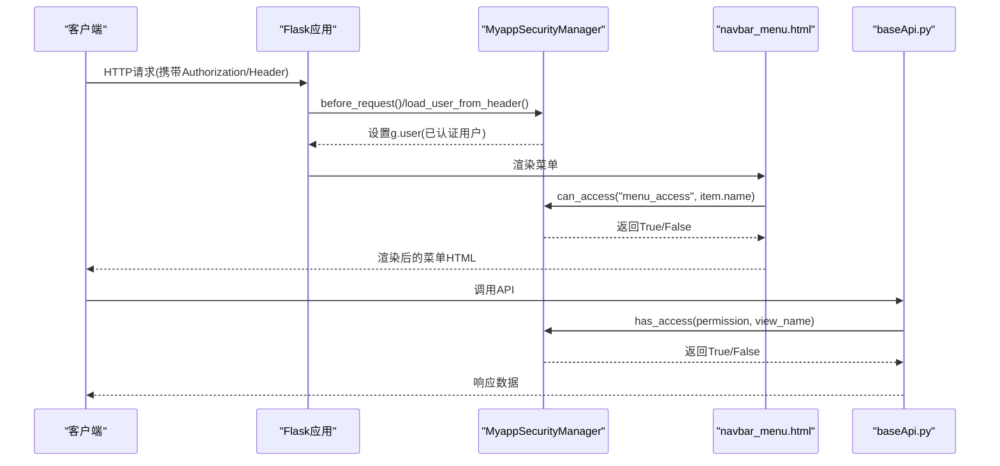
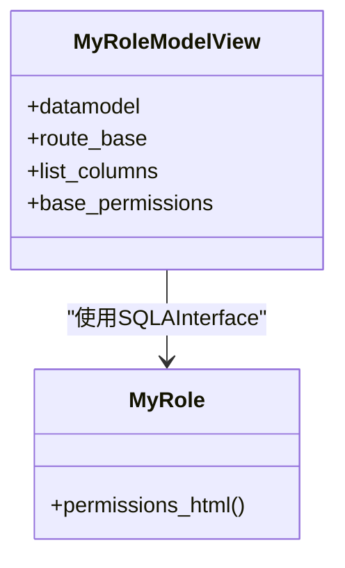
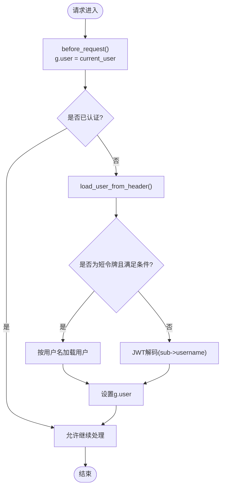
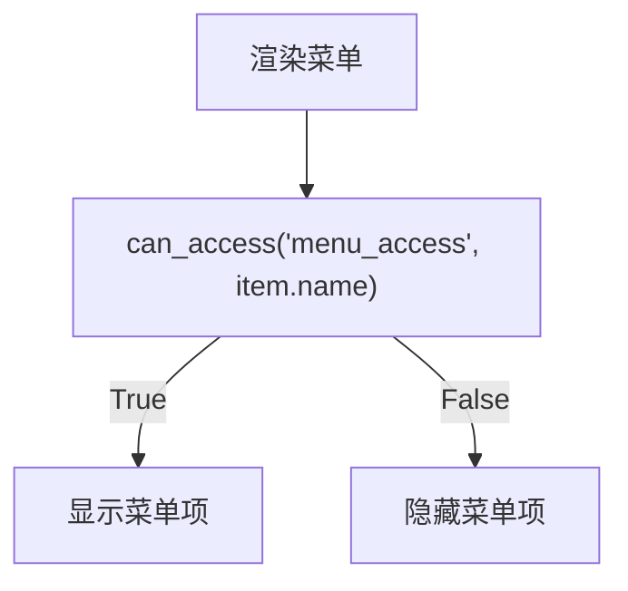
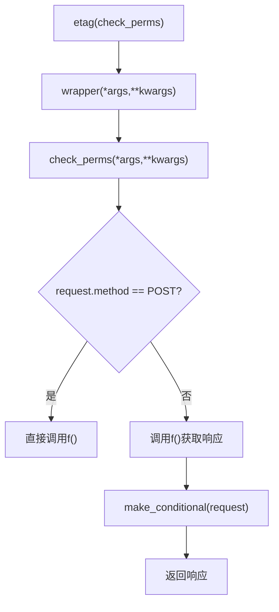
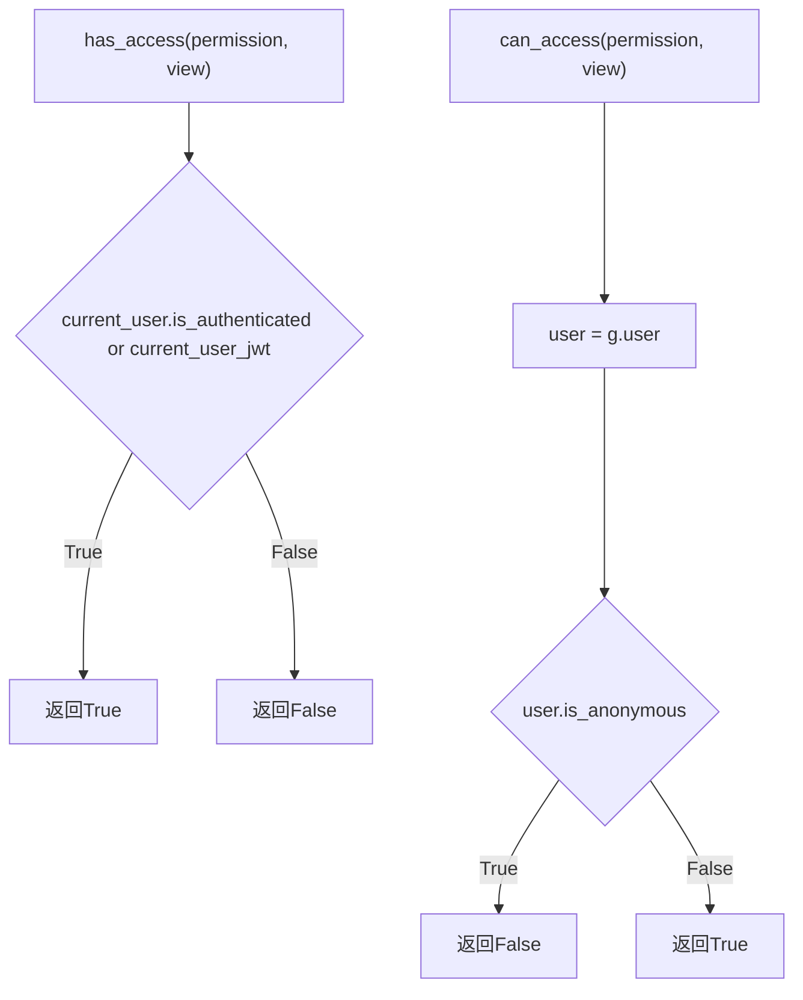
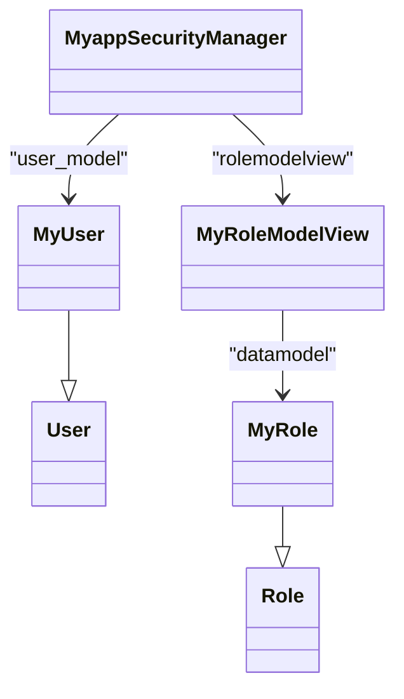
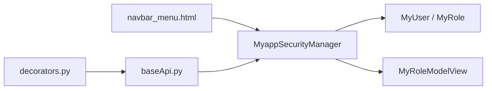

# RBAC权限系统

<cite>
**本文引用的文件**   
- [security.py](file://myapp/security.py)
- [navbar_menu.html](file://myapp/templates/appbuilder/navbar_menu.html)
- [decorators.py](file://myapp/utils/decorators.py)
- [baseApi.py](file://myapp/views/baseApi.py)
</cite>

## 目录
1. [简介](#简介)
2. [项目结构](#项目结构)
3. [核心组件](#核心组件)
4. [架构总览](#架构总览)
5. [详细组件分析](#详细组件分析)
6. [依赖关系分析](#依赖关系分析)
7. [性能与缓存策略](#性能与缓存策略)
8. [故障排查指南](#故障排查指南)
9. [结论](#结论)
10. [附录：常见权限场景配置示例](#附录常见权限场景配置示例)

## 简介
本文件系统性梳理并文档化 cube-studio 的 RBAC（基于角色的访问控制）权限体系，重点覆盖以下方面：
- 基于角色的访问控制实现与权限验证流程
- 菜单控制机制与动态菜单生成
- MyRoleModelView 自定义角色视图、权限继承关系与角色权限配置
- 自定义权限装饰器与接口访问控制
- has_access 与 can_access 的实现原理与使用方式
- 权限缓存策略与优化建议
- 常见权限场景的配置示例与实践模式

## 项目结构
RBAC 相关代码主要位于 myapp 模块中，关键文件如下：
- myapp/security.py：用户/角色模型扩展、安全管理器、认证与授权逻辑
- myapp/templates/appbuilder/navbar_menu.html：导航菜单渲染与菜单级权限控制
- myapp/utils/decorators.py：通用装饰器（含 ETag 与权限检查钩子）
- myapp/views/baseApi.py：API 基类中对权限检查的使用位置

图表来源
- [security.py:47-116](file://myapp/security.py#L47-L116)
- [navbar_menu.html:10-38](file://myapp/templates/appbuilder/navbar_menu.html#L10-L38)
- [decorators.py:21-40](file://myapp/utils/decorators.py#L21-L40)
- [baseApi.py:628-628](file://myapp/views/baseApi.py#L628-L628)

章节来源
- [security.py:47-116](file://myapp/security.py#L47-L116)
- [navbar_menu.html:10-38](file://myapp/templates/appbuilder/navbar_menu.html#L10-L38)
- [decorators.py:21-40](file://myapp/utils/decorators.py#L21-L40)
- [baseApi.py:628-628](file://myapp/views/baseApi.py#L628-L628)

## 核心组件
- MyUser：在 FAB 默认 User 模型基础上扩展业务字段（昵称、组织、配额、余额等），并提供 is_admin 便捷方法。
- MyRole：在 FAB 默认 Role 模型基础上提供 permissions_html 展示属性。
- MyRoleModelView：自定义角色管理视图，定义路由、列、基础权限等。
- MyappSecurityManager：继承 FAB SecurityManager，注入自定义用户/角色视图、认证入口（Header/JWT）、登录前钩子、菜单注册、以及 has_access/can_access 的简化实现。

章节来源
- [security.py:47-116](file://myapp/security.py#L47-L116)
- [security.py:237-406](file://myapp/security.py#L237-L406)

## 架构总览
下图展示了请求进入后，认证与授权的关键路径：
- 请求进入时通过 Header 或 JWT 进行身份解析，设置 g.user
- 模板层通过 security_manager.can_access("menu_access", menu_name) 控制菜单显示
- API 层可通过 baseApi 中的权限检查点（如注释处）集成 has_access

图表来源
- [security.py:247-286](file://myapp/security.py#L247-L286)
- [navbar_menu.html:10-38](file://myapp/templates/appbuilder/navbar_menu.html#L10-L38)
- [baseApi.py:628-628](file://myapp/views/baseApi.py#L628-L628)

## 详细组件分析

### 自定义角色视图 MyRoleModelView
- 作用：为角色管理提供自定义列表、编辑、新增、展示等能力，并限定基础权限集合。
- 关键点：
  - datamodel 指向 MyRole
  - route_base 指定管理路由
  - list_columns 仅展示 name 与 permissions（后者由 MyRole.permissions_html 提供）
  - base_permissions 限制可操作的基础权限

图表来源
- [security.py:101-116](file://myapp/security.py#L101-L116)

章节来源
- [security.py:101-116](file://myapp/security.py#L101-L116)

### 安全管理器 MyappSecurityManager
- 认证入口：
  - before_request：将 current_user 赋值给 g.user
  - load_user_from_header：支持两种认证方式
    - 短字符串（长度小于阈值）且满足条件时，直接按用户名解析
    - 否则作为 JWT 解码，提取 sub 字段查找用户
- 菜单注册：register_views 注册安全相关视图与API
- 权限判断：
  - has_access：若当前用户已认证或通过JWT认证则放行
  - can_access：若 g.user 非匿名则放行
- 角色同步：sync_role_definitions 初始化 Admin/Gamma 角色

图表来源
- [security.py:247-286](file://myapp/security.py#L247-L286)

章节来源
- [security.py:247-286](file://myapp/security.py#L247-L286)

### 菜单控制与动态菜单生成
- navbar_menu.html 在渲染菜单时，对每个菜单项调用 security_manager.can_access("menu_access", item.name) 决定是否显示。
- 该机制实现了“菜单级”权限控制，结合后端 can_access 的简化实现，达到“已认证即可见”的效果。

图表来源
- [navbar_menu.html:10-38](file://myapp/templates/appbuilder/navbar_menu.html#L10-L38)
- [security.py:391-395](file://myapp/security.py#L391-L395)

章节来源
- [navbar_menu.html:10-38](file://myapp/templates/appbuilder/navbar_menu.html#L10-L38)
- [security.py:391-395](file://myapp/security.py#L391-L395)

### 自定义权限装饰器与接口访问控制
- decorators.py 提供 etag(check_perms=bool) 装饰器，可在 GET 请求中进行 ETag 协商；check_perms 参数可用于传入权限校验函数。
- baseApi.py 中存在对 has_access 的引用（注释形式），表明 API 层可按需接入权限检查。

图表来源
- [decorators.py:21-40](file://myapp/utils/decorators.py#L21-L40)
- [baseApi.py:628-628](file://myapp/views/baseApi.py#L628-L628)

章节来源
- [decorators.py:21-40](file://myapp/utils/decorators.py#L21-L40)
- [baseApi.py:628-628](file://myapp/views/baseApi.py#L628-L628)

### 权限检查方法 has_access 与 can_access 实现原理
- has_access(permission_name, view_name)：
  - 若当前用户已认证或存在 JWT 上下文用户，则返回 True
  - 否则返回 False
- can_access(permission_name, view_name)：
  - 从 g.user 读取当前用户
  - 若用户为匿名则返回 False
  - 否则返回 True

图表来源
- [security.py:383-395](file://myapp/security.py#L383-L395)

章节来源
- [security.py:383-395](file://myapp/security.py#L383-L395)

### 权限继承关系与角色权限配置
- MyUser 与 MyRole 分别继承自 FAB 的 User 与 Role，并在 MyappSecurityManager 中通过 user_model 与 rolemodelview 完成绑定。
- MyRoleModelView 暴露基础权限 can_list/can_edit/can_add/can_show，用于角色管理界面。
- sync_role_definitions 确保系统启动时存在 Admin/Gamma 两个基础角色。

图表来源
- [security.py:47-116](file://myapp/security.py#L47-L116)
- [security.py:237-244](file://myapp/security.py#L237-L244)
- [security.py:403-406](file://myapp/security.py#L403-L406)

章节来源
- [security.py:47-116](file://myapp/security.py#L47-L116)
- [security.py:237-244](file://myapp/security.py#L237-L244)
- [security.py:403-406](file://myapp/security.py#L403-L406)

## 依赖关系分析
- 认证与授权依赖链：
  - 模板层依赖 security_manager.can_access 控制菜单显示
  - API 层可通过 baseApi 中的权限检查点集成 has_access
  - 装饰器 etag 支持外部传入 check_perms 以复用权限逻辑
- 内部耦合：
  - MyappSecurityManager 与 MyUser/MyRole/MyRoleModelView 强耦合
  - 模板与安全管理器通过全局 security_manager 实例交互

图表来源
- [navbar_menu.html:10-38](file://myapp/templates/appbuilder/navbar_menu.html#L10-L38)
- [baseApi.py:628-628](file://myapp/views/baseApi.py#L628-L628)
- [decorators.py:21-40](file://myapp/utils/decorators.py#L21-L40)
- [security.py:47-116](file://myapp/security.py#L47-L116)
- [security.py:237-244](file://myapp/security.py#L237-L244)

章节来源
- [navbar_menu.html:10-38](file://myapp/templates/appbuilder/navbar_menu.html#L10-L38)
- [baseApi.py:628-628](file://myapp/views/baseApi.py#L628-L628)
- [decorators.py:21-40](file://myapp/utils/decorators.py#L21-L40)
- [security.py:47-116](file://myapp/security.py#L47-L116)
- [security.py:237-244](file://myapp/security.py#L237-L244)

## 性能与缓存策略
- 当前 has_access/can_access 的实现为轻量级逻辑，无数据库查询，因此开销极低。
- 未实现显式权限缓存；如需进一步优化，可考虑：
  - 在 MyappSecurityManager 中引入内存缓存（如 LRU 缓存）存储用户角色与权限映射
  - 在模板渲染阶段批量收集菜单项，一次性判定权限以减少重复调用
  - 对高频 API 使用 etag 装饰器减少网络传输与重复计算

[本节为通用指导，不直接分析具体文件]

## 故障排查指南
- 菜单不显示：
  - 确认 security_manager.can_access 返回是否符合预期
  - 检查模板中 can_access 的参数是否正确（permission_name="menu_access"，view_name=菜单名）
- 接口被拒绝：
  - 检查 has_access 是否被正确调用
  - 确认当前用户已通过 Header/JWT 认证成功（g.user 非空）
- 角色管理异常：
  - 检查 MyRoleModelView 的基础权限配置是否包含所需权限
  - 确认 sync_role_definitions 已执行，Admin/Gamma 角色存在

章节来源
- [navbar_menu.html:10-38](file://myapp/templates/appbuilder/navbar_menu.html#L10-L38)
- [security.py:383-395](file://myapp/security.py#L383-L395)
- [security.py:403-406](file://myapp/security.py#L403-L406)

## 结论
本项目基于 FAB 的安全框架进行了适度扩展，提供了简化的认证与授权流程：
- 通过 Header/JWT 快速认证用户
- 通过 can_access/has_access 提供灵活的权限判断
- 通过模板层的菜单权限控制实现动态菜单
- 通过 MyRoleModelView 与角色模型扩展完善角色管理能力

建议在后续迭代中引入更细粒度的权限模型与缓存机制，以提升可扩展性与性能。

[本节为总结性内容，不直接分析具体文件]

## 附录：常见权限场景配置示例
- 管理员全量访问：
  - 将用户分配至 Admin 角色，并确保 sync_role_definitions 已创建该角色
- 普通用户受限访问：
  - 将用户分配至 Gamma 角色，并通过菜单权限控制其可见范围
- 接口级访问控制：
  - 在 API 层调用 has_access(permission, view_name)，根据业务需求配置 permission 与 view_name
- 菜单级访问控制：
  - 在 navbar_menu.html 中使用 can_access("menu_access", menu_name) 控制菜单显示

[本节为概念性说明，不直接分析具体文件]