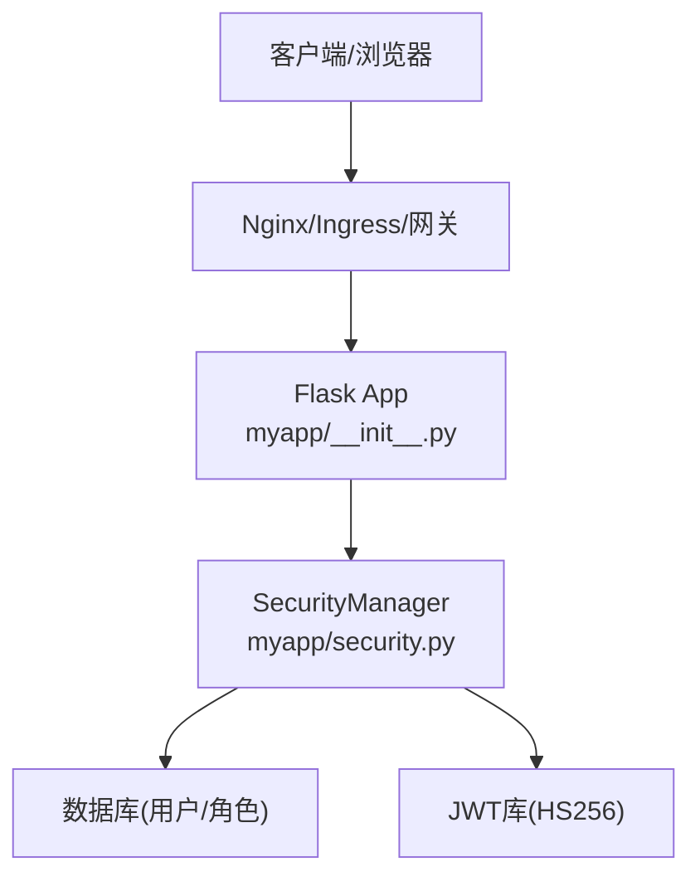
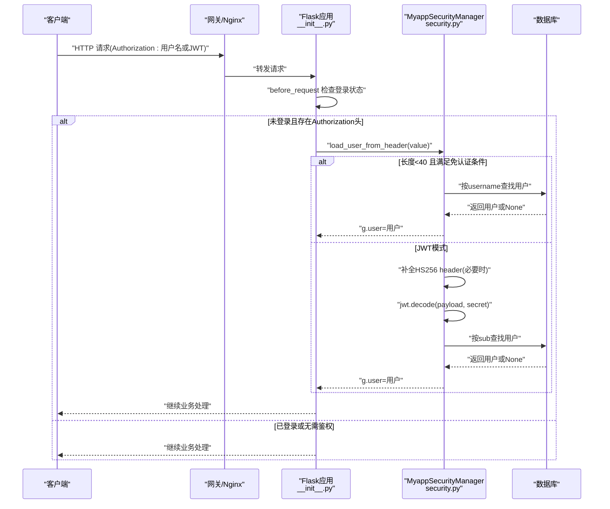
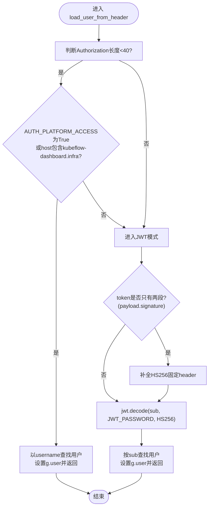
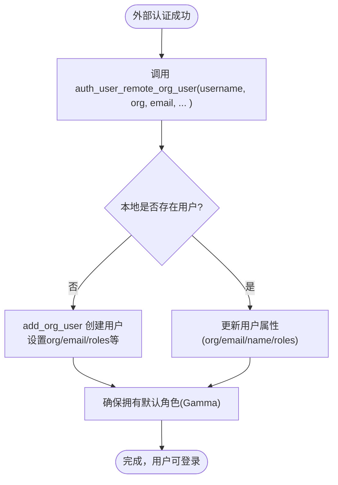
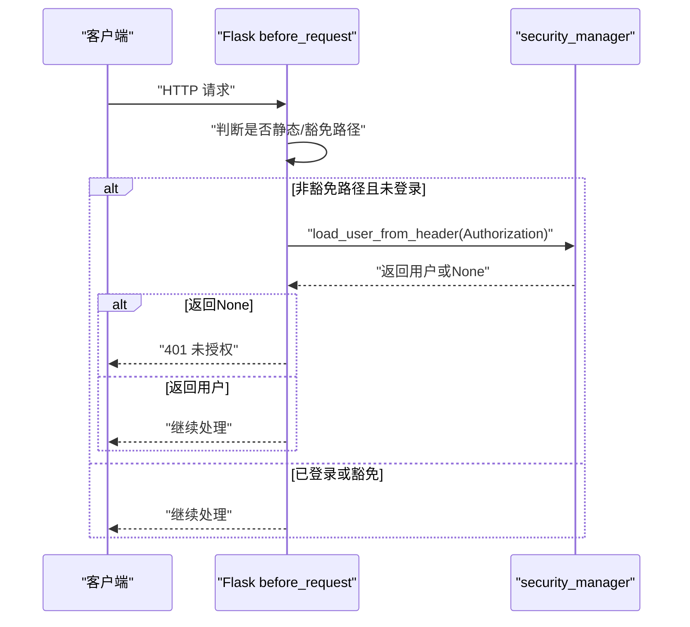
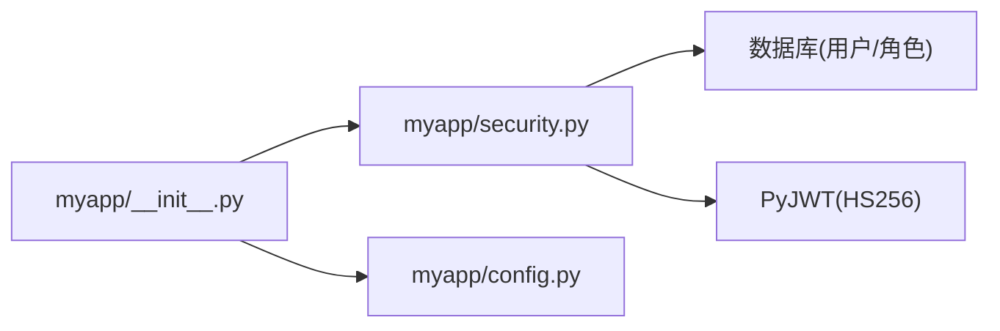

# SSO单点登录集成

<cite>
**本文引用的文件**   
- [myapp/security.py](file://myapp/security.py)
- [myapp/__init__.py](file://myapp/__init__.py)
- [myapp/config.py](file://myapp/config.py)
</cite>

## 目录
1. [简介](#简介)
2. [项目结构](#项目结构)
3. [核心组件](#核心组件)
4. [架构总览](#架构总览)
5. [详细组件分析](#详细组件分析)
6. [依赖关系分析](#依赖关系分析)
7. [性能与可扩展性](#性能与可扩展性)
8. [故障排查指南](#故障排查指南)
9. [结论](#结论)
10. [附录：配置项速查](#附录配置项速查)

## 简介
本文面向需要在 CubeStudio 中接入外部认证系统（SSO）的工程师，系统性说明如何通过请求头完成用户识别、自动注册与组织信息同步，并给出两种认证模式的具体实现原理与落地方式：
- 用户名免认证模式：通过 Authorization 头直接携带用户名进行识别，适用于受信任的内部网关或代理。
- JWT Token 认证模式：通过 HS256 签名的 JWT 进行身份校验，适合对接 OIDC/CAS/LDAP 等外部认证源。

同时文档覆盖以下关键点：
- AUTH_PLATFORM_ACCESS 配置选项的作用与使用场景
- K8s 内部域名白名单机制（kubeflow-dashboard.infra）
- 首次登录用户自动注册与属性同步流程
- 常见 SSO 提供商（LDAP/OIDC/CAS）的集成思路与注意事项
- 认证失败处理与排障建议

## 项目结构
CubeStudio 的认证逻辑主要位于后端 Python 应用中，关键路径如下：
- 应用启动与安全中间件装配：myapp/__init__.py
- 安全策略与用户加载器：myapp/security.py
- 全局配置与默认值：myapp/config.py

图表来源
- [myapp/__init__.py:259-287](file://myapp/__init__.py#L259-L287)
- [myapp/security.py:237-286](file://myapp/security.py#L237-L286)

章节来源
- [myapp/__init__.py:259-287](file://myapp/__init__.py#L259-L287)
- [myapp/security.py:237-286](file://myapp/security.py#L237-L286)
- [myapp/config.py:76-90](file://myapp/config.py#L76-L90)

## 核心组件
- MyappSecurityManager：继承自 FAB 的 SecurityManager，扩展了基于 Header 的用户加载逻辑、用户自动注册与组织信息同步能力。
- load_user_from_header：核心方法，支持“用户名免认证”和“JWT Token 认证”两种模式。
- before_request 钩子：在请求进入控制器前统一进行鉴权，若未登录则尝试从 Authorization 头解析用户。
- add_org_user / auth_user_remote_org_user：用于新用户自动注册与已有用户属性同步（包括组织 org、邮箱 email、姓名 first_name/last_name、角色 roles 等）。

章节来源
- [myapp/security.py:237-286](file://myapp/security.py#L237-L286)
- [myapp/security.py:311-381](file://myapp/security.py#L311-L381)
- [myapp/__init__.py:259-287](file://myapp/__init__.py#L259-L287)

## 架构总览
下图展示了从客户端到后端的安全处理链路，以及两种认证模式的分支逻辑。

图表来源
- [myapp/__init__.py:259-287](file://myapp/__init__.py#L259-L287)
- [myapp/security.py:258-286](file://myapp/security.py#L258-L286)

## 详细组件分析

### 1) load_user_from_header 实现原理
该方法根据 Authorization 头的值决定走哪条认证路径：
- 用户名免认证模式
  - 触发条件：Authorization 值长度小于 40，并且满足以下任一条件：
    - 全局开启 AUTH_PLATFORM_ACCESS = True
    - 访问主机包含 kubeflow-dashboard.infra（K8s 内部域名白名单）
  - 行为：将 Authorization 值视为 username，查询本地用户；若存在则设置 g.user 并放行。
- JWT Token 认证模式
  - 当不满足免认证条件时，视为 JWT。
  - 兼容短 token：如果只包含 payload.signature（两段），会自动补回固定的 HS256 header，以便 jwt.decode 正常解析。
  - 使用 HS256 算法与配置的 JWT_PASSWORD 校验签名，提取 sub 字段作为用户名，再查询本地用户。

注意：
- 免认证模式下不会校验密码或签名，仅做用户识别，因此必须确保上游网关可信。
- JWT 模式需要保证 JWT_PASSWORD 与签发方一致，否则验签失败。

图表来源
- [myapp/security.py:258-286](file://myapp/security.py#L258-L286)

章节来源
- [myapp/security.py:258-286](file://myapp/security.py#L258-L286)

### 2) 首次登录与用户自动注册、组织信息同步
当外部认证系统返回的用户名在本地不存在时，可通过以下接口完成自动注册与属性同步：
- add_org_user：创建新用户，设置用户名、昵称、组织 org、邮箱、角色 roles、激活状态等。
- auth_user_remote_org_user：对外暴露的统一入口，负责：
  - 查找用户，若不存在则调用 add_org_user 自动注册
  - 若用户存在但未激活，拒绝登录
  - 同步更新用户的 org、email、first_name、last_name 等属性
  - 确保用户具备默认角色（如 Gamma）

典型集成步骤：
- 在外部认证回调或网关注入逻辑中，调用 security_manager.auth_user_remote_org_user(...)
- 传入参数包括 username、org、email、first_name、last_name、roles 等
- 成功后该用户即可被后续请求通过 load_user_from_header 识别

图表来源
- [myapp/security.py:311-381](file://myapp/security.py#L311-L381)

章节来源
- [myapp/security.py:311-381](file://myapp/security.py#L311-L381)

### 3) 请求生命周期中的鉴权流程
Flask 应用在 before_request 阶段会：
- 跳过静态资源与特定路径（如 /static/, /logout, /login, /register, /health 等）
- 若当前未登录且请求携带 Authorization 头，则调用 security_manager.load_user_from_header 进行识别
- 若识别失败，返回 401；否则将用户写入 g.user 并继续处理

图表来源
- [myapp/__init__.py:259-287](file://myapp/__init__.py#L259-L287)

章节来源
- [myapp/__init__.py:259-287](file://myapp/__init__.py#L259-L287)

### 4) 配置项与开关
- AUTH_TYPE：FAB 认证类型，默认使用数据库认证（AUTH_DB）。
- AUTH_USER_REGISTRATION：是否允许用户自助注册（默认关闭）。
- AUTH_USER_REGISTRATION_ROLE：注册用户默认角色（默认 Gamma）。
- AUTH_HEADER_NAME：用于 API 认证的 Header 名称（默认 Authorization）。
- AUTH_PLATFORM_ACCESS：全局开关，启用后允许“用户名免认证”模式。
- JWT_PASSWORD：JWT 签名密钥（HS256），需与签发方保持一致。
- COOKIE_DOMAIN：可选，用于设置 Cookie 的 domain。

章节来源
- [myapp/config.py:76-90](file://myapp/config.py#L76-L90)
- [myapp/config.py:561-563](file://myapp/config.py#L561-L563)
- [myapp/security.py:264-278](file://myapp/security.py#L264-L278)

## 依赖关系分析
- myapp/__init__.py 负责应用初始化、中间件装配、before_request 钩子注册，并在未登录时委托给 security_manager 进行 Header 认证。
- myapp/security.py 定义 MyappSecurityManager，提供 load_user_from_header、用户自动注册与属性同步等方法。
- myapp/config.py 提供全局配置项，包括认证类型、默认角色、Cookie 域名、CORS、日志等。

图表来源
- [myapp/__init__.py:259-287](file://myapp/__init__.py#L259-L287)
- [myapp/security.py:237-286](file://myapp/security.py#L237-L286)
- [myapp/config.py:76-90](file://myapp/config.py#L76-L90)

章节来源
- [myapp/__init__.py:259-287](file://myapp/__init__.py#L259-L287)
- [myapp/security.py:237-286](file://myapp/security.py#L237-L286)
- [myapp/config.py:76-90](file://myapp/config.py#L76-L90)

## 性能与可扩展性
- 免认证模式仅在满足长度与策略条件时生效，避免对每个请求都进行昂贵的 JWT 验签。
- JWT 验签采用轻量级 HS256，开销较低；建议在网关层缓存用户信息以减少频繁数据库查询。
- 用户自动注册与属性同步可在外部认证回调中批量执行，避免每次请求重复落库。
- 建议结合 Redis 缓存用户基本信息（org、email、roles），降低数据库压力。

[本节为通用指导，不涉及具体文件]

## 故障排查指南
常见问题与定位要点：
- 401 未授权
  - 检查 before_request 是否正确拦截未登录请求。
  - 确认 Authorization 头是否由可信网关注入，内容是否符合预期（用户名或 JWT）。
  - 若使用 JWT 模式，核对 JWT_PASSWORD 是否与签发方一致。
- 免认证模式不生效
  - 检查 AUTH_PLATFORM_ACCESS 是否开启。
  - 检查访问 host 是否包含 kubeflow-dashboard.infra。
  - 确认 Authorization 值长度小于 40。
- JWT 解码失败
  - 检查 token 是否为三段式；若为两段式（payload.signature），代码会自动补全 HS256 header。
  - 检查 JWT 签名算法是否为 HS256，密钥是否匹配。
- 首次登录无法自动注册
  - 确认是否调用了 auth_user_remote_org_user 并完成用户创建。
  - 检查用户是否被标记为 active，未激活用户会被拒绝登录。
- 组织信息与属性不同步
  - 检查调用 auth_user_remote_org_user 时是否传入 org、email、first_name、last_name 等字段。
  - 确认数据库字段映射与默认角色（Gamma）是否正确添加。

章节来源
- [myapp/__init__.py:259-287](file://myapp/__init__.py#L259-L287)
- [myapp/security.py:258-286](file://myapp/security.py#L258-L286)
- [myapp/security.py:311-381](file://myapp/security.py#L311-L381)

## 结论
CubeStudio 通过 MyappSecurityManager 提供了灵活的 SSO 集成能力：既支持受信任网关注入的用户名免认证，也支持标准的 JWT Token 认证。配合自动注册与属性同步机制，能够快速对接 LDAP/OIDC/CAS 等外部认证系统。生产环境建议：
- 严格管控 Authorization 头的注入来源，避免安全风险。
- 合理配置 AUTH_PLATFORM_ACCESS 与 K8s 内部域名白名单。
- 使用强密钥管理 JWT_PASSWORD，并确保与签发方一致。
- 在外部认证回调中完善用户首次注册与属性同步逻辑。

[本节为总结性内容，不涉及具体文件]

## 附录：配置项速查
- AUTH_TYPE：认证类型（默认 AUTH_DB）
- AUTH_USER_REGISTRATION：是否允许用户注册（默认 False）
- AUTH_USER_REGISTRATION_ROLE：注册用户默认角色（默认 Gamma）
- AUTH_HEADER_NAME：API 认证 Header 名称（默认 Authorization）
- AUTH_PLATFORM_ACCESS：启用用户名免认证模式（布尔）
- JWT_PASSWORD：JWT 签名密钥（HS256）
- COOKIE_DOMAIN：Cookie 域名（可选）

章节来源
- [myapp/config.py:76-90](file://myapp/config.py#L76-L90)
- [myapp/config.py:561-563](file://myapp/config.py#L561-L563)
- [myapp/security.py:264-278](file://myapp/security.py#L264-L278)