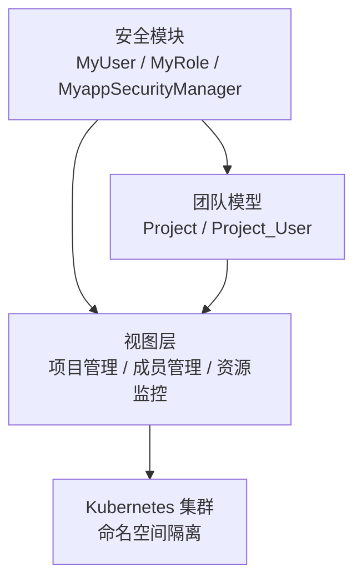
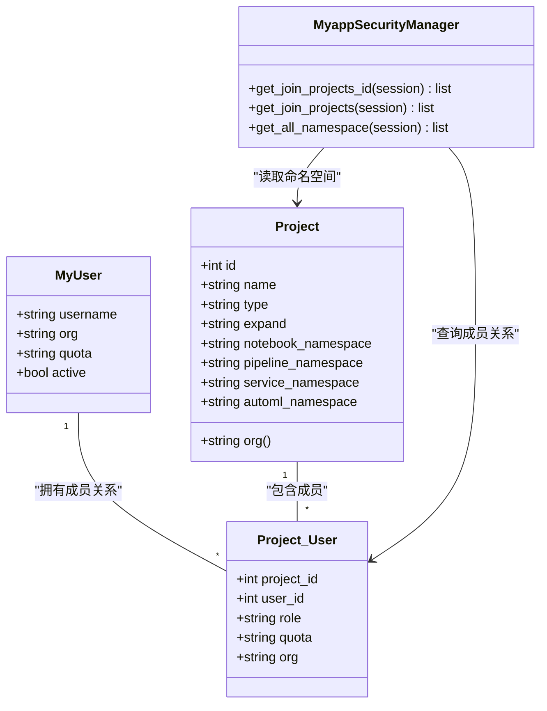
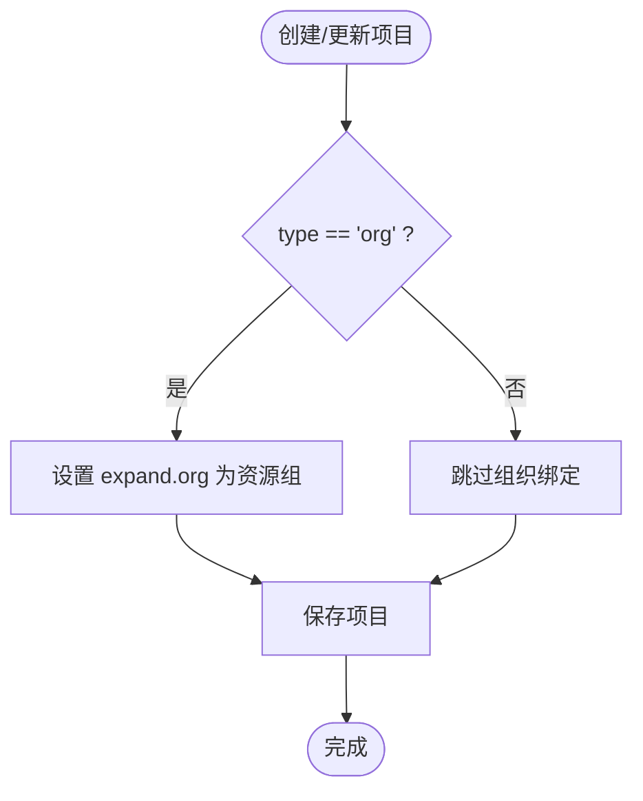
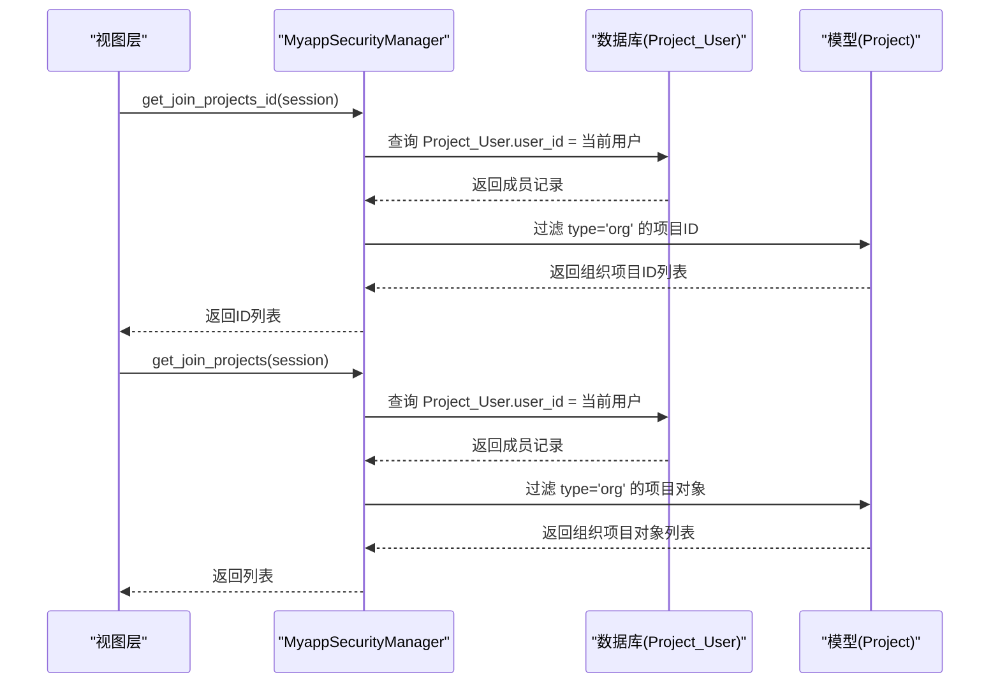
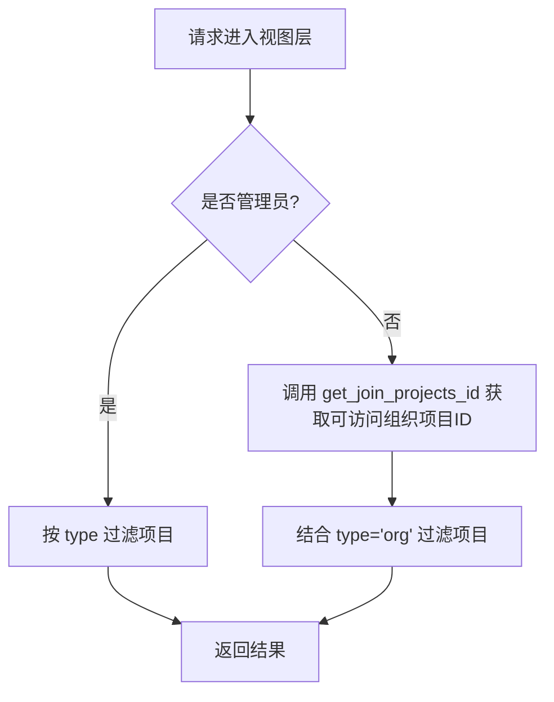
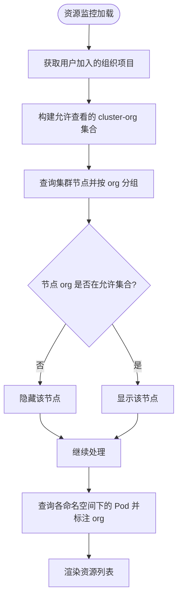
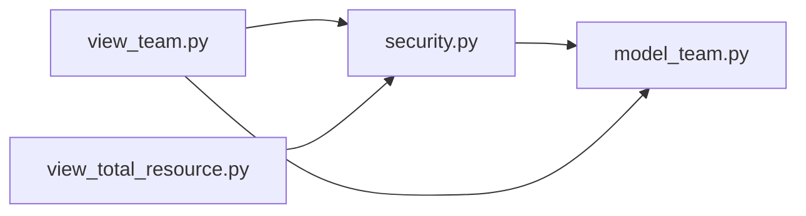

# 多租户隔离

<cite>
**本文引用的文件**   
- [security.py](file://myapp/security.py)
- [model_team.py](file://myapp/models/model_team.py)
- [view_team.py](file://myapp/views/view_team.py)
- [view_total_resource.py](file://myapp/views/view_total_resource.py)
</cite>

## 目录
1. [引言](#引言)
2. [项目结构](#项目结构)
3. [核心组件](#核心组件)
4. [架构总览](#架构总览)
5. [详细组件分析](#详细组件分析)
6. [依赖关系分析](#依赖关系分析)
7. [性能考虑](#性能考虑)
8. [故障排查指南](#故障排查指南)
9. [结论](#结论)
10. [附录](#附录)

## 引言
本文件面向“多租户隔离”机制，系统性阐述组织架构隔离、项目成员管理与资源隔离的实现方式。重点解析以下能力：
- 基于组织（org）与项目（project）的权限过滤与数据隔离
- get_join_projects_id 与 get_join_projects 的实现原理与使用场景
- 命名空间隔离（notebook/pipeline/service/automl）与跨租户访问控制
- 资源配额管理（用户级与项目级）及可视化展示中的租户可见性控制

## 项目结构
围绕多租户隔离的核心代码分布在安全模块、团队模型与视图层：
- 安全与认证：扩展用户模型、角色与安全管理器，提供组织字段、JWT 认证、加入项目的查询方法
- 团队模型：定义 Project 与 Project_User，承载组织类型、成员角色、配额等
- 视图层：在项目管理、成员管理、资源监控等页面中应用组织与项目维度的过滤

图表来源
- [security.py:47-106](file://myapp/security.py#L47-L106)
- [model_team.py:26-225](file://myapp/models/model_team.py#L26-L225)
- [view_team.py:44-149](file://myapp/views/view_team.py#L44-L149)
- [view_total_resource.py:67-131](file://myapp/views/view_total_resource.py#L67-L131)

章节来源
- [security.py:47-106](file://myapp/security.py#L47-L106)
- [model_team.py:26-225](file://myapp/models/model_team.py#L26-L225)
- [view_team.py:44-149](file://myapp/views/view_team.py#L44-L149)
- [view_total_resource.py:67-131](file://myapp/views/view_total_resource.py#L67-L131)

## 核心组件
- 用户与组织
  - 用户模型扩展了 org（组织架构）、quota（资源配额）、balance（余额）等字段，用于标识租户归属与计费/配额能力
- 项目与成员
  - Project.type 区分组织型项目（org）与其他类型（如 job-template），用于决定哪些项目参与组织级隔离
  - Project_User 记录用户在项目中的角色（dev/ops/creator）以及项目级 quota 与 org 标签
- 安全管理器
  - 提供 get_join_projects_id/get_join_projects 等方法，按当前用户返回其可访问的组织型项目集合
  - 提供 namespace 聚合方法，汇总各项目的 notebook/pipeline/service/automl 命名空间

章节来源
- [security.py:47-106](file://myapp/security.py#L47-L106)
- [model_team.py:26-225](file://myapp/models/model_team.py#L26-L225)
- [security.py:408-490](file://myapp/security.py#L408-L490)

## 架构总览
多租户隔离通过“组织 + 项目 + 成员 + 命名空间”四层协同实现：
- 组织维度：用户关联 org；项目 expand.org 标记资源组
- 项目维度：type=org 的项目作为组织边界，成员通过 Project_User 加入
- 成员维度：角色（dev/ops/creator）决定编辑/删除等权限
- 命名空间维度：每个项目映射到 K8s 命名空间（notebook/pipeline/service/automl），实现运行时资源隔离

图表来源
- [security.py:47-106](file://myapp/security.py#L47-L106)
- [model_team.py:26-225](file://myapp/models/model_team.py#L26-L225)
- [security.py:408-490](file://myapp/security.py#L408-L490)

## 详细组件分析

### 组织与项目模型（Project / Project_User）
- Project
  - type 字段用于区分组织型项目（org）与其他类型（如 job-template）
  - expand 存储集群、挂载、SERVICE_EXTERNAL_IP、org 等资源相关配置
  - 提供 node_selector、volume_mount、cluster、org 等属性，支撑调度与资源分配
  - 提供 notebook_namespace/pipeline_namespace/service_namespace/automl_namespace 属性，统一从全局配置获取命名空间
- Project_User
  - 记录用户与项目的成员关系，role 支持 dev/ops/creator
  - 支持项目级 quota 与 org 标签，便于配额与资源组控制

图表来源
- [model_team.py:26-174](file://myapp/models/model_team.py#L26-L174)

章节来源
- [model_team.py:26-225](file://myapp/models/model_team.py#L26-L225)

### 安全管理器与加入项目查询（get_join_projects_id / get_join_projects）
- get_join_projects_id
  - 根据当前用户查询其加入的所有 Project_User 记录
  - 仅返回 type='org' 的项目 ID 列表，确保组织级隔离
- get_join_projects
  - 同上，但返回完整的 Project 对象列表（同样限制 type='org'）
- 使用场景
  - 在视图层进行组织型项目过滤（例如只列出用户可访问的组织项目）
  - 在资源监控中按组织与集群组合过滤节点与 Pod 可见范围

图表来源
- [security.py:408-426](file://myapp/security.py#L408-L426)
- [model_team.py:26-225](file://myapp/models/model_team.py#L26-L225)

章节来源
- [security.py:408-426](file://myapp/security.py#L408-L426)
- [model_team.py:26-225](file://myapp/models/model_team.py#L26-L225)

### 视图层组织过滤与成员管理
- Project_Join_Filter
  - 管理员直接按 type 过滤；普通用户先调用 security_manager.get_join_projects_id 获取可访问组织项目ID，再结合 type 过滤
- filter_join_org_project
  - 非管理员时，仅返回用户已加入且 type='org' 的项目
- Project_ModelView_org_Api
  - 针对 type='org' 的项目，提供增删改查接口，并在新增时自动将当前用户设为 creator
  - 支持 expand 参数校验与修正（如 volume_mount 格式）

图表来源
- [view_team.py:44-51](file://myapp/views/view_team.py#L44-L51)
- [view_team.py:141-149](file://myapp/views/view_team.py#L141-L149)
- [view_team.py:233-363](file://myapp/views/view_team.py#L233-L363)
- [security.py:408-426](file://myapp/security.py#L408-L426)

章节来源
- [view_team.py:44-51](file://myapp/views/view_team.py#L44-L51)
- [view_team.py:141-149](file://myapp/views/view_team.py#L141-L149)
- [view_team.py:233-363](file://myapp/views/view_team.py#L233-L363)

### 资源隔离与配额管理
- 命名空间隔离
  - 每个项目映射到统一的 notebook/pipeline/service/automl 命名空间（由全局配置决定）
  - 安全管理器提供 get_all_namespace 等方法汇总所有命名空间
- 资源监控中的租户可见性
  - 非管理员用户仅能查看其加入的组织项目对应的集群与资源组（cluster_name + org）
  - 节点与 Pod 列表按 org 标签分组，未授权的资源组被隐藏
- 配额字段
  - 用户级 quota（MyUser.quota）与项目级 quota（Project_User.quota）可用于后续配额校验与计量

图表来源
- [view_total_resource.py:67-131](file://myapp/views/view_total_resource.py#L67-L131)
- [security.py:439-490](file://myapp/security.py#L439-L490)

章节来源
- [view_total_resource.py:67-131](file://myapp/views/view_total_resource.py#L67-L131)
- [security.py:439-490](file://myapp/security.py#L439-L490)

## 依赖关系分析
- 安全模块依赖团队模型以查询成员关系与项目信息
- 视图层依赖安全模块提供的加入项目查询方法，以实现组织级数据过滤
- 资源监控依赖安全模块的命名空间聚合方法与加入项目查询，以限制可见范围

图表来源
- [security.py:408-490](file://myapp/security.py#L408-L490)
- [model_team.py:26-225](file://myapp/models/model_team.py#L26-L225)
- [view_team.py:44-149](file://myapp/views/view_team.py#L44-L149)
- [view_total_resource.py:67-131](file://myapp/views/view_total_resource.py#L67-L131)

章节来源
- [security.py:408-490](file://myapp/security.py#L408-L490)
- [model_team.py:26-225](file://myapp/models/model_team.py#L26-L225)
- [view_team.py:44-149](file://myapp/views/view_team.py#L44-L149)
- [view_total_resource.py:67-131](file://myapp/views/view_total_resource.py#L67-L131)

## 性能考虑
- 加入项目查询
  - get_join_projects_id/get_join_projects 会扫描 Project_User 表，建议在高频调用处增加缓存（如 Redis）以减少数据库压力
- 命名空间聚合
  - get_all_namespace 遍历所有项目收集命名空间，建议对静态配置或低频变更的数据做缓存
- 资源监控
  - 节点与 Pod 指标采集耗时较长，已在 view_total_resource.py 中使用缓存策略（cache.set/get），注意合理设置过期时间以避免数据陈旧

[本节为通用指导，不直接分析具体文件]

## 故障排查指南
- 无法看到组织项目
  - 检查当前用户是否已通过 Project_User 加入对应组织项目
  - 确认 Project.type 是否为 'org'
  - 验证 security_manager.get_join_projects_id 返回结果是否符合预期
- 资源监控中节点不可见
  - 检查节点的 labels.org 是否与用户加入的组织项目 expand.org 匹配
  - 确认非管理员用户的 joined_cluster_org 过滤逻辑是否正确
- 配额字段未生效
  - 确认 MyUser.quota 与 Project_User.quota 是否已正确填写
  - 在业务逻辑中显式读取并校验配额字段

章节来源
- [security.py:408-426](file://myapp/security.py#L408-L426)
- [model_team.py:26-225](file://myapp/models/model_team.py#L26-L225)
- [view_total_resource.py:67-131](file://myapp/views/view_total_resource.py#L67-L131)

## 结论
本项目通过“组织 + 项目 + 成员 + 命名空间”的多层设计实现了稳健的多租户隔离：
- 组织边界由 type='org' 的项目界定，成员关系通过 Project_User 维护
- 安全管理器提供加入项目查询与命名空间聚合，支撑视图层与资源监控的租户可见性控制
- 命名空间隔离确保运行时的资源隔离，配额字段为用户与项目级资源管控奠定基础

[本节为总结性内容，不直接分析具体文件]

## 附录

### 常见隔离场景与实现要点
- 租户级数据隔离
  - 在查询前调用 get_join_projects_id 获取可访问组织项目ID，并以 in_ 条件过滤业务数据
- 跨租户访问控制
  - 非管理员用户仅能访问其加入的组织项目；管理员可访问全部组织项目
- 资源配额管理
  - 用户级配额（MyUser.quota）与项目级配额（Project_User.quota）可在业务逻辑中进行校验与限制

[本节为概念性说明，不直接分析具体文件]