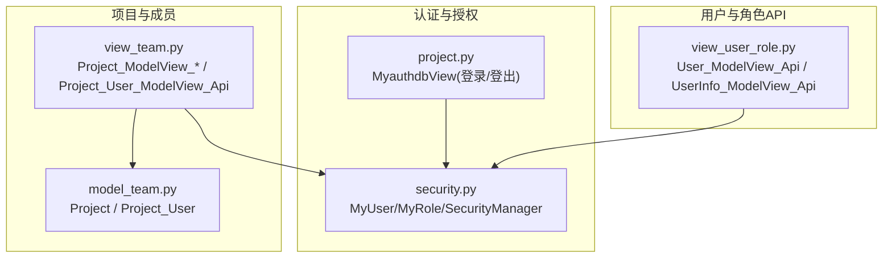
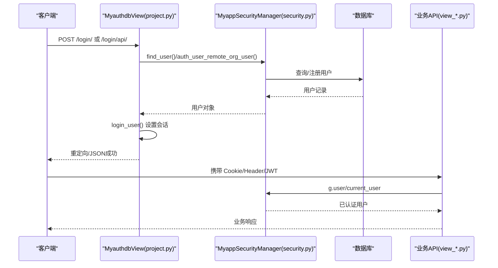
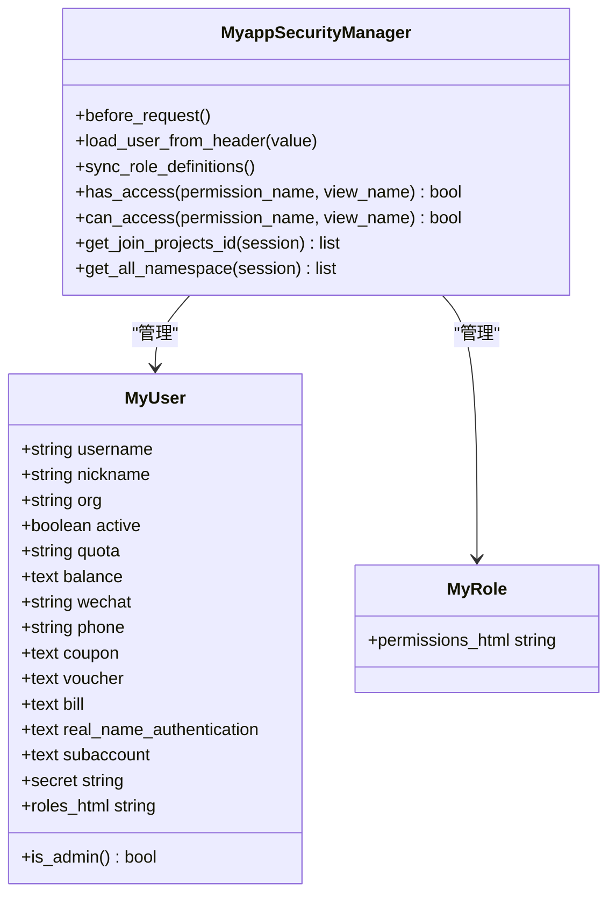
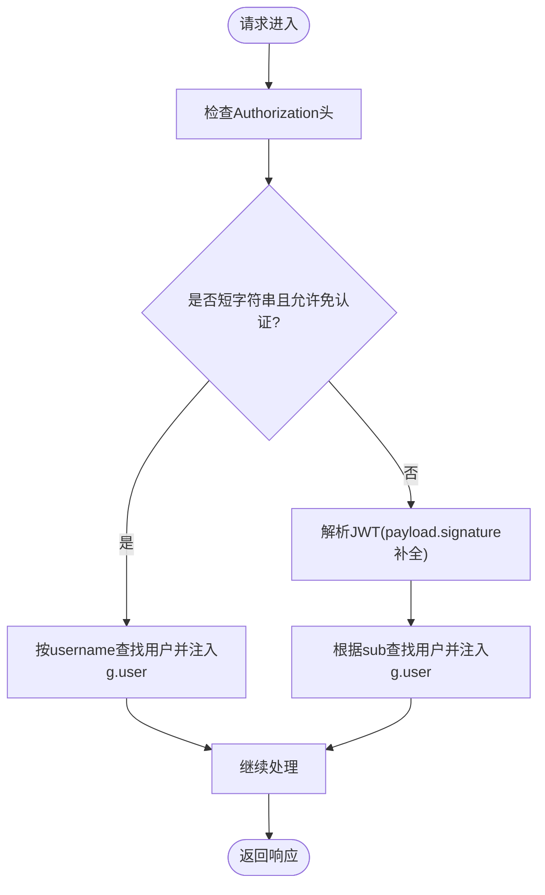
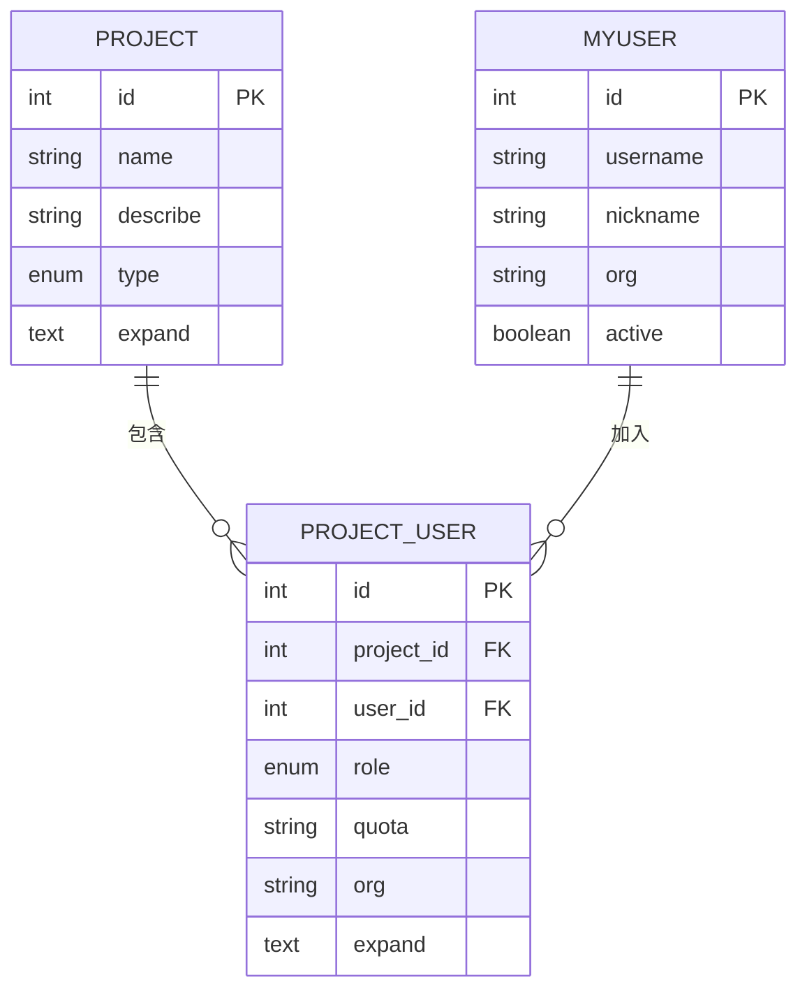
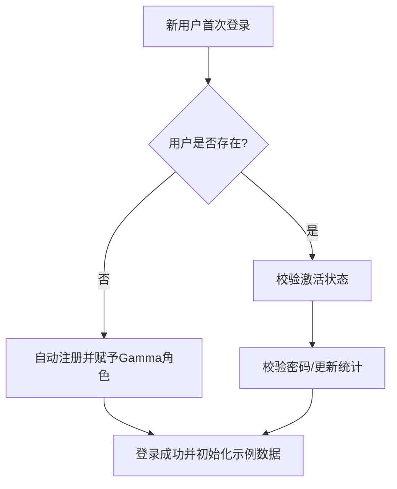
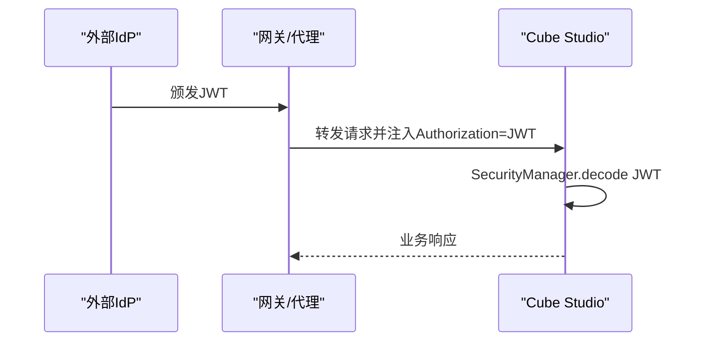
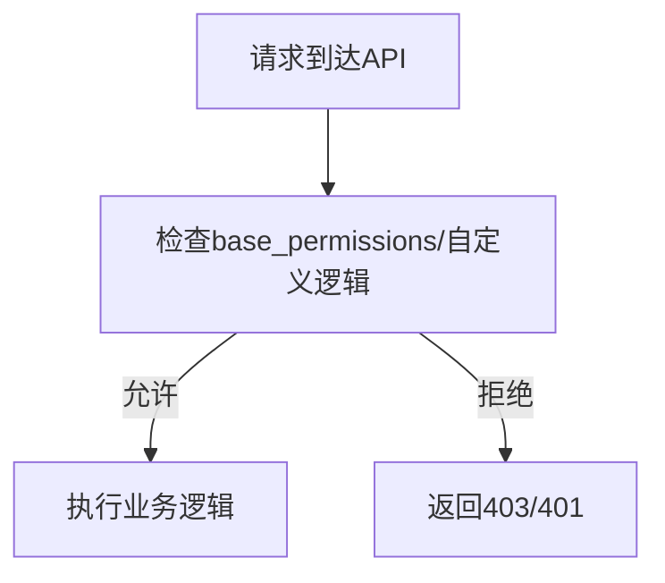
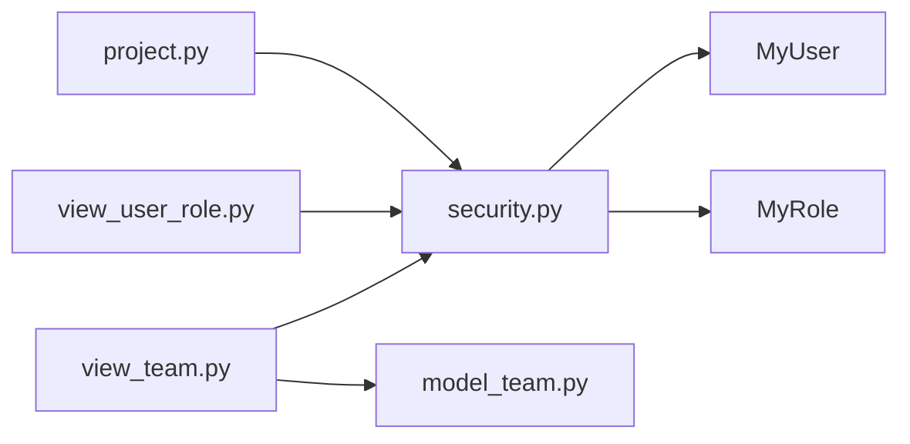

# 用户权限管理

<cite>
**本文引用的文件**   
- [security.py](file://myapp/security.py)
- [project.py](file://myapp/project.py)
- [view_user_role.py](file://myapp/views/view_user_role.py)
- [model_team.py](file://myapp/models/model_team.py)
- [view_team.py](file://myapp/views/view_team.py)
</cite>

## 目录
1. [引言](#引言)
2. [项目结构](#项目结构)
3. [核心组件](#核心组件)
4. [架构总览](#架构总览)
5. [详细组件分析](#详细组件分析)
6. [依赖关系分析](#依赖关系分析)
7. [性能考虑](#性能考虑)
8. [故障排查指南](#故障排查指南)
9. [结论](#结论)
10. [附录：常见权限场景与配置示例](#附录常见权限场景与配置示例)

## 引言
本文件面向“用户权限管理模块”的开发者与运维人员，系统性阐述用户管理体系、RBAC 权限控制机制、多租户（项目组）隔离实现以及 SSO/单点登录集成方案。文档覆盖以下主题：
- 用户生命周期管理（注册、激活、信息维护、密码策略）
- RBAC 角色与权限模型（内置角色、自定义视图权限、菜单控制）
- 多租户与项目组隔离（组织级项目、成员角色、资源命名空间）
- 认证授权流程（表单登录、Token/Header 免密、JWT 校验）
- 会话管理与安全最佳实践
- 常见问题与排障指引

## 项目结构
权限相关代码主要分布在以下模块：
- 安全与认证：myapp/security.py
- 登录视图与退出：myapp/project.py
- 用户与角色 API：myapp/views/view_user_role.py
- 项目与成员模型：myapp/models/model_team.py
- 项目与成员管理视图：myapp/views/view_team.py

**图示来源**
- [security.py:47-106](file://myapp/security.py#L47-L106)
- [project.py:42-181](file://myapp/project.py#L42-L181)
- [view_user_role.py:27-115](file://myapp/views/view_user_role.py#L27-L115)
- [model_team.py:26-225](file://myapp/models/model_team.py#L26-L225)
- [view_team.py:53-129](file://myapp/views/view_team.py#L53-L129)

**章节来源**
- [security.py:47-106](file://myapp/security.py#L47-L106)
- [project.py:42-181](file://myapp/project.py#L42-L181)
- [view_user_role.py:27-115](file://myapp/views/view_user_role.py#L27-L115)
- [model_team.py:26-225](file://myapp/models/model_team.py#L26-L225)
- [view_team.py:53-129](file://myapp/views/view_team.py#L53-L129)

## 核心组件
- 用户与角色扩展
  - MyUser：在基础 User 上扩展昵称、组织、配额、余额、微信、电话、优惠券、代金券、发票、实名认证、子账户等字段；提供 is_admin、secret(JWT)、roles_html 等能力。
  - MyRole：在基础 Role 上提供 permissions_html 展示。
- 安全管理器
  - MyappSecurityManager：注入 header 认证加载器、定义 before_request、load_user_from_header、has_access/can_access、同步默认角色、获取用户参与的项目与命名空间等。
- 登录视图
  - MyauthdbView：提供 /login/api/ 与 /login/ 接口，支持 token 快速登录、用户名+密码登录、自动注册、状态统计更新、登录后初始化默认角色与示例数据。
- 用户与角色 API
  - User_ModelView_Api：基于 Flask-AppBuilder 的 REST API，暴露用户列表/详情等能力。
  - UserInfo_ModelView_Api：当前用户信息 GET/POST，包含 roles、org、secret 等。
- 项目与成员
  - Project：项目分组（类型包括 org/job-template/model），提供 user_role、get_creators、namespace/volume_mount/cluster/org 等属性。
  - Project_User：项目-用户关联，含角色 dev/ops/creator、配额、组织、扩展参数。
- 项目管理视图
  - Project_ModelView_org_Api：组织项目 CRUD，限制编辑/删除权限，创建时自动将当前用户设为 creator。
  - Project_User_ModelView_Api：组成员管理，仅 creator 或 admin 可增删改。

**章节来源**
- [security.py:47-106](file://myapp/security.py#L47-L106)
- [security.py:237-491](file://myapp/security.py#L237-L491)
- [project.py:42-181](file://myapp/project.py#L42-L181)
- [view_user_role.py:27-115](file://myapp/views/view_user_role.py#L27-L115)
- [model_team.py:26-225](file://myapp/models/model_team.py#L26-L225)
- [view_team.py:152-374](file://myapp/views/view_team.py#L152-L374)

## 架构总览
下图展示了认证、授权、项目隔离与 API 访问的整体流程。

**图示来源**
- [project.py:45-168](file://myapp/project.py#L45-L168)
- [security.py:247-286](file://myapp/security.py#L247-L286)

## 详细组件分析

### 用户与角色模型（RBAC）
- 用户扩展字段与能力
  - 账号基本信息、组织、配额、余额、联系方式、票据、认证、子账户等。
  - is_admin：通过角色名判断是否为管理员。
  - secret：生成 JWT（HS256），用于服务间调用或短 Token 场景。
- 角色与权限
  - 默认角色 Admin/Gamma 由 SecurityManager 同步。
  - 权限以视图菜单维度进行控制，可通过 BaseView/ModelView 的 base_permissions 控制。

**图示来源**
- [security.py:47-106](file://myapp/security.py#L47-L106)
- [security.py:237-491](file://myapp/security.py#L237-L491)

**章节来源**
- [security.py:47-106](file://myapp/security.py#L47-L106)
- [security.py:237-491](file://myapp/security.py#L237-L491)

### 认证与授权流程
- 登录入口
  - /login/api/：支持 token 快速登录，成功后设置 remember=True。
  - /login/：表单登录，支持用户名/邮箱、密码校验、未激活拦截、自动注册、统计更新、初始化默认角色与示例数据。
- Header/JWT 认证
  - SecurityManager.before_request 将 current_user 注入 g.user。
  - load_user_from_header：
    - 短字符串（长度小于阈值）且开启全局平台访问或来自 K8s 内部域名时，按用户名免认证。
    - 否则作为 JWT 解码（兼容两段式 payload.signature）。
- has_access/can_access
  - 当前实现偏向宽松：只要已认证或存在 JWT 即放行，便于后续接入细粒度权限控制。

**图示来源**
- [security.py:247-286](file://myapp/security.py#L247-L286)

**章节来源**
- [project.py:45-168](file://myapp/project.py#L45-L168)
- [security.py:247-286](file://myapp/security.py#L247-L286)

### 多租户与项目组隔离
- 项目模型
  - Project.type 区分 org/job-template/model。
  - 提供 user_role(user_id)、get_creators、namespace/volume_mount/cluster/org 等属性，用于资源隔离与调度。
- 成员模型
  - Project_User 记录用户在项目中的角色（dev/ops/creator）、配额、组织、扩展参数。
- 权限控制
  - 仅 creator 或 admin 可添加/修改组成员。
  - 非 admin 用户只能看到自己为 owner 的组织项目。
  - 创建组织项目时自动将当前用户设置为 creator。

**图示来源**
- [model_team.py:26-225](file://myapp/models/model_team.py#L26-L225)

**章节来源**
- [model_team.py:26-225](file://myapp/models/model_team.py#L26-L225)
- [view_team.py:53-129](file://myapp/views/view_team.py#L53-L129)
- [view_team.py:152-374](file://myapp/views/view_team.py#L152-L374)

### 用户生命周期管理
- 注册与激活
  - 首次登录若不存在则自动注册，分配 Gamma 角色并激活。
  - 支持明文/哈希密码兼容，统一在入库前加密。
- 信息维护
  - 个人信息 API 支持修改昵称、邮箱、组织、密码等。
  - 用户名/邮箱唯一性校验。
- 角色与权限
  - 默认角色 Admin/Gamma 由 SecurityManager 同步。
  - 用户创建时自动附加 Gamma 角色。

**图示来源**
- [project.py:106-168](file://myapp/project.py#L106-L168)
- [security.py:311-381](file://myapp/security.py#L311-L381)

**章节来源**
- [project.py:106-168](file://myapp/project.py#L106-L168)
- [security.py:311-381](file://myapp/security.py#L311-L381)
- [view_user_role.py:78-115](file://myapp/views/view_user_role.py#L78-L115)

### SSO 单点登录集成
- 支持两种模式：
  - Header 免认证：当 Authorization 值为短字符串且满足条件（全局开关或 K8s 内部域名）时，直接按用户名加载用户。
  - JWT 免认证：Authorization 为 JWT（兼容两段式），解码后取 sub 字段加载用户。
- 建议对接外部 IdP：
  - 在网关层签发 JWT，后端使用 SecurityManager.load_user_from_header 完成无感鉴权。
  - 如需与现有 Cookie 会话共存，可在登录成功后保持双通道身份。

**图示来源**
- [security.py:258-286](file://myapp/security.py#L258-L286)

**章节来源**
- [security.py:258-286](file://myapp/security.py#L258-L286)

### 菜单控制与接口访问类型限制
- 菜单控制
  - 通过 Flask-AppBuilder 的 ModelView/RestApi 的 base_permissions 控制菜单项可见性与操作按钮。
  - 例如组织项目 API 对非 admin 仅暴露 can_list/can_show。
- 接口访问类型限制
  - 当前 has_access/can_access 实现较宽松，建议在业务 API 中结合 g.user 的角色与项目成员关系做二次校验。
  - 可按需扩展 SecurityManager.has_access 实现细粒度权限判定。

**图示来源**
- [view_team.py:223-229](file://myapp/views/view_team.py#L223-L229)
- [view_team.py:357-362](file://myapp/views/view_team.py#L357-L362)
- [security.py:383-398](file://myapp/security.py#L383-L398)

**章节来源**
- [view_team.py:223-229](file://myapp/views/view_team.py#L223-L229)
- [view_team.py:357-362](file://myapp/views/view_team.py#L357-L362)
- [security.py:383-398](file://myapp/security.py#L383-L398)

## 依赖关系分析
- 组件耦合
  - SecurityManager 与 MyUser/MyRole 强耦合，负责用户加载、角色同步与权限钩子。
  - 登录视图依赖 SecurityManager 的用户查询与统计更新。
  - 项目与成员视图依赖 model_team 模型，并通过 SecurityManager 获取当前用户上下文。
- 外部依赖
  - Flask-Login、Flask-JWT-Extended、Flask-AppBuilder、SQLAlchemy。

**图示来源**
- [security.py:47-106](file://myapp/security.py#L47-L106)
- [project.py:42-181](file://myapp/project.py#L42-L181)
- [view_user_role.py:27-115](file://myapp/views/view_user_role.py#L27-L115)
- [model_team.py:26-225](file://myapp/models/model_team.py#L26-L225)
- [view_team.py:53-129](file://myapp/views/view_team.py#L53-L129)

**章节来源**
- [security.py:47-106](file://myapp/security.py#L47-L106)
- [project.py:42-181](file://myapp/project.py#L42-L181)
- [view_user_role.py:27-115](file://myapp/views/view_user_role.py#L27-L115)
- [model_team.py:26-225](file://myapp/models/model_team.py#L26-L225)
- [view_team.py:53-129](file://myapp/views/view_team.py#L53-L129)

## 性能考虑
- 用户加载
  - load_user_from_header 每次请求都会进行 JWT 解码或用户名查找，建议：
    - 启用服务端缓存（如 Redis）缓存用户对象与角色权限。
    - 合理设置 JWT 有效期，减少频繁刷新。
- 项目成员查询
  - get_join_projects/get_join_projects_id 会扫描 project_user 表，建议在高频路径引入缓存或预计算。
- 命名空间聚合
  - get_all_namespace 等方法遍历所有项目，建议按需分页或缓存结果。

[本节为通用指导，不直接分析具体文件]

## 故障排查指南
- 无法登录或提示未找到用户
  - 检查 /login/api/ 传入的 token 是否正确，或 /login/ 用户名/邮箱与密码是否匹配。
  - 确认用户是否被自动注册且处于激活状态。
- Header/JWT 认证失败
  - 确认 Authorization 头格式：短字符串或完整 JWT（两段式会自动补全头部）。
  - 检查 JWT_PASSWORD 配置是否与签发端一致。
- 无权限访问接口
  - 检查 base_permissions 配置与当前用户角色。
  - 确认 has_access/can_access 是否被重写为宽松逻辑，必要时改为严格校验。
- 无法管理组成员
  - 确认当前用户是否为 creator 或 admin。
  - 检查 Project_User 表中是否存在对应记录。

**章节来源**
- [project.py:45-168](file://myapp/project.py#L45-L168)
- [security.py:258-286](file://myapp/security.py#L258-L286)
- [security.py:383-398](file://myapp/security.py#L383-L398)
- [view_team.py:97-118](file://myapp/views/view_team.py#L97-L118)

## 结论
该权限模块以 Flask-AppBuilder 为基础，扩展了用户与角色模型，实现了灵活的认证方式（表单、Header、JWT）与基础的 RBAC 控制。通过 Project/Project_User 模型实现了多租户隔离，配合视图层的权限校验，可满足常见的企业级权限需求。建议在后续迭代中完善 has_access/can_access 的细粒度权限判定，并结合缓存优化高频查询路径。

[本节为总结性内容，不直接分析具体文件]

## 附录：常见权限场景与配置示例
- 自定义权限验证
  - 在 SecurityManager.has_access 中根据 g.user.roles 与目标 view_name 进行判定，返回 True/False。
  - 参考路径：[security.py:383-389](file://myapp/security.py#L383-L389)
- 菜单控制
  - 在 ModelView/RestApi 中设置 base_permissions 控制菜单与按钮可见性。
  - 参考路径：[view_team.py:223-229](file://myapp/views/view_team.py#L223-L229), [view_team.py:357-362](file://myapp/views/view_team.py#L357-L362)
- 接口访问类型限制
  - 在业务 API 中读取 g.user 并结合项目成员关系进行二次校验。
  - 参考路径：[security.py:247-250](file://myapp/security.py#L247-L250), [view_team.py:97-118](file://myapp/views/view_team.py#L97-L118)
- 多租户隔离
  - 通过 Project.type='org' 与 Project_User.role 控制成员权限。
  - 参考路径：[model_team.py:26-225](file://myapp/models/model_team.py#L26-L225), [view_team.py:141-149](file://myapp/views/view_team.py#L141-L149)
- SSO 集成
  - 在网关层签发 JWT，后端使用 load_user_from_header 完成鉴权。
  - 参考路径：[security.py:258-286](file://myapp/security.py#L258-L286)