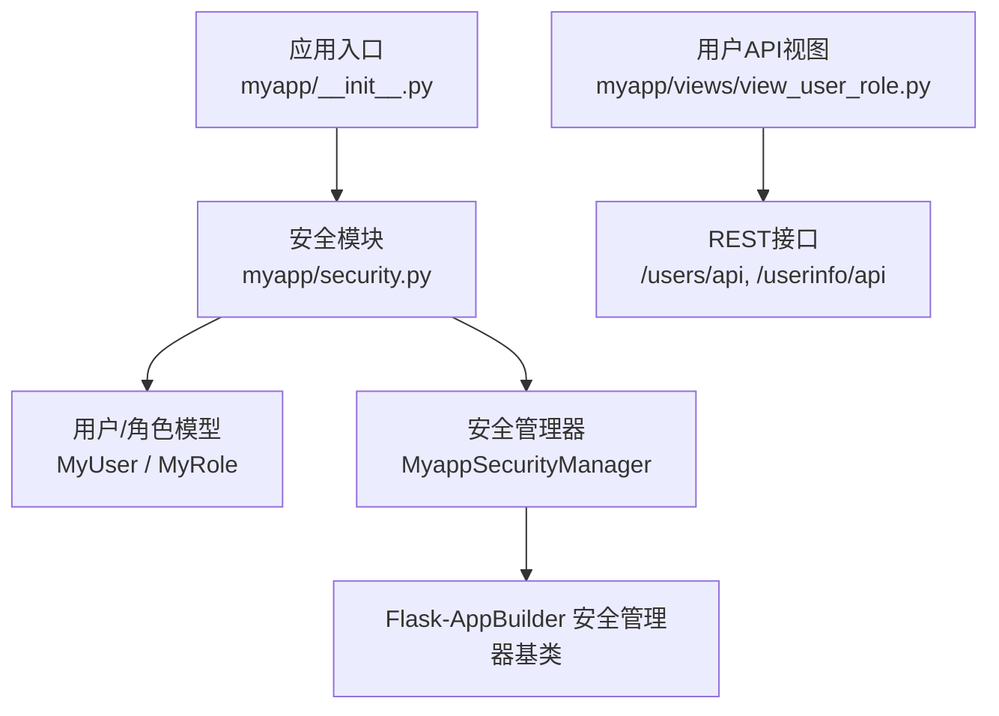
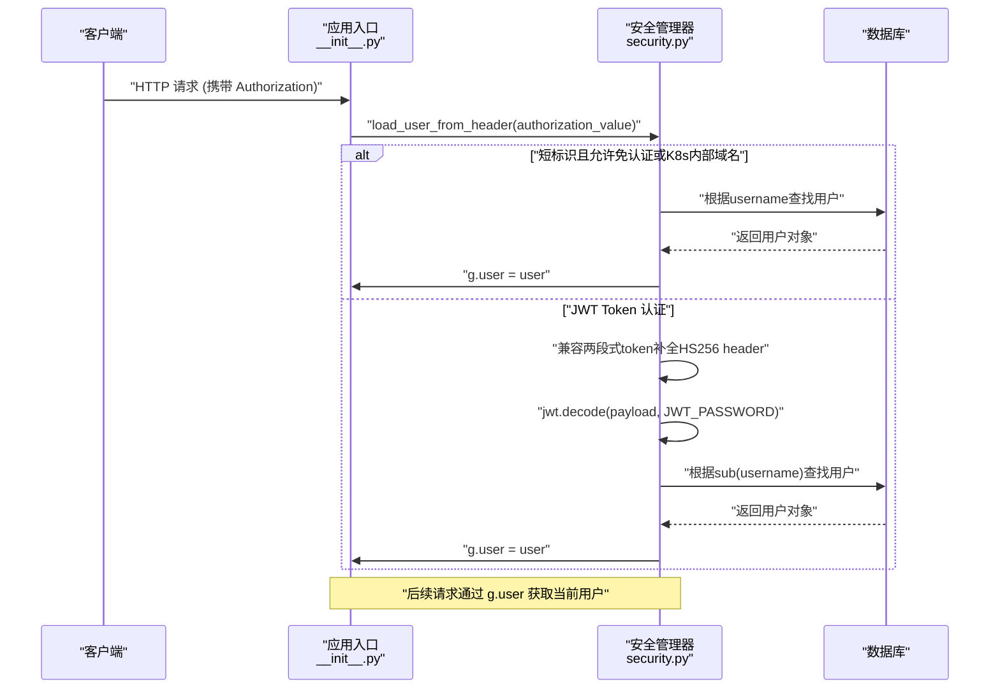
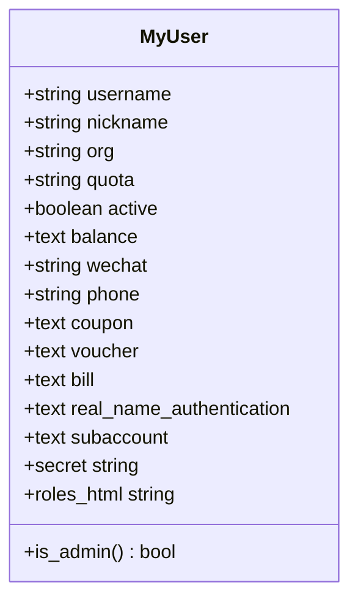
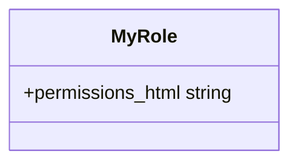
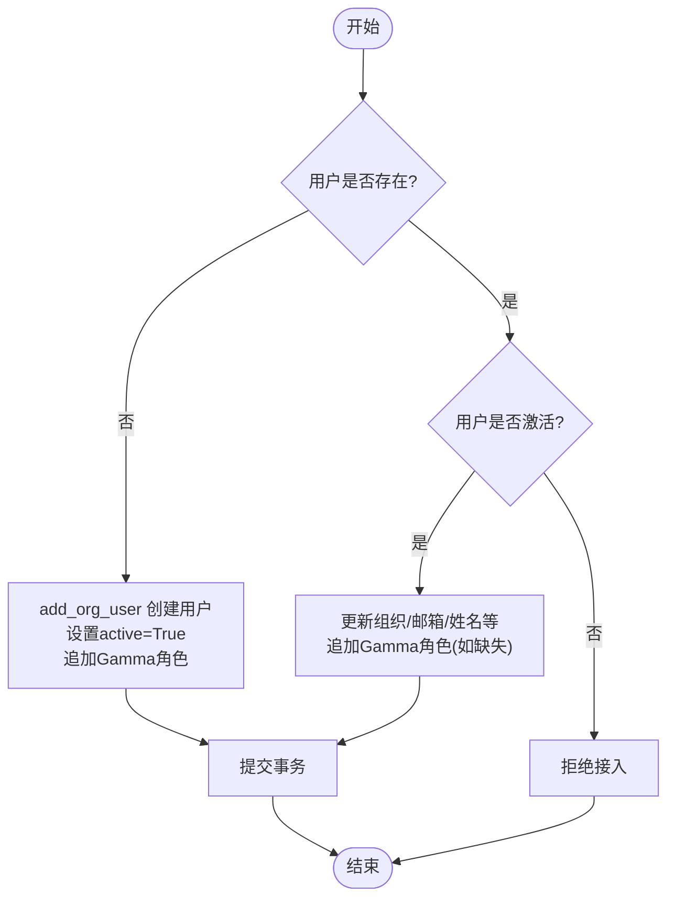
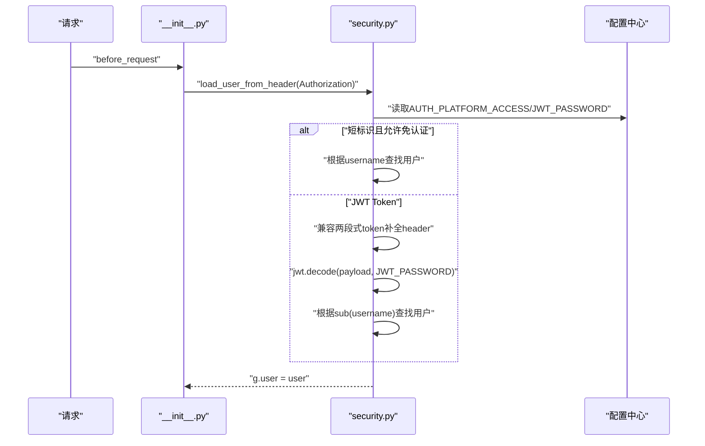
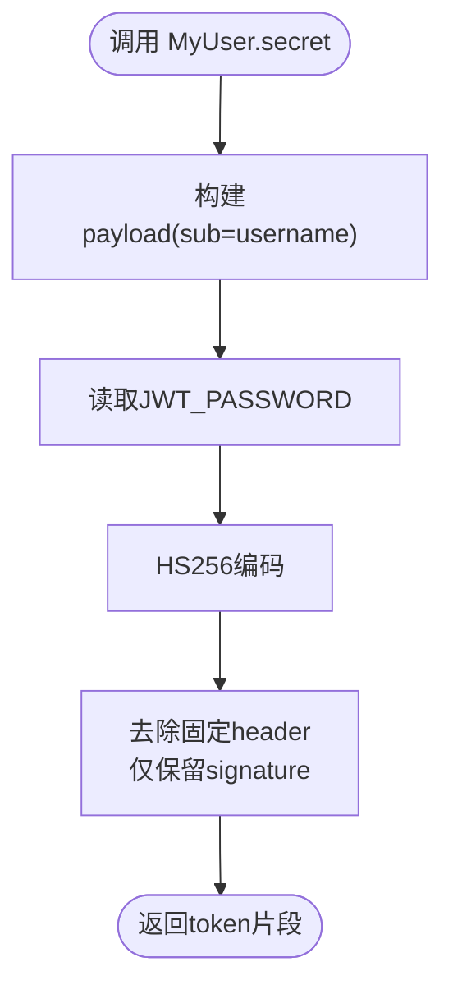
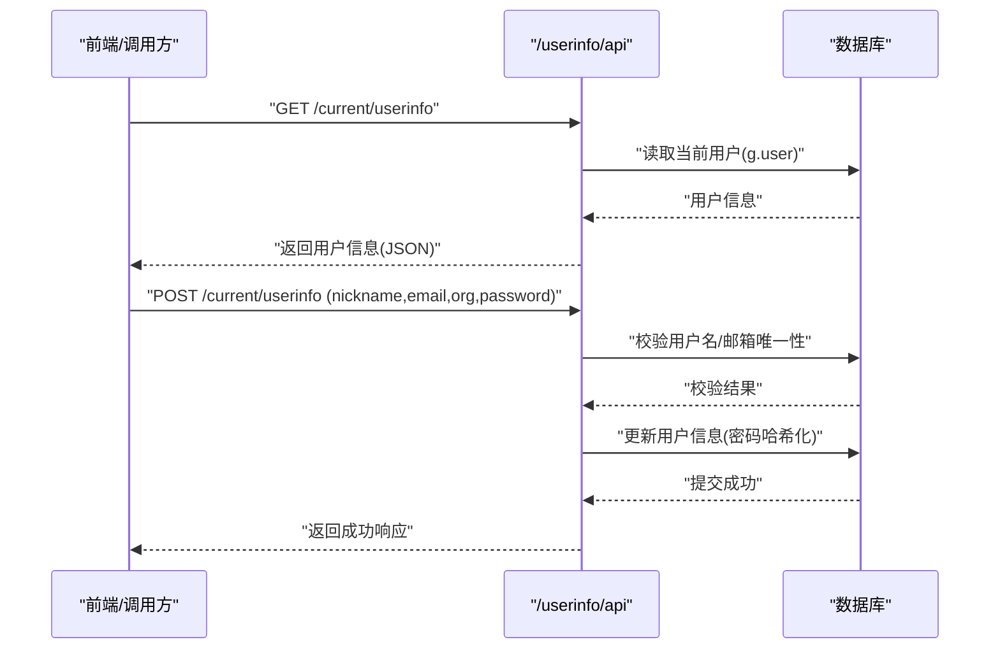
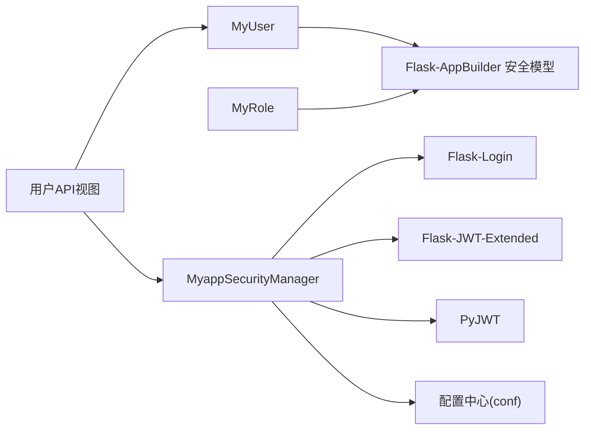

# 用户管理核心

<cite>
**本文引用的文件**   
- [myapp/security.py](file://myapp/security.py)
- [myapp/views/view_user_role.py](file://myapp/views/view_user_role.py)
- [myapp/__init__.py](file://myapp/__init__.py)
</cite>

## 目录
1. [简介](#简介)
2. [项目结构](#项目结构)
3. [核心组件](#核心组件)
4. [架构总览](#架构总览)
5. [详细组件分析](#详细组件分析)
6. [依赖关系分析](#依赖关系分析)
7. [性能考虑](#性能考虑)
8. [故障排查指南](#故障排查指南)
9. [结论](#结论)
10. [附录](#附录)

## 简介
本文件聚焦平台“用户管理核心”能力，围绕以下目标展开：
- 深入解释 MyUser 与 MyRole 模型扩展、用户生命周期管理与基础权限控制机制
- 详细说明用户字段扩展（昵称、组织、配额、余额等）、角色权限继承与默认角色分配
- 提供具体代码示例路径，展示如何创建用户、设置密码哈希、验证用户状态与管理用户会话
- 覆盖用户认证流程、JWT Token 生成与 Header 认证机制
- 给出用户数据模型设计与常见用户操作的最佳实践

## 项目结构
与用户管理核心直接相关的后端实现主要位于 myapp 包内：
- 安全与用户/角色模型扩展：myapp/security.py
- 用户相关 API 视图：myapp/views/view_user_role.py
- 应用启动与请求前置处理（Header 认证注入）：myapp/__init__.py

图表来源
- [myapp/__init__.py:259-278](file://myapp/__init__.py#L259-L278)
- [myapp/security.py:47-106](file://myapp/security.py#L47-L106)
- [myapp/security.py:237-286](file://myapp/security.py#L237-L286)
- [myapp/views/view_user_role.py:59-70](file://myapp/views/view_user_role.py#L59-L70)

章节来源
- [myapp/security.py:47-106](file://myapp/security.py#L47-L106)
- [myapp/views/view_user_role.py:59-70](file://myapp/views/view_user_role.py#L59-L70)
- [myapp/__init__.py:259-278](file://myapp/__init__.py#L259-L278)

## 核心组件
- MyUser：在系统 User 模型基础上扩展了业务字段（昵称、组织、配额、余额、微信、电话、优惠券、代金券、发票、实名认证、子账户等），并提供管理员判断、JWT secret 属性与角色 HTML 渲染。
- MyRole：在系统 Role 模型基础上提供权限 HTML 渲染。
- MyappSecurityManager：自定义安全策略，包含基于 Header 的认证加载、登录用户加载、默认角色同步、用户创建与更新钩子、访问控制简化策略等。
- 用户 API 视图：提供用户列表与个人信息读写接口，支持用户名/邮箱唯一性校验与密码哈希更新。

章节来源
- [myapp/security.py:47-99](file://myapp/security.py#L47-L99)
- [myapp/security.py:101-106](file://myapp/security.py#L101-L106)
- [myapp/security.py:237-406](file://myapp/security.py#L237-L406)
- [myapp/views/view_user_role.py:27-115](file://myapp/views/view_user_role.py#L27-L115)

## 架构总览
下图展示了从请求进入、Header 认证解析、JWT 解码到当前用户落盘 g.user 的完整流程，以及 MyUser.secret 生成 JWT 的过程。

图表来源
- [myapp/__init__.py:259-278](file://myapp/__init__.py#L259-L278)
- [myapp/security.py:258-286](file://myapp/security.py#L258-L286)

## 详细组件分析

### MyUser 模型扩展与字段设计
- 扩展字段说明
  - nickname：昵称
  - org：组织架构
  - quota：资源配额
  - active：是否激活
  - balance：余额（JSON文本）
  - wechat：微信
  - phone：电话
  - coupon：优惠券（JSON文本）
  - voucher：代金券（JSON文本）
  - bill：发票信息（JSON文本）
  - real_name_authentication：实名认证（JSON文本）
  - subaccount：子账户（JSON文本）
- 行为与方法
  - is_admin：基于角色名判断是否为管理员
  - secret：动态生成 JWT（仅 payload.signature），用于服务间调用或轻量鉴权
  - roles_html：将角色集合渲染为可读字符串

图表来源
- [myapp/security.py:47-99](file://myapp/security.py#L47-L99)

章节来源
- [myapp/security.py:47-99](file://myapp/security.py#L47-L99)

### MyRole 模型与权限显示
- 扩展点
  - permissions_html：将角色的权限集合渲染为可读字符串，便于界面展示与调试

图表来源
- [myapp/security.py:101-106](file://myapp/security.py#L101-L106)

章节来源
- [myapp/security.py:101-106](file://myapp/security.py#L101-L106)

### 用户生命周期管理
- 创建用户
  - 通过 add_org_user 方法创建用户，支持传入明文密码或已哈希密码；自动设置 active=True，并追加默认注册角色（Gamma）。
- 预添加/预更新钩子
  - pre_add：初始化 first_name/last_name，设置 active=True，并对明文密码进行哈希存储。
  - pre_update：若新密码未以哈希格式存在，则进行哈希处理。
- 后添加/后更新钩子
  - post_add/post_update：确保用户拥有 Gamma 角色并处于激活状态。
- 远程组织用户接入
  - auth_user_remote_org_user：当外部系统传入用户名时，若用户不存在则自动注册；若用户未激活则拒绝接入；同时更新组织信息与默认角色。

图表来源
- [myapp/security.py:311-381](file://myapp/security.py#L311-L381)
- [myapp/security.py:201-227](file://myapp/security.py#L201-L227)

章节来源
- [myapp/security.py:201-227](file://myapp/security.py#L201-L227)
- [myapp/security.py:311-381](file://myapp/security.py#L311-L381)

### 基础权限控制机制
- 默认角色同步
  - sync_role_definitions：确保 Admin 与 Gamma 角色存在。
- 访问控制简化
  - has_access/can_access：在当前用户已认证或通过 JWT 认证时放行；否则拒绝。
- 角色与权限展示
  - MyRole.permissions_html 与 MyUser.roles_html 提供可读的权限与角色集合展示。

章节来源
- [myapp/security.py:403-406](file://myapp/security.py#L403-L406)
- [myapp/security.py:383-399](file://myapp/security.py#L383-L399)
- [myapp/security.py:101-106](file://myapp/security.py#L101-L106)
- [myapp/security.py:96-99](file://myapp/security.py#L96-L99)

### 用户认证流程与 Header 认证机制
- Header 认证入口
  - load_user_from_header：优先尝试短标识免认证（需配置开启或来自 K8s 内部域名），否则走 JWT 解码流程；兼容两段式 token（仅 payload.signature）自动补全 HS256 header。
- 应用层注入
  - __init__.py 中在 before_request 阶段读取 Authorization 头并调用 security_manager.load_user_from_header，将当前用户写入 g.user。
- 登录用户加载
  - load_user：根据主键加载用户并设置 cookie（由框架负责）。

图表来源
- [myapp/__init__.py:259-278](file://myapp/__init__.py#L259-L278)
- [myapp/security.py:258-286](file://myapp/security.py#L258-L286)

章节来源
- [myapp/__init__.py:259-278](file://myapp/__init__.py#L259-L278)
- [myapp/security.py:258-286](file://myapp/security.py#L258-L286)

### JWT Token 生成与使用
- 生成方式
  - MyUser.secret：构造 payload（包含 sub=用户名），使用全局 JWT_PASSWORD 进行 HS256 编码，并返回去掉固定 header 的签名部分，以缩短长度。
- 使用场景
  - 常用于服务间调用或轻量鉴权；配合 Header 认证机制，服务端可据此识别用户身份。

图表来源
- [myapp/security.py:74-94](file://myapp/security.py#L74-L94)

章节来源
- [myapp/security.py:74-94](file://myapp/security.py#L74-L94)

### 用户 API 与最佳实践
- 用户列表 API
  - /users/api：基于 MyUser 模型的 REST 接口，支持列表、详情、编辑等操作（由基类提供）。
- 个人信息 API
  - /userinfo/api/current/userinfo：GET 返回当前用户信息（含 locale），POST 更新昵称、邮箱、组织、密码等，并进行用户名/邮箱唯一性校验与密码哈希处理。
- 最佳实践
  - 创建用户时始终对明文密码进行哈希存储（pre_add/pre_update/add_org_user）。
  - 更新用户信息前进行唯一性校验，避免用户名/邮箱冲突。
  - 对外暴露的敏感字段（如 password）应谨慎处理，建议仅在后台管理界面可见。
  - 使用 g.user 获取当前用户上下文，避免重复查询。

图表来源
- [myapp/views/view_user_role.py:78-113](file://myapp/views/view_user_role.py#L78-L113)

章节来源
- [myapp/views/view_user_role.py:59-115](file://myapp/views/view_user_role.py#L59-L115)

## 依赖关系分析
- 组件耦合
  - MyUser/MyRole 依赖 Flask-AppBuilder 的安全模型与 SQLAlchemy 基础类型。
  - MyappSecurityManager 依赖 Flask-Login、Flask-JWT-Extended、PyJWT 与配置中心。
  - 用户 API 视图依赖 MyUser 模型与安全模块提供的 Base 类。
- 外部依赖
  - werkzeug.security：密码哈希与校验
  - jwt：JWT 编解码
  - flask_appbuilder：安全模型与视图基类
  - sqlalchemy：ORM 字段定义

图表来源
- [myapp/security.py:47-106](file://myapp/security.py#L47-L106)
- [myapp/security.py:237-286](file://myapp/security.py#L237-L286)
- [myapp/views/view_user_role.py:27-70](file://myapp/views/view_user_role.py#L27-L70)

章节来源
- [myapp/security.py:47-106](file://myapp/security.py#L47-L106)
- [myapp/security.py:237-286](file://myapp/security.py#L237-L286)
- [myapp/views/view_user_role.py:27-70](file://myapp/views/view_user_role.py#L27-L70)

## 性能考虑
- JWT 生成与解码
  - MyUser.secret 仅生成 payload.signature，减少传输体积；服务端解码时使用固定算法 HS256，开销较低。
- 用户查询
  - 通过 g.user 缓存当前用户，避免重复查询；在批量操作中注意事务提交时机，减少锁竞争。
- 密码哈希
  - 使用 werkzeug 的哈希函数，建议在批量导入时预先计算哈希值，避免在线高并发下重复计算。

[本节为通用指导，不直接分析具体文件]

## 故障排查指南
- 无法通过 Header 认证
  - 检查 Authorization 头是否携带有效 token 或短标识；确认 AUTH_PLATFORM_ACCESS 配置与访问域名是否符合免认证条件。
- JWT 解码失败
  - 确认 JWT_PASSWORD 配置一致；若客户端发送两段式 token，服务端会自动补全 HS256 header。
- 用户创建失败
  - 检查 pre_add/pre_update 钩子是否正确执行；确认密码是否已哈希化；查看数据库约束与唯一索引。
- 个人信息更新冲突
  - 检查用户名/邮箱唯一性校验逻辑；确保 POST 请求体字段正确。

章节来源
- [myapp/security.py:258-286](file://myapp/security.py#L258-L286)
- [myapp/security.py:215-227](file://myapp/security.py#L215-L227)
- [myapp/views/view_user_role.py:94-113](file://myapp/views/view_user_role.py#L94-L113)

## 结论
本项目通过扩展 MyUser/MyRole 模型与自定义安全策略，实现了完善的用户生命周期管理与基础权限控制。结合 Header 认证与 JWT Token 机制，既支持轻量服务间鉴权，也满足常规 Web 登录场景。用户 API 提供了便捷的用户信息查询与更新能力，并在关键路径上进行了唯一性与安全性校验。建议在生产环境中严格管理 JWT_PASSWORD 与 AUTH_PLATFORM_ACCESS 配置，遵循密码哈希与最小权限原则，保障系统安全与稳定。

[本节为总结性内容，不直接分析具体文件]

## 附录
- 常用操作参考
  - 创建用户：调用 add_org_user，传入用户名、组织、邮箱与密码（明文或哈希）。
  - 设置密码哈希：使用 generate_password_hash 对明文密码进行哈希后再存储。
  - 验证用户状态：通过 user.active 与 is_authenticated 判断用户是否可用。
  - 管理用户会话：通过 g.user 获取当前用户上下文，结合 can_access/has_access 进行权限判断。

章节来源
- [myapp/security.py:311-381](file://myapp/security.py#L311-L381)
- [myapp/security.py:215-227](file://myapp/security.py#L215-L227)
- [myapp/security.py:383-399](file://myapp/security.py#L383-L399)