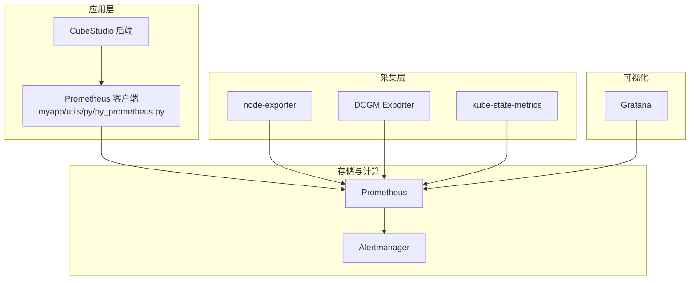
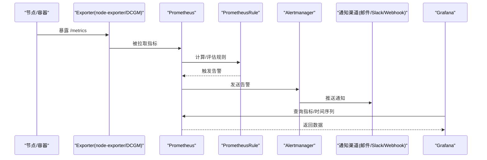
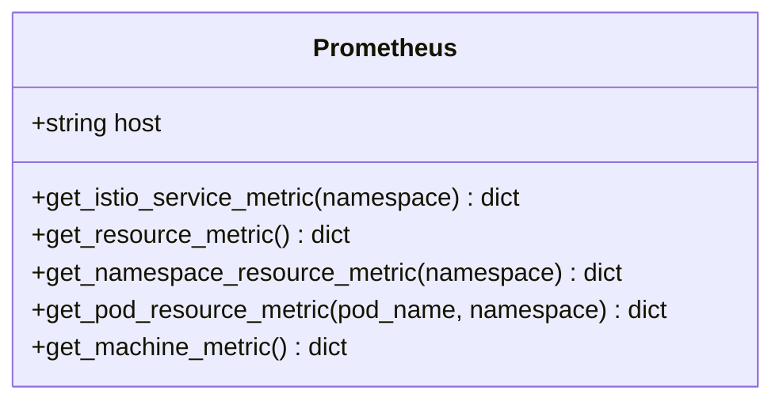
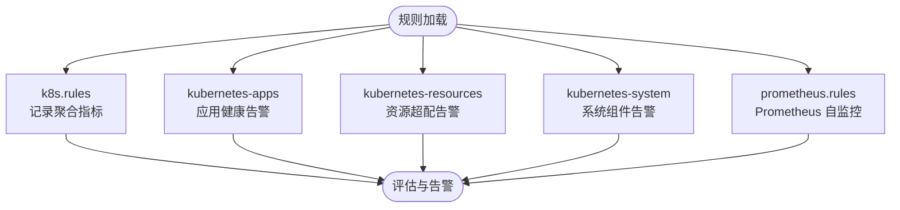
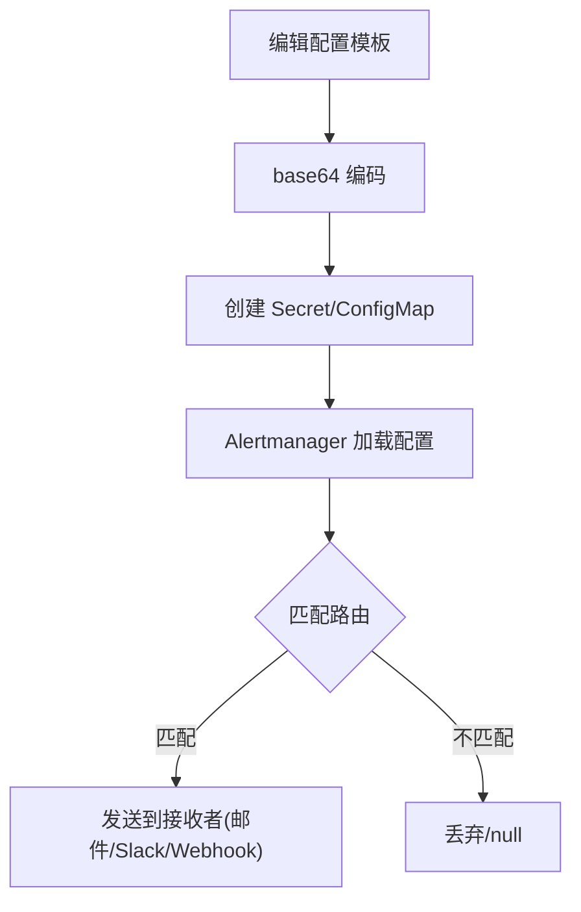
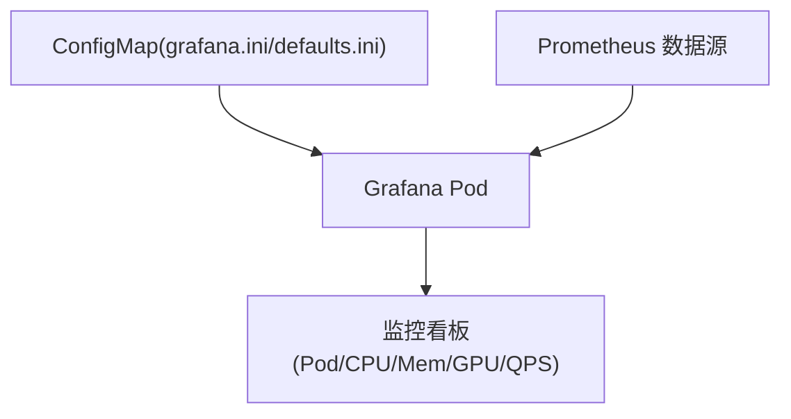
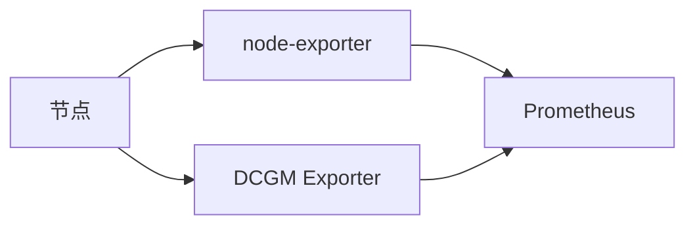
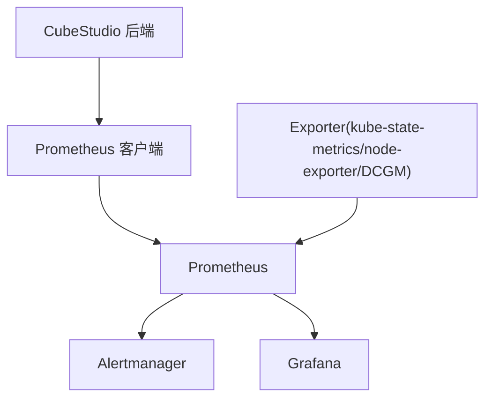

# 监控与告警

<cite>
**本文引用的文件**   
- [README.md](file://README.md)
- [py_prometheus.py](file://myapp/utils/py/py_prometheus.py)
- [prometheus-rules.yml](file://install/kubernetes/prometheus/prometheus/prometheus-rules.yml)
- [grafana readme.md](file://install/kubernetes/prometheus/grafana/readme.md)
- [make-alert-email-config.py](file://install/kubernetes/prometheus/alertmanater/make-alert-email-config.py)
- [make-alert-wechat-config.py](file://install/kubernetes/prometheus/alertmanater/make-alert-wechat-config.py)
- [dcgm-exporter.yaml](file://install/kubernetes/gpu/dcgm-exporter.yaml)
- [init_node.sh](file://install/kubernetes/init_node.sh)
- [all_image.py](file://install/kubernetes/all_image.py)
</cite>

## 目录
1. [引言](#引言)
2. [项目结构](#项目结构)
3. [核心组件](#核心组件)
4. [架构总览](#架构总览)
5. [详细组件分析](#详细组件分析)
6. [依赖关系分析](#依赖关系分析)
7. [性能与存储优化](#性能与存储优化)
8. [故障诊断指南](#故障诊断指南)
9. [结论](#结论)
10. [附录：指标、规则与配置示例](#附录指标规则与配置示例)

## 引言
本章节面向“监控与告警”能力，系统性说明 CubeStudio 在资源监控、服务监控、告警配置、Prometheus/Grafana 集成、日志管理与性能分析方面的实现方式。文档覆盖监控数据采集、指标定义、告警规则、通知渠道、可视化面板以及存储优化和故障诊断实践，帮助读者快速搭建并扩展平台级的可观测性体系。

## 项目结构
仓库中与监控告警相关的核心位置如下：
- 应用侧 Prometheus 客户端封装：用于查询 Pod/命名空间/服务的 CPU、内存、GPU、QPS 等指标。
- Kubernetes 部署清单：包含 Prometheus、Alertmanager、Grafana、Node Exporter、DCGM Exporter、Kube State Metrics 等组件的部署与规则。
- 初始化脚本与镜像清单：准备监控数据持久化目录与所需镜像版本。

图表来源
- [py_prometheus.py:6-131](file://myapp/utils/py/py_prometheus.py#L6-L131)
- [prometheus-rules.yml:1-800](file://install/kubernetes/prometheus/prometheus/prometheus-rules.yml#L1-L800)
- [dcgm-exporter.yaml:5-76](file://install/kubernetes/gpu/dcgm-exporter.yaml#L5-L76)

章节来源
- [README.md:352-360](file://README.md#L352-L360)
- [all_image.py:23-33](file://install/kubernetes/all_image.py#L23-L33)

## 核心组件
- Prometheus 客户端（Python）：提供对 Prometheus API 的统一访问，封装常用指标查询方法，包括 QPS、CPU、内存、GPU 利用率等。
- PrometheusRule 规则集：定义系统级、节点级、应用级告警规则，覆盖组件可用性、资源超配、磁盘预测、API 错误率等。
- Alertmanager 配置生成器：提供邮件、Slack、Webhook 等通知渠道的配置模板与 base64 编码工具。
- Grafana 配置与数据源：通过 ConfigMap 挂载 grafana.ini 与默认配置，连接 Prometheus 作为数据源。
- 指标导出器：Node Exporter 采集主机指标；DCGM Exporter 采集 GPU 指标；Kube State Metrics 暴露集群对象状态。

章节来源
- [py_prometheus.py:6-463](file://myapp/utils/py/py_prometheus.py#L6-L463)
- [prometheus-rules.yml:1-800](file://install/kubernetes/prometheus/prometheus/prometheus-rules.yml#L1-L800)
- [make-alert-email-config.py:10-57](file://install/kubernetes/prometheus/alertmanater/make-alert-email-config.py#L10-L57)
- [make-alert-wechat-config.py:4-36](file://install/kubernetes/prometheus/alertmanater/make-alert-wechat-config.py#L4-L36)
- [grafana readme.md:1-5](file://install/kubernetes/prometheus/grafana/readme.md#L1-L5)
- [dcgm-exporter.yaml:5-76](file://install/kubernetes/gpu/dcgm-exporter.yaml#L5-L76)

## 架构总览
下图展示从采集到可视化的端到端流程：Exporter 采集指标 → Prometheus 聚合与评估规则 → Alertmanager 路由与通知 → Grafana 可视化。

图表来源
- [prometheus-rules.yml:266-800](file://install/kubernetes/prometheus/prometheus/prometheus-rules.yml#L266-L800)
- [make-alert-email-config.py:10-57](file://install/kubernetes/prometheus/alertmanater/make-alert-email-config.py#L10-L57)
- [make-alert-wechat-config.py:4-36](file://install/kubernetes/prometheus/alertmanater/make-alert-wechat-config.py#L4-L36)

## 详细组件分析

### Prometheus 客户端（指标查询与应用集成）
该模块封装了 Prometheus HTTP API 的调用，提供以下关键能力：
- 按命名空间或服务维度获取 QPS、CPU、内存、GPU 利用率时序数据。
- 按 Pod 或命名空间维度汇总最近一段时间的最大/平均利用率。
- 统一异常处理与超时控制，便于上层业务逻辑稳定消费。

图表来源
- [py_prometheus.py:6-463](file://myapp/utils/py/py_prometheus.py#L6-L463)

章节来源
- [py_prometheus.py:16-131](file://myapp/utils/py/py_prometheus.py#L16-L131)
- [py_prometheus.py:137-233](file://myapp/utils/py/py_prometheus.py#L137-L233)
- [py_prometheus.py:236-333](file://myapp/utils/py/py_prometheus.py#L236-L333)
- [py_prometheus.py:337-414](file://myapp/utils/py/py_prometheus.py#L337-L414)

### PrometheusRule 告警规则
规则集覆盖以下关键场景：
- 组件可用性：Alertmanager、APIServer、ControllerManager、Scheduler、Kubelet、NodeExporter、Prometheus、PrometheusOperator 等 down 检测。
- 应用健康：Pod CrashLooping、NotReady、Deployment/StatefulSet 副本不匹配、DaemonSet 滚动卡住等。
- 资源超配与配额：CPU/Memory Overcommit、QuotaExceeded。
- 节点健康：CPU/内存/磁盘/网络饱和度与 IO 使用率。
- Prometheus 自身健康：配置重载失败、通知队列满、TSDB 重载/压缩失败、WAL 损坏等。

图表来源
- [prometheus-rules.yml:10-11](file://install/kubernetes/prometheus/prometheus/prometheus-rules.yml#L10-L11)
- [prometheus-rules.yml:349-470](file://install/kubernetes/prometheus/prometheus/prometheus-rules.yml#L349-L470)
- [prometheus-rules.yml:471-539](file://install/kubernetes/prometheus/prometheus/prometheus-rules.yml#L471-L539)
- [prometheus-rules.yml:540-651](file://install/kubernetes/prometheus/prometheus/prometheus-rules.yml#L540-L651)
- [prometheus-rules.yml:724-800](file://install/kubernetes/prometheus/prometheus/prometheus-rules.yml#L724-L800)

章节来源
- [prometheus-rules.yml:266-348](file://install/kubernetes/prometheus/prometheus/prometheus-rules.yml#L266-L348)
- [prometheus-rules.yml:349-470](file://install/kubernetes/prometheus/prometheus/prometheus-rules.yml#L349-L470)
- [prometheus-rules.yml:471-539](file://install/kubernetes/prometheus/prometheus/prometheus-rules.yml#L471-L539)
- [prometheus-rules.yml:540-651](file://install/kubernetes/prometheus/prometheus/prometheus-rules.yml#L540-L651)
- [prometheus-rules.yml:724-800](file://install/kubernetes/prometheus/prometheus/prometheus-rules.yml#L724-L800)

### Alertmanager 通知渠道配置
提供两类配置生成脚本：
- 邮件/Slack 通知：支持 SMTP、Slack Webhook，包含路由分组、抑制规则与接收者定义。
- Webhook 通知：通用 Webhook 回调，适合对接企业微信、钉钉、飞书等内部系统。

图表来源
- [make-alert-email-config.py:10-57](file://install/kubernetes/prometheus/alertmanater/make-alert-email-config.py#L10-L57)
- [make-alert-wechat-config.py:4-36](file://install/kubernetes/prometheus/alertmanater/make-alert-wechat-config.py#L4-L36)

章节来源
- [make-alert-email-config.py:10-57](file://install/kubernetes/prometheus/alertmanater/make-alert-email-config.py#L10-L57)
- [make-alert-wechat-config.py:4-36](file://install/kubernetes/prometheus/alertmanater/make-alert-wechat-config.py#L4-L36)

### Grafana 数据源与配置
通过 ConfigMap 挂载 grafana.ini 与默认配置，将 Prometheus 添加为数据源，便于构建监控看板。

图表来源
- [grafana readme.md:1-5](file://install/kubernetes/prometheus/grafana/readme.md#L1-L5)

章节来源
- [grafana readme.md:1-5](file://install/kubernetes/prometheus/grafana/readme.md#L1-L5)

### 指标采集器（Node Exporter 与 DCGM Exporter）
- Node Exporter：采集 CPU、内存、磁盘、网络等主机级指标。
- DCGM Exporter：采集 GPU 利用率等指标，并通过 ServiceMonitor 自动发现接入 Prometheus。

图表来源
- [dcgm-exporter.yaml:5-76](file://install/kubernetes/gpu/dcgm-exporter.yaml#L5-L76)

章节来源
- [dcgm-exporter.yaml:5-76](file://install/kubernetes/gpu/dcgm-exporter.yaml#L5-L76)

## 依赖关系分析
- 应用层依赖 Prometheus 客户端进行指标查询。
- Prometheus 依赖各类 Exporter 与 kube-state-metrics 提供指标。
- Alertmanager 依赖 Prometheus 推送告警，并将告警路由至不同通知渠道。
- Grafana 依赖 Prometheus 作为数据源进行可视化。

图表来源
- [py_prometheus.py:6-131](file://myapp/utils/py/py_prometheus.py#L6-L131)
- [prometheus-rules.yml:1-800](file://install/kubernetes/prometheus/prometheus/prometheus-rules.yml#L1-L800)

章节来源
- [py_prometheus.py:6-131](file://myapp/utils/py/py_prometheus.py#L6-L131)
- [prometheus-rules.yml:1-800](file://install/kubernetes/prometheus/prometheus/prometheus-rules.yml#L1-L800)

## 性能与存储优化
- 指标聚合与预计算：通过 PrometheusRule 中的 recording rules 对高频指标进行聚合，降低查询压力。
- 采样间隔与范围：客户端查询中合理设置 start/end/step，避免过大时间窗口导致响应慢。
- 持久化目录：初始化脚本已创建监控数据持久化目录，确保 Prometheus/Grafana 数据不丢失。
- 镜像版本管理：通过 all_image.py 统一管理 Prometheus、Grafana 等组件镜像版本，便于升级与回滚。

章节来源
- [prometheus-rules.yml:10-46](file://install/kubernetes/prometheus/prometheus/prometheus-rules.yml#L10-L46)
- [init_node.sh:18-19](file://install/kubernetes/init_node.sh#L18-L19)
- [all_image.py:23-33](file://install/kubernetes/all_image.py#L23-L33)

## 故障诊断指南
- 组件不可用告警：检查对应 job 的 up 指标是否缺失，确认 Exporter/Prometheus/Alertmanager 运行状态。
- 通知通道失败：查看 Alertmanager 配置是否正确，SMTP/Slack/Webhook 凭据与 URL 是否有效。
- Prometheus 自身问题：关注配置重载失败、通知队列满、TSDB 重载/压缩失败、WAL 损坏等告警。
- 资源超配与配额：根据 CPU/Memory Overcommit 与 QuotaExceeded 告警调整资源请求与命名空间配额。
- 节点健康：依据 CPU/内存/磁盘/网络饱和度告警定位瓶颈节点。

章节来源
- [prometheus-rules.yml:266-348](file://install/kubernetes/prometheus/prometheus/prometheus-rules.yml#L266-L348)
- [prometheus-rules.yml:471-539](file://install/kubernetes/prometheus/prometheus/prometheus-rules.yml#L471-L539)
- [prometheus-rules.yml:724-800](file://install/kubernetes/prometheus/prometheus/prometheus-rules.yml#L724-L800)

## 结论
本方案以 Prometheus 为核心，结合 Node Exporter、DCGM Exporter、Kube State Metrics 完成全栈指标采集；通过 PrometheusRule 定义系统化告警规则；借助 Alertmanager 实现多渠道通知；Grafana 提供可视化能力。应用层通过 Prometheus 客户端便捷地获取资源与服务指标，支撑平台级的可观测性与运维自动化。

## 附录：指标、规则与配置示例

### 监控指标定义（应用侧）
- QPS：基于 Istio 请求总量按工作负载聚合的速率。
- CPU：容器 CPU 使用率的 rate 聚合。
- 内存：容器工作集内存字节数。
- GPU：DCGM GPU 利用率平均值。

章节来源
- [py_prometheus.py:16-131](file://myapp/utils/py/py_prometheus.py#L16-L131)
- [py_prometheus.py:137-233](file://myapp/utils/py/py_prometheus.py#L137-L233)
- [py_prometheus.py:236-333](file://myapp/utils/py/py_prometheus.py#L236-L333)
- [py_prometheus.py:337-414](file://myapp/utils/py/py_prometheus.py#L337-L414)

### 告警规则分类与示例
- 组件可用性：AlertmanagerDown、KubeAPIDown、KubeletDown、PrometheusDown 等。
- 应用健康：KubePodCrashLooping、KubePodNotReady、Deployment/StatefulSet 副本不一致。
- 资源超配：KubeCPUOvercommit、KubeMemOvercommit、KubeQuotaExceeded。
- 节点健康：NodeDiskRunningFull、CPU/内存/网络饱和度。
- Prometheus 自监控：配置重载失败、通知队列满、TSDB 问题、WAL 损坏。

章节来源
- [prometheus-rules.yml:266-348](file://install/kubernetes/prometheus/prometheus/prometheus-rules.yml#L266-L348)
- [prometheus-rules.yml:349-470](file://install/kubernetes/prometheus/prometheus/prometheus-rules.yml#L349-L470)
- [prometheus-rules.yml:471-539](file://install/kubernetes/prometheus/prometheus/prometheus-rules.yml#L471-L539)
- [prometheus-rules.yml:702-723](file://install/kubernetes/prometheus/prometheus/prometheus-rules.yml#L702-L723)
- [prometheus-rules.yml:724-800](file://install/kubernetes/prometheus/prometheus/prometheus-rules.yml#L724-L800)

### 通知渠道配置示例
- 邮件/Slack：配置 SMTP 服务器、发件人、认证信息；Slack channel 与消息模板；路由分组与抑制规则。
- Webhook：通用 Webhook URL，适合对接企业内部 IM 或工单系统。

章节来源
- [make-alert-email-config.py:10-57](file://install/kubernetes/prometheus/alertmanater/make-alert-email-config.py#L10-L57)
- [make-alert-wechat-config.py:4-36](file://install/kubernetes/prometheus/alertmanater/make-alert-wechat-config.py#L4-L36)

### 自定义监控面板与策略建议
- 面板维度：命名空间、节点、Pod、服务、GPU/NPU、IB 流量。
- 策略建议：
  - 针对高延迟与错误率设置分级告警（warning/critical）。
  - 对资源超配与配额接近阈值提前预警。
  - 对磁盘容量进行线性预测告警，预留扩容时间。
  - 对 GPU/NPU 利用率与显存占用设置阈值告警，避免训练任务阻塞。

章节来源
- [README.md:352-360](file://README.md#L352-L360)
- [prometheus-rules.yml:702-723](file://install/kubernetes/prometheus/prometheus/prometheus-rules.yml#L702-L723)