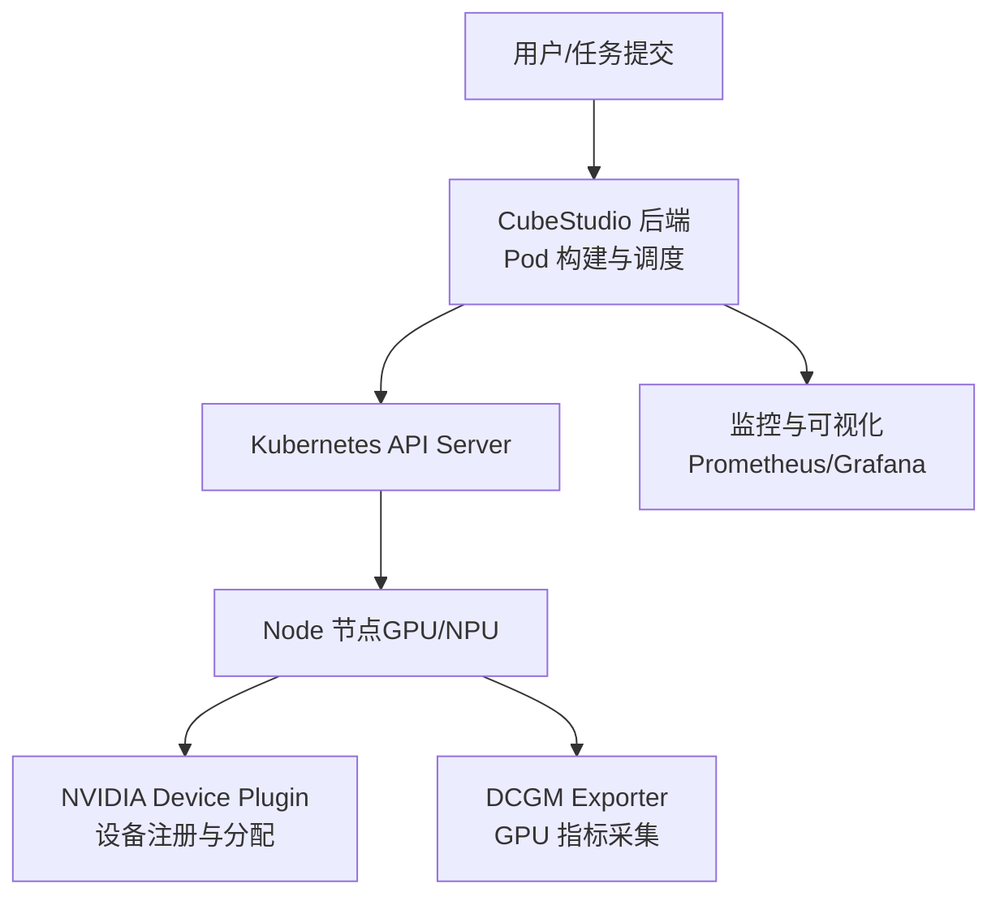
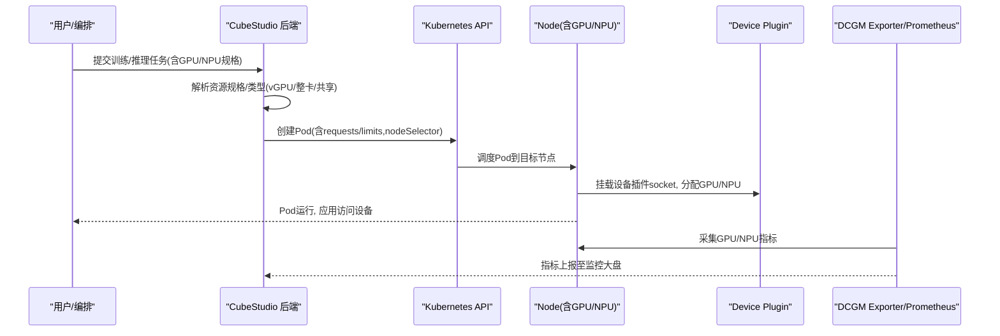
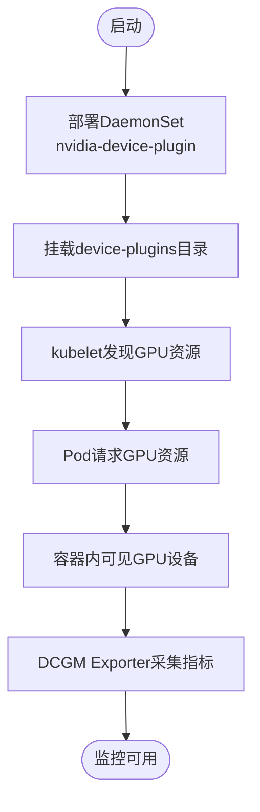
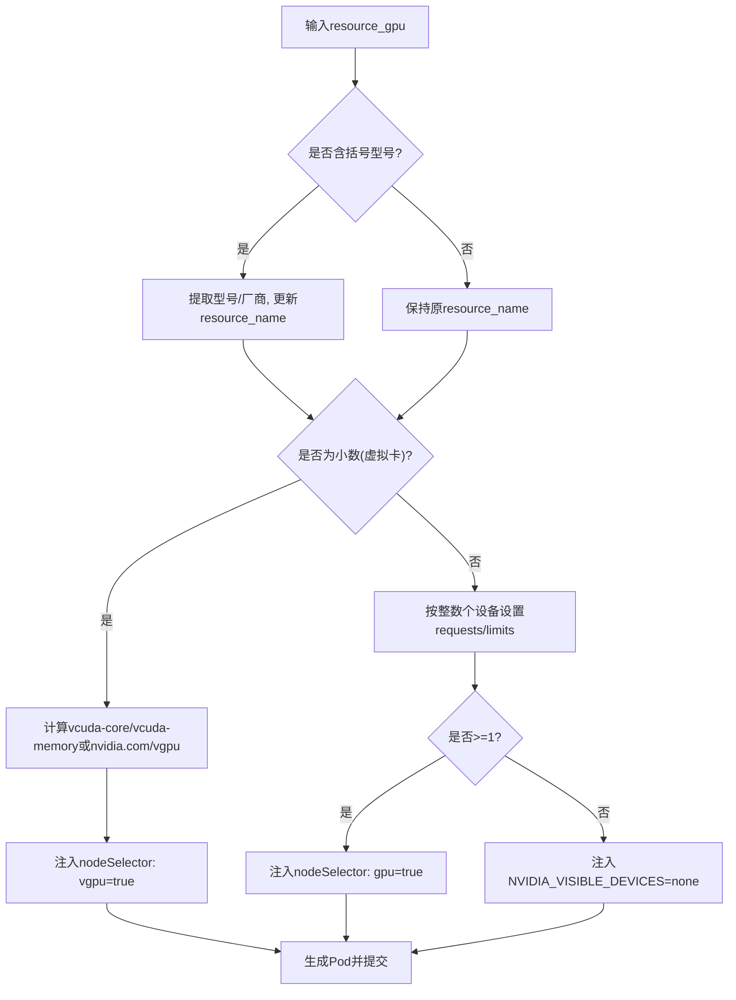
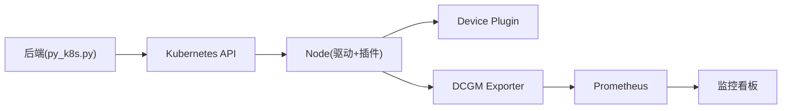

# GPU/NPU调度

<cite>
**本文引用的文件**   
- [README.md](file://README.md)
- [nvidia-device-plugin.yml](file://install/kubernetes/gpu/nvidia-device-plugin.yml)
- [dcgm-exporter.yaml](file://install/kubernetes/gpu/dcgm-exporter.yaml)
- [py_k8s.py](file://job-template/job/pkgs/k8s/py_k8s.py)
</cite>

## 目录
1. [简介](#简介)
2. [项目结构](#项目结构)
3. [核心组件](#核心组件)
4. [架构总览](#架构总览)
5. [详细组件分析](#详细组件分析)
6. [依赖关系分析](#依赖关系分析)
7. [性能与优化建议](#性能与优化建议)
8. [故障诊断指南](#故障诊断指南)
9. [结论](#结论)
10. [附录：扩展新算力与驱动](#附录扩展新算力与驱动)

## 简介
本文件系统性梳理 CubeStudio 在 Kubernetes 底座上的 GPU/NPU 异构算力调度能力，覆盖设备插件集成、资源发现与分配、vGPU 虚拟化、RDMA 网络支持、NUMA 感知调度、显存管理与性能监控。文档面向平台运维与算法工程师，既提供高层架构说明，也给出代码级实现路径与排障要点。

## 项目结构
围绕 GPU/NPU 调度的关键位置如下：
- 设备插件与监控：Kubernetes 部署清单位于 install/kubernetes/gpu 目录，包含 NVIDIA Device Plugin 与 DCGM Exporter。
- 调度与 Pod 构建逻辑：job-template/job/pkgs/k8s/py_k8s.py 中封装了 GPU/NPU 资源解析、vGPU 切分、节点选择器注入等逻辑。
- 功能与能力说明：README.md 对多厂商异构算力、RDMA、vGPU、NPU 监控等进行总体描述。

图表来源
- [nvidia-device-plugin.yml:1-62](file://install/kubernetes/gpu/nvidia-device-plugin.yml#L1-L62)
- [dcgm-exporter.yaml:30-40](file://install/kubernetes/gpu/dcgm-exporter.yaml#L30-L40)
- [py_k8s.py:1000-1148](file://job-template/job/pkgs/k8s/py_k8s.py#L1000-L1148)

章节来源
- [README.md:30-37](file://README.md#L30-L37)
- [README.md:432-446](file://README.md#L432-L446)

## 核心组件
- 设备插件集成
  - NVIDIA Device Plugin：以 DaemonSet 形式运行，将宿主机的 GPU 暴露为 Kubernetes 可调度资源，并挂载 /var/lib/kubelet/device-plugins 供 kubelet 使用。
  - DCGM Exporter：采集 GPU 利用率、温度、功耗、显存等指标，供 Prometheus 抓取。
- 资源发现与分配
  - 通过 K8s Python SDK 读取 Node.allocatable 与 Pod.requests，聚合各厂商 GPU/NPU 资源名，统一统计占用。
  - 根据用户输入的资源规格（整卡/共享/vGPU），动态设置容器 requests/limits 与 nodeSelector。
- vGPU 虚拟化
  - 支持按百分比或显存大小进行虚拟卡切分；默认映射到 tencent.com/vcuda-core/vcuda-memory，同时兼容 nvidia.com/vgpu。
- RDMA 网络支持
  - README 明确支持 IB/RoCE 的 RDMA 协议透传；训练模板与示例镜像中包含 RDMA 相关依赖安装。
- NUMA 感知调度
  - 通过 nodeSelector/affinity 与节点标签控制调度亲和性；结合自定义调度策略（如 binpack）提升局部性与带宽。

章节来源
- [nvidia-device-plugin.yml:1-62](file://install/kubernetes/gpu/nvidia-device-plugin.yml#L1-L62)
- [dcgm-exporter.yaml:30-40](file://install/kubernetes/gpu/dcgm-exporter.yaml#L30-L40)
- [py_k8s.py:31-37](file://job-template/job/pkgs/k8s/py_k8s.py#L31-L37)
- [py_k8s.py:1000-1148](file://job-template/job/pkgs/k8s/py_k8s.py#L1000-L1148)
- [README.md:30-37](file://README.md#L30-L37)
- [README.md:432-446](file://README.md#L432-L446)

## 架构总览
下图展示从任务提交到 Pod 调度、设备挂载与指标采集的全链路。

图表来源
- [py_k8s.py:1000-1148](file://job-template/job/pkgs/k8s/py_k8s.py#L1000-L1148)
- [nvidia-device-plugin.yml:1-62](file://install/kubernetes/gpu/nvidia-device-plugin.yml#L1-L62)
- [dcgm-exporter.yaml:30-40](file://install/kubernetes/gpu/dcgm-exporter.yaml#L30-L40)

## 详细组件分析

### 设备插件与监控集成
- NVIDIA Device Plugin
  - 以 DaemonSet 部署，容忍 CriticalAddonsOnly 与 nvidia.com/gpu 污点，确保在 GPU 节点稳定运行。
  - 挂载 hostPath /var/lib/kubelet/device-plugins，使 kubelet 能发现并管理 GPU 设备。
- DCGM Exporter
  - 通过 ServiceMonitor 或 Prometheus 配置抓取 GPU 指标，用于监控大盘与告警。

图表来源
- [nvidia-device-plugin.yml:1-62](file://install/kubernetes/gpu/nvidia-device-plugin.yml#L1-L62)
- [dcgm-exporter.yaml:30-40](file://install/kubernetes/gpu/dcgm-exporter.yaml#L30-L40)

章节来源
- [nvidia-device-plugin.yml:1-62](file://install/kubernetes/gpu/nvidia-device-plugin.yml#L1-L62)
- [dcgm-exporter.yaml:30-40](file://install/kubernetes/gpu/dcgm-exporter.yaml#L30-L40)

### 资源发现与分配算法
- 资源名称映射
  - 内置 gpu_resource 字典维护厂商资源名（如 nvidia.com/gpu），支持环境变量覆盖。
  - 聚合 Pod 与 Node 维度的 allocatable/requests，计算已用与剩余。
- 规格解析
  - get_gpu 方法解析形如“1”、“0.5”、“1G”、“(T4)”等输入，返回数量、型号与资源名。
- 分配策略
  - 整卡：直接设置 requests/limits 为整数个设备。
  - 虚拟卡：按比例或显存切分，写入 vcuda-core/vcuda-memory 或 nvidia.com/vgpu。
  - 无 GPU：注入 NVIDIA_VISIBLE_DEVICES=none，避免容器误见宿主 GPU。
- 节点选择器
  - 根据 gpu_type 与是否 vGPU 注入 gpu-type、vgpu、gpu 等标签，配合调度策略（binpack/亲和性）。

图表来源
- [py_k8s.py:40-86](file://job-template/job/pkgs/k8s/py_k8s.py#L40-L86)
- [py_k8s.py:1000-1148](file://job-template/job/pkgs/k8s/py_k8s.py#L1000-L1148)

章节来源
- [py_k8s.py:31-37](file://job-template/job/pkgs/k8s/py_k8s.py#L31-L37)
- [py_k8s.py:40-86](file://job-template/job/pkgs/k8s/py_k8s.py#L40-L86)
- [py_k8s.py:1000-1148](file://job-template/job/pkgs/k8s/py_k8s.py#L1000-L1148)

### vGPU 虚拟化与显存管理
- 虚拟卡切分
  - 当 0 < gpu_num < 1 时，按显卡型号估算显存（例如 T4/V100/A100 对应不同基数），设置 tencent.com/vcuda-core 与 tencent.com/vcuda-memory。
  - 同时兼容 nvidia.com/vgpu 资源名，便于不同虚拟化方案共存。
- 显存隔离
  - 通过 vcuda-memory 限制容器可见显存上限，避免越界访问。
- 监控
  - DCGM Exporter 与 Prometheus 可观测 vGPU 使用率与显存占用。

章节来源
- [py_k8s.py:1013-1021](file://job-template/job/pkgs/k8s/py_k8s.py#L1013-L1021)
- [dcgm-exporter.yaml:30-40](file://install/kubernetes/gpu/dcgm-exporter.yaml#L30-L40)

### RDMA 网络支持与 NUMA 感知调度
- RDMA
  - README 明确支持 IB/RoCE 的 RDMA 协议透传；示例镜像中安装 infiniband-diags/perftest 等工具。
  - 可在任务模板中透传 RDMA 相关资源与环境变量，保障多机多卡通信性能。
- NUMA 感知
  - 通过 nodeSelector/affinity 与节点标签（如 gpu-type、vgpu）控制调度亲和性；结合集群调度器（如 Volcano/Kube-Batch）的 binpack 策略，减少跨 NUMA 访问。
  - 建议在节点侧开启 numa_node 亲和标签，并在调度策略中优先选择同 NUMA 的设备与 CPU 核。

章节来源
- [README.md:30-37](file://README.md#L30-L37)
- [README.md:432-446](file://README.md#L432-L446)
- [py_k8s.py:1103-1110](file://job-template/job/pkgs/k8s/py_k8s.py#L1103-L1110)

### 监控体系与性能观测
- GPU/NPU 指标
  - DCGM Exporter 采集 GPU 利用率、显存、温度、功耗等；Prometheus 存储，Grafana 可视化。
  - README 提及 NPU 监控与 IB 流量监控能力。
- 任务维度
  - 后端聚合 Pod 的 CPU/MEM/GPU 申请与使用，输出节点维度占用统计，辅助容量规划与瓶颈定位。

章节来源
- [dcgm-exporter.yaml:30-40](file://install/kubernetes/gpu/dcgm-exporter.yaml#L30-L40)
- [README.md:63-65](file://README.md#L63-L65)
- [py_k8s.py:303-348](file://job-template/job/pkgs/k8s/py_k8s.py#L303-L348)

## 依赖关系分析
- 组件耦合
  - 后端 py_k8s.py 依赖 Kubernetes API 与设备插件暴露的资源名；设备插件依赖宿主机驱动与内核模块。
  - DCGM Exporter 依赖 GPU 驱动与 NVML，指标经 Prometheus 被前端/看板消费。
- 外部依赖
  - NVIDIA 驱动、CUDA、Device Plugin、DCGM；国产 NPU/DCU 需各自驱动与设备插件。
- 潜在循环依赖
  - 无直接循环；但需注意设备插件与 kubelet 的版本兼容性，以及 DCGM 与驱动版本匹配。

图表来源
- [py_k8s.py:1-30](file://job-template/job/pkgs/k8s/py_k8s.py#L1-L30)
- [nvidia-device-plugin.yml:1-62](file://install/kubernetes/gpu/nvidia-device-plugin.yml#L1-L62)
- [dcgm-exporter.yaml:30-40](file://install/kubernetes/gpu/dcgm-exporter.yaml#L30-L40)

章节来源
- [py_k8s.py:1-30](file://job-template/job/pkgs/k8s/py_k8s.py#L1-L30)
- [nvidia-device-plugin.yml:1-62](file://install/kubernetes/gpu/nvidia-device-plugin.yml#L1-L62)
- [dcgm-exporter.yaml:30-40](file://install/kubernetes/gpu/dcgm-exporter.yaml#L30-L40)

## 性能与优化建议
- 调度策略
  - 启用 binpack 或 locality-aware 调度，减少跨 NUMA 与跨 NUMA 内存访问。
  - 针对大模型训练，优先选择同 NUMA 的 GPU/CPU 组合，降低通信延迟。
- 资源配额
  - 合理设置 requests/limits，避免过度预留导致碎片化；对小任务采用 vGPU 提高吞吐。
- 显存管理
  - 为 vGPU 精确设置显存上限，避免 OOM；对独占任务关闭 vGPU，使用整卡模式。
- RDMA 优化
  - 确保网卡、交换机与内核参数（如 rdma_cm、ib_uverbs）正确配置；使用 perftest 验证带宽与延迟。
- 监控与告警
  - 基于 DCGM 指标设定阈值告警（显存、温度、功耗、ECC 错误）；结合 Prometheus 规则与 Grafana 面板持续观察。

[本节为通用指导，不直接分析具体文件]

## 故障诊断指南
- 设备不可见
  - 检查 Device Plugin 是否正常运行，确认 /var/lib/kubelet/device-plugins 挂载成功。
  - 校验节点是否被打上 gpu=true 或 vgpu=true 标签，且未被污点排斥。
- 无法调度
  - 核对 Pod 的 nodeSelector/affinity 是否与节点标签一致；检查是否存在资源不足或抢占。
- vGPU 异常
  - 确认虚拟化方案（tencent.com/vcuda-* 或 nvidia.com/vgpu）是否正确注入；检查显存上限是否过小导致 OOM。
- RDMA 不通
  - 检查 ibstatus/perftest 连通性；确认内核模块与固件版本匹配；排查交换机 RoCE 配置。
- 监控缺失
  - 检查 DCGM Exporter 是否就绪，Prometheus 是否抓取到指标；确认 ServiceMonitor/Endpoints 配置。

章节来源
- [nvidia-device-plugin.yml:1-62](file://install/kubernetes/gpu/nvidia-device-plugin.yml#L1-L62)
- [dcgm-exporter.yaml:30-40](file://install/kubernetes/gpu/dcgm-exporter.yaml#L30-L40)
- [py_k8s.py:1103-1110](file://job-template/job/pkgs/k8s/py_k8s.py#L1103-L1110)

## 结论
CubeStudio 在 Kubernetes 之上实现了统一的 GPU/NPU 异构算力调度，涵盖设备插件集成、资源发现与分配、vGPU 虚拟化、RDMA 网络与 NUMA 感知调度，并提供完善的监控与告警能力。通过灵活的资源规格解析与节点选择器注入，平台能够适配多厂商、多卡型与多种虚拟化方案，满足训练与推理场景的性能与成本诉求。

[本节为总结性内容，不直接分析具体文件]

## 附录：扩展新算力与驱动
- 新增厂商资源名
  - 在 py_k8s.py 的 gpu_resource 字典中添加新厂商资源名（如 huawei.com/npu、hygon.com/dcu），并支持环境变量覆盖。
- 适配虚拟卡方案
  - 若厂商提供虚拟卡资源（如 xxx.com/vcore/vmem），在 make_container 分支中增加对应 requests/limits 注入逻辑。
- 节点标签与亲和性
  - 在 make_pod 中根据新资源类型注入相应 nodeSelector（如 npu=true、dcu=true），并结合调度策略进行亲和性绑定。
- 监控接入
  - 为新设备接入对应的 exporter（如 NPU/DCU 指标导出），纳入 Prometheus 与 Grafana 监控。
- 端到端验证
  - 使用最小 Pod 验证设备可见性、显存隔离与 RDMA 连通性；逐步扩展到训练/推理任务。

章节来源
- [py_k8s.py:31-37](file://job-template/job/pkgs/k8s/py_k8s.py#L31-L37)
- [py_k8s.py:1000-1148](file://job-template/job/pkgs/k8s/py_k8s.py#L1000-L1148)