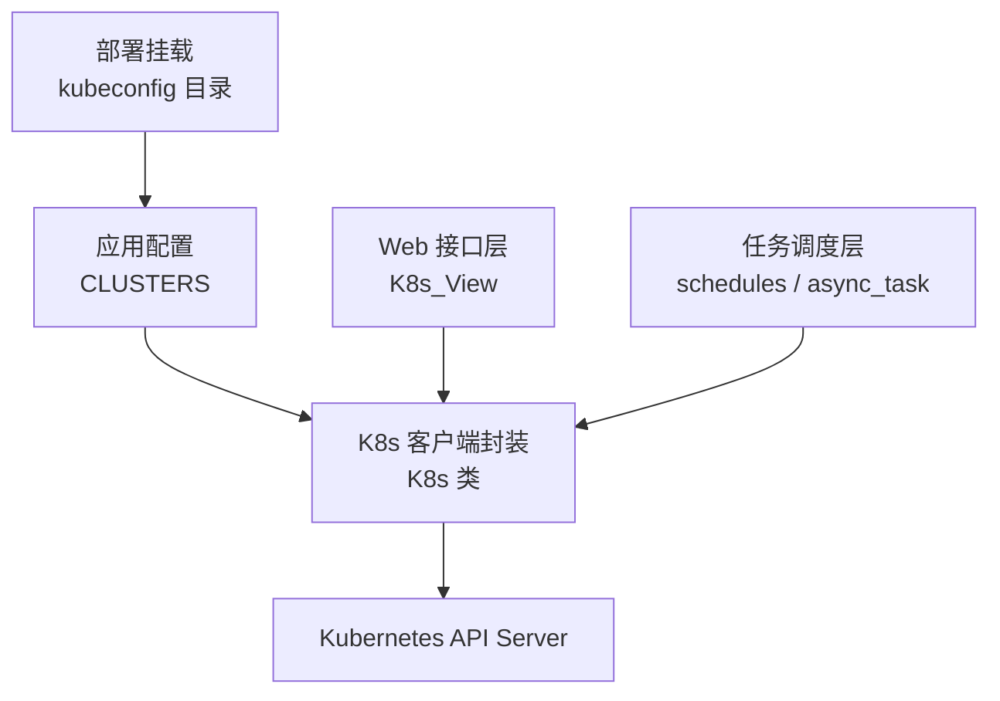
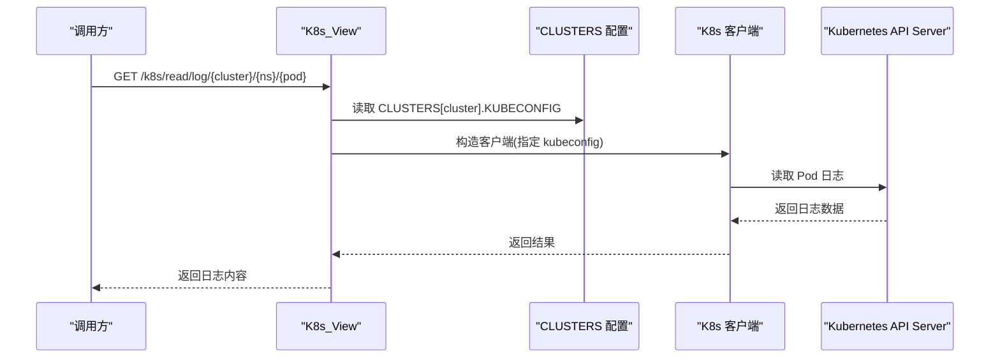
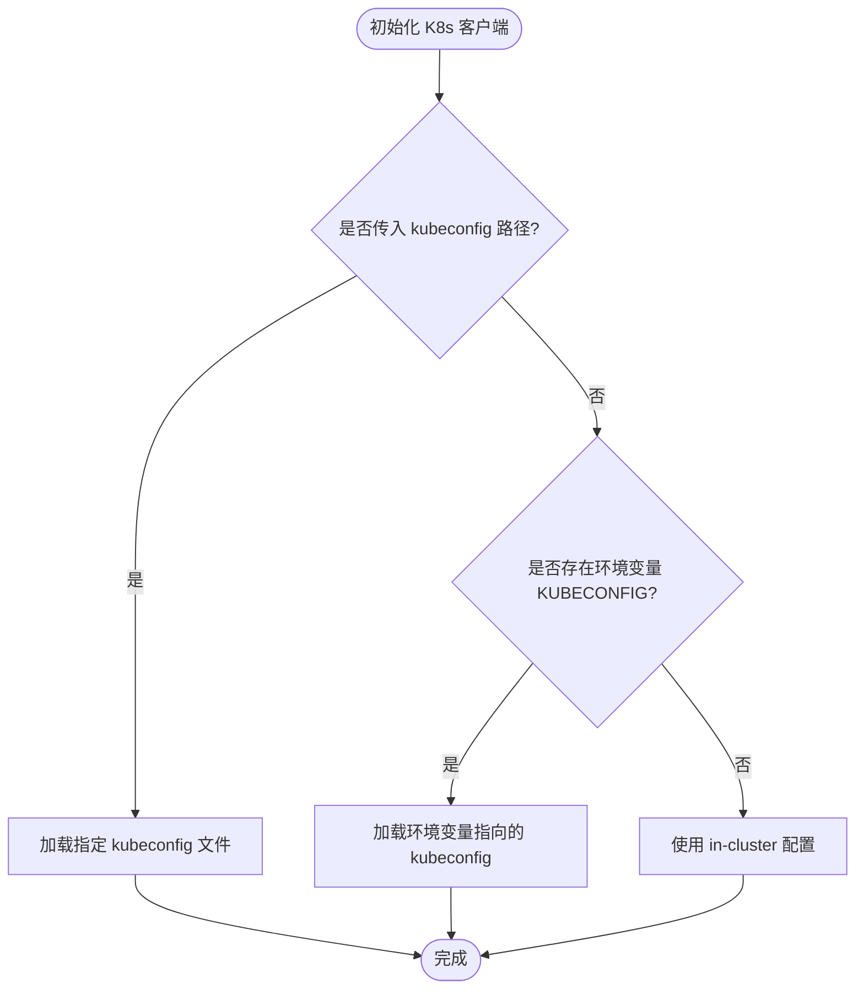
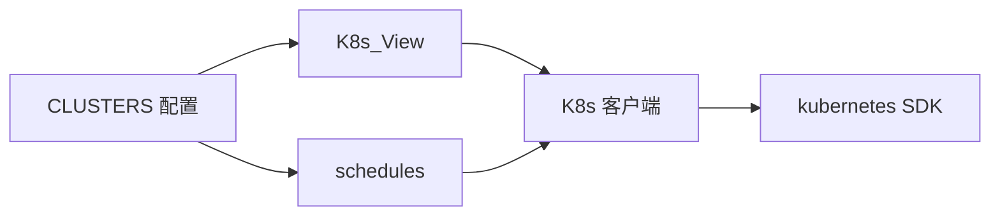

# 多集群管理

<cite>
**本文引用的文件**   
- [myapp/utils/py/py_k8s.py](file://myapp/utils/py/py_k8s.py)
- [myapp/views/view_k8s.py](file://myapp/views/view_k8s.py)
- [myapp/config.py](file://myapp/config.py)
- [install/README.md](file://install/README.md)
- [install/docker/docker-compose.yml](file://install/docker/docker-compose.yml)
- [install/kubernetes/cube/base/deploy-backend.yaml](file://install/kubernetes/cube/base/deploy-backend.yaml)
- [install/kubernetes/cube/base/deploy-worker.yaml](file://install/kubernetes/cube/base/deploy-worker.yaml)
- [install/kubernetes/cube/base/deploy-watch.yaml](file://install/kubernetes/cube/base/deploy-watch.yaml)
- [myapp/tasks/schedules.py](file://myapp/tasks/schedules.py)
- [myapp/models/model_team.py](file://myapp/models/model_team.py)
</cite>

## 目录
1. [简介](#简介)
2. [项目结构](#项目结构)
3. [核心组件](#核心组件)
4. [架构总览](#架构总览)
5. [详细组件分析](#详细组件分析)
6. [依赖关系分析](#依赖关系分析)
7. [性能与高可用](#性能与高可用)
8. [故障排查指南](#故障排查指南)
9. [结论](#结论)
10. [附录：配置清单与示例](#附录配置清单与示例)

## 简介
本文件面向在 CubeStudio 中“多 Kubernetes 集群”的统一管理与调度，覆盖以下主题：
- 集群连接配置与发现（KUBECONFIG、环境变量、配置文件挂载）
- 认证机制与权限控制（RBAC、用户隔离、创建者校验）
- 集群健康检查、资源统计与事件采集
- 动态添加/删除集群（通过配置中心与部署挂载）
- 跨集群调度策略（节点亲和、标签选择、调度器）
- 负载均衡与高可用（Ingress/Gateway、HPA、Prometheus 指标）
- 故障转移与运维工具（日志、终端、强制删除、Terminating Pod 清理）

## 项目结构
CubeStudio 的多集群能力由“后端配置 + K8s 客户端封装 + Web API + 任务调度”共同组成：
- 配置层：CLUSTERS 字典定义多个集群的 kubeconfig 路径与 HOST 等元信息
- 客户端层：K8s 类负责按集群上下文初始化 ApiClient，并封装常用操作
- 接口层：K8s_View 提供日志、终端、Pod 详情、删除等 API，统一走 CLUSTERS 路由
- 调度层：定时任务与异步任务按集群维度遍历执行监控、清理等操作
- 部署层：Docker/K8s 部署将 kubeconfig 目录挂载到容器内固定路径

图示来源
- [myapp/config.py:848-857](file://myapp/config.py#L848-L857)
- [myapp/utils/py/py_k8s.py:21-66](file://myapp/utils/py/py_k8s.py#L21-L66)
- [myapp/views/view_k8s.py:32-64](file://myapp/views/view_k8s.py#L32-L64)
- [install/docker/docker-compose.yml:67-67](file://install/docker/docker-compose.yml#L67-L67)

章节来源
- [install/README.md:67-70](file://install/README.md#L67-L70)
- [myapp/config.py:848-862](file://myapp/config.py#L848-L862)

## 核心组件
- 多集群配置 CLUSTERS：以环境名为键，包含 NAME、KUBECONFIG、SERVICE_DOMAIN、HOST 等字段。ENVIRONMENT 决定默认集群。
- K8s 客户端封装：根据 file_path 或环境变量加载 kubeconfig，若不存在则使用 in-cluster 配置；为每个实例创建独立 ApiClient，避免共享状态。
- Web 接口层：所有 /k8s/* 接口均从 CLUSTERS 解析 cluster_name -> kubeconfig，再构造 K8s 客户端执行操作，并在部分接口进行创建者/管理员权限校验。
- 任务调度层：定时任务与异步任务按 CLUSTERS 遍历集群，批量执行资源查询、清理、监控等任务。

章节来源
- [myapp/config.py:848-862](file://myapp/config.py#L848-L862)
- [myapp/utils/py/py_k8s.py:21-66](file://myapp/utils/py/py_k8s.py#L21-L66)
- [myapp/views/view_k8s.py:32-64](file://myapp/views/view_k8s.py#L32-L64)
- [myapp/tasks/schedules.py:50-53](file://myapp/tasks/schedules.py#L50-L53)

## 架构总览
下图展示多集群管理的端到端流程：前端/调用方访问后端 API，后端根据 cluster_name 查找对应 kubeconfig，构造 K8s 客户端后对目标集群执行操作。

图示来源
- [myapp/views/view_k8s.py:187-216](file://myapp/views/view_k8s.py#L187-L216)
- [myapp/utils/py/py_k8s.py:21-66](file://myapp/utils/py/py_k8s.py#L21-L66)

## 详细组件分析

### 集群连接与认证
- 连接优先级：
  - 优先使用传入的 file_path（kubeconfig 绝对路径）
  - 其次使用配置 CLUSTERS[ENVIRONMENT].KUBECONFIG
  - 再次使用环境变量 KUBECONFIG
  - 最后回退到 in-cluster 配置（适用于 Pod 内运行）
- SSL 校验：默认关闭 verify_ssl（便于本地调试），生产建议开启并使用受信任证书。
- 认证方式：基于 kubeconfig 中的 user/token/kertificate 与集群 RBAC 配合，实现细粒度权限控制。

图示来源
- [myapp/utils/py/py_k8s.py:23-43](file://myapp/utils/py/py_k8s.py#L23-L43)

章节来源
- [myapp/utils/py/py_k8s.py:23-43](file://myapp/utils/py/py_k8s.py#L23-L43)

### 权限控制与集群隔离
- 用户隔离：
  - Pod 创建时注入 username 标签，接口层据此限制非管理员仅能查看/操作自己的 Pod
  - 服务 Service 同样支持用户名标签过滤
- 集群隔离：
  - 通过 CLUSTERS 配置项隔离不同集群的 kubeconfig 与 HOST
  - 部署时将 kubeconfig 目录挂载到容器内固定路径，避免越权访问其他集群
- RBAC：
  - 建议在每个集群为平台服务账号授予最小必要权限（如 Pod/Service/Event/Node 读权限，按需授予写权限）

章节来源
- [myapp/views/view_k8s.py:46-53](file://myapp/views/view_k8s.py#L46-L53)
- [myapp/views/view_k8s.py:338-353](file://myapp/views/view_k8s.py#L338-L353)
- [myapp/views/view_k8s.py:479-500](file://myapp/views/view_k8s.py#L479-L500)
- [install/docker/docker-compose.yml:67-67](file://install/docker/docker-compose.yml#L67-L67)

### 集群发现与配置管理
- 配置入口：
  - myapp/config.py 中 CLUSTERS 字典维护多集群信息
  - install/kubernetes/cube/overlays/config/config.py 提供 K8s 部署时的配置覆盖
- 部署挂载：
  - docker-compose 与 K8s Deployment 将 kubeconfig 目录挂载到 /home/myapp/kubeconfig
  - 命名规范：$ENVIRONMENT-kubeconfig（例如 dev-kubeconfig）

章节来源
- [myapp/config.py:848-862](file://myapp/config.py#L848-L862)
- [install/docker/docker-compose.yml:67-67](file://install/docker/docker-compose.yml#L67-L67)
- [install/kubernetes/cube/base/deploy-backend.yaml:108-108](file://install/kubernetes/cube/base/deploy-backend.yaml#L108-L108)
- [install/kubernetes/cube/base/deploy-worker.yaml:103-103](file://install/kubernetes/cube/base/deploy-worker.yaml#L103-L103)
- [install/kubernetes/cube/base/deploy-watch.yaml:95-95](file://install/kubernetes/cube/base/deploy-watch.yaml#L95-L95)

### 动态添加/删除集群
- 添加集群：
  - 在 CLUSTERS 中添加新条目，包含 NAME、KUBECONFIG、SERVICE_DOMAIN、HOST
  - 将对应 kubeconfig 文件放入挂载目录，确保文件名符合 $ENVIRONMENT-kubeconfig 规范
- 删除集群：
  - 移除 CLUSTERS 中对应条目，并清理挂载目录中的 kubeconfig 文件
- 生效范围：
  - 新增/修改配置后，需重启相关服务（后端、worker、watch）使配置生效

章节来源
- [myapp/config.py:848-862](file://myapp/config.py#L848-L862)
- [install/README.md:67-70](file://install/README.md#L67-L70)

### 集群健康检查与资源统计
- 节点健康：
  - get_node 方法聚合节点可分配 CPU/Memory/GPU、标签、状态等
  - 支持缓存 all_nodes_{cluster_name} 提升性能
- 资源占用统计：
  - get_all_node_allocated_resources 汇总各节点已用 CPU/Memory/GPU
  - 结合 exist_hold_resource 判断 Pod 是否实际占用资源（Pending+Scheduled 也算占用）
- 事件采集：
  - get_pod_event/get_job_event/get_node_event 获取事件并按时间排序，辅助定位问题

章节来源
- [myapp/utils/py/py_k8s.py:338-393](file://myapp/utils/py/py_k8s.py#L338-L393)
- [myapp/utils/py/py_k8s.py:410-467](file://myapp/utils/py/py_k8s.py#L410-L467)
- [myapp/utils/py/py_k8s.py:269-286](file://myapp/utils/py/py_k8s.py#L269-L286)

### 跨集群调度策略
- 节点亲和与选择：
  - pod_model2dict 解析 node_selector 与 node_affinity，用于可视化与筛选
  - label_node 可按 IP 批量打标签，便于后续调度约束
- 调度器与拓扑：
  - 可在 Pod/Deployment 中指定 scheduler_name 与 topologySpreadConstraints（由上层模板/CRD 控制）
- 资源配额：
  - 通过 ResourceQuota/LimitRange 在命名空间层面限制 CPU/Memory/GPU 使用

章节来源
- [myapp/utils/py/py_k8s.py:153-169](file://myapp/utils/py/py_k8s.py#L153-L169)
- [myapp/utils/py/py_k8s.py:470-497](file://myapp/utils/py/py_k8s.py#L470-L497)

### 负载均衡与高可用
- 入口网关：
  - 通过 Istio IngressGateway 暴露外部流量，结合 Service/Ingress 实现多副本与负载均衡
- 自动扩缩容：
  - HPA 基于 Prometheus 指标（CPU/Memory/自定义指标）触发扩缩容
- 多集群高可用：
  - 通过多集群配置与异地部署，结合 DNS/全局负载均衡实现跨集群容灾

章节来源
- [install/README.md:12-37](file://install/README.md#L12-L37)

### 故障转移与运维工具
- 日志与终端：
  - /k8s/read/log 与 /k8s/web/debug 提供日志下载与终端接入
- 强制删除：
  - /k8s/delete/pod 支持快速删除卡住的 Pod
- Terminating Pod 清理：
  - /k8s/read/pod/terminating 聚合 Warning 事件与 Pod 状态，辅助定位长时间无法终止的 Pod

章节来源
- [myapp/views/view_k8s.py:167-216](file://myapp/views/view_k8s.py#L167-L216)
- [myapp/views/view_k8s.py:305-334](file://myapp/views/view_k8s.py#L305-L334)
- [myapp/views/view_k8s.py:251-303](file://myapp/views/view_k8s.py#L251-L303)

## 依赖关系分析
- 配置依赖：
  - CLUSTERS 字典被 K8s_View、schedules、model_team 等多处引用
- 客户端依赖：
  - K8s 类依赖 kubernetes 官方 SDK，封装 CoreV1Api/AppsV1Api/CustomObjectsApi/RbacAuthorizationV1Api/AutoscalingV1Api/AutoscalingV2Api
- 部署依赖：
  - docker-compose 与 K8s Deployment 挂载 kubeconfig 目录，保证运行时可访问

图示来源
- [myapp/config.py:848-862](file://myapp/config.py#L848-L862)
- [myapp/views/view_k8s.py:32-64](file://myapp/views/view_k8s.py#L32-L64)
- [myapp/tasks/schedules.py:50-53](file://myapp/tasks/schedules.py#L50-L53)
- [myapp/utils/py/py_k8s.py:58-66](file://myapp/utils/py/py_k8s.py#L58-L66)

章节来源
- [myapp/config.py:848-862](file://myapp/config.py#L848-L862)
- [myapp/views/view_k8s.py:32-64](file://myapp/views/view_k8s.py#L32-L64)
- [myapp/tasks/schedules.py:50-53](file://myapp/tasks/schedules.py#L50-L53)
- [myapp/utils/py/py_k8s.py:58-66](file://myapp/utils/py/py_k8s.py#L58-L66)

## 性能与高可用
- 缓存优化：
  - 全量 Pod/Node 列表查询支持缓存 key=all_pods_{namespace}_{cluster_name}/all_nodes_{cluster_name}
  - 异步任务触发缓存刷新，减少频繁 API 调用
- 并发处理：
  - 多命名空间 CRD 查询支持进程池并行拉取，缩短整体耗时
- 高可用建议：
  - 启用多副本后端服务与 Worker，避免单点故障
  - 使用持久化存储保存缓存与任务队列状态
  - 合理设置 HPA 与资源配额，保障关键业务弹性

章节来源
- [myapp/utils/py/py_k8s.py:204-267](file://myapp/utils/py/py_k8s.py#L204-L267)
- [myapp/utils/py/py_k8s.py:616-640](file://myapp/utils/py/py_k8s.py#L616-L640)

## 故障排查指南
- 无法连接集群：
  - 检查 CLUSTERS 中对应集群的 KUBECONFIG 路径是否正确
  - 确认容器内已挂载 kubeconfig 目录且文件存在
  - 验证环境变量 KUBECONFIG 是否被意外覆盖
- 权限不足：
  - 检查集群 RBAC 是否授予平台服务账号所需权限
  - 确认当前用户是否为管理员或 Pod 创建者
- 日志/终端不可用：
  - 确认 Pod 处于 Running 状态且容器存在
  - 检查网络连通性与 Ingress/Gateway 配置
- Terminating Pod 无法删除：
  - 使用 /k8s/read/pod/terminating 查看 Warning 事件与主机信息
  - 必要时强制删除或联系集群管理员排查底层原因

章节来源
- [myapp/views/view_k8s.py:251-303](file://myapp/views/view_k8s.py#L251-L303)
- [myapp/views/view_k8s.py:305-334](file://myapp/views/view_k8s.py#L305-L334)

## 结论
CubeStudio 通过 CLUSTERS 配置与 K8s 客户端封装，实现了多集群的统一接入、权限隔离与运维能力。结合部署层的 kubeconfig 挂载与任务调度层的批量操作，平台能够在多集群环境下稳定调度与管理工作负载。生产环境中建议开启 SSL 校验、完善 RBAC、启用缓存与 HPA，并结合 Istio/Prometheus 构建高可用的多集群体系。

## 附录：配置清单与示例
- CLUSTERS 配置关键字段：
  - NAME：集群显示名
  - KUBECONFIG：kubeconfig 文件路径
  - SERVICE_DOMAIN：服务域名（可选）
  - HOST：集群对外访问地址（用于跳转 Dashboard 等）
- 部署挂载路径：
  - /home/myapp/kubeconfig（容器内固定路径）
- 命名规范：
  - $ENVIRONMENT-kubeconfig（例如 dev-kubeconfig）

章节来源
- [myapp/config.py:848-862](file://myapp/config.py#L848-L862)
- [install/docker/docker-compose.yml:67-67](file://install/docker/docker-compose.yml#L67-L67)
- [install/kubernetes/cube/base/deploy-backend.yaml:108-108](file://install/kubernetes/cube/base/deploy-backend.yaml#L108-L108)
- [install/kubernetes/cube/base/deploy-worker.yaml:103-103](file://install/kubernetes/cube/base/deploy-worker.yaml#L103-L103)
- [install/kubernetes/cube/base/deploy-watch.yaml:95-95](file://install/kubernetes/cube/base/deploy-watch.yaml#L95-L95)