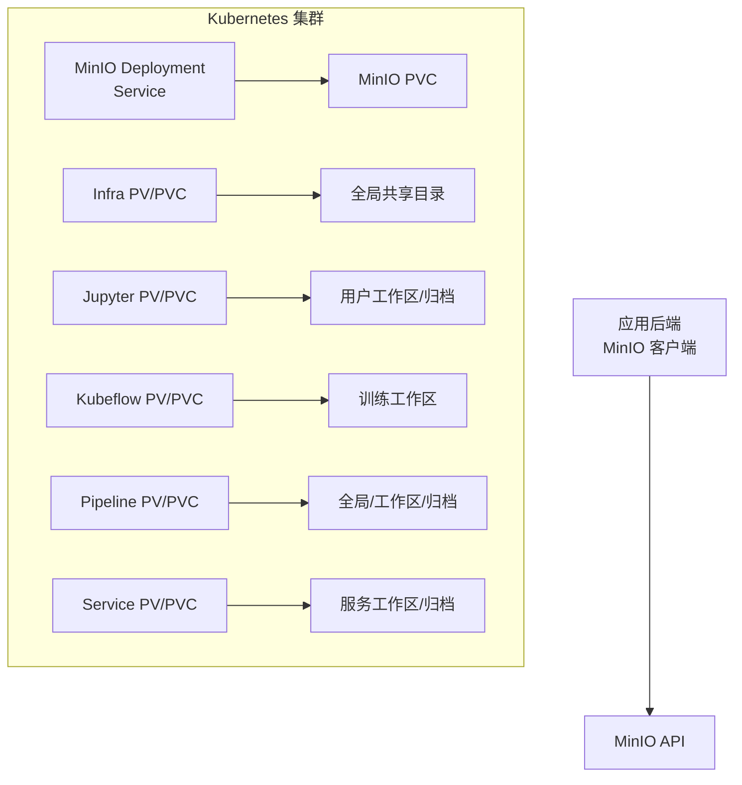
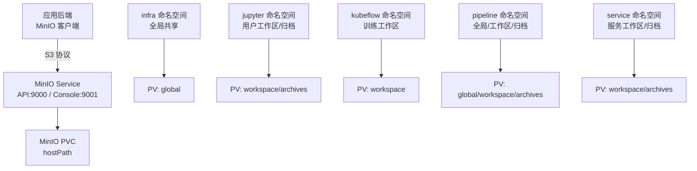
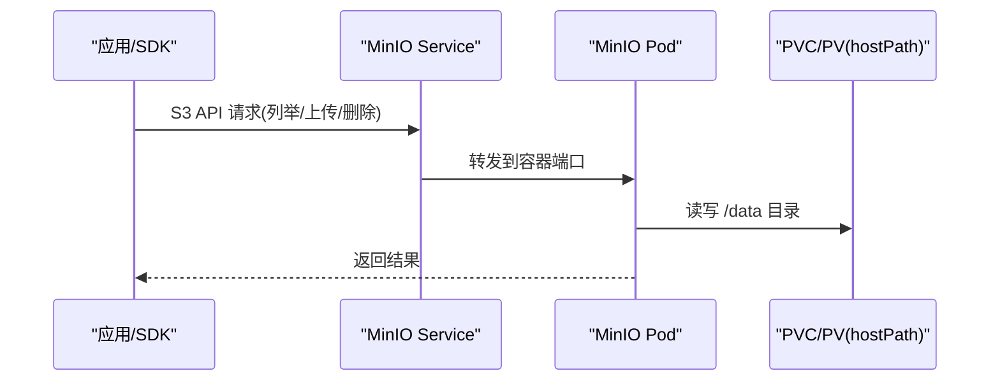
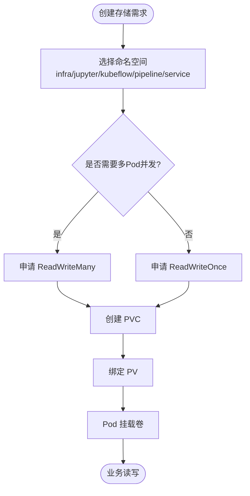
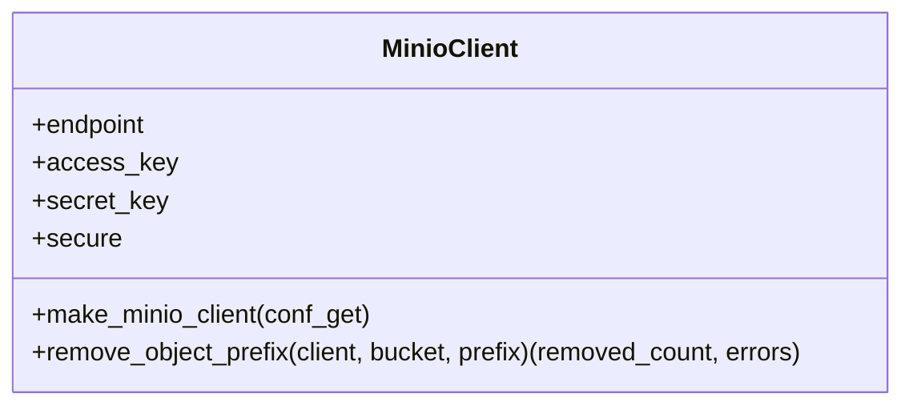
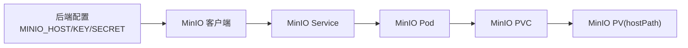

# 存储管理

<cite>
**本文引用的文件**   
- [README.md](file://README.md)
- [minio-pv-pvc-hostpath.yaml](file://install/kubernetes/argo/minio-pv-pvc-hostpath.yaml)
- [minio.yaml](file://install/kubernetes/argo/minio.yaml)
- [pv-pvc-infra.yaml](file://install/kubernetes/pv-pvc-infra.yaml)
- [pv-pvc-jupyter.yaml](file://install/kubernetes/pv-pvc-jupyter.yaml)
- [pv-pvc-kubeflow.yaml](file://install/kubernetes/pv-pvc-kubeflow.yaml)
- [pv-pvc-pipeline.yaml](file://install/kubernetes/pv-pvc-pipeline.yaml)
- [pv-pvc-service.yaml](file://install/kubernetes/pv-pvc-service.yaml)
- [py_minio.py](file://myapp/utils/py/py_minio.py)
- [config.py](file://install/kubernetes/cube/overlays/config/config.py)
</cite>

## 目录
1. [引言](#引言)
2. [项目结构](#项目结构)
3. [核心组件](#核心组件)
4. [架构总览](#架构总览)
5. [详细组件分析](#详细组件分析)
6. [依赖关系分析](#依赖关系分析)
7. [性能与容量规划](#性能与容量规划)
8. [安全与访问控制](#安全与访问控制)
9. [监控与故障恢复](#监控与故障恢复)
10. [结论](#结论)
11. [附录：配置与操作清单](#附录配置与操作清单)

## 引言
本文件面向 CubeStudio 平台的存储管理，聚焦以下目标：
- 持久化卷（PV）、存储类（StorageClass）与动态卷供应在平台中的落地方式与最佳实践
- 对象存储（MinIO）、块存储与文件存储的集成模式
- 存储卷的创建与管理、数据备份与迁移流程
- 存储性能优化、数据安全与访问控制策略
- 实际存储配置示例与容量规划建议
- 存储监控与故障恢复策略

CubeStudio 支持通过 Web 界面添加存储盘并绑定项目组，Notebook、Pipeline、推理服务可直接挂载外部分布式存储；支持的存储类型包括 NFS、CFS、OSS、NAS、COS、GlusterFS、CephFS、S3/MinIO。平台同时提供 K8s Dashboard 可视化 PVC、StorageClass 等资源，以及 Prometheus/Grafana 对磁盘 IO、网络 IO 等指标的监控能力。

**章节来源**
- [README.md:36-36](file://README.md#L36-L36)
- [README.md:207-208](file://README.md#L207-L208)
- [README.md:220-224](file://README.md#L220-L224)
- [README.md:356-358](file://README.md#L356-L358)

## 项目结构
仓库中与存储相关的资源主要分布在 install/kubernetes 目录下，包含：
- MinIO 部署与持久化卷声明
- 各命名空间（infra、jupyter、kubeflow、pipeline、service）的 PV/PVC 模板
- 平台后端配置中关于 MinIO 的连接参数

**图示来源**
- [minio.yaml:1-85](file://install/kubernetes/argo/minio.yaml#L1-L85)
- [minio-pv-pvc-hostpath.yaml:1-34](file://install/kubernetes/argo/minio-pv-pvc-hostpath.yaml#L1-L34)
- [pv-pvc-infra.yaml:1-69](file://install/kubernetes/pv-pvc-infra.yaml#L1-L69)
- [pv-pvc-jupyter.yaml:1-65](file://install/kubernetes/pv-pvc-jupyter.yaml#L1-L65)
- [pv-pvc-kubeflow.yaml:1-37](file://install/kubernetes/pv-pvc-kubeflow.yaml#L1-L37)
- [pv-pvc-pipeline.yaml:1-107](file://install/kubernetes/pv-pvc-pipeline.yaml#L1-L107)
- [pv-pvc-service.yaml:1-72](file://install/kubernetes/pv-pvc-service.yaml#L1-L72)
- [py_minio.py:1-42](file://myapp/utils/py/py_minio.py#L1-L42)

**章节来源**
- [minio.yaml:1-85](file://install/kubernetes/argo/minio.yaml#L1-L85)
- [minio-pv-pvc-hostpath.yaml:1-34](file://install/kubernetes/argo/minio-pv-pvc-hostpath.yaml#L1-L34)
- [pv-pvc-infra.yaml:1-69](file://install/kubernetes/pv-pvc-infra.yaml#L1-L69)
- [pv-pvc-jupyter.yaml:1-65](file://install/kubernetes/pv-pvc-jupyter.yaml#L1-L65)
- [pv-pvc-kubeflow.yaml:1-37](file://install/kubernetes/pv-pvc-kubeflow.yaml#L1-L37)
- [pv-pvc-pipeline.yaml:1-107](file://install/kubernetes/pv-pvc-pipeline.yaml#L1-L107)
- [pv-pvc-service.yaml:1-72](file://install/kubernetes/pv-pvc-service.yaml#L1-L72)
- [py_minio.py:1-42](file://myapp/utils/py/py_minio.py#L1-L42)

## 核心组件
- 对象存储（MinIO）
  - 以 Deployment + Service 形式部署，暴露 API 与控制台端口
  - 使用 PVC 挂载数据目录，预置桶 mlpipeline
  - 健康检查探针确保可用性
- 持久化卷（PV）与持久化卷声明（PVC）
  - 针对 infra、jupyter、kubeflow、pipeline、service 等命名空间分别定义 PV/PVC
  - 采用 hostPath 作为本地块存储示例，便于快速验证；生产环境可替换为分布式文件系统或云存储 CSI
- 应用侧 MinIO 客户端封装
  - 惰性导入 SDK，从配置读取 endpoint、access_key、secret_key
  - 提供按前缀批量删除对象的工具方法

**章节来源**
- [minio.yaml:1-85](file://install/kubernetes/argo/minio.yaml#L1-L85)
- [minio-pv-pvc-hostpath.yaml:1-34](file://install/kubernetes/argo/minio-pv-pvc-hostpath.yaml#L1-L34)
- [py_minio.py:1-42](file://myapp/utils/py/py_minio.py#L1-L42)

## 架构总览
下图展示应用后端、MinIO 与各类 PV/PVC 的关系，以及不同命名空间的存储用途。

**图示来源**
- [minio.yaml:1-85](file://install/kubernetes/argo/minio.yaml#L1-L85)
- [minio-pv-pvc-hostpath.yaml:1-34](file://install/kubernetes/argo/minio-pv-pvc-hostpath.yaml#L1-L34)
- [pv-pvc-infra.yaml:1-69](file://install/kubernetes/pv-pvc-infra.yaml#L1-L69)
- [pv-pvc-jupyter.yaml:1-65](file://install/kubernetes/pv-pvc-jupyter.yaml#L1-L65)
- [pv-pvc-kubeflow.yaml:1-37](file://install/kubernetes/pv-pvc-kubeflow.yaml#L1-L37)
- [pv-pvc-pipeline.yaml:1-107](file://install/kubernetes/pv-pvc-pipeline.yaml#L1-L107)
- [pv-pvc-service.yaml:1-72](file://install/kubernetes/pv-pvc-service.yaml#L1-L72)

## 详细组件分析

### MinIO 对象存储
- 部署形态
  - Deployment 运行 minio/server，监听 API 与控制台端口
  - Service 暴露 9000（API）与 9001（控制台）
  - 容器启动后自动创建 mlpipeline 桶
  - 通过 liveness/readiness 探针进行健康检查
- 持久化
  - 通过 PVC 挂载 /data 目录，底层 PV 使用 hostPath 指向宿主机路径
- 配置要点
  - 环境变量设置 root 用户名与密码
  - 可通过 Ingress/NodePort 对外暴露控制台用于运维

**图示来源**
- [minio.yaml:1-85](file://install/kubernetes/argo/minio.yaml#L1-L85)
- [minio-pv-pvc-hostpath.yaml:1-34](file://install/kubernetes/argo/minio-pv-pvc-hostpath.yaml#L1-L34)

**章节来源**
- [minio.yaml:1-85](file://install/kubernetes/argo/minio.yaml#L1-L85)
- [minio-pv-pvc-hostpath.yaml:1-34](file://install/kubernetes/argo/minio-pv-pvc-hostpath.yaml#L1-L34)

### 持久化卷（PV）与持久化卷声明（PVC）
- 命名空间划分
  - infra：全局共享目录，供平台上传与公共数据
  - jupyter：用户工作区与模型归档
  - kubeflow：训练工作区
  - pipeline：全局、工作区与归档
  - service：服务工作区与归档
- 访问模式
  - 多数场景使用 ReadWriteMany 以满足多 Pod 并发读写
  - MinIO 单实例使用 ReadWriteOnce
- 回收策略
  - 统一设置为 Retain，避免误删数据

**图示来源**
- [pv-pvc-infra.yaml:1-69](file://install/kubernetes/pv-pvc-infra.yaml#L1-L69)
- [pv-pvc-jupyter.yaml:1-65](file://install/kubernetes/pv-pvc-jupyter.yaml#L1-L65)
- [pv-pvc-kubeflow.yaml:1-37](file://install/kubernetes/pv-pvc-kubeflow.yaml#L1-L37)
- [pv-pvc-pipeline.yaml:1-107](file://install/kubernetes/pv-pvc-pipeline.yaml#L1-L107)
- [pv-pvc-service.yaml:1-72](file://install/kubernetes/pv-pvc-service.yaml#L1-L72)

**章节来源**
- [pv-pvc-infra.yaml:1-69](file://install/kubernetes/pv-pvc-infra.yaml#L1-L69)
- [pv-pvc-jupyter.yaml:1-65](file://install/kubernetes/pv-pvc-jupyter.yaml#L1-L65)
- [pv-pvc-kubeflow.yaml:1-37](file://install/kubernetes/pv-pvc-kubeflow.yaml#L1-L37)
- [pv-pvc-pipeline.yaml:1-107](file://install/kubernetes/pv-pvc-pipeline.yaml#L1-L107)
- [pv-pvc-service.yaml:1-72](file://install/kubernetes/pv-pvc-service.yaml#L1-L72)

### 应用侧 MinIO 客户端封装
- 功能点
  - 惰性导入 minio SDK，避免冷启动依赖
  - 从配置读取 endpoint、access_key、secret_key，默认值兼容现网
  - 提供 remove_object_prefix(bucket, prefix) 工具方法，按前缀递归删除对象，失败项记录日志不中断整体流程
- 典型调用方
  - 平台后端在任务清理、工件回收等场景中调用该工具

**图示来源**
- [py_minio.py:1-42](file://myapp/utils/py/py_minio.py#L1-L42)

**章节来源**
- [py_minio.py:1-42](file://myapp/utils/py/py_minio.py#L1-L42)

### 动态卷供应与 StorageClass
- 现状说明
  - 仓库内未提供 StorageClass 定义与 CSI 驱动配置
  - 当前示例使用 hostPath 实现本地块存储，适合演示与单机验证
- 扩展建议
  - 在生产环境中引入 CSI（如 Ceph RBD、NFS-Subdir-External-Provisioner、云厂商 CSI），并定义 StorageClass
  - 将现有 PV/PVC 逐步迁移至基于 StorageClass 的动态供应，提升弹性与可移植性

[本节为概念性说明，不涉及具体代码文件]

## 依赖关系分析
- 应用后端依赖 MinIO 客户端库，并通过配置注入连接信息
- MinIO 依赖 PVC/PV 提供数据持久化
- 各命名空间的 PV/PVC 被对应 Pod 挂载，支撑 Notebook、Pipeline、服务等组件的数据读写

**图示来源**
- [config.py:734-749](file://install/kubernetes/cube/overlays/config/config.py#L734-L749)
- [py_minio.py:1-42](file://myapp/utils/py/py_minio.py#L1-L42)
- [minio.yaml:1-85](file://install/kubernetes/argo/minio.yaml#L1-L85)
- [minio-pv-pvc-hostpath.yaml:1-34](file://install/kubernetes/argo/minio-pv-pvc-hostpath.yaml#L1-L34)

**章节来源**
- [config.py:734-749](file://install/kubernetes/cube/overlays/config/config.py#L734-L749)
- [py_minio.py:1-42](file://myapp/utils/py/py_minio.py#L1-L42)
- [minio.yaml:1-85](file://install/kubernetes/argo/minio.yaml#L1-L85)
- [minio-pv-pvc-hostpath.yaml:1-34](file://install/kubernetes/argo/minio-pv-pvc-hostpath.yaml#L1-L34)

## 性能与容量规划
- 访问模式选择
  - 多 Pod 并发读写的目录（如训练工作区、归档）优先使用 ReadWriteMany
  - 单实例独占写入（如 MinIO 单节点）使用 ReadWriteOnce
- 存储介质
  - 示例使用 hostPath，适用于本地 SSD/NVMe 以提升吞吐与延迟
  - 生产建议采用高性能分布式文件系统（如 CephFS、NFS 高可用集群）或云存储
- 容量规划建议
  - 全局共享目录（infra/pipeline/global）：根据团队规模与数据沉淀策略预留 100Gi+
  - 用户工作区（jupyter/kubeflow/pipeline/workspace）：按人均 500Gi 起步，结合冷热分层
  - 归档目录（archives）：按模型版本与保留策略评估，建议 500Gi+ 并配合生命周期管理
  - MinIO 对象存储：按数据集大小与副本策略估算，初始 500Gi，后续按需扩容

[本节为通用指导，不涉及具体代码文件]

## 安全与访问控制
- MinIO 凭证
  - 通过环境变量设置 root 用户名与密码
  - 应用后端通过配置注入 access_key/secret_key，避免硬编码
- 网络与安全
  - 控制台与 API 端口建议在 Ingress/网关层启用 TLS
  - 限制控制台访问来源 IP 白名单
- 权限隔离
  - 使用命名空间隔离不同业务域（infra/jupyter/kubeflow/pipeline/service）
  - 结合 RBAC 控制对 PVC/PV 的管理权限
- 数据保护
  - 定期备份 MinIO 桶数据与关键 PV 数据
  - 使用 Retain 回收策略防止误删

**章节来源**
- [minio.yaml:47-51](file://install/kubernetes/argo/minio.yaml#L47-L51)
- [config.py:747-749](file://install/kubernetes/cube/overlays/config/config.py#L747-L749)
- [minio-pv-pvc-hostpath.yaml:15-15](file://install/kubernetes/argo/minio-pv-pvc-hostpath.yaml#L15-L15)

## 监控与故障恢复
- 监控
  - 使用 K8s Dashboard 查看 PVC、StorageClass、PV 状态
  - 通过 Prometheus/Grafana 监控磁盘 IO、网络 IO、MinIO 健康状态
- 故障定位
  - 检查 MinIO Pod 的 liveness/readiness 探针状态
  - 核对 PVC 是否处于 Bound 状态，PV 是否存在且可写
  - 校验后端配置 MINIO_HOST/ACCESS_KEY/SECRET_KEY 是否正确
- 恢复策略
  - 若 PVC 异常，先确认底层 PV 是否可用，必要时重建 PV/PVC
  - MinIO 数据损坏时，从备份恢复桶数据，或使用 mc 工具校验一致性
  - 对于 hostPath，确保宿主机磁盘健康与路径存在

**章节来源**
- [README.md:356-358](file://README.md#L356-L358)
- [minio.yaml:63-68](file://install/kubernetes/argo/minio.yaml#L63-L68)

## 结论
- 仓库提供了 MinIO 对象存储与多命名空间 PV/PVC 的基础模板，满足演示与快速验证
- 生产环境应引入 StorageClass 与 CSI 实现动态卷供应，并结合分布式存储提升性能与可靠性
- 通过命名空间隔离、凭证管理与监控告警，构建安全的存储治理体系
- 容量规划需结合团队规模、数据增长与保留策略持续优化

[本节为总结性内容，不涉及具体代码文件]

## 附录：配置与操作清单
- 创建与挂载存储卷
  - 参考各命名空间的 PV/PVC 模板文件，按需调整 capacity、accessModes、hostPath
  - 在 Pod/Deployment 中挂载对应 PVC 到指定目录
- MinIO 初始化与访问
  - 通过环境变量设置 root 用户名与密码
  - 应用后端通过配置注入 endpoint、access_key、secret_key
  - 使用 SDK 提供的工具方法进行对象管理（如按前缀删除）
- 备份与迁移
  - 对象存储：使用 mc/s3cmd 等工具对桶进行快照与跨地域复制
  - 块/文件存储：对 PV 所在目录进行快照或离线拷贝，注意一致性
- 性能调优
  - 合理选择访问模式（RWX/RWO）
  - 使用高性能介质（SSD/NVMe）与合适的块大小
  - 对大文件与海量小文件采用不同的存储后端与分片策略

**章节来源**
- [minio.yaml:47-51](file://install/kubernetes/argo/minio.yaml#L47-L51)
- [config.py:747-749](file://install/kubernetes/cube/overlays/config/config.py#L747-L749)
- [py_minio.py:24-41](file://myapp/utils/py/py_minio.py#L24-L41)