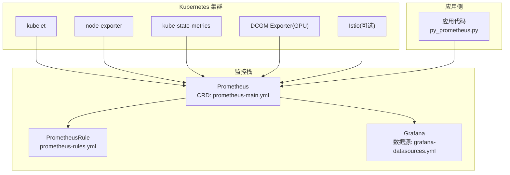
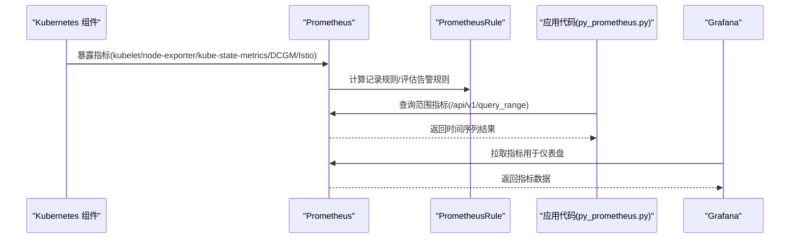
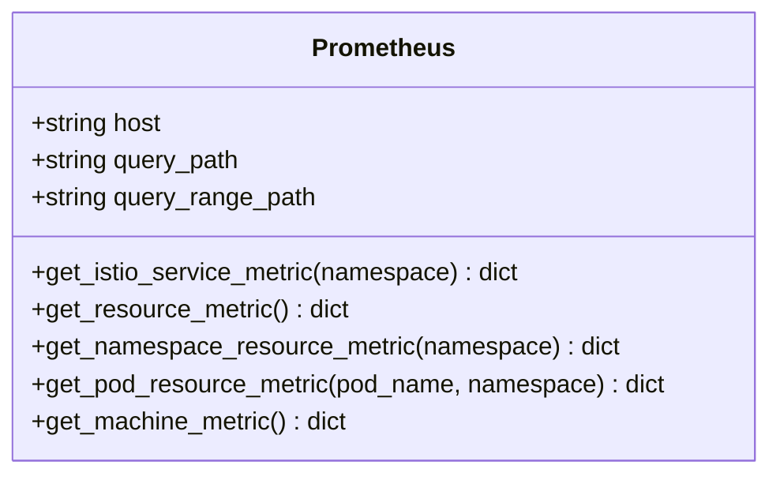
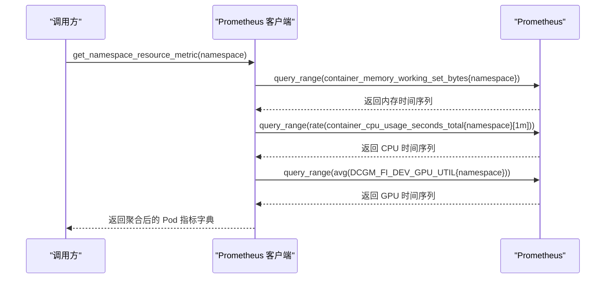
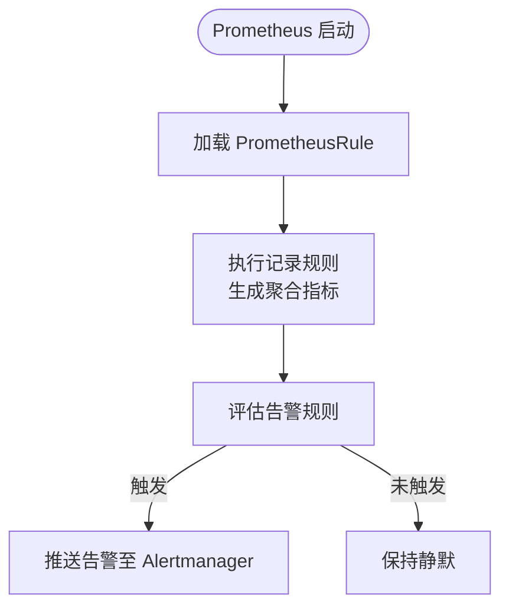
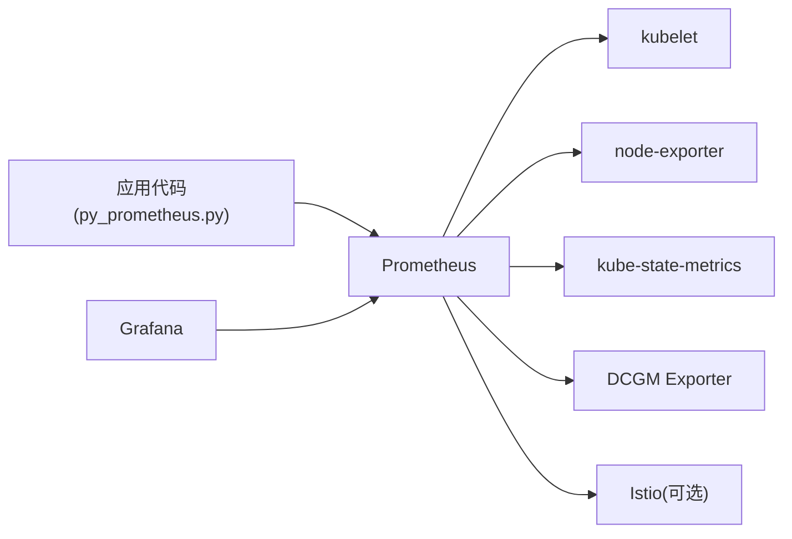

# 监控与计量

<cite>
**本文引用的文件**   
- [py_prometheus.py](file://myapp/utils/py/py_prometheus.py)
- [prometheus-main.yml](file://install/kubernetes/prometheus/prometheus/prometheus-main.yml)
- [prometheus-rules.yml](file://install/kubernetes/prometheus/prometheus/prometheus-rules.yml)
- [grafana-datasources.yml](file://install/kubernetes/prometheus/grafana/grafana-datasources.yml)
</cite>

## 目录
1. [简介](#简介)
2. [项目结构](#项目结构)
3. [核心组件](#核心组件)
4. [架构总览](#架构总览)
5. [详细组件分析](#详细组件分析)
6. [依赖关系分析](#依赖关系分析)
7. [性能考量](#性能考量)
8. [故障排查指南](#故障排查指南)
9. [结论](#结论)
10. [附录](#附录)

## 简介
本章节面向“监控与计量”主题，系统性说明资源使用监控、性能指标收集与计费统计的实现思路，并给出 Prometheus 集成、自定义指标定义与告警规则配置的具体实践。文档涵盖：
- 节点资源使用率采集（CPU/内存/GPU）
- Pod 性能指标采集（QPS、延迟、错误率等）
- 用户行为统计与业务指标接入
- 实时监控仪表板与历史数据分析
- 异常检测与自动扩缩容触发机制
- 实际监控配置示例与性能调优建议

## 项目结构
仓库中与监控相关的核心内容主要分布在以下位置：
- myapp/utils/py/py_prometheus.py：Prometheus 客户端封装，提供按命名空间、Pod、节点维度的指标查询能力
- install/kubernetes/prometheus/prometheus/prometheus-main.yml：Prometheus CRD 部署配置（存储、保留策略、Rule/ServiceMonitor 选择器、附加抓取配置挂载）
- install/kubernetes/prometheus/prometheus/prometheus-rules.yml：PrometheusRule 定义，包含大量记录规则与告警规则
- install/kubernetes/prometheus/grafana/grafana-datasources.yml：Grafana 数据源配置（指向 Prometheus）

图表来源
- [prometheus-main.yml:1-52](file://install/kubernetes/prometheus/prometheus/prometheus-main.yml#L1-L52)
- [prometheus-rules.yml:1-800](file://install/kubernetes/prometheus/prometheus/prometheus-rules.yml#L1-L800)
- [grafana-datasources.yml:1-22](file://install/kubernetes/prometheus/grafana/grafana-datasources.yml#L1-L22)
- [py_prometheus.py:1-463](file://myapp/utils/py/py_prometheus.py#L1-L463)

章节来源
- [prometheus-main.yml:1-52](file://install/kubernetes/prometheus/prometheus/prometheus-main.yml#L1-L52)
- [prometheus-rules.yml:1-800](file://install/kubernetes/prometheus/prometheus/prometheus-rules.yml#L1-L800)
- [grafana-datasources.yml:1-22](file://install/kubernetes/prometheus/grafana/grafana-datasources.yml#L1-L22)
- [py_prometheus.py:1-463](file://myapp/utils/py/py_prometheus.py#L1-L463)

## 核心组件
- Prometheus 客户端封装（Python）
  - 提供按命名空间、Pod 维度查询 CPU/内存/GPU 利用率的方法
  - 支持 Istio QPS 指标聚合
  - 统一通过 HTTP API 调用 /api/v1/query_range 进行范围查询
- Prometheus 部署与规则
  - 通过 CRD 部署 Prometheus，启用 RuleSelector 加载 PrometheusRule
  - 内置大量系统与应用层告警规则（如组件存活、资源超配、配额超限、API 错误率等）
- Grafana 数据源
  - 预置 Prometheus 数据源，便于直接构建仪表盘

章节来源
- [py_prometheus.py:6-463](file://myapp/utils/py/py_prometheus.py#L6-L463)
- [prometheus-main.yml:1-52](file://install/kubernetes/prometheus/prometheus/prometheus-main.yml#L1-L52)
- [prometheus-rules.yml:1-800](file://install/kubernetes/prometheus/prometheus/prometheus-rules.yml#L1-L800)
- [grafana-datasources.yml:1-22](file://install/kubernetes/prometheus/grafana/grafana-datasources.yml#L1-L22)

## 架构总览
下图展示从数据采集到可视化与告警的端到端流程：

图表来源
- [prometheus-main.yml:1-52](file://install/kubernetes/prometheus/prometheus/prometheus-main.yml#L1-L52)
- [prometheus-rules.yml:1-800](file://install/kubernetes/prometheus/prometheus/prometheus-rules.yml#L1-L800)
- [grafana-datasources.yml:1-22](file://install/kubernetes/prometheus/grafana/grafana-datasources.yml#L1-L22)
- [py_prometheus.py:1-463](file://myapp/utils/py/py_prometheus.py#L1-L463)

## 详细组件分析

### Prometheus 客户端封装（py_prometheus.py）
该模块定义了 Prometheus 类，封装了多种指标查询方法：
- get_istio_service_metric(namespace)
  - 聚合 Istio 请求 QPS（按 destination_workload/response_code）
  - 同时采集命名空间内 Pod 的 CPU/内存/GPU 指标
- get_resource_metric()
  - 获取当前集群所有 Pod 的 CPU/内存/GPU 最大值（最近一段时间窗口）
- get_namespace_resource_metric(namespace)
  - 按命名空间聚合 Pod 的 CPU/内存/GPU 指标
- get_pod_resource_metric(pod_name, namespace)
  - 针对指定 Pod 聚合 CPU/内存/GPU 指标
- get_machine_metric()
  - 预留节点级负载相关指标接口（示例中部分表达式为空占位）

关键实现要点：
- 统一使用 query_range 接口进行时间范围查询，step 粒度为 1m
- 对 GPU 指标使用 DCGM_FI_DEV_GPU_UTIL，并按百分比归一化
- 对 CPU 使用 container_cpu_usage_seconds_total 的 rate 计算瞬时速率
- 对内存使用 container_memory_working_set_bytes 取最大值

图表来源
- [py_prometheus.py:6-463](file://myapp/utils/py/py_prometheus.py#L6-L463)

章节来源
- [py_prometheus.py:16-131](file://myapp/utils/py/py_prometheus.py#L16-L131)
- [py_prometheus.py:137-233](file://myapp/utils/py/py_prometheus.py#L137-L233)
- [py_prometheus.py:236-333](file://myapp/utils/py/py_prometheus.py#L236-L333)
- [py_prometheus.py:337-414](file://myapp/utils/py/py_prometheus.py#L337-L414)
- [py_prometheus.py:418-456](file://myapp/utils/py/py_prometheus.py#L418-L456)

#### 指标采集时序图（以命名空间维度为例）

图表来源
- [py_prometheus.py:236-333](file://myapp/utils/py/py_prometheus.py#L236-L333)

### Prometheus 部署与规则（prometheus-main.yml 与 prometheus-rules.yml）
- prometheus-main.yml
  - 使用 Prometheus CRD 部署 Prometheus，设置 retention=3d，storage 使用 PVC
  - ruleSelector 匹配 prometheus=k8s 且 role=alert-rules 的规则对象
  - serviceMonitorSelector 匹配 k8s-app 存在的 ServiceMonitor
  - additionalScrapeConfigs 通过 ConfigMap 挂载额外抓取配置
- prometheus-rules.yml
  - 定义多组记录规则与告警规则，覆盖：
    - 命名空间/节点/调度器/API Server 等系统组件
    - 资源超配与配额超限告警
    - 组件存活与可用性告警（Alertmanager/KubeAPIServer/KubeScheduler/KubeStateMetrics/Kubelet/NodeExporter/Prometheus 等）
    - 应用健康（Pod CrashLooping/NotReady/Deployment/StatefulSet/DaemonSet/Job 等）
    - Prometheus 自身运行状态（配置重载失败、通知队列满、发送错误、TSDB 问题等）

图表来源
- [prometheus-main.yml:1-52](file://install/kubernetes/prometheus/prometheus/prometheus-main.yml#L1-L52)
- [prometheus-rules.yml:1-800](file://install/kubernetes/prometheus/prometheus/prometheus-rules.yml#L1-L800)

章节来源
- [prometheus-main.yml:1-52](file://install/kubernetes/prometheus/prometheus/prometheus-main.yml#L1-L52)
- [prometheus-rules.yml:1-800](file://install/kubernetes/prometheus/prometheus/prometheus-rules.yml#L1-L800)

### Grafana 数据源（grafana-datasources.yml）
- 通过 ConfigMap 预置 Prometheus 数据源，URL 指向 prometheus-k8s.monitoring.svc:9090
- 可直接在 Grafana 中创建仪表盘，基于 Prometheus 指标进行可视化

章节来源
- [grafana-datasources.yml:1-22](file://install/kubernetes/prometheus/grafana/grafana-datasources.yml#L1-L22)

## 依赖关系分析
- 组件耦合
  - 应用代码依赖 Prometheus HTTP API（query/query_range）
  - Prometheus 依赖 kubelet、node-exporter、kube-state-metrics、DCGM、Istio 等指标源
  - Grafana 依赖 Prometheus 作为数据源
- 外部依赖
  - Kubernetes 存储（PVC）用于持久化 TSDB
  - 可选：Alertmanager（未在 main.yml 中启用）

图表来源
- [py_prometheus.py:1-463](file://myapp/utils/py/py_prometheus.py#L1-L463)
- [prometheus-main.yml:1-52](file://install/kubernetes/prometheus/prometheus/prometheus-main.yml#L1-L52)

章节来源
- [py_prometheus.py:1-463](file://myapp/utils/py/py_prometheus.py#L1-L463)
- [prometheus-main.yml:1-52](file://install/kubernetes/prometheus/prometheus/prometheus-main.yml#L1-L52)

## 性能考量
- 指标采集频率与步长
  - 默认 step=1m，避免过细粒度导致查询压力过大
  - 对短生命周期任务（<1m）可能无法被采集，需根据业务调整
- 查询超时与并发
  - 客户端对多次 Prometheus 查询设置了较短超时（如 5s），防止阻塞
  - 建议在批量查询时控制并发度，避免对 Prometheus 造成瞬时压力
- 存储与保留策略
  - retention=3d，适合短期趋势分析与告警；如需长期归档，可结合远端存储或离线导出
- 资源超配与配额告警
  - 已内置 CPU/内存超配与配额超限告警，有助于提前发现容量瓶颈
- GPU 指标
  - 使用 DCGM_FI_DEV_GPU_UTIL，注意单位换算（百分比→小数）

[本节为通用指导，不直接分析具体文件]

## 故障排查指南
- Prometheus 不可用
  - 检查 Prometheus CRD 是否成功部署，ruleSelector/serviceMonitorSelector 是否正确
  - 查看 Prometheus 日志与存储卷挂载状态
- 指标缺失
  - 确认各 exporter（kubelet/node-exporter/kube-state-metrics/DCGM/Istio）目标可达
  - 检查 ServiceMonitor 是否匹配对应服务标签
- 告警未触发
  - 核对 PrometheusRule 中的 expr 与 for 条件是否符合预期
  - 若启用了 Alertmanager，检查通知通道与路由配置
- 查询缓慢或超时
  - 优化 PromQL，减少高基数标签组合
  - 适当增大 step 或缩小时间窗口

章节来源
- [prometheus-main.yml:1-52](file://install/kubernetes/prometheus/prometheus/prometheus-main.yml#L1-L52)
- [prometheus-rules.yml:1-800](file://install/kubernetes/prometheus/prometheus/prometheus-rules.yml#L1-L800)
- [py_prometheus.py:1-463](file://myapp/utils/py/py_prometheus.py#L1-L463)

## 结论
本项目提供了完整的监控与计量基础能力：
- 通过 Prometheus 采集节点与 Pod 的 CPU/内存/GPU 指标，并结合 Istio 获取服务 QPS
- 通过 PrometheusRule 定义丰富的记录与告警规则，覆盖系统与应用健康
- 通过 Grafana 数据源快速构建实时监控仪表盘
- 应用侧通过 Python 客户端封装，便捷地查询与聚合指标，支撑计费统计与自动化决策

在实际落地中，建议：
- 完善业务指标埋点（如用户行为、任务耗时、错误率）
- 结合 HPA/VPA 或自定义控制器，将告警与扩缩容联动
- 建立成本分摊模型，基于 CPU/内存/GPU 使用量进行计费统计

[本节为总结性内容，不直接分析具体文件]

## 附录

### 监控配置示例与最佳实践
- Prometheus 部署
  - 使用 CRD 部署，开启 RuleSelector 与 ServiceMonitorSelector
  - 合理设置 retention 与 storage，确保 TSDB 稳定
- 指标采集
  - 优先使用聚合指标（如 namespace/pod 维度）减少查询复杂度
  - 对 GPU 指标注意单位转换与空值处理
- 告警规则
  - 区分 warning/critical 级别，配合 for 持续时间避免抖动
  - 定期评审与清理无效规则，降低维护成本
- 可视化
  - 在 Grafana 中按命名空间/工作负载/节点维度构建仪表盘
  - 将关键指标（CPU/内存/GPU/QPS/错误率）纳入统一视图

[本节为通用指导，不直接分析具体文件]