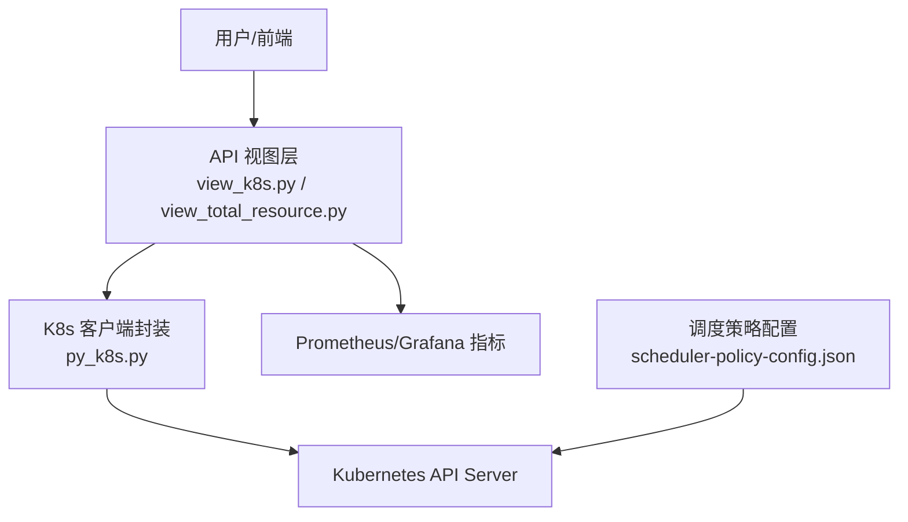
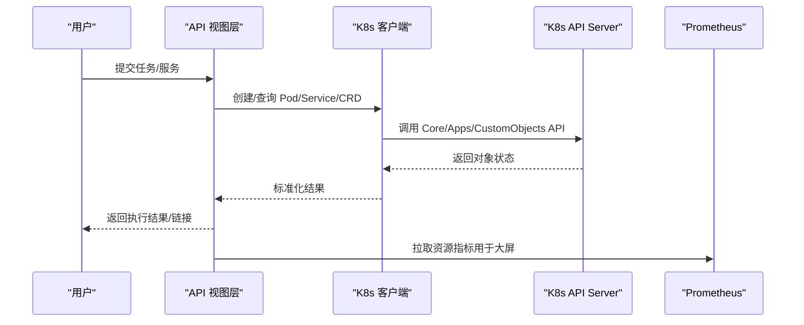
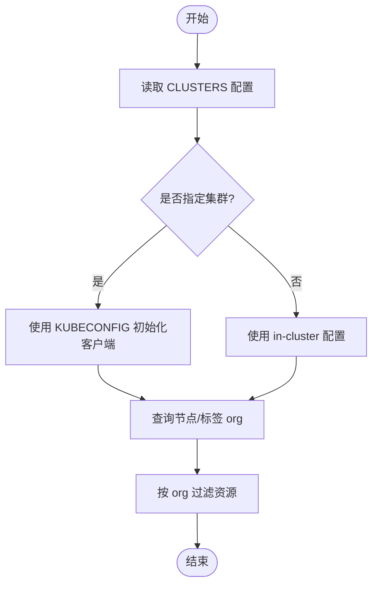
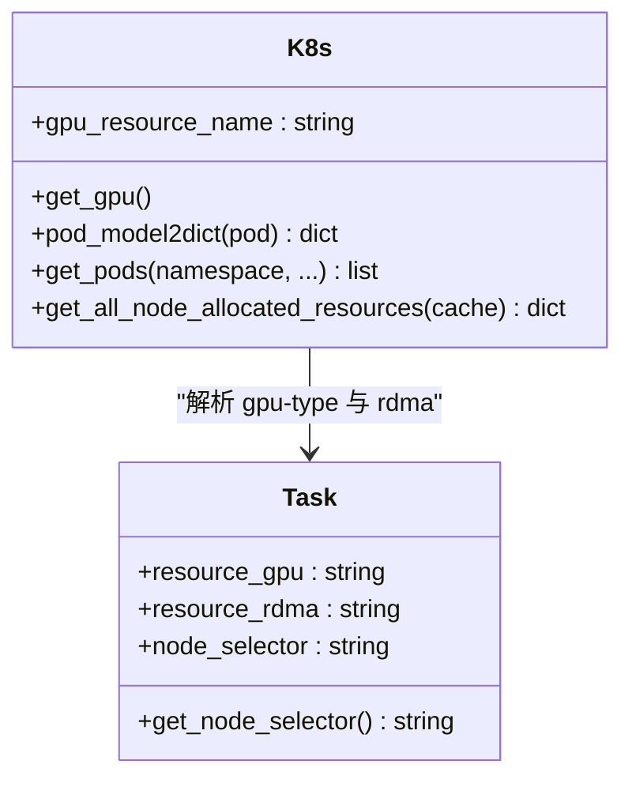
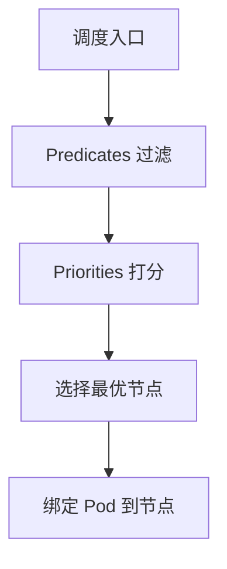
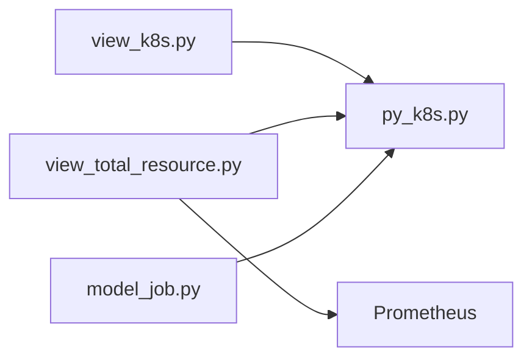
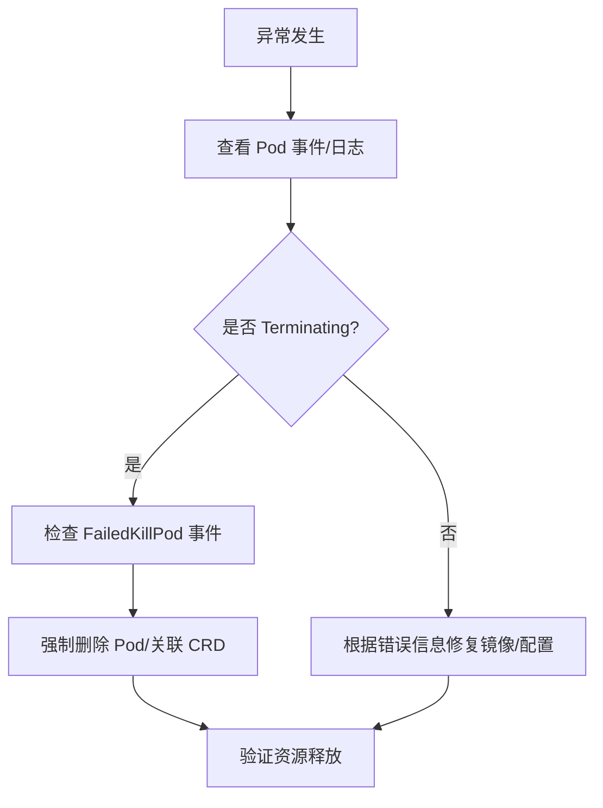
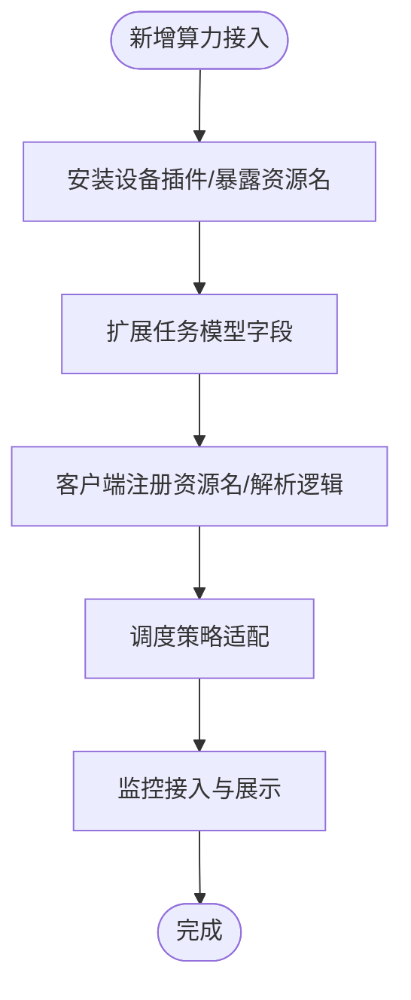
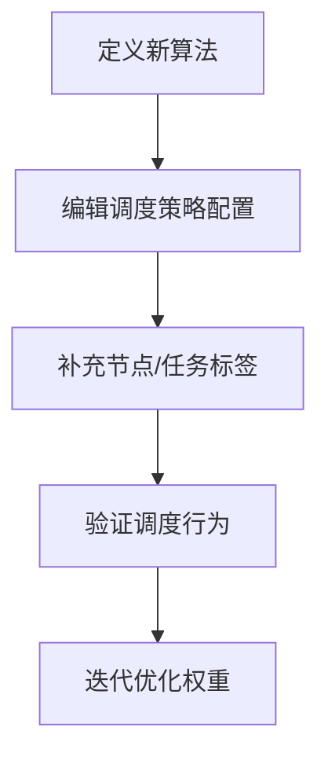

# 算力调度管理

<cite>
**本文引用的文件**   
- [README.md](file://README.md)
- [scheduler-policy-config.json](file://install/kubernetes/scheduler-policy-config.json)
- [py_k8s.py](file://myapp/utils/py/py_k8s.py)
- [view_k8s.py](file://myapp/views/view_k8s.py)
- [view_total_resource.py](file://myapp/views/view_total_resource.py)
- [model_job.py](file://myapp/models/model_job.py)
</cite>

## 目录
1. [引言](#引言)
2. [项目结构](#项目结构)
3. [核心组件](#核心组件)
4. [架构总览](#架构总览)
5. [详细组件分析](#详细组件分析)
6. [依赖关系分析](#依赖关系分析)
7. [性能与优化](#性能与优化)
8. [故障排查指南](#故障排查指南)
9. [结论](#结论)
10. [附录：扩展实践](#附录扩展实践)

## 引言
本文件面向“算力调度管理”主题，系统性梳理多集群管理、资源组配置、GPU/NPU 调度与 vGPU 虚拟化、异构算力支持（NVIDIA、华为 NPU、海光 DCU 等）、RDMA 网络支持与存储卷管理；并给出调度策略配置、资源配额与计量计费能力说明。同时提供扩展新算力类型与调度算法的实践路径，以及性能优化、故障转移与监控的最佳实践。

## 项目结构
本项目围绕 Kubernetes 作为调度底座，结合平台后端 API、K8s 客户端封装、资源监控与可视化，形成从“任务编排—资源调度—运行观测—治理回收”的闭环。关键目录与职责如下：
- install/kubernetes：集群部署与调度策略配置文件（如调度优先级策略）
- myapp/utils/py/py_k8s.py：Kubernetes 客户端封装，统一访问 Pod/Node/CRD 等资源
- myapp/views：Web API 视图层，提供 K8s 对象操作、整体资源展示与批量清理
- myapp/models/model_job.py：Pipeline/Task/Workflow 等模型定义，承载任务编排与调度参数
- README.md：平台功能与架构总览，包含异构算力、vGPU/RDMA、计量计费与监控等能力说明

图表来源
- [view_k8s.py:32-125](file://myapp/views/view_k8s.py#L32-L125)
- [view_total_resource.py:273-340](file://myapp/views/view_total_resource.py#L273-L340)
- [py_k8s.py:21-68](file://myapp/utils/py/py_k8s.py#L21-L68)
- [scheduler-policy-config.json:1-65](file://install/kubernetes/scheduler-policy-config.json#L1-L65)

章节来源
- [README.md:18-163](file://README.md#L18-L163)

## 核心组件
- 多集群管理：通过 CLUSTERS 配置项与 Kubeconfig 切换，实现多集群统一接入与隔离
- 资源组与命名空间：以 label org 与 namespace 区分资源组与业务域
- GPU/NPU/vGPU 调度：基于 nvidia.com/gpu 资源名与 core.get_gpu 解析卡型，支持整卡/共享/虚拟显存模式
- RDMA 网络：任务模板透传 rdma 资源数量，配合底层 IB/RoCE 网络
- 存储卷管理：PVC/HostPath/ConfigMap 挂载，支持 NFS/CFS/OSS/NAS/COS/GlusterFS/CephFS/S3/MinIO
- 计量计费：按用户/项目/任务维度统计 CPU/Mem/GPU 使用，支持自定义计费与日结账单

章节来源
- [README.md:203-210](file://README.md#L203-L210)
- [model_job.py:523-554](file://myapp/models/model_job.py#L523-L554)

## 架构总览
下图展示从任务提交到调度落地的端到端流程，涵盖 Web 接口、K8s 客户端、调度策略与监控采集。

图表来源
- [view_k8s.py:32-125](file://myapp/views/view_k8s.py#L32-L125)
- [py_k8s.py:204-267](file://myapp/utils/py/py_k8s.py#L204-L267)
- [view_total_resource.py:343-355](file://myapp/views/view_total_resource.py#L343-L355)

## 详细组件分析

### 多集群管理与资源组
- 多集群接入：通过 CLUSTERS 配置项中的 KUBECONFIG 字段选择目标集群，K8s 客户端在构造时自动加载对应 kubeconfig
- 资源组隔离：节点标签 org 标识资源组，Pod 的 node_selector 与 labels 携带 org，便于聚合与过滤
- 命名空间划分：pipeline/service/jupyter/aihub 等命名空间承载不同业务域

图表来源
- [py_k8s.py:21-68](file://myapp/utils/py/py_k8s.py#L21-L68)
- [view_total_resource.py:27-50](file://myapp/views/view_total_resource.py#L27-L50)

章节来源
- [py_k8s.py:21-68](file://myapp/utils/py/py_k8s.py#L21-L68)
- [view_total_resource.py:27-50](file://myapp/views/view_total_resource.py#L27-L50)

### GPU/NPU 调度与 vGPU 虚拟化
- GPU 资源名：默认 nvidia.com/gpu，由 core.get_gpu 解析卡型（T4/V100/A100 等），并在 Pod 资源请求中体现
- 调度模式：整卡独占、共享、vGPU 虚拟显存占用；支持指定卡序号（厂商插件能力）
- 异构算力：平台原生适配昇腾 NPU、海光 DCU、寒武纪 MLU、摩尔线程、沐曦、壁仞、百度昆仑芯等

图表来源
- [py_k8s.py:66-68](file://myapp/utils/py/py_k8s.py#L66-L68)
- [model_job.py:575-580](file://myapp/models/model_job.py#L575-L580)

章节来源
- [README.md:31-33](file://README.md#L31-L33)
- [model_job.py:575-580](file://myapp/models/model_job.py#L575-L580)
- [py_k8s.py:66-68](file://myapp/utils/py/py_k8s.py#L66-L68)

### RDMA 网络支持
- 任务侧：Task.resource_rdma 声明 RDMA 资源数量，模板透传至 Pod 资源请求
- 集群侧：底层 IB/RoCE 网络启用，节点可标记 RDMA 能力（由设备插件/节点标签体现）
- 调度侧：结合 NodeSelector/Affinity 将任务调度到具备 RDMA 能力的节点

章节来源
- [README.md:32-33](file://README.md#L32-L33)
- [model_job.py:546-546](file://myapp/models/model_job.py#L546-L546)

### 存储卷管理
- 挂载方式：PVC/HostPath/ConfigMap 直接挂载为容器目录
- 分布式存储：NFS/CFS/OSS/NAS/COS/GlusterFS/CephFS/S3/MinIO
- 项目组绑定：可在项目维度设置默认挂载，便于组内共享

章节来源
- [README.md:222-226](file://README.md#L222-L226)

### 调度策略配置
- 调度优先级：RequestedToCapacityRatioPriority、BalancedResourceAllocation、NodeAffinityPriority、TaintTolerationPriority 等
- 权重与形状：CPU/Memory 利用率评分曲线，控制 binpack/spread 倾向
- 建议：根据业务特性调整权重，平衡碎片化与利用率

图表来源
- [scheduler-policy-config.json:1-65](file://install/kubernetes/scheduler-policy-config.json#L1-L65)

章节来源
- [scheduler-policy-config.json:1-65](file://install/kubernetes/scheduler-policy-config.json#L1-L65)

### 资源配额与计量计费
- 配额维度：平台/项目/用户/任务/组内个人多级限制，覆盖 Notebook/Docker/Pipeline/超参搜索/内部服务/推理服务
- 计量口径：CPU/Mem/GPU 申请值与实际使用率，结合 Prometheus 指标聚合
- 计费模式：支持自定义计费函数，按量结算与日结账单

章节来源
- [README.md:36-38](file://README.md#L36-L38)
- [view_total_resource.py:343-394](file://myapp/views/view_total_resource.py#L343-L394)

## 依赖关系分析
- 视图层依赖 K8s 客户端进行资源读写
- 视图层依赖 Prometheus 获取实时指标
- 模型层定义 Pipeline/Task/Workflow 等实体，承载调度参数与状态
- 调度策略由 K8s 调度器依据 Policy 配置执行

图表来源
- [view_k8s.py:32-125](file://myapp/views/view_k8s.py#L32-L125)
- [view_total_resource.py:273-340](file://myapp/views/view_total_resource.py#L273-L340)
- [model_job.py:523-554](file://myapp/models/model_job.py#L523-L554)
- [py_k8s.py:204-267](file://myapp/utils/py/py_k8s.py#L204-L267)

章节来源
- [view_k8s.py:32-125](file://myapp/views/view_k8s.py#L32-L125)
- [view_total_resource.py:273-340](file://myapp/views/view_total_resource.py#L273-L340)
- [model_job.py:523-554](file://myapp/models/model_job.py#L523-L554)
- [py_k8s.py:204-267](file://myapp/utils/py/py_k8s.py#L204-L267)

## 性能与优化
- 缓存策略：节点/Pod 列表查询引入缓存键（all_nodes/all_pods），降低频繁 API 调用开销
- 异步刷新：对大规模集群，触发异步任务更新缓存，避免阻塞主流程
- 指标聚合：Prometheus 指标拉取后缓存，减少重复计算
- 调度优化：合理配置调度优先级权重，避免过度碎片化或热点集中

章节来源
- [py_k8s.py:204-267](file://myapp/utils/py/py_k8s.py#L204-L267)
- [view_total_resource.py:27-50](file://myapp/views/view_total_resource.py#L27-L50)
- [view_total_resource.py:343-355](file://myapp/views/view_total_resource.py#L343-L355)

## 故障排查指南
- Pod 日志与事件：通过 API 查看 Pod 日志与事件，定位启动失败原因
- Terminating 不释放：识别 FailedKillPod 事件，必要时强制删除
- 权限校验：非管理员仅能查看/操作自身 Pod，需确认用户上下文
- 批量清理：按命名空间与标签清理 pipeline/service/notebook 相关资源

图表来源
- [view_k8s.py:251-334](file://myapp/views/view_k8s.py#L251-L334)
- [view_total_resource.py:432-512](file://myapp/views/view_total_resource.py#L432-L512)

章节来源
- [view_k8s.py:251-334](file://myapp/views/view_k8s.py#L251-L334)
- [view_total_resource.py:432-512](file://myapp/views/view_total_resource.py#L432-L512)

## 结论
本平台以 Kubernetes 为底座，结合统一的 K8s 客户端封装、灵活的调度策略与完善的监控体系，实现对多集群、多资源组的统一管控；在 GPU/NPU/vGPU 与 RDMA 方面提供开箱即用的调度能力，并通过计量计费与资源限额保障成本可控与公平性。通过缓存与异步刷新提升性能，借助事件与日志机制完善故障处理，形成稳定高效的算力调度管理体系。

## 附录：扩展实践

### 扩展新的算力类型（示例：新增某国产 AI 芯片）
- 步骤概览
  - 在节点侧安装对应设备插件，暴露自定义资源名（例如 vendor.com/accelerator）
  - 在任务模型中增加该资源类型的声明字段（参考 resource_gpu/resource_rdma）
  - 在 K8s 客户端中注册新的资源名与解析逻辑（参考 gpu_resource_name 与 get_gpu）
  - 在调度策略中考虑亲和性与容忍度，确保任务被调度到具备该算力的节点
  - 在监控侧接入对应指标的采集与展示

图表来源
- [model_job.py:543-546](file://myapp/models/model_job.py#L543-L546)
- [py_k8s.py:66-68](file://myapp/utils/py/py_k8s.py#L66-L68)
- [scheduler-policy-config.json:1-65](file://install/kubernetes/scheduler-policy-config.json#L1-L65)

章节来源
- [model_job.py:543-546](file://myapp/models/model_job.py#L543-L546)
- [py_k8s.py:66-68](file://myapp/utils/py/py_k8s.py#L66-L68)
- [scheduler-policy-config.json:1-65](file://install/kubernetes/scheduler-policy-config.json#L1-L65)

### 扩展新的调度算法（示例：自定义 Priorities）
- 步骤概览
  - 在调度策略配置文件中新增自定义优先级规则与权重
  - 在节点/任务层面补充必要标签或注解，供算法评估
  - 验证调度效果，观察节点利用率与任务分布变化

图表来源
- [scheduler-policy-config.json:1-65](file://install/kubernetes/scheduler-policy-config.json#L1-L65)

章节来源
- [scheduler-policy-config.json:1-65](file://install/kubernetes/scheduler-policy-config.json#L1-L65)