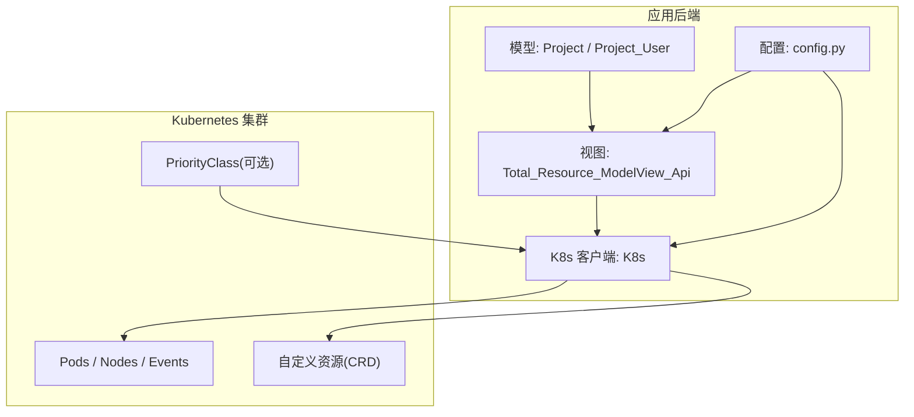
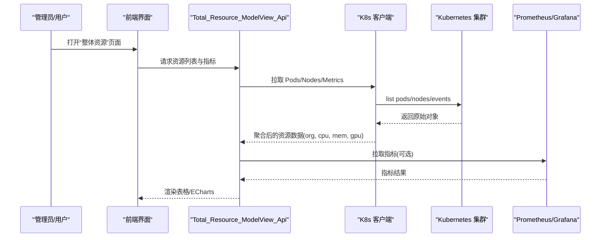
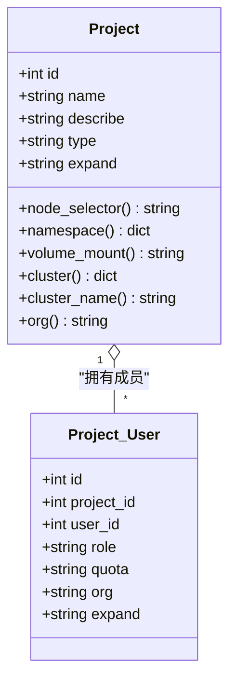
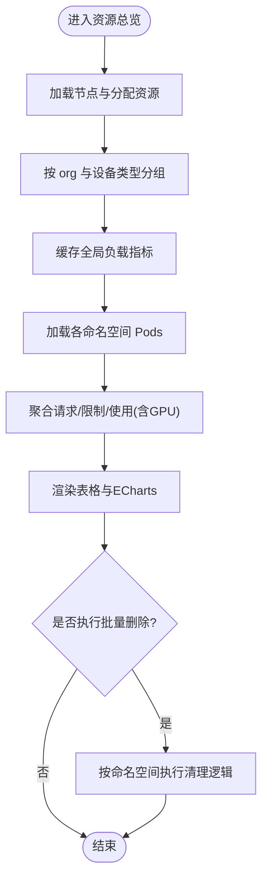
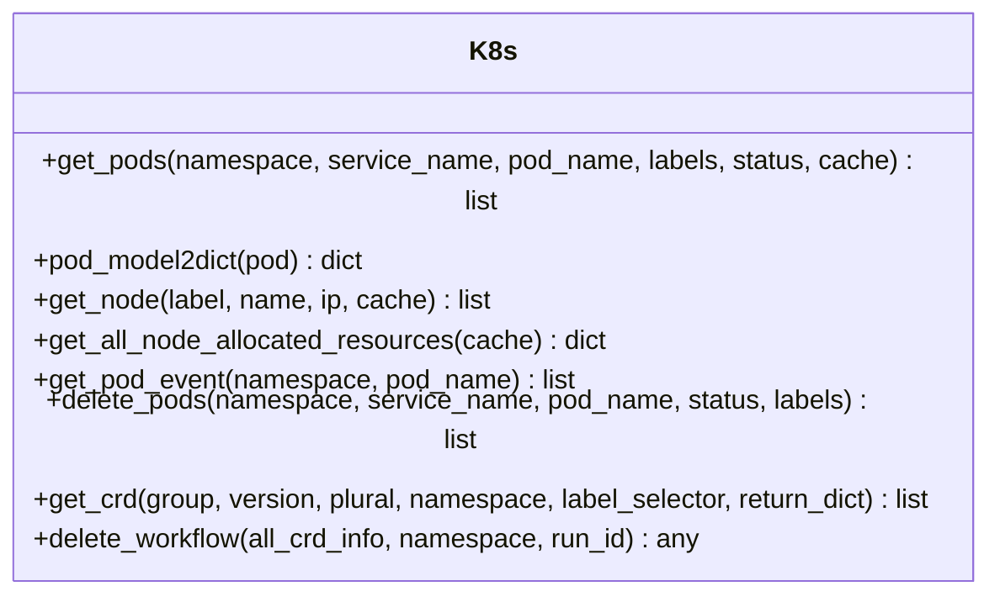
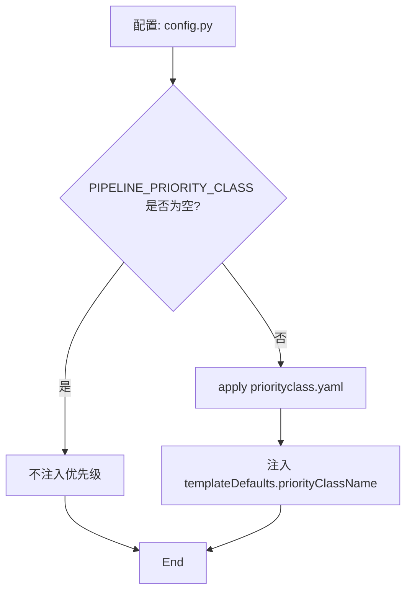
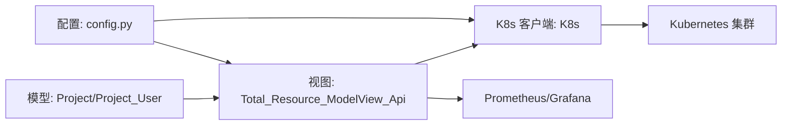

# 资源组管理

<cite>
**本文引用的文件**   
- [model_team.py](file://myapp/models/model_team.py)
- [view_total_resource.py](file://myapp/views/view_total_resource.py)
- [py_k8s.py](file://myapp/utils/py/py_k8s.py)
- [config.py](file://myapp/config.py)
- [priorityclass.yaml](file://install/kubernetes/cube/priorityclass.yaml)
- [pipeline_schedule.py](file://myapp/utils/py/pipeline_schedule.py)
</cite>

## 目录
1. [简介](#简介)
2. [项目结构](#项目结构)
3. [核心组件](#核心组件)
4. [架构总览](#架构总览)
5. [详细组件分析](#详细组件分析)
6. [依赖关系分析](#依赖关系分析)
7. [性能与调度特性](#性能与调度特性)
8. [故障排查指南](#故障排查指南)
9. [结论](#结论)
10. [附录：配置模板与管理最佳实践](#附录配置模板与管理最佳实践)

## 简介
本文件面向 Cube Studio 的“资源组”能力，系统性说明资源组的创建、配置与生命周期管理；解释资源配额、限制策略与优先级调度；给出 CPU/GPU/内存配额、存储配额与网络限制的落地方式；覆盖多租户隔离、资源共享与成本分摊机制；并提供监控与告警的配置建议。文档同时提供可追溯的代码级来源，帮助读者在仓库中快速定位实现位置。

## 项目结构
围绕资源组的核心代码分布在以下模块：
- 模型层：项目与用户成员的资源额度、组织归属等元数据定义
- 视图层：资源使用统计、集群节点负载、Pod 资源占用展示与批量清理
- K8s 客户端：Pod/Node 信息读取、资源聚合、事件获取、CRD 操作
- 配置中心：全局默认资源上限、命名空间、优先级映射等
- 调度扩展：Pipeline 任务流优先级注入（企业版）

**图表来源** 
- [model_team.py:26-225](file://myapp/models/model_team.py#L26-L225)
- [view_total_resource.py:273-544](file://myapp/views/view_total_resource.py#L273-L544)
- [py_k8s.py:21-267](file://myapp/utils/py/py_k8s.py#L21-L267)
- [config.py:555-758](file://myapp/config.py#L555-L758)
- [priorityclass.yaml:1-34](file://install/kubernetes/cube/priorityclass.yaml#L1-L34)

**章节来源**
- [model_team.py:26-225](file://myapp/models/model_team.py#L26-L225)
- [view_total_resource.py:273-544](file://myapp/views/view_total_resource.py#L273-L544)
- [py_k8s.py:21-267](file://myapp/utils/py/py_k8s.py#L21-L267)
- [config.py:555-758](file://myapp/config.py#L555-L758)
- [priorityclass.yaml:1-34](file://install/kubernetes/cube/priorityclass.yaml#L1-L34)

## 核心组件
- 项目与成员模型（Project / Project_User）
  - 支持通过 expand 字段声明 node_selector、volume_mount、cluster、org 等扩展属性
  - 成员维度支持 quota（资源额度）、org（可用资源组）等字段
- 资源总览视图（Total_Resource_ModelView_Api）
  - 聚合各集群节点负载、按 org 分组统计 Pod 资源请求与实际使用
  - 提供列表查询、ECharts 指标渲染、批量删除等操作
- K8s 客户端（K8s）
  - 统一封装 Pod/Node/Event/CRD 的读写、状态解析、资源聚合
  - 提供缓存加速、异步刷新、错误处理等能力
- 配置（config.py）
  - 全局默认资源上限、命名空间、优先级映射 PIPELINE_PRIORITY_CLASS 等
- 优先级类（priorityclass.yaml）
  - 定义 pipeline-high/mid/low 三档 PriorityClass（企业版 opt-in）

**章节来源**
- [model_team.py:26-225](file://myapp/models/model_team.py#L26-L225)
- [view_total_resource.py:273-544](file://myapp/views/view_total_resource.py#L273-L544)
- [py_k8s.py:21-267](file://myapp/utils/py/py_k8s.py#L21-L267)
- [config.py:555-758](file://myapp/config.py#L555-L758)
- [priorityclass.yaml:1-34](file://install/kubernetes/cube/priorityclass.yaml#L1-L34)

## 架构总览
资源组在平台中的职责边界如下：
- 多租户隔离：以 org 为维度进行资源分组与权限过滤
- 资源配额与限制：通过成员 quota 与系统默认上限控制申请量
- 优先级调度：企业版通过 PriorityClass 将 pipeline 任务分为高/中/低三档
- 监控与告警：基于 Prometheus 与 Grafana 采集 Pod/Node 指标，并在前端聚合展示

**图表来源** 
- [view_total_resource.py:174-269](file://myapp/views/view_total_resource.py#L174-L269)
- [py_k8s.py:204-267](file://myapp/utils/py/py_k8s.py#L204-L267)
- [config.py:724-725](file://myapp/config.py#L724-L725)

## 详细组件分析

### 模型层：项目与成员（资源组与配额）
- Project.expand
  - node_selector：用于节点亲和/选择器，支持追加 org 标签
  - volume_mount：挂载卷，自动补充个人工作区路径
  - cluster：指定运行集群
  - org：组织标识，作为资源组维度
- Project_User.quota / org
  - quota：用户在该项目中可用的资源额度（字符串描述）
  - org：用户成员可用资源组

**图表来源** 
- [model_team.py:26-225](file://myapp/models/model_team.py#L26-L225)

**章节来源**
- [model_team.py:26-225](file://myapp/models/model_team.py#L26-L225)

### 视图层：资源总览与生命周期管理
- 节点负载聚合（node_traffic）
  - 遍历集群节点，按 org 与设备类型(cpu/gpu)分组
  - 计算并缓存全局负载指标
- Pod 资源统计（pod_resource）
  - 遍历所有命名空间，按 org 聚合 Pod 的请求/限制/实际使用
  - 关联 Prometheus 指标，生成前端展示数据
- 列表与操作
  - 列表列包含 cluster/project/resource_group/namespace/pod/username/node/cpu/memory/gpu/start_time
  - 批量删除：根据命名空间执行不同清理逻辑（jupyter/service/aihub/pipeline/automl）

**图表来源** 
- [view_total_resource.py:26-169](file://myapp/views/view_total_resource.py#L26-L169)
- [view_total_resource.py:174-269](file://myapp/views/view_total_resource.py#L174-L269)
- [view_total_resource.py:430-512](file://myapp/views/view_total_resource.py#L430-L512)

**章节来源**
- [view_total_resource.py:26-169](file://myapp/views/view_total_resource.py#L26-L169)
- [view_total_resource.py:174-269](file://myapp/views/view_total_resource.py#L174-L269)
- [view_total_resource.py:273-544](file://myapp/views/view_total_resource.py#L273-L544)

### K8s 客户端：资源读取与状态解析
- Pod 模型转字典（pod_model2dict）
  - 提取 CPU/内存/GPU 的请求与限制
  - 解析 node_selector、labels、annotations、容器镜像、启动时间等
- Pod/Node 查询与缓存
  - get_pods/get_node 支持缓存与异步刷新
- 事件与状态
  - get_pod_event/get_job_event 标准化时间戳
- CRD 操作
  - get_crd/delete_crd/get_crd_all_namespaces 等

**图表来源** 
- [py_k8s.py:21-267](file://myapp/utils/py/py_k8s.py#L21-L267)
- [py_k8s.py:338-393](file://myapp/utils/py/py_k8s.py#L338-L393)
- [py_k8s.py:410-467](file://myapp/utils/py/py_k8s.py#L410-L467)
- [py_k8s.py:679-779](file://myapp/utils/py/py_k8s.py#L679-L779)

**章节来源**
- [py_k8s.py:21-267](file://myapp/utils/py/py_k8s.py#L21-L267)
- [py_k8s.py:338-393](file://myapp/utils/py/py_k8s.py#L338-L393)
- [py_k8s.py:410-467](file://myapp/utils/py/py_k8s.py#L410-L467)
- [py_k8s.py:679-779](file://myapp/utils/py/py_k8s.py#L679-L779)

### 配置与优先级调度
- 全局默认资源上限
  - MAX_TASK_CPU/MAX_TASK_MEM 控制任务最大申请值
- 命名空间与镜像策略
  - PIPELINE_NAMESPACE/SERVICE_NAMESPACE/AUTOML_NAMESPACE/NOTEBOOK_NAMESPACE 等
- 优先级映射（企业版）
  - PIPELINE_PRIORITY_CLASS 为空时不注入 priorityClassName
  - 启用需先 apply priorityclass.yaml，再设置映射
- Pipeline 调度扩展
  - pipeline_schedule.py 中 templateDefaults.priorityClassName 注入

**图表来源** 
- [config.py:555-758](file://myapp/config.py#L555-L758)
- [priorityclass.yaml:1-34](file://install/kubernetes/cube/priorityclass.yaml#L1-L34)
- [pipeline_schedule.py:31-31](file://myapp/utils/py/pipeline_schedule.py#L31-L31)

**章节来源**
- [config.py:555-758](file://myapp/config.py#L555-L758)
- [priorityclass.yaml:1-34](file://install/kubernetes/cube/priorityclass.yaml#L1-L34)
- [pipeline_schedule.py:31-31](file://myapp/utils/py/pipeline_schedule.py#L31-L31)

## 依赖关系分析
- 视图层依赖 K8s 客户端进行资源读取与聚合
- 模型层提供项目与成员的组织与额度信息，供视图层进行权限过滤与分组
- 配置中心提供全局默认值与优先级映射
- Prometheus/Grafana 作为外部依赖，提供监控指标

**图表来源** 
- [model_team.py:26-225](file://myapp/models/model_team.py#L26-L225)
- [view_total_resource.py:273-544](file://myapp/views/view_total_resource.py#L273-L544)
- [py_k8s.py:21-267](file://myapp/utils/py/py_k8s.py#L21-L267)
- [config.py:555-758](file://myapp/config.py#L555-L758)

**章节来源**
- [model_team.py:26-225](file://myapp/models/model_team.py#L26-L225)
- [view_total_resource.py:273-544](file://myapp/views/view_total_resource.py#L273-L544)
- [py_k8s.py:21-267](file://myapp/utils/py/py_k8s.py#L21-L267)
- [config.py:555-758](file://myapp/config.py#L555-L758)

## 性能与调度特性
- 缓存与异步刷新
  - get_pods/get_node/get_all_node_allocated_resources 支持缓存与异步任务刷新，降低频繁查询开销
- 指标聚合优化
  - 全局负载指标缓存 60 秒，节点流量数据缓存 10 秒
- 优先级调度
  - 企业版通过 PriorityClass 将 pipeline 任务分为高/中/低三档，preemptionPolicy=Never，避免抢占训练任务

**章节来源**
- [py_k8s.py:204-267](file://myapp/utils/py/py_k8s.py#L204-L267)
- [py_k8s.py:338-393](file://myapp/utils/py/py_k8s.py#L338-L393)
- [view_total_resource.py:153-169](file://myapp/views/view_total_resource.py#L153-L169)
- [priorityclass.yaml:1-34](file://install/kubernetes/cube/priorityclass.yaml#L1-L34)

## 故障排查指南
- Pod 无法调度或 Pending
  - 检查 Pod 的 requests/limits 是否超过 MAX_TASK_CPU/MAX_TASK_MEM
  - 查看 Node 标签与 org 是否符合资源组约束
  - 确认 PriorityClass 是否已正确 apply 且映射配置生效
- 资源使用异常
  - 通过“整体资源”页面查看 Pod 的请求/限制与实际使用差异
  - 结合 Prometheus/Grafana 查看历史利用率曲线
- 批量删除失败
  - 确认命名空间与资源类型匹配（jupyter/service/aihub/pipeline/automl）
  - 检查 CRD 是否存在及权限是否足够

**章节来源**
- [config.py:555-558](file://myapp/config.py#L555-L558)
- [view_total_resource.py:430-512](file://myapp/views/view_total_resource.py#L430-L512)
- [py_k8s.py:204-267](file://myapp/utils/py/py_k8s.py#L204-L267)

## 结论
Cube Studio 的资源组以 org 为核心维度，结合项目与成员模型实现多租户隔离；通过 K8s 客户端聚合 Pod/Node 指标，在前端提供可视化与批量管理能力；企业版通过 PriorityClass 实现 pipeline 任务的优先级调度。配合 Prometheus/Grafana，可实现完整的资源监控与告警闭环。

## 附录：配置模板与管理最佳实践

### 资源组创建与配置
- 在项目 expand 中设置 org、node_selector、volume_mount、cluster 等
- 在成员级别设置 quota 与 org，限定用户可用资源范围

参考来源：
- [model_team.py:63-73](file://myapp/models/model_team.py#L63-L73)
- [model_team.py:105-126](file://myapp/models/model_team.py#L105-L126)
- [model_team.py:167-173](file://myapp/models/model_team.py#L167-L173)
- [model_team.py:213-215](file://myapp/models/model_team.py#L213-L215)

### CPU/GPU/内存配额与限制
- 全局默认上限：MAX_TASK_CPU/MAX_TASK_MEM
- Pod 资源请求与限制：由 K8s 客户端解析 requests/limits 并展示
- GPU 资源名：nvidia.com/gpu

参考来源：
- [config.py:555-558](file://myapp/config.py#L555-L558)
- [py_k8s.py:140-151](file://myapp/utils/py/py_k8s.py#L140-L151)
- [py_k8s.py:167-201](file://myapp/utils/py/py_k8s.py#L167-L201)

### 存储配额
- 工作区与归档目录：WORKSPACE_HOST_PATH/ARCHIVES_HOST_PATH
- 定时检查与清理：CHECK_WORKSPACE_SIZE/DELETE_OLD_DATA

参考来源：
- [config.py:710-723](file://myapp/config.py#L710-L723)

### 网络限制
- 服务域名与网络模式：SERVICE_DOMAIN/K8S_NETWORK_MODE
- 黑名单端口：BLACK_PORT

参考来源：
- [model_team.py:129-153](file://myapp/models/model_team.py#L129-L153)
- [config.py:744-747](file://myapp/config.py#L744-L747)

### 多租户隔离、资源共享与成本分摊
- 多租户隔离：按 org 分组与权限过滤
- 资源共享：节点 share 标签区分共享/独占
- 成本分摊：按 org 统计资源请求与实际使用，结合 Prometheus 指标进行分摊核算

参考来源：
- [view_total_resource.py:88-151](file://myapp/views/view_total_resource.py#L88-L151)
- [view_total_resource.py:194-217](file://myapp/views/view_total_resource.py#L194-L217)

### 监控与告警配置
- Prometheus 地址：PROMETHEUS
- 首页告警开关：ENABEL_ALERT_HOMEPAGE
- 资源总览 ECharts 指标：从 Prometheus 拉取并缓存

参考来源：
- [config.py:724-725](file://myapp/config.py#L724-L725)
- [config.py:654-656](file://myapp/config.py#L654-L656)
- [view_total_resource.py:349-355](file://myapp/views/view_total_resource.py#L349-L355)