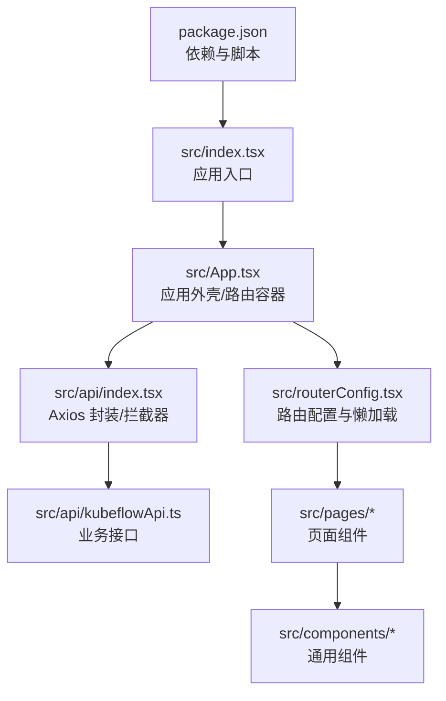
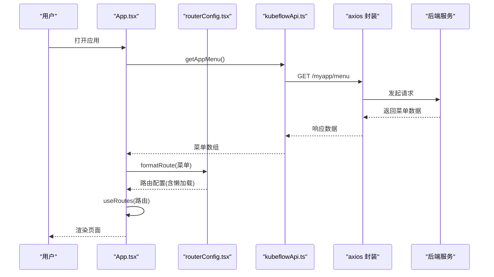
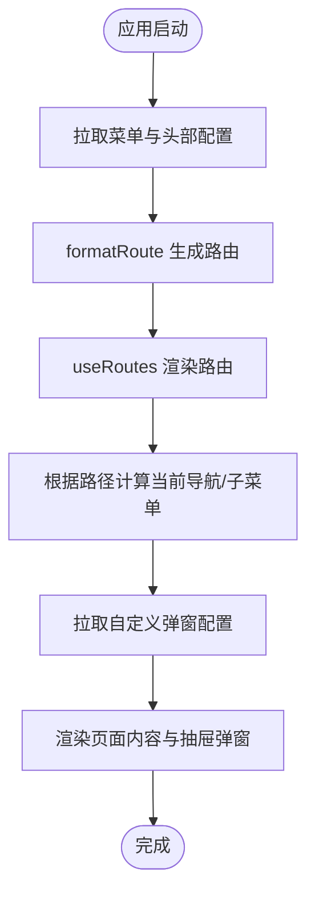
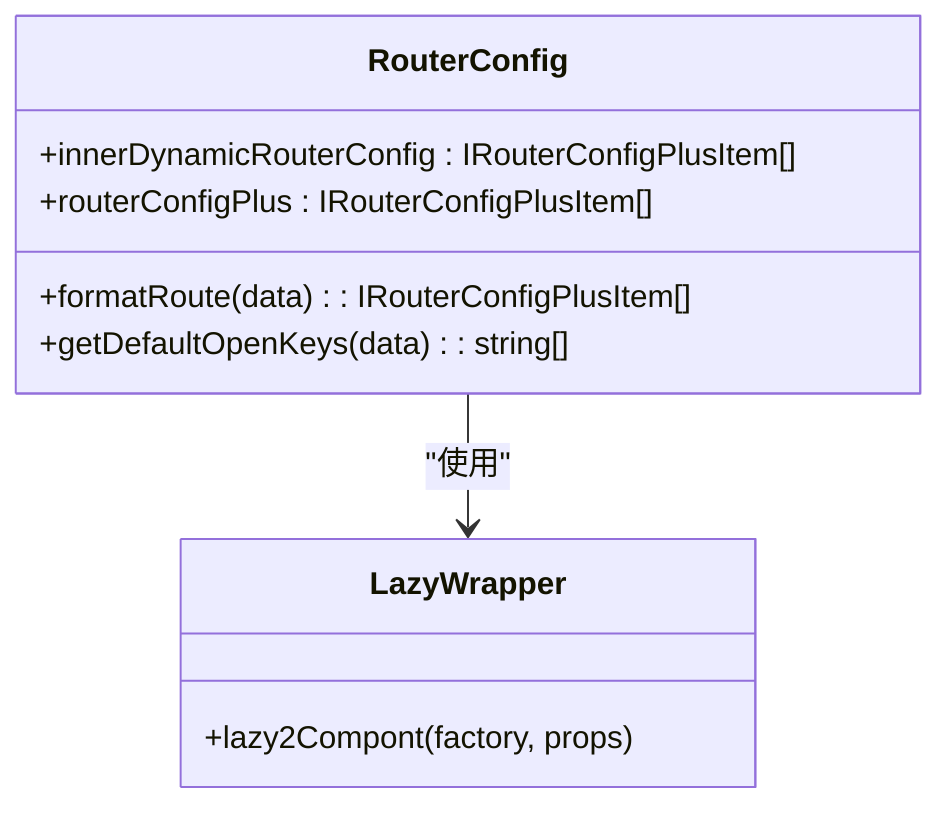
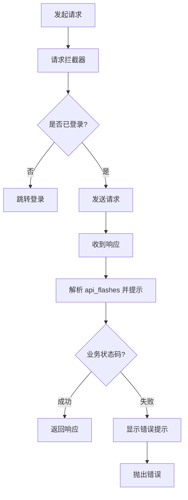
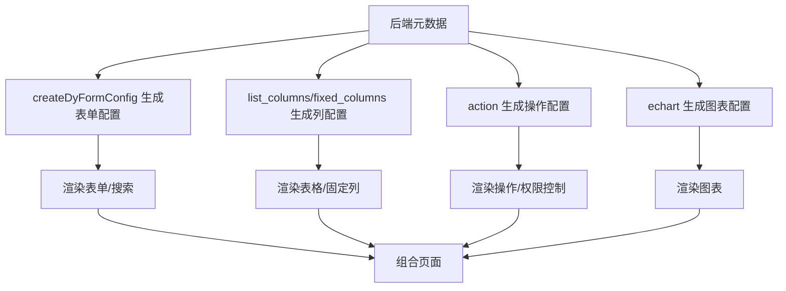
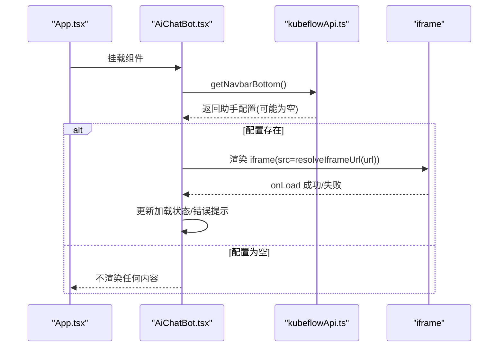
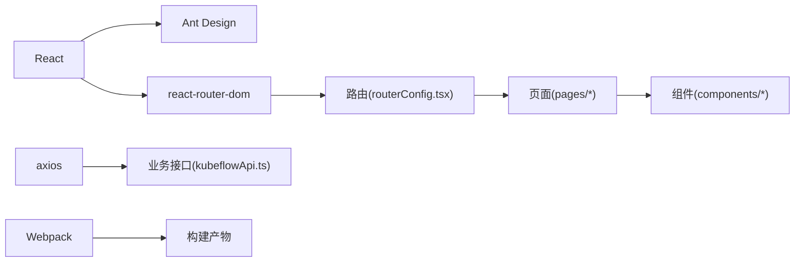

# 前端应用架构

<cite>
**本文引用的文件**   
- [package.json](file://myapp/frontend/package.json)
- [index.tsx](file://myapp/frontend/src/index.tsx)
- [App.tsx](file://myapp/frontend/src/App.tsx)
- [routerConfig.tsx](file://myapp/frontend/src/routerConfig.tsx)
- [api/index.tsx](file://myapp/frontend/src/api/index.tsx)
- [kubeflowApi.ts](file://myapp/frontend/src/api/kubeflowApi.ts)
- [ADUGTemplate.tsx](file://myapp/frontend/src/pages/ADUGTemplate.tsx)
- [AiChatBot.tsx](file://myapp/frontend/src/components/AiChatBot/AiChatBot.tsx)
</cite>

## 目录
1. [简介](#简介)
2. [项目结构](#项目结构)
3. [核心组件](#核心组件)
4. [架构总览](#架构总览)
5. [详细组件分析](#详细组件分析)
6. [依赖关系分析](#依赖关系分析)
7. [性能与构建优化](#性能与构建优化)
8. [开发与调试指南](#开发与调试指南)
9. [故障排查](#故障排查)
10. [结论](#结论)

## 简介
本文件面向 CubeStudio 前端工程，系统性梳理 React + TypeScript + Ant Design 技术栈下的架构设计、组件化模式、状态管理策略、路由配置与 API 封装。文档覆盖前后端分离、RESTful 集成、实时通信（通过 iframe 接入外部 AI 助手）、用户体验优化、构建打包与部署策略，并提供开发环境搭建与调试技巧，帮助开发者快速上手。

## 项目结构
前端位于 myapp/frontend，采用基于 Create React App 的 TypeScript 模板，结合 Webpack 进行构建与开发。关键目录：
- src/api：统一 HTTP 客户端封装与各业务接口定义
- src/components：通用 UI 与业务组件（如动态表单、表格、图表等）
- src/pages：页面级组件与模板（如 ADUGTemplate、IframeTemplate、OutLinkTemplate）
- src/routerConfig.tsx：路由配置与动态菜单到路由的转换
- src/App.tsx：应用外壳、顶部导航、侧边菜单与全局布局
- package.json：依赖、脚本与构建配置

图示来源
- [package.json:1-213](file://myapp/frontend/package.json#L1-L213)
- [index.tsx](file://myapp/frontend/src/index.tsx)
- [App.tsx:1-439](file://myapp/frontend/src/App.tsx#L1-L439)
- [routerConfig.tsx:1-161](file://myapp/frontend/src/routerConfig.tsx#L1-L161)
- [api/index.tsx:1-168](file://myapp/frontend/src/api/index.tsx#L1-L168)
- [kubeflowApi.ts:1-106](file://myapp/frontend/src/api/kubeflowApi.ts#L1-L106)

章节来源
- [package.json:124-129](file://myapp/frontend/package.json#L124-L129)

## 核心组件
- Axios 封装与拦截器：集中处理鉴权、错误提示、登录跳转、静默错误模式等
- 路由系统：支持远程菜单生成路由、内嵌/外链/iframe 三种菜单类型、子路由与面包屑
- 应用外壳：顶部导航、侧边菜单、用户下拉、自定义弹窗与全局悬浮 AI 助手
- 数据驱动页面模板：ADUGTemplate 根据后端元数据动态渲染列表、表单、操作与图表

章节来源
- [api/index.tsx:15-168](file://myapp/frontend/src/api/index.tsx#L15-L168)
- [routerConfig.tsx:14-145](file://myapp/frontend/src/routerConfig.tsx#L14-L145)
- [App.tsx:48-439](file://myapp/frontend/src/App.tsx#L48-L439)
- [ADUGTemplate.tsx:92-800](file://myapp/frontend/src/pages/ADUGTemplate.tsx#L92-L800)

## 架构总览
整体为前后端分离架构：前端通过 RESTful API 获取菜单、页面元数据与业务数据；页面以“元数据驱动”的方式渲染，减少硬编码；同时提供 iframe 方式嵌入第三方服务（如 AI 助手）。

图示来源
- [App.tsx:66-87](file://myapp/frontend/src/App.tsx#L66-L87)
- [routerConfig.tsx:71-145](file://myapp/frontend/src/routerConfig.tsx#L71-L145)
- [kubeflowApi.ts:6-8](file://myapp/frontend/src/api/kubeflowApi.ts#L6-L8)
- [api/index.tsx:15-18](file://myapp/frontend/src/api/index.tsx#L15-L18)

## 详细组件分析

### 应用外壳与路由容器（App.tsx）
职责
- 拉取远程菜单与头部配置，转换为路由并挂载
- 维护顶部导航、侧边菜单、当前选中项与折叠状态
- 根据路由变化更新面包屑、子模块展示与抽屉式自定义弹窗
- 挂载全局悬浮 AI 助手组件

关键点
- 使用 react-router-dom v6 的 useRoutes 动态渲染路由
- 将远程菜单与内置路由合并，统一由 useRoutes 管理
- 对 out_link/in_link/iframe 三类菜单分别处理跳转或外链
- 通过 getCustomDialog 拉取并展示自定义弹窗内容

图示来源
- [App.tsx:66-115](file://myapp/frontend/src/App.tsx#L66-L115)
- [App.tsx:117-163](file://myapp/frontend/src/App.tsx#L117-L163)
- [App.tsx:165-324](file://myapp/frontend/src/App.tsx#L165-L324)
- [App.tsx:336-439](file://myapp/frontend/src/App.tsx#L336-L439)

章节来源
- [App.tsx:1-439](file://myapp/frontend/src/App.tsx#L1-L439)

### 路由配置与懒加载（routerConfig.tsx）
职责
- 定义内置路由与动态路由映射
- 将远程菜单递归转换为路由树，按 menu_type 选择不同模板组件
- 提供 lazy2Compont 包装 React.lazy 与 Suspense，实现按需加载

关键点
- innerDynamicRouterConfigMap 用于将远程 name 映射到本地组件
- related 字段支持子路由扩展，自动注入父级上下文
- getDefaultOpenKeys 计算默认展开的菜单节点

图示来源
- [routerConfig.tsx:14-22](file://myapp/frontend/src/routerConfig.tsx#L14-L22)
- [routerConfig.tsx:24-69](file://myapp/frontend/src/routerConfig.tsx#L24-L69)
- [routerConfig.tsx:71-145](file://myapp/frontend/src/routerConfig.tsx#L71-L145)
- [routerConfig.tsx:147-161](file://myapp/frontend/src/routerConfig.tsx#L147-L161)

章节来源
- [routerConfig.tsx:1-161](file://myapp/frontend/src/routerConfig.tsx#L1-L161)

### API 封装与拦截器（api/index.tsx）
职责
- 创建 Axios 实例，设置超时与响应类型
- 请求拦截：校验登录态，未登录时跳转到登录页
- 响应拦截：解析后端统一消息头 api_flashes，统一提示；处理错误码与 401/502 等异常
- 提供 handleTips 工具类，支持队列化提示、跳转登录与退出

关键点
- 支持 X-Silent-Error 静默错误模式，便于特定组件自行处理错误
- gotoLogin/userlogout 统一跳转逻辑，避免重复触发

图示来源
- [api/index.tsx:15-18](file://myapp/frontend/src/api/index.tsx#L15-L18)
- [api/index.tsx:21-66](file://myapp/frontend/src/api/index.tsx#L21-L66)
- [api/index.tsx:68-82](file://myapp/frontend/src/api/index.tsx#L68-L82)
- [api/index.tsx:84-165](file://myapp/frontend/src/api/index.tsx#L84-L165)

章节来源
- [api/index.tsx:1-168](file://myapp/frontend/src/api/index.tsx#L1-L168)

### 业务接口层（kubeflowApi.ts）
职责
- 暴露统一的业务方法：菜单、头部配置、模板信息、CRUD 动作、收藏、图表选项、TabsModal 等
- 所有方法均基于 axios 封装，保持调用风格一致

关键点
- getData/postData/putData 等基础方法简化常见请求
- actionADUGTemplate* 系列方法对应模板驱动的增删改查与批量操作

章节来源
- [kubeflowApi.ts:1-106](file://myapp/frontend/src/api/kubeflowApi.ts#L1-L106)

### 数据驱动页面模板（ADUGTemplate.tsx）
职责
- 根据后端返回的元数据（列定义、过滤条件、表单定义、权限、操作、图表等）动态渲染页面
- 支持分页、排序、筛选、导入导出、收藏、详情抽屉、多标签页增强详情等

关键点
- createDyFormConfig 将后端字段描述转换为 DynamicForm 配置
- list_columns/fixed_columns 区分普通列与固定列，支持 ellipsis、tooltip、HTML 渲染
- actionList 拆分 single/multiple 操作，结合权限控制按钮可见性
- 通过 TabsModal 承载增强详情视图

图示来源
- [ADUGTemplate.tsx:242-338](file://myapp/frontend/src/pages/ADUGTemplate.tsx#L242-L338)
- [ADUGTemplate.tsx:427-665](file://myapp/frontend/src/pages/ADUGTemplate.tsx#L427-L665)
- [ADUGTemplate.tsx:667-800](file://myapp/frontend/src/pages/ADUGTemplate.tsx#L667-L800)

章节来源
- [ADUGTemplate.tsx:92-800](file://myapp/frontend/src/pages/ADUGTemplate.tsx#L92-L800)

### 全局悬浮 AI 助手（AiChatBot.tsx）
职责
- 从后端获取底部助手配置，若为空则不显示任何内容
- 提供右下角悬浮按钮与可拖拽面板，支持最小化、关闭、重试
- 通过 iframe 嵌入外部 AI 服务，自动处理相对 URL 与跨域场景

关键点
- resolveIframeUrl 兼容多种协议与相对地址
- 位置与尺寸持久化至 localStorage，窗口 resize 时自适应
- 在登录页跳过接口请求，避免未认证导致的登录循环

图示来源
- [AiChatBot.tsx:131-171](file://myapp/frontend/src/components/AiChatBot/AiChatBot.tsx#L131-L171)
- [AiChatBot.tsx:11-35](file://myapp/frontend/src/components/AiChatBot/AiChatBot.tsx#L11-L35)
- [AiChatBot.tsx:291-449](file://myapp/frontend/src/components/AiChatBot/AiChatBot.tsx#L291-L449)
- [kubeflowApi.ts:34-37](file://myapp/frontend/src/api/kubeflowApi.ts#L34-L37)

章节来源
- [AiChatBot.tsx:1-449](file://myapp/frontend/src/components/AiChatBot/AiChatBot.tsx#L1-L449)

## 依赖关系分析
- 运行时依赖
  - react/react-dom：UI 框架
  - antd：组件库
  - react-router-dom：路由
  - axios：HTTP 客户端
  - mobx/mobx-react：可选的状态管理（项目中存在依赖，但未见集中 store 使用）
  - echarts/d3/three：可视化与 3D 能力
- 构建与开发
  - webpack/webpack-dev-server：开发与打包
  - typescript：类型检查
  - jest：测试
  - less/sass：样式预处理
  - workbox-webpack-plugin：PWA 支持

图示来源
- [package.json:5-123](file://myapp/frontend/package.json#L5-L123)

章节来源
- [package.json:5-123](file://myapp/frontend/package.json#L5-L123)

## 性能与构建优化
- 代码分割与懒加载
  - 通过 lazy2Compont 包裹页面组件，结合 React.Suspense 实现路由级按需加载
- 资源优化
  - Terser 压缩、CSS 提取与压缩、Source Map 开启（开发）
- 缓存与离线
  - workbox-webpack-plugin 提供 Service Worker 能力（可按需启用）
- 构建脚本
  - start/build/buildSelf/buildFab 支持不同环境的构建与内存限制

建议
- 对大型图表/可视化库按需引入
- 图片与静态资源走 CDN 或分桶存储
- 生产环境开启 gzip/brotli 压缩

章节来源
- [routerConfig.tsx:14-22](file://myapp/frontend/src/routerConfig.tsx#L14-L22)
- [package.json:124-129](file://myapp/frontend/package.json#L124-L129)
- [package.json:115-122](file://myapp/frontend/package.json#L115-L122)

## 开发与调试指南
- 安装与运行
  - 安装依赖后执行 npm run start 启动开发服务器
  - 构建命令：npm run build（默认），npm run buildSelf/npm run buildFab 切换构建目标
- 代理与跨域
  - 开发环境可通过 setupProxy.js 配置反向代理（如需）
- 环境变量
  - REACT_APP_BASE_URL 控制 API 基础地址
- 调试技巧
  - 使用浏览器 DevTools 查看网络请求与拦截器行为
  - 利用 handleTips 的错误提示定位问题
  - 针对 iframe 场景，检查 resolveIframeUrl 生成的最终地址

章节来源
- [package.json:124-129](file://myapp/frontend/package.json#L124-L129)
- [api/index.tsx:4-5](file://myapp/frontend/src/api/index.tsx#L4-L5)

## 故障排查
常见问题与定位思路
- 401 未登录
  - 现象：请求被拦截并跳转登录
  - 排查：确认 Cookie 中是否存在 myapp_username；检查后端登录态下发
  - 参考：[api/index.tsx:68-82](file://myapp/frontend/src/api/index.tsx#L68-L82)、[api/index.tsx:145-148](file://myapp/frontend/src/api/index.tsx#L145-L148)
- 502 网关错误
  - 现象：提示网络连接中
  - 排查：检查后端服务与网关状态
  - 参考：[api/index.tsx:148-150](file://myapp/frontend/src/api/index.tsx#L148-L150)
- 菜单不显示或路由异常
  - 现象：顶部/侧边菜单为空或点击无效
  - 排查：确认 /myapp/menu 返回结构与 menu_type 字段；检查 formatRoute 映射逻辑
  - 参考：[App.tsx:66-87](file://myapp/frontend/src/App.tsx#L66-L87)、[routerConfig.tsx:71-145](file://myapp/frontend/src/routerConfig.tsx#L71-L145)
- AI 助手无法连接
  - 现象：面板显示“服务连接失败”
  - 排查：检查 /myapp/navbar_bottom 返回 url；验证 resolveIframeUrl 结果；确认跨域与证书
  - 参考：[AiChatBot.tsx:157-171](file://myapp/frontend/src/components/AiChatBot/AiChatBot.tsx#L157-L171)、[AiChatBot.tsx:11-35](file://myapp/frontend/src/components/AiChatBot/AiChatBot.tsx#L11-L35)

章节来源
- [api/index.tsx:68-165](file://myapp/frontend/src/api/index.tsx#L68-L165)
- [App.tsx:66-87](file://myapp/frontend/src/App.tsx#L66-L87)
- [routerConfig.tsx:71-145](file://myapp/frontend/src/routerConfig.tsx#L71-L145)
- [AiChatBot.tsx:11-35](file://myapp/frontend/src/components/AiChatBot/AiChatBot.tsx#L11-L35)
- [AiChatBot.tsx:157-171](file://myapp/frontend/src/components/AiChatBot/AiChatBot.tsx#L157-L171)

## 结论
CubeStudio 前端采用 React + TypeScript + Ant Design 的技术栈，围绕“元数据驱动页面”的核心思想，实现了高度可配置的列表、表单与操作界面。通过 Axios 拦截器统一处理鉴权与错误提示，结合 react-router-dom 的动态路由与懒加载，保证了良好的可维护性与可扩展性。同时，借助 iframe 机制灵活接入外部服务（如 AI 助手），在不侵入主应用的前提下提升用户体验。构建层面基于 Webpack 与 Workbox，具备完善的开发与生产优化能力。