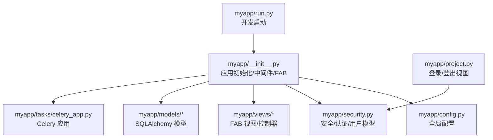
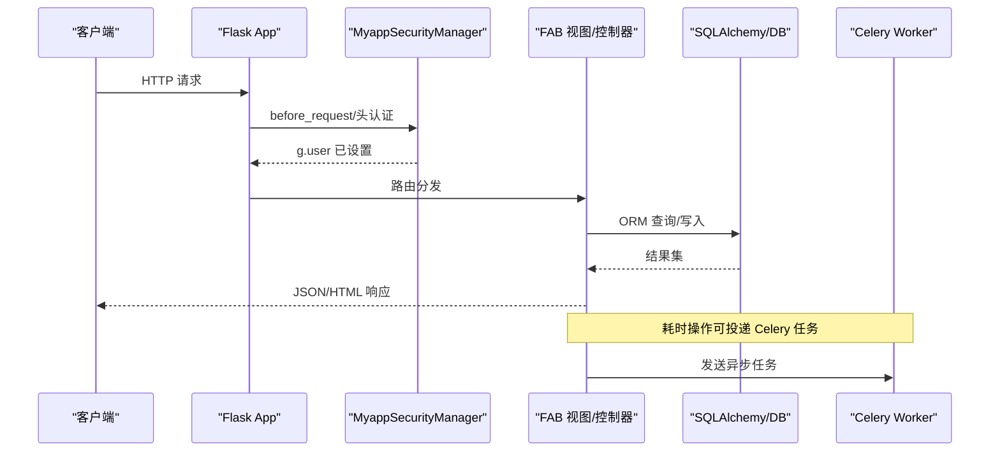
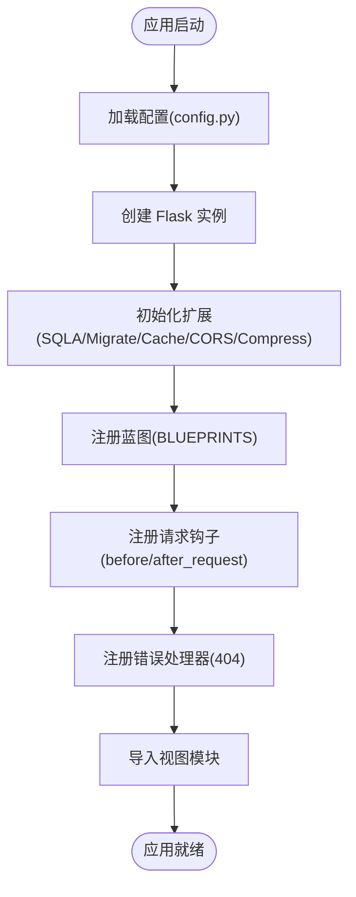
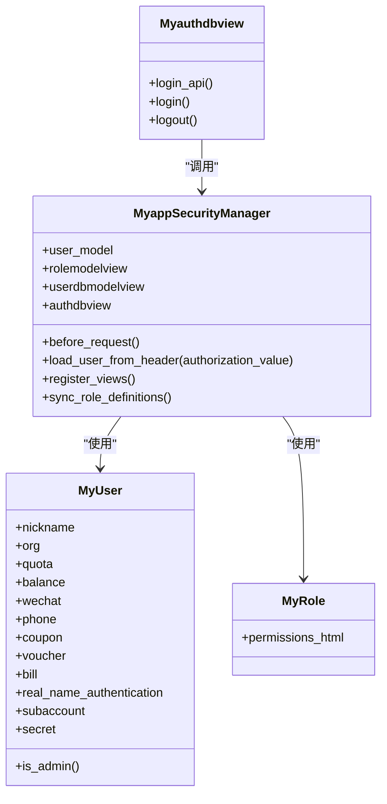
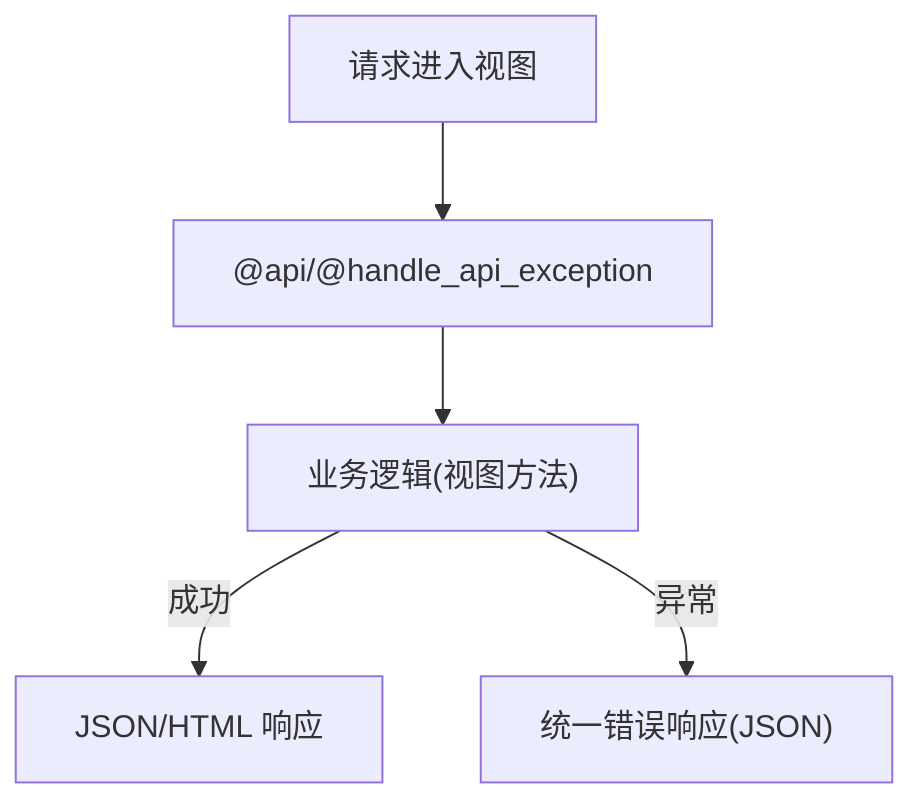
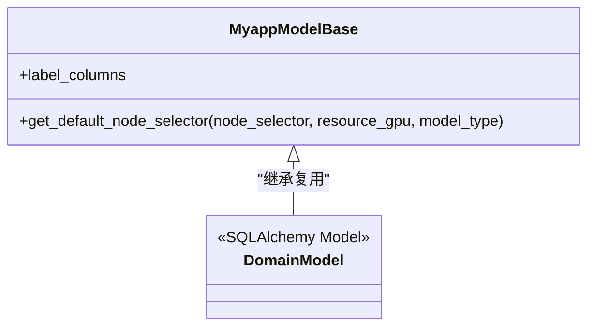
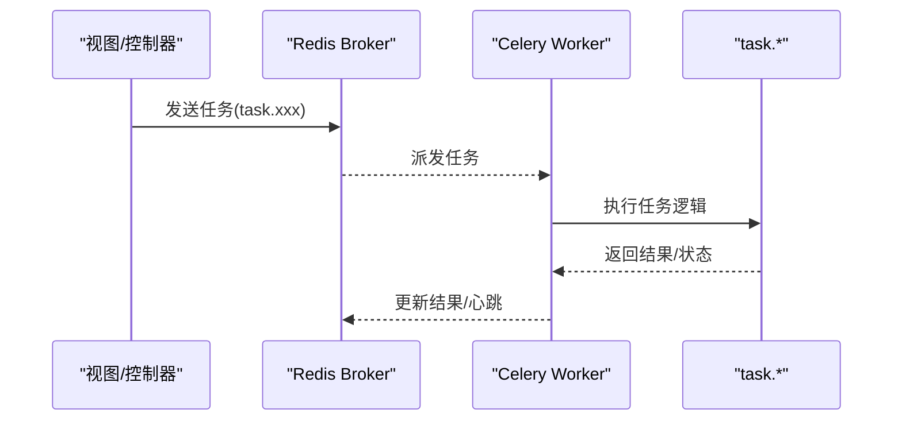
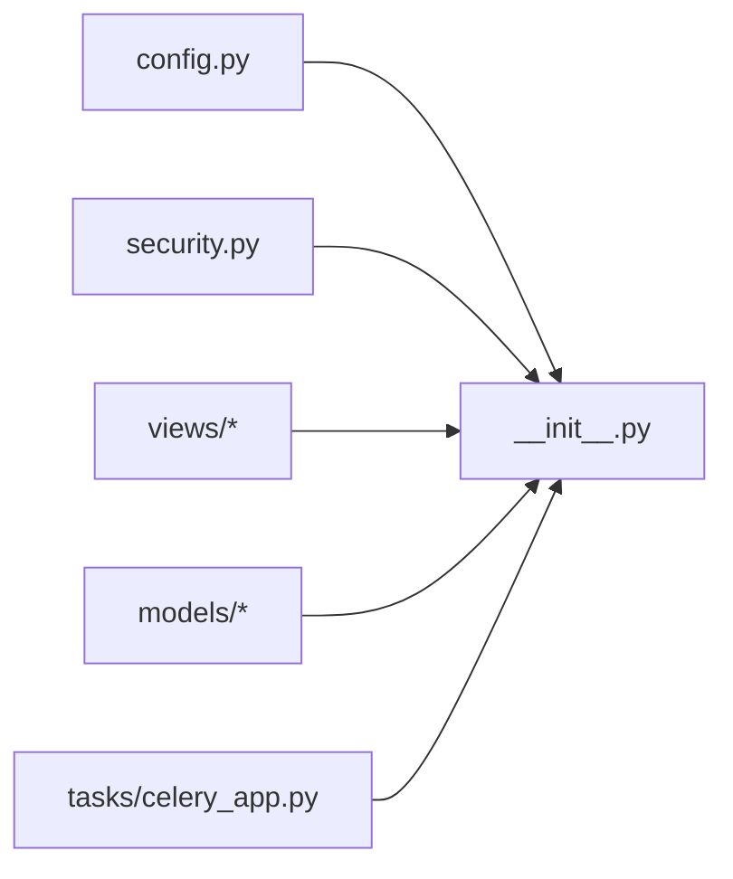

# 后端服务架构

<cite>
**本文引用的文件**   
- [myapp/__init__.py](file://myapp/__init__.py)
- [myapp/config.py](file://myapp/config.py)
- [myapp/run.py](file://myapp/run.py)
- [myapp/security.py](file://myapp/security.py)
- [myapp/project.py](file://myapp/project.py)
- [myapp/views/base.py](file://myapp/views/base.py)
- [myapp/models/base.py](file://myapp/models/base.py)
- [myapp/tasks/celery_app.py](file://myapp/tasks/celery_app.py)
</cite>

## 目录
1. [简介](#简介)
2. [项目结构](#项目结构)
3. [核心组件](#核心组件)
4. [架构总览](#架构总览)
5. [详细组件分析](#详细组件分析)
6. [依赖关系分析](#依赖关系分析)
7. [性能与优化建议](#性能与优化建议)
8. [故障排查指南](#故障排查指南)
9. [结论](#结论)

## 简介
本文件面向 CubeStudio 后端服务的整体架构，围绕 Flask + Flask-AppBuilder 框架展开，系统阐述应用初始化、中间件注册、路由与视图层设计；说明 MVC 模式在代码中的落地（模型层 SQLAlchemy、视图层 FAB、控制层业务逻辑）；并覆盖异步任务（Celery）、数据库连接管理、会话与认证、错误处理机制。同时给出插件化扩展点与配置管理机制的说明，以及性能优化与最佳实践建议。

## 项目结构
CubeStudio 后端以 myapp 为根包，关键目录与职责如下：
- myapp/__init__.py：Flask 应用创建、全局中间件与钩子、FAB 初始化、蓝图/扩展注册、请求前后置处理器、错误页、视图导入入口
- myapp/config.py：集中式配置（数据库、Redis、缓存、Celery、CORS、日志、特性开关等）
- myapp/security.py：用户/角色模型扩展、自定义安全管理器、登录视图集成
- myapp/project.py：自定义登录/登出 API 与页面逻辑
- myapp/views/*：基于 FAB 的 ModelView/API 视图实现
- myapp/models/*：SQLAlchemy 模型定义
- myapp/tasks/*：Celery 应用与任务调度配置
- myapp/run.py：开发环境启动脚本

图表来源
- [myapp/__init__.py:28-219](file://myapp/__init__.py#L28-L219)
- [myapp/config.py:350-559](file://myapp/config.py#L350-L559)
- [myapp/security.py:237-309](file://myapp/security.py#L237-L309)
- [myapp/project.py:42-181](file://myapp/project.py#L42-L181)
- [myapp/tasks/celery_app.py:1-18](file://myapp/tasks/celery_app.py#L1-L18)
- [myapp/run.py:1-2](file://myapp/run.py#L1-L2)

章节来源
- [myapp/__init__.py:28-219](file://myapp/__init__.py#L28-L219)
- [myapp/config.py:350-559](file://myapp/config.py#L350-L559)
- [myapp/security.py:237-309](file://myapp/security.py#L237-L309)
- [myapp/project.py:42-181](file://myapp/project.py#L42-L181)
- [myapp/tasks/celery_app.py:1-18](file://myapp/tasks/celery_app.py#L1-L18)
- [myapp/run.py:1-2](file://myapp/run.py#L1-L2)

## 核心组件
- 应用容器与扩展装配：Flask 应用实例、SQLA、Migrate、CSRFProtect、CORS、Compress、上下文处理器、蓝图注册、中间件链
- 安全与认证：MyappSecurityManager、MyUser/MyRole 扩展、自定义登录视图 Myauthdbview
- 视图与控制层：BaseMyappView、API 装饰器、统一异常处理、权限校验工具
- 数据模型：MyappModelBase 提供通用字段标签与辅助方法，具体领域模型位于 models/*
- 异步任务：Celery 应用通过 get_celery_app 注入配置，任务与定时任务在 CeleryConfig 中声明
- 配置中心：config.py 聚合所有运行时参数，支持环境变量覆盖与外部配置文件加载

章节来源
- [myapp/__init__.py:28-219](file://myapp/__init__.py#L28-L219)
- [myapp/security.py:47-107](file://myapp/security.py#L47-L107)
- [myapp/views/base.py:166-195](file://myapp/views/base.py#L166-L195)
- [myapp/models/base.py:7-311](file://myapp/models/base.py#L7-L311)
- [myapp/tasks/celery_app.py:1-18](file://myapp/tasks/celery_app.py#L1-L18)
- [myapp/config.py:350-559](file://myapp/config.py#L350-L559)

## 架构总览
下图展示从请求进入、认证鉴权、视图处理到数据访问与异步任务的完整链路。

图表来源
- [myapp/__init__.py:260-319](file://myapp/__init__.py#L260-L319)
- [myapp/security.py:251-286](file://myapp/security.py#L251-L286)
- [myapp/tasks/celery_app.py:1-18](file://myapp/tasks/celery_app.py#L1-L18)

## 详细组件分析

### 应用初始化与中间件注册
- 应用创建与配置加载：Flask 实例化后从环境变量或模块加载配置，启用 JSON 排序与 UTF-8 输出
- 静态资源清单解析：在调试模式下动态解析 manifest.json，向模板暴露 js/css 清单函数
- 蓝图注册：根据配置项动态注册外部 Blueprint
- 扩展装配顺序：SQLA -> CSRFProtect(可选) -> Migrate -> Cache -> CORS(可选) -> Compress(可选) -> 自定义 WSGI 中间件
- 请求钩子：before_request 进行未登录拦截与 Header 认证；after_request 设置 Cookie 与统一响应头
- 错误处理：FAB 404 模板渲染

图表来源
- [myapp/__init__.py:28-219](file://myapp/__init__.py#L28-L219)
- [myapp/__init__.py:260-319](file://myapp/__init__.py#L260-L319)
- [myapp/__init__.py:322-329](file://myapp/__init__.py#L322-L329)

章节来源
- [myapp/__init__.py:28-219](file://myapp/__init__.py#L28-L219)
- [myapp/__init__.py:260-319](file://myapp/__init__.py#L260-L319)
- [myapp/__init__.py:322-329](file://myapp/__init__.py#L322-L329)

### 认证与会话管理
- 安全基类：MyappSecurityManager 继承 FAB SecurityManager，扩展用户/角色模型，重写认证流程
- 用户模型扩展：MyUser 增加昵称、组织、配额、余额、微信、电话、优惠券、代金券、发票、实名认证、子账户等字段
- 登录视图：Myauthdbview 提供 /login/ 与 /login/api/，支持表单登录、Token 登录、自动注册用户、事件记录、工作区初始化
- Header 认证：支持短 Token 与平台直连用户名两种模式，兼容 JWT 三段格式补齐
- 会话：Flask-Login 管理当前用户，g.user 在请求生命周期内可用

图表来源
- [myapp/security.py:47-107](file://myapp/security.py#L47-L107)
- [myapp/security.py:237-309](file://myapp/security.py#L237-L309)
- [myapp/project.py:42-181](file://myapp/project.py#L42-L181)

章节来源
- [myapp/security.py:47-107](file://myapp/security.py#L47-L107)
- [myapp/security.py:237-309](file://myapp/security.py#L237-L309)
- [myapp/project.py:42-181](file://myapp/project.py#L42-L181)

### 视图层与控制层（FAB + BaseMyappView）
- BaseMyappView：封装 JSON 响应、前端公共载荷、告警配置合并、国际化与特性开关透传
- API 装饰器：@api 捕获未处理异常并返回统一 JSON 错误；@handle_api_exception 区分 MyappException/MyappSecurityException/HTTPException
- 删除与批量删除：DeleteMixin 封装单条/批量删除逻辑，联动权限视图菜单清理
- 权限校验：check_ownership 结合 Admin 角色与对象所有者字段进行细粒度授权

图表来源
- [myapp/views/base.py:102-156](file://myapp/views/base.py#L102-L156)
- [myapp/views/base.py:166-195](file://myapp/views/base.py#L166-L195)
- [myapp/views/base.py:231-291](file://myapp/views/base.py#L231-L291)
- [myapp/views/base.py:323-366](file://myapp/views/base.py#L323-L366)

章节来源
- [myapp/views/base.py:102-156](file://myapp/views/base.py#L102-L156)
- [myapp/views/base.py:166-195](file://myapp/views/base.py#L166-L195)
- [myapp/views/base.py:231-291](file://myapp/views/base.py#L231-L291)
- [myapp/views/base.py:323-366](file://myapp/views/base.py#L323-L366)

### 模型层（SQLAlchemy）
- MyappModelBase：集中维护字段显示标签、默认节点选择器计算等通用能力，供各领域模型复用
- 领域模型：按功能域拆分（数据集、任务、流水线、推理服务等），遵循 SQLAlchemy ORM 规范

图表来源
- [myapp/models/base.py:7-311](file://myapp/models/base.py#L7-L311)

章节来源
- [myapp/models/base.py:7-311](file://myapp/models/base.py#L7-L311)

### 异步任务处理（Celery）
- Celery 应用：celery_app.py 通过 get_celery_app(conf) 获取全局 Celery 实例，统一挂载任务
- 任务配置：CeleryConfig 定义 broker/result_backend、worker 行为、任务注解（限流/超时/重试）、beat 定时任务
- 典型任务：workflow 清理、pipeline 运行检查、pod 状态巡检、GPU 监控、K8s 资源查询等

图表来源
- [myapp/tasks/celery_app.py:1-18](file://myapp/tasks/celery_app.py#L1-L18)
- [myapp/config.py:382-559](file://myapp/config.py#L382-L559)

章节来源
- [myapp/tasks/celery_app.py:1-18](file://myapp/tasks/celery_app.py#L1-L18)
- [myapp/config.py:382-559](file://myapp/config.py#L382-L559)

### 数据库连接管理与迁移
- 连接池：SQLALCHEMY_POOL_SIZE、SQLALCHEMY_MAX_OVERFLOW、SQLALCHEMY_POOL_RECYCLE 控制连接池大小与回收策略
- 悲观连接处理：pessimistic_connection_handling(db.engine) 增强连接健壮性
- 迁移：Flask-Migrate 集成 Alembic，migrations 目录存放版本脚本

章节来源
- [myapp/config.py:350-355](file://myapp/config.py#L350-L355)
- [myapp/__init__.py:127-139](file://myapp/__init__.py#L127-L139)

### 会话管理与跨域
- 会话：Flask-Login 管理用户会话，after_request 设置 myapp_username/id Cookie
- 跨域：CORS 扩展根据 ENABLE_CORS 与 CORS_OPTIONS 开启，HTTP_HEADERS 统一附加响应头

章节来源
- [myapp/__init__.py:294-319](file://myapp/__init__.py#L294-L319)
- [myapp/config.py:152-153](file://myapp/config.py#L152-L153)
- [myapp/config.py:216-220](file://myapp/config.py#L216-L220)

### 错误处理机制
- 视图层：@api 与 @handle_api_exception 统一捕获异常并返回结构化 JSON
- 全局：FAB 404 模板渲染；SHOW_STACKTRACE 控制是否暴露堆栈信息

章节来源
- [myapp/views/base.py:102-156](file://myapp/views/base.py#L102-L156)
- [myapp/__init__.py:322-329](file://myapp/__init__.py#L322-L329)

### 插件化扩展点与配置管理
- 蓝图扩展：BLUEPRINTS 列表允许外部蓝图动态注册
- 中间件扩展：ADDITIONAL_MIDDLEWARE 允许在 WSGI 层追加中间件
- 特性开关：DEFAULT_FEATURE_FLAGS/FEATURE_FLAGS/GET_FEATURE_FLAGS_FUNC 组合形成特性开关体系
- 外部配置：支持 MYAPP_CONFIG 环境变量指向外部模块，或加载 myapp_config 模块进行覆盖
- 应用修改钩子：FLASK_APP_MUTATOR 允许在启动后对 Flask app 进行二次定制

章节来源
- [myapp/__init__.py:102-111](file://myapp/__init__.py#L102-L111)
- [myapp/__init__.py:184-186](file://myapp/__init__.py#L184-L186)
- [myapp/__init__.py:225-252](file://myapp/__init__.py#L225-L252)
- [myapp/config.py:308-333](file://myapp/config.py#L308-L333)

## 依赖关系分析
- 低耦合高内聚：__init__.py 负责装配，views/models/tasks 各司其职
- 安全与视图解耦：MyappSecurityManager 提供认证能力，视图通过 g.user 与权限工具访问
- 配置驱动：Celery、Redis、缓存、CORS、日志等均通过 config.py 集中管理

图表来源
- [myapp/__init__.py:28-219](file://myapp/__init__.py#L28-L219)
- [myapp/config.py:350-559](file://myapp/config.py#L350-L559)

章节来源
- [myapp/__init__.py:28-219](file://myapp/__init__.py#L28-L219)
- [myapp/config.py:350-559](file://myapp/config.py#L350-L559)

## 性能与优化建议
- 连接池调优：根据并发与数据库负载调整 SQLALCHEMY_POOL_SIZE、SQLALCHEMY_MAX_OVERFLOW、SQLALCHEMY_POOL_RECYCLE
- 缓存策略：合理使用 Redis 缓存（CACHE_CONFIG），对热点数据设置合理过期时间
- 压缩传输：ENABLE_FLASK_COMPRESS 开启 gzip/deflate 减少带宽占用
- 异步化：将长耗时任务（镜像构建、K8s 资源查询、数据导出等）放入 Celery，避免阻塞请求线程
- 日志轮转：生产环境启用 ENABLE_TIME_ROTATE，限制日志级别与保留天数
- 静态资源：利用 manifest 按需加载前端 chunk，减少首屏体积
- 跨域与头部：谨慎设置 CORS 与 HTTP_HEADERS，避免不必要的预检请求

[本节为通用指导，不直接分析具体文件]

## 故障排查指南
- 401 未认证：检查 before_request 中对 Authorization 头的解析与 load_user_from_header 逻辑
- 404 页面：确认 FAB 错误处理器是否生效，模板路径是否正确
- 数据库连接异常：检查 pessimistic_connection_handling 与连接池参数，确认 MySQL 服务可达
- Celery 任务失败：核对 broker_url/result_backend 与 Redis 连通性，查看 worker 日志与任务注解配置
- 跨域问题：确认 ENABLE_CORS 与 CORS_OPTIONS、HTTP_HEADERS 配置是否匹配前端域名

章节来源
- [myapp/__init__.py:260-319](file://myapp/__init__.py#L260-L319)
- [myapp/__init__.py:322-329](file://myapp/__init__.py#L322-L329)
- [myapp/config.py:350-559](file://myapp/config.py#L350-L559)

## 结论
CubeStudio 后端采用 Flask + Flask-AppBuilder 的经典架构，通过 __init__.py 完成应用装配与中间件注册，security.py 提供可扩展的安全与认证能力，views 与 models 分别承担控制与数据层职责，Celery 承担异步与定时任务。配置集中在 config.py，支持环境变量与外部模块覆盖，具备良好的可维护性与扩展性。在生产环境中，应重点关注连接池、缓存、压缩、异步化与日志轮转等性能与安全要点。