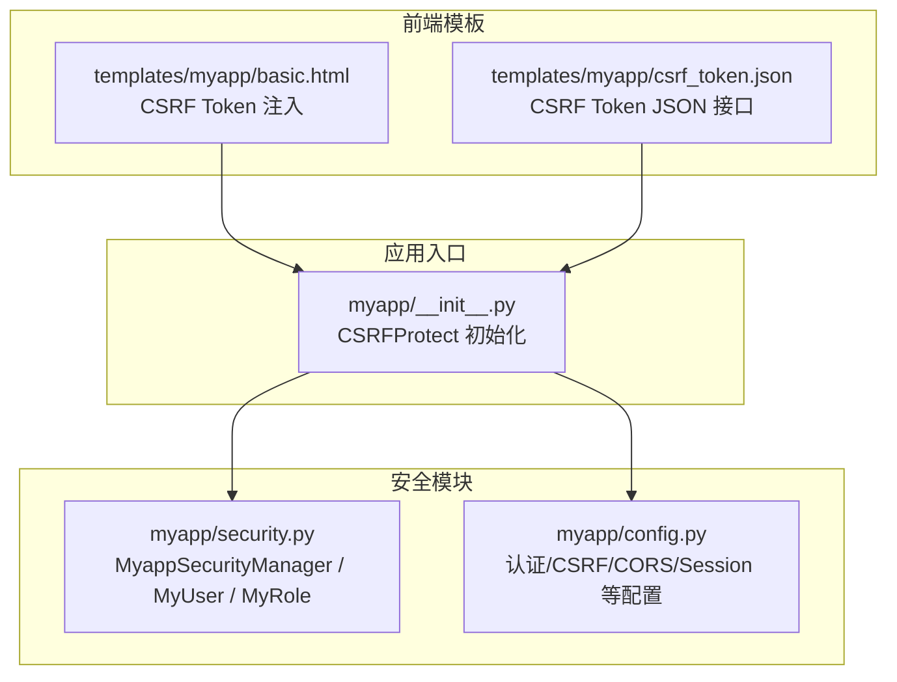
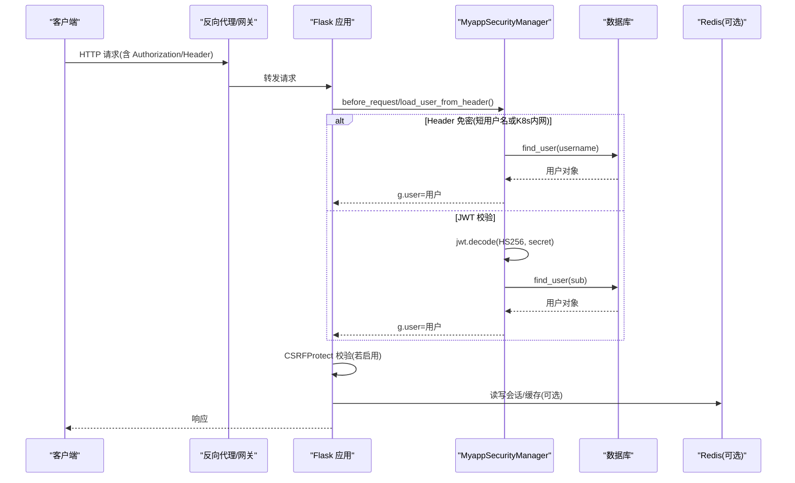
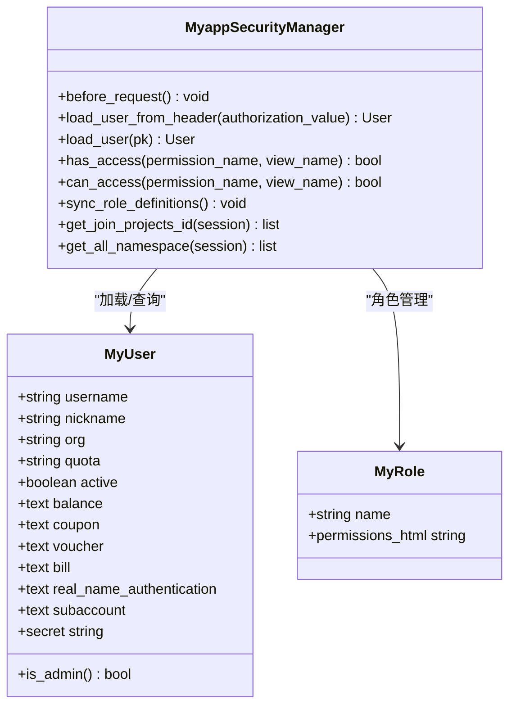
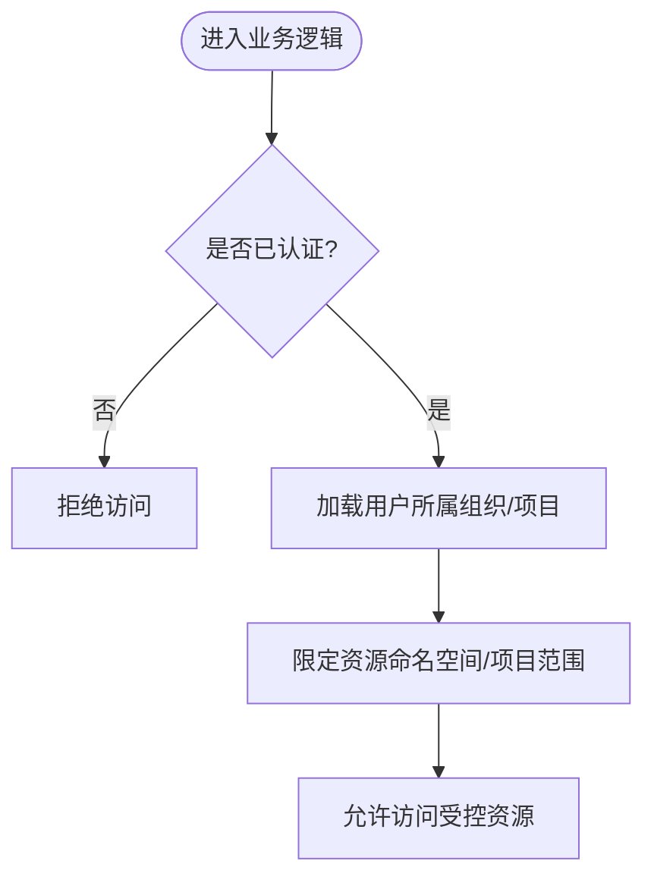
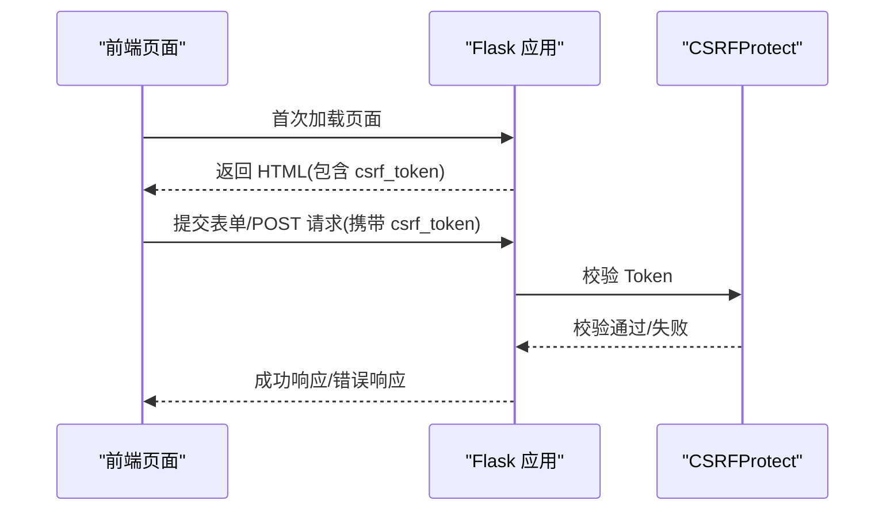
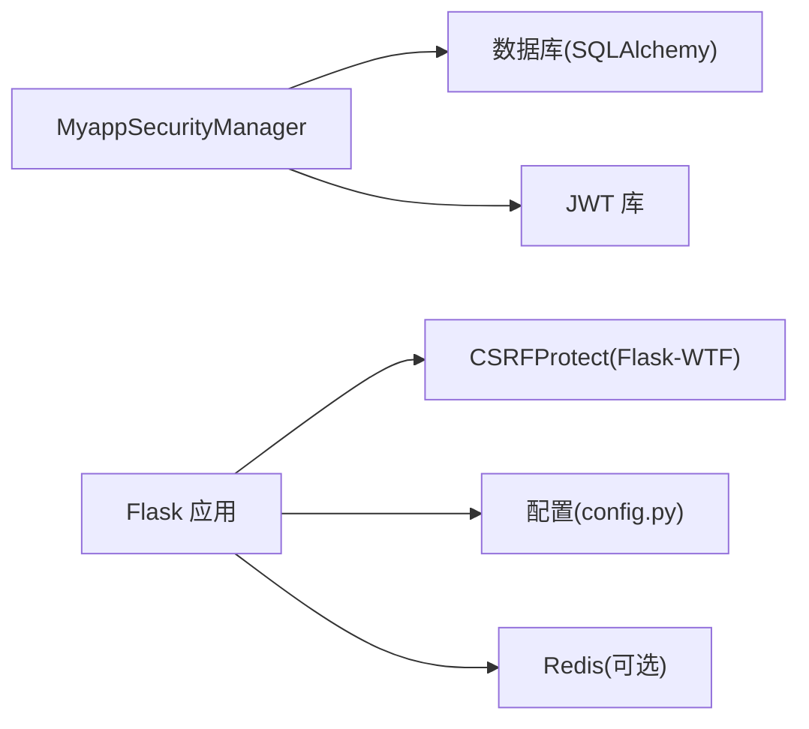

# 安全架构

<cite>
**本文引用的文件**   
- [security.py](file://myapp/security.py)
- [config.py](file://myapp/config.py)
- [__init__.py](file://myapp/__init__.py)
- [basic.html](file://myapp/templates/myapp/basic.html)
- [csrf_token.json](file://myapp/templates/myapp/csrf_token.json)
</cite>

## 目录
1. [简介](#简介)
2. [项目结构](#项目结构)
3. [核心组件](#核心组件)
4. [架构总览](#架构总览)
5. [详细组件分析](#详细组件分析)
6. [依赖关系分析](#依赖关系分析)
7. [性能与可用性考虑](#性能与可用性考虑)
8. [故障排查指南](#故障排查指南)
9. [结论](#结论)
10. [附录：安全配置最佳实践、漏洞扫描与应急响应](#附录安全配置最佳实践漏洞扫描与应急响应)

## 简介
本文件系统性梳理 CubeStudio 的安全架构，围绕认证授权、访问控制、数据安全与服务安全展开，重点说明 RBAC 权限模型、多租户隔离机制、SSO/单点登录集成、会话安全管理，以及输入校验、SQL 注入防护、XSS 防护、CSRF 保护与文件上传安全。同时给出敏感数据加密存储、API 鉴权、网络通信安全与审计日志记录的建议方案，并补充安全测试方法与合规性检查清单。

## 项目结构
CubeStudio 后端基于 Flask + Flask-AppBuilder 构建，安全相关能力集中在以下位置：
- 认证与授权：自定义 SecurityManager、用户/角色模型扩展、JWT 令牌生成与解析、Header 免密认证通道
- CSRF 保护：Flask-WTF CSRFProtect 初始化与豁免列表
- 配置项：认证类型、CSRF 开关、CORS、Cookie 名称、HTTP 响应头等

**图示来源** 
- [__init__.py:129-133](file://myapp/__init__.py#L129-L133)
- [security.py:237-286](file://myapp/security.py#L237-L286)
- [config.py:45-50](file://myapp/config.py#L45-L50)
- [basic.html:37-37](file://myapp/templates/myapp/basic.html#L37-L37)
- [csrf_token.json:1-2](file://myapp/templates/myapp/csrf_token.json#L1-L2)

**章节来源**
- [__init__.py:129-133](file://myapp/__init__.py#L129-L133)
- [security.py:237-286](file://myapp/security.py#L237-L286)
- [config.py:45-50](file://myapp/config.py#L45-L50)
- [basic.html:37-37](file://myapp/templates/myapp/basic.html#L37-L37)
- [csrf_token.json:1-2](file://myapp/templates/myapp/csrf_token.json#L1-L2)

## 核心组件
- 自定义用户与角色模型（RBAC）
  - 扩展 FAB 的 User/Role，增加组织、配额、余额、优惠券、发票、实名认证、子账户等字段，便于多租户与计费场景
  - 提供 is_admin 判断、secret 属性用于生成 JWT
- 自定义安全管理器（MyappSecurityManager）
  - 支持 Header 免密认证（短用户名或短 token），兼容 K8s 内部域名白名单
  - 支持标准 JWT HS256 校验，自动补齐固定 header 以兼容“短 token”
  - 提供 has_access/can_access/user_view_menu_names/merge_perm/sync_role_definitions 等方法，简化默认权限策略
  - 提供 get_join_projects/get_all_namespace 等工具方法，支撑多租户命名空间隔离
- CSRF 保护
  - 通过 Flask-WTF 的 CSRFProtect 统一启用，支持豁免列表与超时时间
  - 前端模板注入 csrf_token，供表单提交使用
- 配置中心
  - AUTH_TYPE、AUTH_USER_REGISTRATION、AUTH_HEADER_NAME、REMEMBER_COOKIE_NAME 等
  - WTF_CSRF_ENABLED/WTF_CSRF_EXEMPT_LIST/WTF_CSRF_TIME_LIMIT
  - CORS、HTTP_HEADERS、SECRET_KEY 等

**章节来源**
- [security.py:47-107](file://myapp/security.py#L47-L107)
- [security.py:237-286](file://myapp/security.py#L237-L286)
- [security.py:383-406](file://myapp/security.py#L383-L406)
- [security.py:409-490](file://myapp/security.py#L409-L490)
- [config.py:76-90](file://myapp/config.py#L76-L90)
- [config.py:45-50](file://myapp/config.py#L45-L50)
- [config.py:215-220](file://myapp/config.py#L215-L220)
- [config.py:561-563](file://myapp/config.py#L561-L563)

## 架构总览
下图展示请求进入后的认证与授权流程，包括 Header 免密、JWT 校验、CSRF 校验与会话管理。

**图示来源** 
- [security.py:247-286](file://myapp/security.py#L247-L286)
- [__init__.py:129-133](file://myapp/__init__.py#L129-L133)
- [config.py:357-380](file://myapp/config.py#L357-L380)

## 详细组件分析

### 认证与授权（RBAC、SSO、会话）
- RBAC 权限模型
  - 通过扩展 User/Role 模型，结合 FAB 的 RoleModelView/UserModelView，实现角色与视图菜单权限管理
  - 提供 sync_role_definitions 同步基础角色（Admin/Gamma）
- SSO/单点登录集成
  - 支持 Header 免密认证：当 Authorization 为短用户名且满足条件时直接加载用户；或通过 K8s 内部域名放行
  - 支持标准 JWT：HS256 算法，兼容“短 token”（仅 payload.signature），自动补全固定 header 后解码
  - 可通过外部系统签发 JWT，将 sub 设置为用户名进行对接
- 会话安全管理
  - 使用 REMEMBER_COOKIE_NAME 定义 Cookie 名称
  - SECRET_KEY 用于 Session 签名，需在生产环境替换为强随机值
  - 可结合 Redis 作为缓存/会话后端（见配置中的 CACHE_CONFIG/REDIS_*）

**图示来源** 
- [security.py:47-107](file://myapp/security.py#L47-L107)
- [security.py:237-286](file://myapp/security.py#L237-L286)
- [security.py:383-406](file://myapp/security.py#L383-L406)
- [security.py:409-490](file://myapp/security.py#L409-L490)

**章节来源**
- [security.py:47-107](file://myapp/security.py#L47-L107)
- [security.py:237-286](file://myapp/security.py#L237-L286)
- [security.py:383-406](file://myapp/security.py#L383-L406)
- [security.py:409-490](file://myapp/security.py#L409-L490)
- [config.py:561-563](file://myapp/config.py#L561-L563)
- [config.py:357-380](file://myapp/config.py#L357-L380)

### 访问控制与多租户隔离
- 访问控制
  - has_access/can_access 当前实现偏向宽松（已认证即允许），建议按视图菜单与资源维度细化
  - user_view_menu_names/merge_perm 返回空集合，未启用细粒度菜单权限过滤
- 多租户隔离
  - 通过 Project_User 关联获取用户参与的组织项目，结合 Project.namespace 字段实现命名空间级隔离
  - 提供 get_join_projects/get_all_namespace 等工具方法，用于 Notebook/Pipeline/Service/AutoML 等资源命名空间聚合

**图示来源** 
- [security.py:383-395](file://myapp/security.py#L383-L395)
- [security.py:409-490](file://myapp/security.py#L409-L490)

**章节来源**
- [security.py:383-395](file://myapp/security.py#L383-L395)
- [security.py:409-490](file://myapp/security.py#L409-L490)

### CSRF 保护
- 启用方式
  - 通过 Flask-WTF 的 CSRFProtect 在应用启动时注册
  - 支持豁免列表（WTF_CSRF_EXEMPT_LIST）与超时时间（WTF_CSRF_TIME_LIMIT）
- 前端集成
  - basic.html 中注入 csrf_token 隐藏字段
  - csrf_token.json 提供 CSRF Token 的 JSON 接口，供 AJAX 调用

**图示来源** 
- [__init__.py:129-133](file://myapp/__init__.py#L129-L133)
- [basic.html:37-37](file://myapp/templates/myapp/basic.html#L37-L37)
- [csrf_token.json:1-2](file://myapp/templates/myapp/csrf_token.json#L1-L2)
- [config.py:45-50](file://myapp/config.py#L45-L50)
- [config.py:264-265](file://myapp/config.py#L264-L265)

**章节来源**
- [__init__.py:129-133](file://myapp/__init__.py#L129-L133)
- [basic.html:37-37](file://myapp/templates/myapp/basic.html#L37-L37)
- [csrf_token.json:1-2](file://myapp/templates/myapp/csrf_token.json#L1-L2)
- [config.py:45-50](file://myapp/config.py#L45-L50)
- [config.py:264-265](file://myapp/config.py#L264-L265)

### 输入验证与 SQL 注入防护
- 输入验证
  - 用户创建表单使用 WTForms 校验器（DataRequired、Regexp、Length）对用户名、邮箱等进行格式校验
- SQL 注入防护
  - 建议使用 SQLAlchemy ORM 参数化查询，避免字符串拼接
  - 对 SQL Lab 等动态查询场景，应限制执行语句类型、禁用危险函数，并在服务端做白名单校验

**章节来源**
- [security.py:169-197](file://myapp/security.py#L169-L197)

### XSS 攻击防护
- 模板渲染
  - 使用 MarkupSafe 的 Markup 进行可控 HTML 渲染，避免直接输出未经转义的用户输入
- 建议
  - 对所有用户输入进行上下文相关的转义（HTML/JS/CSS/URL）
  - 设置 Content-Security-Policy 响应头，限制脚本来源

**章节来源**
- [security.py:15-15](file://myapp/security.py#L15-L15)

### 文件上传安全
- 上传路径
  - UPLOAD_FOLDER/IMG_UPLOAD_FOLDER/DOWNLOAD_FOLDER 集中配置
- 建议
  - 限制文件类型、大小与命名规则
  - 对上传文件进行病毒扫描与内容检测
  - 下载接口校验访问权限与路径穿越

**章节来源**
- [config.py:138-146](file://myapp/config.py#L138-L146)

### API 接口鉴权与网络通信安全
- API 鉴权
  - 支持 Authorization Header 免密（短用户名）与 JWT（HS256）两种模式
  - 短 token 兼容：自动补全固定 header 后解码
- 网络通信
  - 建议强制 HTTPS，配置 TLS 证书与 HSTS
  - 谨慎设置 CORS 与 HTTP_HEADERS，避免过度放宽

**章节来源**
- [security.py:258-286](file://myapp/security.py#L258-L286)
- [config.py:215-220](file://myapp/config.py#L215-L220)

### 审计日志记录
- 日志级别与轮转
  - LOG_LEVEL、ENABLE_TIME_ROTATE、FILENAME、BACKUP_COUNT 等
- 建议
  - 对认证、授权、关键操作写入结构化审计日志
  - 接入集中式日志平台（如 ELK/Loki）

**章节来源**
- [config.py:186-208](file://myapp/config.py#L186-L208)

## 依赖关系分析
- 组件耦合
  - MyappSecurityManager 依赖 User/Role 模型与数据库
  - CSRFProtect 依赖 Flask-WTF 与前端模板注入
  - 配置项集中管理认证、CSRF、CORS、Session、Redis 等
- 外部依赖
  - JWT 库用于令牌签发与校验
  - Redis 用于缓存/任务队列/会话（可选）

**图示来源** 
- [security.py:237-286](file://myapp/security.py#L237-L286)
- [__init__.py:129-133](file://myapp/__init__.py#L129-L133)
- [config.py:357-380](file://myapp/config.py#L357-L380)

**章节来源**
- [security.py:237-286](file://myapp/security.py#L237-L286)
- [__init__.py:129-133](file://myapp/__init__.py#L129-L133)
- [config.py:357-380](file://myapp/config.py#L357-L380)

## 性能与可用性考虑
- 认证开销
  - JWT 解码与数据库查询应在高频路径上优化（如缓存用户信息）
- CSRF 校验
  - 对静态资源与长连接接口合理豁免，减少不必要的校验
- 会话与缓存
  - 使用 Redis 作为缓存/会话后端，注意键空间隔离与过期策略

[本节为通用指导，不直接分析具体文件]

## 故障排查指南
- 认证失败
  - 检查 Authorization Header 是否为短用户名或有效 JWT
  - 确认 JWT_PASSWORD 配置一致
  - 检查 K8s 内部域名白名单条件
- CSRF 报错
  - 确认前端已注入 csrf_token
  - 检查豁免列表是否正确配置
- 会话异常
  - 检查 SECRET_KEY 是否变更导致旧会话失效
  - 检查 Redis 连通性与密码配置

**章节来源**
- [security.py:258-286](file://myapp/security.py#L258-L286)
- [config.py:45-50](file://myapp/config.py#L45-L50)
- [config.py:357-380](file://myapp/config.py#L357-L380)

## 结论
CubeStudio 的安全架构以 Flask-AppBuilder 为基础，通过自定义 SecurityManager 实现了灵活的认证与授权能力，支持 Header 免密与 JWT 双通道，并提供 CSRF 保护与基础的多租户命名空间隔离。生产环境建议进一步收紧访问控制、强化输入校验、完善审计日志与网络安全策略，以满足企业级安全要求。

[本节为总结性内容，不直接分析具体文件]

## 附录：安全配置最佳实践、漏洞扫描与应急响应

- 安全配置最佳实践
  - 认证
    - 生产环境关闭 DEBUG 与 SHOW_STACKTRACE
    - 使用强随机 SECRET_KEY，定期轮换 JWT_PASSWORD
    - 限制 AUTH_USER_REGISTRATION，默认角色最小化
  - CSRF
    - 仅在需要时启用 CSRFProtect，精确配置豁免列表
    - 设置合理的 WTF_CSRF_TIME_LIMIT
  - CORS/HTTP 头
    - 限制 Access-Control-Allow-Origin 为可信域名
    - 添加 Strict-Transport-Security、X-Content-Type-Options、X-Frame-Options 等安全头
  - 文件上传
    - 限制类型/大小/命名，启用病毒扫描
    - 下载接口校验权限与路径穿越
  - 会话
    - 使用 Redis 作为会话后端，设置过期时间与隔离 db
    - 启用 SameSite Cookie 策略

- 漏洞扫描方案
  - 代码层：静态扫描（SAST）、依赖漏洞扫描（SCA）
  - 运行期：动态扫描（DAST）、容器镜像扫描
  - 持续集成：在 CI 流水线集成扫描与门禁

- 应急响应流程
  - 发现与分级：建立告警与事件分级标准
  - 遏制与根因分析：快速隔离受影响服务，收集证据
  - 修复与恢复：发布补丁、回滚版本、恢复服务
  - 复盘与改进：更新策略、加固配置、完善监控

[本节为通用指导，不直接分析具体文件]