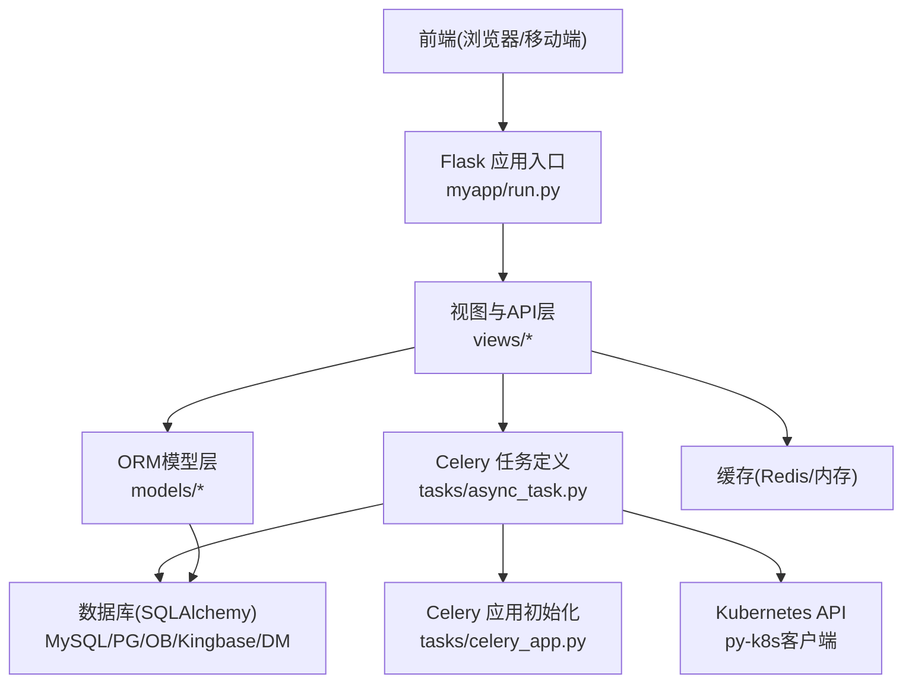
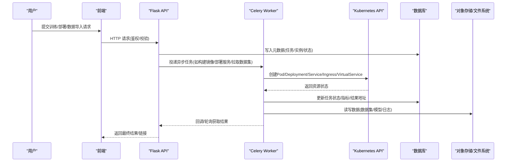
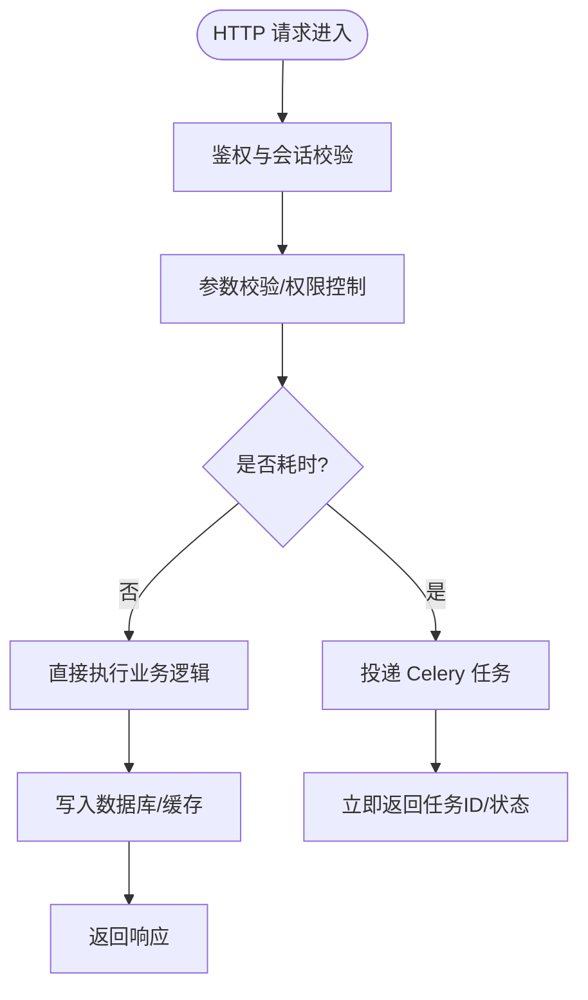
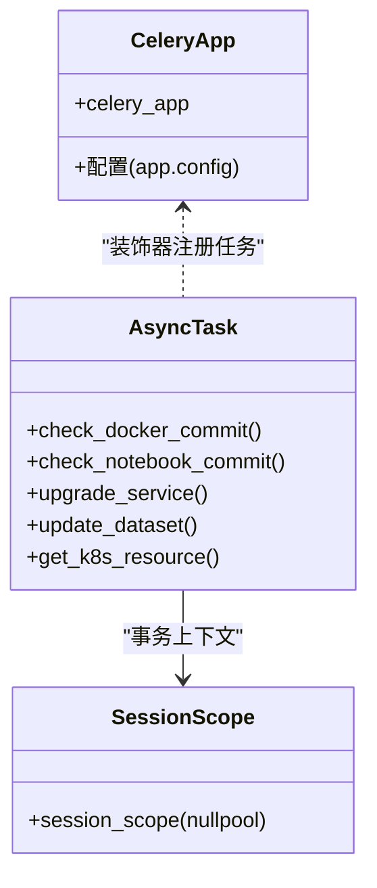
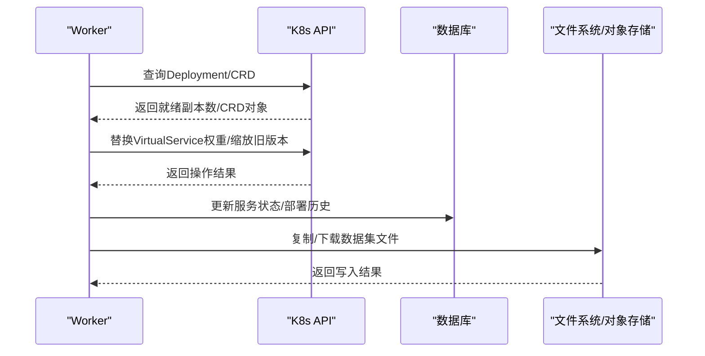
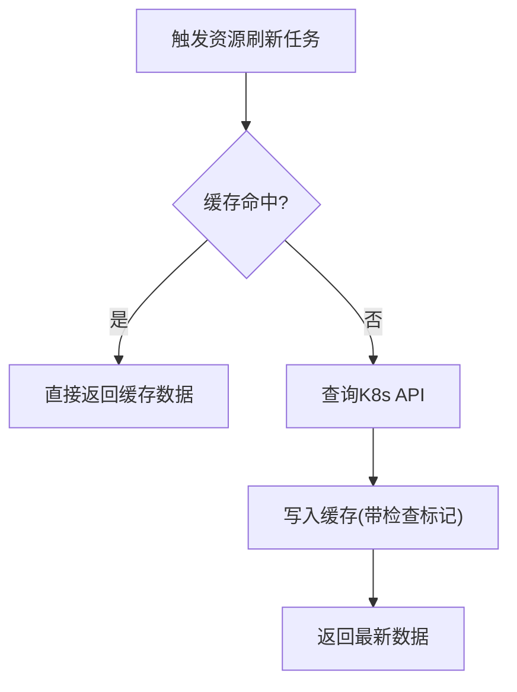
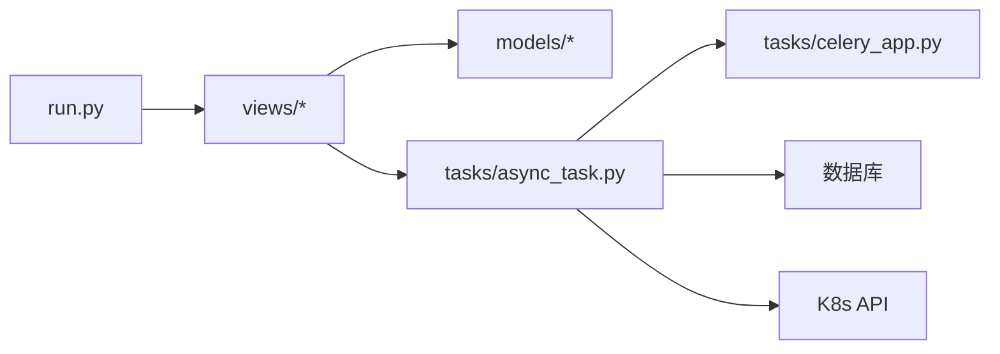

# 数据流设计

<cite>
**本文引用的文件**   
- [README.md](file://README.md)
- [run.py](file://myapp/run.py)
- [project.py](file://myapp/project.py)
- [celery_app.py](file://myapp/tasks/celery_app.py)
- [async_task.py](file://myapp/tasks/async_task.py)
- [celery.py](file://myapp/utils/celery.py)
</cite>

## 目录
1. [引言](#引言)
2. [项目结构](#项目结构)
3. [核心组件](#核心组件)
4. [架构总览](#架构总览)
5. [详细组件分析](#详细组件分析)
6. [依赖关系分析](#依赖关系分析)
7. [性能与一致性](#性能与一致性)
8. [监控、日志与排障](#监控日志与排障)
9. [结论](#结论)

## 引言
本文件面向 CubeStudio 平台的数据流设计，聚焦从用户请求到数据存储的全链路流转。内容覆盖同步请求处理、异步任务执行路径、Kubernetes 资源操作与持久化过程；并给出缓存策略、消息队列机制、事务处理与数据一致性保证说明；同时提供大数据量、流式数据处理与批量操作的优化建议，以及监控、日志追踪和问题排查方法。

## 项目结构
CubeStudio 后端基于 Flask + AppBuilder，使用 Celery 作为异步任务调度器，通过 Kubernetes Python Client 管理集群资源，数据库采用 SQLAlchemy（支持外部 MySQL/PostgreSQL/OceanBase/人大金仓/达梦等）。前端通过 Web 界面发起请求，后端在视图层接收请求后，将耗时或需要跨进程的任务交给 Celery Worker 执行，Worker 再调用 K8s API 创建/更新 Pod/Deployment/Service/Ingress/VirtualService 等资源，并将状态落库。

**图示来源**
- [run.py:1-26](file://myapp/run.py#L1-L26)
- [celery_app.py:1-18](file://myapp/tasks/celery_app.py#L1-L18)
- [async_task.py:1-368](file://myapp/tasks/async_task.py#L1-L368)

**章节来源**
- [README.md:143-160](file://README.md#L143-L160)
- [run.py:1-26](file://myapp/run.py#L1-L26)

## 核心组件
- 应用入口与路由：Flask 应用启动与基础配置。
- 视图与API：承载同步请求处理、鉴权、参数校验、业务编排。
- 异步任务系统：Celery 应用与任务实现，负责长耗时、可重试、可观测的执行流程。
- 数据访问层：SQLAlchemy ORM 与事务上下文封装。
- 资源编排层：Kubernetes 客户端封装，统一对集群资源进行增删改查与滚动升级。
- 缓存与消息：用于状态去重、热点数据缓存与任务进度通知。

**章节来源**
- [run.py:1-26](file://myapp/run.py#L1-L26)
- [celery_app.py:1-18](file://myapp/tasks/celery_app.py#L1-L18)
- [async_task.py:1-368](file://myapp/tasks/async_task.py#L1-L368)
- [celery.py:1-36](file://myapp/utils/celery.py#L1-L36)

## 架构总览
下图展示“请求—任务—资源—存储”的端到端数据流。

**图示来源**
- [async_task.py:27-368](file://myapp/tasks/async_task.py#L27-L368)
- [celery_app.py:1-18](file://myapp/tasks/celery_app.py#L1-L18)

## 详细组件分析

### 同步请求处理流程
- 入口：Flask 应用由 run.py 启动，对外暴露 HTTP 接口。
- 鉴权与会话：项目内包含登录/登出逻辑与用户会话管理，确保后续请求具备身份上下文。
- 视图层：接收请求，完成参数校验、权限检查，必要时直接写库并返回；对于耗时操作则投递 Celery 任务。

**图示来源**
- [run.py:1-26](file://myapp/run.py#L1-L26)
- [project.py:40-184](file://myapp/project.py#L40-L184)

**章节来源**
- [run.py:1-26](file://myapp/run.py#L1-L26)
- [project.py:40-184](file://myapp/project.py#L40-L184)

### 异步任务执行路径（Celery）
- 任务注册：Celery 应用通过 celery_app.py 初始化，统一加载配置。
- 任务实现：async_task.py 定义了多个任务，包括镜像/Notebook 提交检查、推理服务滚动升级、数据集备份、K8s 资源缓存刷新等。
- 事务封装：celery.py 提供 session_scope 上下文管理器，为 Worker 进程隔离数据库连接池，保证事务一致性与异常回滚。

**图示来源**
- [celery_app.py:1-18](file://myapp/tasks/celery_app.py#L1-L18)
- [async_task.py:27-368](file://myapp/tasks/async_task.py#L27-L368)
- [celery.py:1-36](file://myapp/utils/celery.py#L1-L36)

**章节来源**
- [celery_app.py:1-18](file://myapp/tasks/celery_app.py#L1-L18)
- [async_task.py:27-368](file://myapp/tasks/async_task.py#L27-L368)
- [celery.py:1-36](file://myapp/utils/celery.py#L1-L36)

### Kubernetes 资源操作与数据持久化
- 资源操作：Worker 通过 K8s 客户端查询/更新 Deployment、VirtualService 等 CRD，实现滚动升级与流量切换。
- 状态持久化：任务执行过程中持续更新数据库中的任务状态、版本信息与部署历史。
- 数据落盘：数据集备份/下载时，将远程数据复制到本地/共享存储目录，供下游任务消费。

**图示来源**
- [async_task.py:99-284](file://myapp/tasks/async_task.py#L99-L284)
- [async_task.py:287-335](file://myapp/tasks/async_task.py#L287-L335)

**章节来源**
- [async_task.py:99-284](file://myapp/tasks/async_task.py#L99-L284)
- [async_task.py:287-335](file://myapp/tasks/async_task.py#L287-L335)

### 缓存策略与消息机制
- 缓存：针对 K8s 资源列表（Pods/Nodes）进行缓存，避免频繁查询 API Server，降低压力。
- 消息：任务执行过程中向用户推送状态变更消息（成功/失败/进度），便于前端轮询或主动通知。

**图示来源**
- [async_task.py:339-365](file://myapp/tasks/async_task.py#L339-L365)

**章节来源**
- [async_task.py:339-365](file://myapp/tasks/async_task.py#L339-L365)

## 依赖关系分析
- Flask 应用依赖视图模块、模型模块、Celery 任务模块。
- Celery Worker 依赖数据库会话封装、K8s 客户端、缓存与消息推送。
- 视图层可能直接调用模型层进行读写，也可能仅做参数校验后将任务投递给 Celery。

**图示来源**
- [run.py:1-26](file://myapp/run.py#L1-L26)
- [celery_app.py:1-18](file://myapp/tasks/celery_app.py#L1-L18)
- [async_task.py:1-368](file://myapp/tasks/async_task.py#L1-L368)

**章节来源**
- [run.py:1-26](file://myapp/run.py#L1-L26)
- [celery_app.py:1-18](file://myapp/tasks/celery_app.py#L1-L18)
- [async_task.py:1-368](file://myapp/tasks/async_task.py#L1-L368)

## 性能与一致性

### 大数据量处理
- 分批与流式：数据集下载/复制应分块读取与写入，避免一次性占用过多内存；对超大文件优先走对象存储直传。
- 并行与限流：多文件并行拷贝需限制并发度，防止打满磁盘IO与网络带宽。
- 断点续传：对大文件下载实现断点续传与重试，提升稳定性。

### 流式数据处理
- 流式输出：对训练/推理日志采用流式输出，结合 WebSocket 或 SSE 推送到前端，减少全量拉取开销。
- 增量计算：特征工程/ETL 尽量采用增量模式，配合时间戳/分区键减少重复计算。

### 批量操作优化
- 批量写入：数据库批量插入/更新使用 bulk 接口，减少往返次数。
- 幂等与去重：对重复请求进行幂等控制，利用唯一键或分布式锁避免重复执行。

### 事务与一致性
- 事务边界：Worker 中使用 session_scope 包裹数据库操作，确保异常时自动回滚。
- 最终一致性：K8s 资源状态与数据库状态通过任务轮询/回调达成最终一致；关键路径增加重试与补偿机制。
- 幂等性：所有写操作需具备幂等能力，避免重试导致数据不一致。

**章节来源**
- [celery.py:1-36](file://myapp/utils/celery.py#L1-L36)
- [async_task.py:27-368](file://myapp/tasks/async_task.py#L27-L368)

## 监控、日志与排障

### 监控
- 资源监控：通过 Prometheus/Grafana 监控节点/Pod/Service 的 CPU、内存、GPU、网络与磁盘 IO。
- 任务监控：记录任务开始/结束时间、重试次数、失败原因，结合告警通道（邮件/企业微信/钉钉/飞书）及时通知。

### 日志
- 结构化日志：关键步骤输出结构化日志，包含任务ID、命名空间、资源名称、状态码与错误堆栈。
- 日志采集：容器标准输出接入日志采集系统，便于集中检索与分析。

### 排障
- 常见现象与定位：
  - 任务长时间 Running：检查 K8s Pod 事件与日志，确认镜像拉取、资源配额、依赖服务可用性。
  - 滚动升级卡住：查看 VirtualService 权重与 Deployment 副本就绪情况，必要时手动回滚。
  - 数据集备份失败：检查目标目录权限、网络连通性与远端源可达性。
- 快速命令：
  - 查看 Pod 状态与事件
  - 查看 Deployment 与 Service 详情
  - 查看 VirtualService 配置与权重
  - 查看数据库任务表状态与错误信息

**章节来源**
- [README.md:350-359](file://README.md#L350-L359)
- [async_task.py:99-284](file://myapp/tasks/async_task.py#L99-L284)

## 结论
CubeStudio 的数据流以“Web 请求 → 视图层 → Celery 异步任务 → K8s 资源编排 → 数据库/存储”为主线，结合缓存与消息机制提升吞吐与可观测性。通过事务封装与最终一致性策略保障数据正确性；在大数据量、流式与批量场景下，采用分块、并行、幂等与增量策略提升性能与稳定性。配套监控与日志体系为问题定位与容量规划提供支撑。