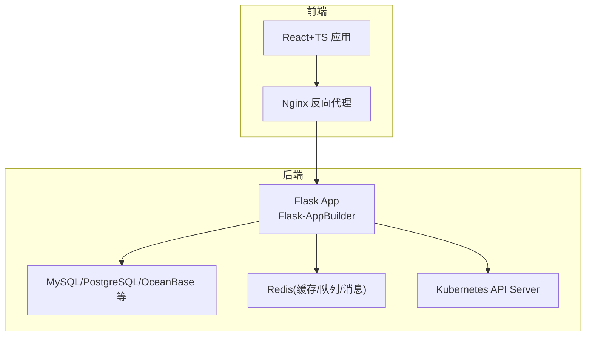
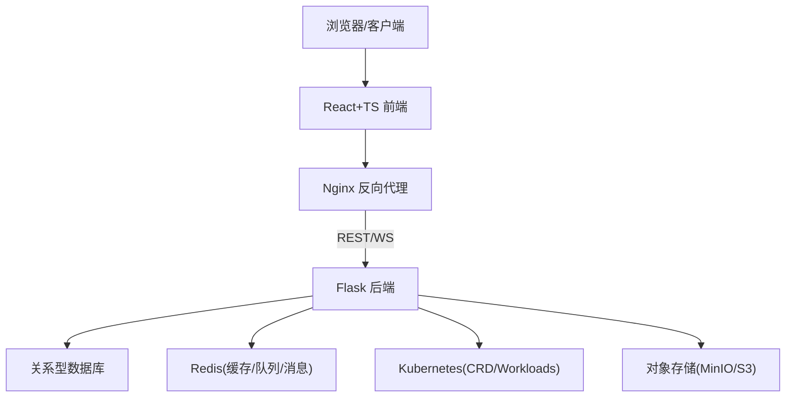
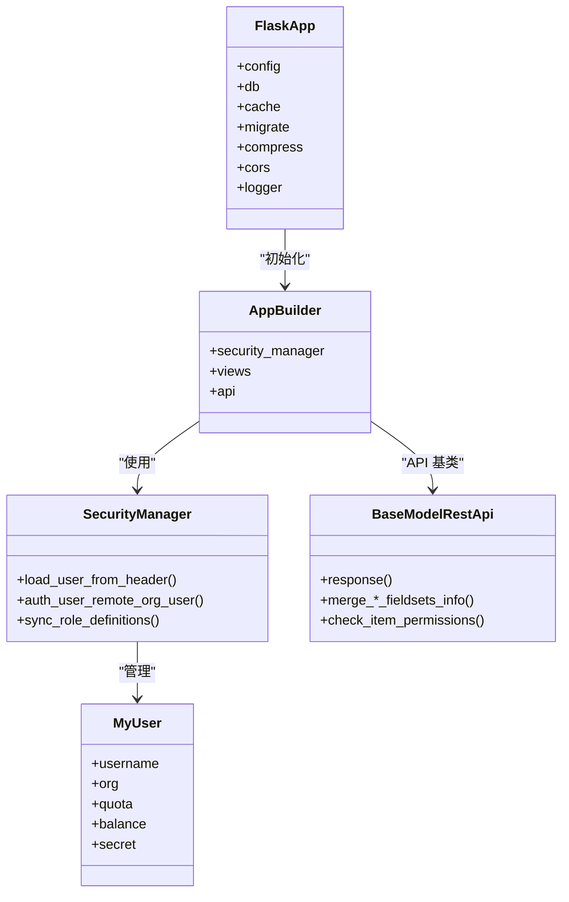
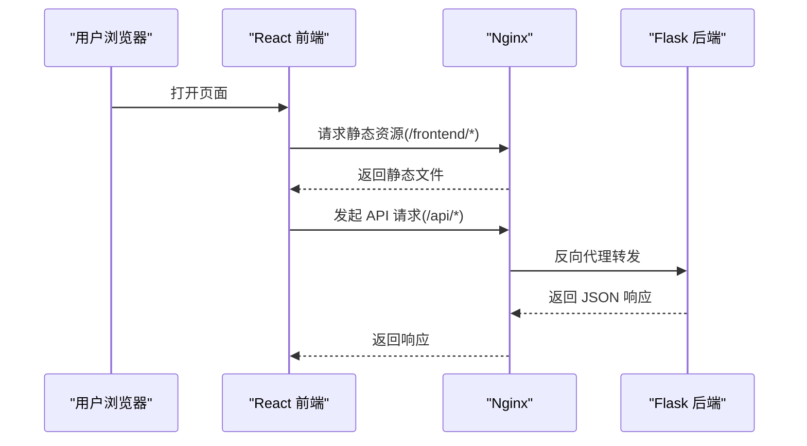
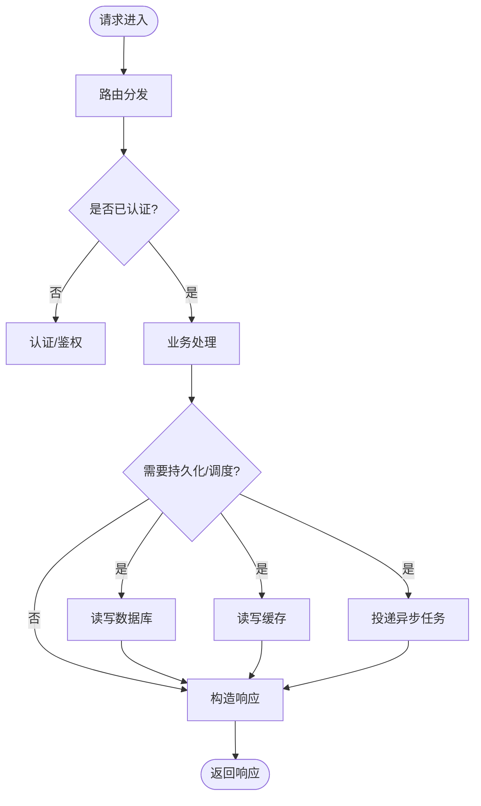
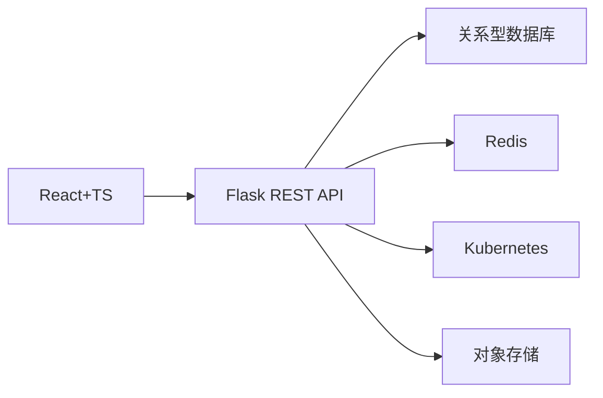
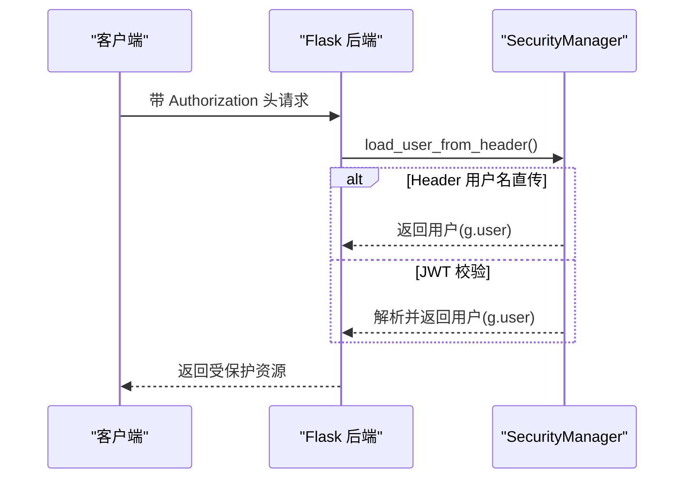
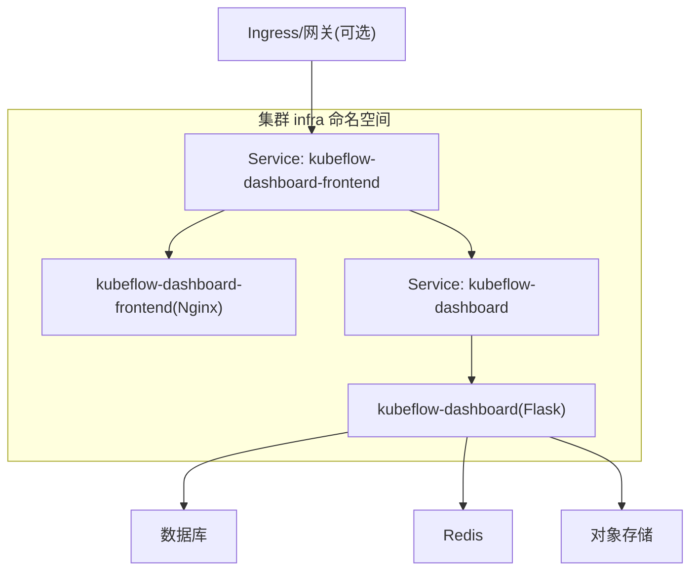

# 系统架构

<cite>
**本文引用的文件**   
- [README.md](file://README.md)
- [myapp/__init__.py](file://myapp/__init__.py)
- [myapp/config.py](file://myapp/config.py)
- [myapp/project.py](file://myapp/project.py)
- [myapp/run.py](file://myapp/run.py)
- [myapp/security.py](file://myapp/security.py)
- [myapp/views/base.py](file://myapp/views/base.py)
- [myapp/views/baseApi.py](file://myapp/views/baseApi.py)
- [install/kubernetes/cube/base/deploy-backend.yaml](file://install/kubernetes/cube/base/deploy-backend.yaml)
- [install/kubernetes/cube/base/deploy-frontend.yaml](file://install/kubernetes/cube/base/deploy-frontend.yaml)
</cite>

## 目录
1. [简介](#简介)
2. [项目结构](#项目结构)
3. [核心组件](#核心组件)
4. [架构总览](#架构总览)
5. [详细组件分析](#详细组件分析)
6. [依赖关系分析](#依赖关系分析)
7. [性能与可扩展性](#性能与可扩展性)
8. [安全架构](#安全架构)
9. [监控与可观测性](#监控与可观测性)
10. [部署拓扑与基础设施](#部署拓扑与基础设施)
11. [故障排查指南](#故障排查指南)
12. [结论](#结论)

## 简介
本文件为 CubeStudio 平台的系统架构文档，面向开发者与运维人员，覆盖整体架构图、后端服务架构（Flask + Flask-AppBuilder）、前端应用架构（React + TypeScript）和数据流设计；解释核心组件交互关系、微服务/插件化模式、基础设施需求、可扩展性考虑与部署拓扑；并涵盖安全架构、监控体系与灾难恢复策略。同时给出技术栈选择、第三方依赖与版本兼容性说明，以及系统上下文图与组件分解图，帮助快速理解平台全貌。

## 项目结构
仓库采用前后端同仓组织：
- 后端：基于 Flask + Flask-AppBuilder 的 Web 应用，提供 REST API、RBAC 权限、数据库迁移、缓存与异步任务等能力。
- 前端：React + TypeScript 工程，通过 Nginx 反向代理与后端分离部署。
- 部署：Kubernetes YAML 定义后端与前端 Deployment/Service，Nginx 作为静态资源与反向代理入口。
- 配置：集中式 Python 配置模块，支持环境变量注入与外部覆盖。

图表来源
- [install/kubernetes/cube/base/deploy-frontend.yaml:10-66](file://install/kubernetes/cube/base/deploy-frontend.yaml#L10-L66)
- [install/kubernetes/cube/base/deploy-backend.yaml:53-138](file://install/kubernetes/cube/base/deploy-backend.yaml#L53-L138)
- [myapp/__init__.py:127-139](file://myapp/__init__.py#L127-L139)

章节来源
- [README.md:145-163](file://README.md#L145-L163)
- [install/kubernetes/cube/base/deploy-frontend.yaml:1-148](file://install/kubernetes/cube/base/deploy-frontend.yaml#L1-L148)
- [install/kubernetes/cube/base/deploy-backend.yaml:1-162](file://install/kubernetes/cube/base/deploy-backend.yaml#L1-L162)

## 核心组件
- 应用启动与装配：Flask 应用创建、扩展初始化（SQLAlchemy、Migrate、CORS、Compress）、AppBuilder 装配、全局中间件与错误处理。
- 认证与授权：自定义 SecurityManager、用户模型扩展、JWT/Header 认证、登录视图与自动注册逻辑。
- API 框架：基于 FAB 的 ModelRestApi 扩展，统一响应格式、字段元数据、权限控制与异常处理。
- 配置中心：集中配置项（数据库、Redis、Celery、CRD、命名空间、镜像、存储等），支持环境变量与环境覆盖。
- 异步任务：Celery 任务与定时调度（Beat），用于流水线检查、清理、监控上报等。
- 前端与反向代理：React 静态资源由 Nginx 托管，非静态请求转发至后端。

章节来源
- [myapp/__init__.py:28-139](file://myapp/__init__.py#L28-L139)
- [myapp/security.py:237-286](file://myapp/security.py#L237-L286)
- [myapp/views/baseApi.py:242-407](file://myapp/views/baseApi.py#L242-L407)
- [myapp/config.py:336-410](file://myapp/config.py#L336-L410)
- [myapp/config.py:496-544](file://myapp/config.py#L496-L544)
- [install/kubernetes/cube/base/deploy-frontend.yaml:10-66](file://install/kubernetes/cube/base/deploy-frontend.yaml#L10-L66)

## 架构总览
CubeStudio 以 Kubernetes 为算力底座，后端提供统一的 Web/API 能力，前端通过 Nginx 反向代理访问。平台通过 Redis 提供缓存与消息队列，通过 Celery 执行异步任务；通过 SQLAlchemy 连接元数据库；通过 Kubernetes CRD 与 API 管理训练/推理工作负载。

图表来源
- [install/kubernetes/cube/base/deploy-frontend.yaml:10-66](file://install/kubernetes/cube/base/deploy-frontend.yaml#L10-L66)
- [install/kubernetes/cube/base/deploy-backend.yaml:53-138](file://install/kubernetes/cube/base/deploy-backend.yaml#L53-L138)
- [myapp/config.py:350-380](file://myapp/config.py#L350-L380)
- [myapp/config.py:724-753](file://myapp/config.py#L724-L753)

## 详细组件分析

### 后端服务架构（Flask + Flask-AppBuilder）
- 应用装配：创建 Flask 实例，加载配置，初始化数据库、迁移、缓存、压缩、CORS、日志等扩展；注册 AppBuilder 与安全管理器。
- 路由与视图：通过 FAB 的 BaseView/ModelView 与自定义基类，统一 JSON 响应、权限校验、异常捕获与国际化。
- 认证流程：支持 Cookie、Header JWT/用户名直传，结合自定义 SecurityManager 实现鉴权与用户上下文注入。
- 异步任务：Celery Worker 与 Beat 调度器，按任务名配置速率限制、超时、重试与定时任务。

图表来源
- [myapp/__init__.py:28-139](file://myapp/__init__.py#L28-L139)
- [myapp/security.py:47-94](file://myapp/security.py#L47-L94)
- [myapp/security.py:237-286](file://myapp/security.py#L237-L286)
- [myapp/views/baseApi.py:242-407](file://myapp/views/baseApi.py#L242-L407)

章节来源
- [myapp/__init__.py:28-139](file://myapp/__init__.py#L28-L139)
- [myapp/security.py:237-286](file://myapp/security.py#L237-L286)
- [myapp/views/base.py:166-195](file://myapp/views/base.py#L166-L195)
- [myapp/views/baseApi.py:242-407](file://myapp/views/baseApi.py#L242-L407)

### 前端应用架构（React + TypeScript）
- 构建产物由 Nginx 托管，静态资源直接返回，HTML 走 history fallback。
- 所有非静态请求经 Nginx 反向代理到后端服务，支持 WebSocket 透传。
- 前端通过 API 调用后端 REST 接口，携带认证头或 Cookie。

图表来源
- [install/kubernetes/cube/base/deploy-frontend.yaml:10-66](file://install/kubernetes/cube/base/deploy-frontend.yaml#L10-L66)

章节来源
- [install/kubernetes/cube/base/deploy-frontend.yaml:1-148](file://install/kubernetes/cube/base/deploy-frontend.yaml#L1-L148)

### 数据流设计
- 请求链路：浏览器 -> Nginx -> Flask -> 业务逻辑 -> 数据库/Redis/K8S -> 返回结果。
- 异步链路：Flask 提交任务 -> Redis 队列 -> Celery Worker 消费 -> 更新状态/指标 -> 前端轮询/WebSocket 获取进度。
- 配置注入：环境变量与 ConfigMap 注入到容器，运行时读取配置驱动行为。

图表来源
- [myapp/__init__.py:260-319](file://myapp/__init__.py#L260-L319)
- [myapp/config.py:372-410](file://myapp/config.py#L372-L410)
- [myapp/config.py:496-544](file://myapp/config.py#L496-L544)

章节来源
- [myapp/__init__.py:260-319](file://myapp/__init__.py#L260-L319)
- [myapp/config.py:372-410](file://myapp/config.py#L372-L410)

### 插件化与模板机制
- 算子/模板：通过“标准化 → 注册 → 模板库 → 编排”的流程沉淀能力资产，支持多类型参数与可视化 UI 生成。
- 视图/表单：通过 FAB 的 ModelView 与自定义列宽、字段集、操作按钮等扩展点，形成可插拔的业务界面。
- 功能开关：Feature Flags 与配置项控制特性启用，便于灰度与裁剪。

章节来源
- [README.md:301-311](file://README.md#L301-L311)
- [myapp/views/baseApi.py:538-553](file://myapp/views/baseApi.py#L538-L553)
- [myapp/config.py:110-133](file://myapp/config.py#L110-L133)

## 依赖关系分析
- 后端依赖：Flask、Flask-AppBuilder、SQLAlchemy、Flask-Migrate、Flask-CORS、Flask-Compress、PyJWT、Celery、Redis、Kubernetes Python SDK。
- 前端依赖：React、TypeScript、Webpack/Babel 工具链（由 create-react-app 脚手架提供）。
- 运行依赖：Kubernetes、Redis、关系型数据库、MinIO/S3 兼容对象存储。

图表来源
- [myapp/config.py:350-380](file://myapp/config.py#L350-L380)
- [myapp/config.py:724-753](file://myapp/config.py#L724-L753)

章节来源
- [myapp/config.py:336-410](file://myapp/config.py#L336-L410)
- [myapp/config.py:724-753](file://myapp/config.py#L724-L753)

## 性能与可扩展性
- 水平扩展：后端无状态，可通过增加 Pod 副本横向扩展；Nginx 与前端同样可多副本部署。
- 缓存与队列：Redis 承担缓存与消息队列，提升吞吐与解耦；Celery Worker 可按需扩容。
- 数据库连接池：SQLAlchemy 连接池与超时重连配置，保障高并发稳定性。
- 资源隔离：通过 Kubernetes 命名空间与资源配额进行租户/项目级隔离。
- 弹性伸缩：推理服务支持按 CPU/Mem/GPU 弹性伸缩与定时伸缩。

章节来源
- [myapp/config.py:350-380](file://myapp/config.py#L350-L380)
- [myapp/config.py:496-544](file://myapp/config.py#L496-L544)
- [README.md:342-350](file://README.md#L342-L350)

## 安全架构
- 认证方式：Cookie 会话、Header JWT、Header 用户名直传（内网域名或全局开关）。
- 授权模型：FAB RBAC，角色/菜单/接口权限控制；支持只读 public 角色与接口访问类型控制。
- 安全中间件：CSRF 开关、CORS 白名单、HTTP 响应头注入。
- 审计与事件：事件日志记录登录等行为，便于审计追踪。

图表来源
- [myapp/security.py:258-286](file://myapp/security.py#L258-L286)
- [myapp/__init__.py:260-287](file://myapp/__init__.py#L260-L287)

章节来源
- [myapp/security.py:237-286](file://myapp/security.py#L237-L286)
- [myapp/__init__.py:260-319](file://myapp/__init__.py#L260-L319)
- [myapp/config.py:45-53](file://myapp/config.py#L45-L53)

## 监控与可观测性
- 指标采集：Prometheus + Grafana 采集主机/Pod/GPU/网络/磁盘等指标，平台侧聚合展示。
- 告警通知：Pipeline/Workflow 状态变更推送通知，支持邮件与企业微信/钉钉/飞书 webhook。
- 日志输出：应用日志按级别输出，支持时间轮转与文件落盘。

章节来源
- [README.md:352-361](file://README.md#L352-L361)
- [myapp/config.py:186-208](file://myapp/config.py#L186-L208)

## 部署拓扑与基础设施
- 前端：Nginx 托管 React 静态资源，反向代理 / 到后端服务，支持 WebSocket 透传。
- 后端：Flask 应用以 Deployment 形式运行，挂载配置与持久卷，暴露 Service。
- 依赖服务：Redis、关系型数据库、MinIO/S3、Kubernetes API。
- 健康检查：后端暴露 /health 探针，配合 Liveness/Readiness 探测。

图表来源
- [install/kubernetes/cube/base/deploy-frontend.yaml:72-148](file://install/kubernetes/cube/base/deploy-frontend.yaml#L72-L148)
- [install/kubernetes/cube/base/deploy-backend.yaml:1-162](file://install/kubernetes/cube/base/deploy-backend.yaml#L1-L162)

章节来源
- [install/kubernetes/cube/base/deploy-frontend.yaml:1-148](file://install/kubernetes/cube/base/deploy-frontend.yaml#L1-L148)
- [install/kubernetes/cube/base/deploy-backend.yaml:1-162](file://install/kubernetes/cube/base/deploy-backend.yaml#L1-L162)

## 故障排查指南
- 无法访问前端静态资源：检查 Nginx 配置与路径映射，确认 try_files 与 index.html 回退生效。
- 后端 401 未认证：检查 Authorization 头或 Cookie，确认 SecurityManager 的 header_loader 与 JWT 密钥一致。
- 数据库连接失败：检查 SQLALCHEMY_DATABASE_URI 与连接池配置，确认网络可达与凭据正确。
- 异步任务不执行：检查 Redis 队列连通性与 Celery Worker/Beat 进程状态，核对任务名与 rate_limit/time_limit。
- 健康检查失败：检查 /health 端点与探针配置，确认容器端口与服务映射正确。

章节来源
- [install/kubernetes/cube/base/deploy-frontend.yaml:10-66](file://install/kubernetes/cube/base/deploy-frontend.yaml#L10-L66)
- [myapp/security.py:258-286](file://myapp/security.py#L258-L286)
- [myapp/config.py:350-380](file://myapp/config.py#L350-L380)
- [myapp/config.py:496-544](file://myapp/config.py#L496-L544)
- [install/kubernetes/cube/base/deploy-backend.yaml:120-135](file://install/kubernetes/cube/base/deploy-backend.yaml#L120-L135)

## 结论
CubeStudio 以 Kubernetes 为底座，采用 Flask + Flask-AppBuilder 的后端与 React + TypeScript 的前端分离架构，通过 Nginx 反向代理统一入口，借助 Redis/Celery 实现缓存与异步任务，依托 Kubernetes CRD 管理训练与推理工作负载。平台具备完善的认证授权、监控告警、插件化模板与多租户隔离能力，支持异构算力与国产化生态，适合大规模企业级私有化部署与持续演进。