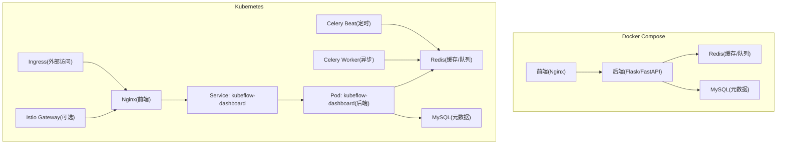
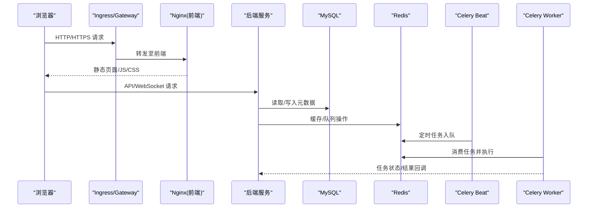
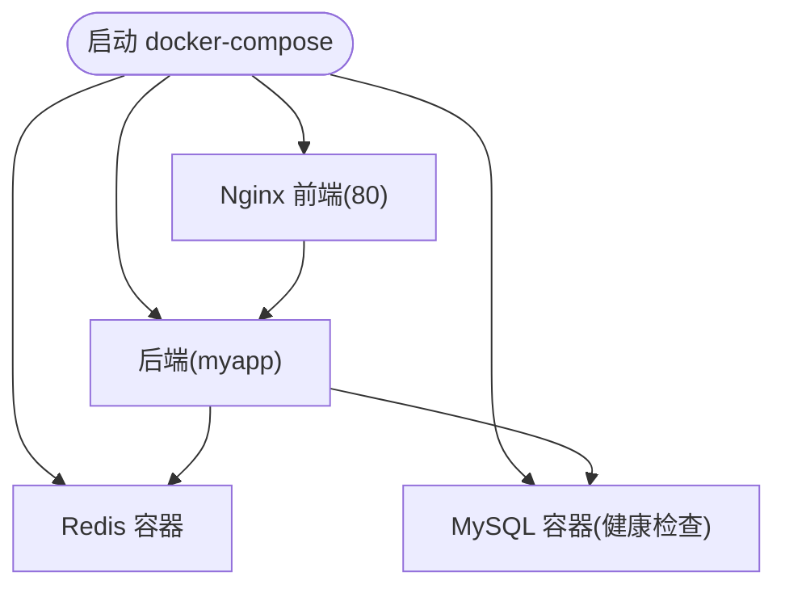
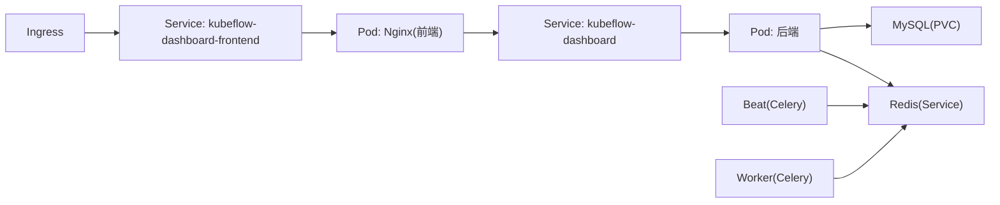
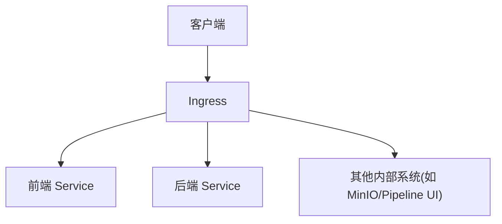
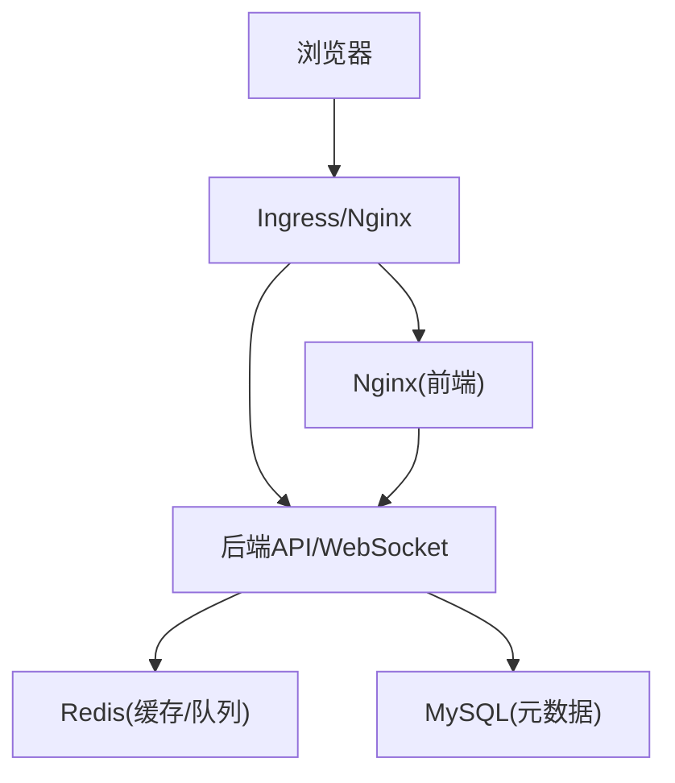
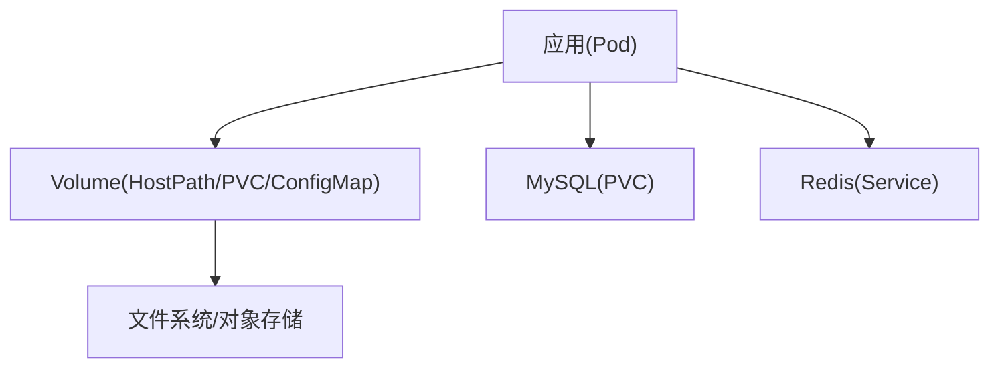
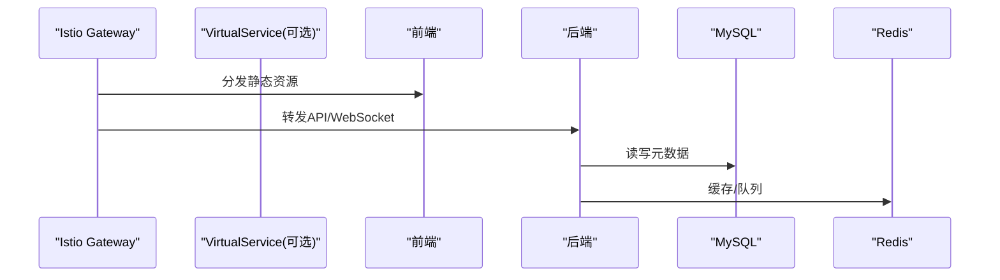
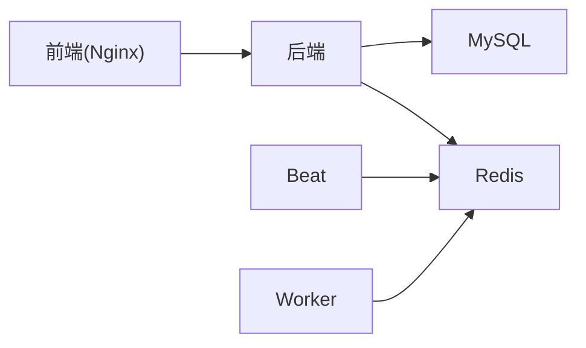

# 部署拓扑

<cite>
**本文引用的文件**   
- [README.md](file://README.md)
- [docker-compose.yml](file://install/docker/docker-compose.yml)
- [deploy-backend.yaml](file://install/kubernetes/cube/base/deploy-backend.yaml)
- [deploy-frontend.yaml](file://install/kubernetes/cube/base/deploy-frontend.yaml)
- [ingress.yaml](file://install/kubernetes/ingress.yaml)
- [gateway.yaml](file://install/kubernetes/gateway.yaml)
- [deploy-schedule.yaml](file://install/kubernetes/cube/base/deploy-schedule.yaml)
- [deploy-worker.yaml](file://install/kubernetes/cube/base/deploy-worker.yaml)
- [deploy-watch.yaml](file://install/kubernetes/cube/base/deploy-watch.yaml)
- [mysql-deploy.yaml](file://install/kubernetes/mysql/deploy.yaml)
- [redis.yaml](file://install/kubernetes/redis/redis.yaml)
</cite>

## 目录
1. [引言](#引言)
2. [项目结构](#项目结构)
3. [核心组件](#核心组件)
4. [架构总览](#架构总览)
5. [详细组件分析](#详细组件分析)
6. [依赖关系分析](#依赖关系分析)
7. [性能与容量规划](#性能与容量规划)
8. [故障排查指南](#故障排查指南)
9. [结论](#结论)
10. [附录：部署模板与参数调优](#附录部署模板与参数调优)

## 引言
本文件面向运维与平台工程团队，系统性梳理 CubeStudio 的部署拓扑与高可用方案，覆盖 Docker 容器化、Kubernetes 集群与混合云（含服务网格）三种部署形态。文档重点说明：
- 服务发现与负载均衡机制
- 高可用与故障转移策略
- 网络拓扑、存储架构与依赖关系
- 微服务通信协议与 API 网关配置
- 资源配额、弹性伸缩与容量规划建议
- 不同环境的部署模板、参数调优与监控告警
- 灾难恢复与业务连续性保障

## 项目结构
CubeStudio 提供两类部署入口：
- Docker Compose 快速体验与本地开发
- Kubernetes 生产级部署，包含前后端、任务调度、异步 Worker、Ingress/Gateway、数据库与缓存等基础设施

图表来源
- [docker-compose.yml:1-125](file://install/docker/docker-compose.yml#L1-L125)
- [deploy-backend.yaml:1-162](file://install/kubernetes/cube/base/deploy-backend.yaml#L1-L162)
- [deploy-frontend.yaml:1-148](file://install/kubernetes/cube/base/deploy-frontend.yaml#L1-L148)
- [ingress.yaml:1-155](file://install/kubernetes/ingress.yaml#L1-L155)
- [gateway.yaml:1-38](file://install/kubernetes/gateway.yaml#L1-L38)
- [deploy-schedule.yaml:1-103](file://install/kubernetes/cube/base/deploy-schedule.yaml#L1-L103)
- [deploy-worker.yaml:1-113](file://install/kubernetes/cube/base/deploy-worker.yaml#L1-L113)
- [mysql-deploy.yaml:1-67](file://install/kubernetes/mysql/deploy.yaml#L1-L67)
- [redis.yaml:1-72](file://install/kubernetes/redis/redis.yaml#L1-L72)

章节来源
- [README.md:143-161](file://README.md#L143-L161)

## 核心组件
- 前端 Nginx：静态资源托管与反向代理，支持 WebSocket 透传
- 后端服务：REST/WebSocket API，读写 MySQL，使用 Redis 做缓存与任务队列
- 定时调度 Celery Beat：周期性任务触发
- 异步 Worker：执行耗时任务（如 Pipeline、训练、推理任务编排）
- 监控与观测：Prometheus/Grafana（仓库内提供安装清单），K8s Dashboard
- 存储：MySQL（元数据）、MinIO/S3/NFS/CephFS 等（由平台运行时挂载）
- 网络：Ingress 或 Istio Gateway 作为统一入口

章节来源
- [deploy-frontend.yaml:1-148](file://install/kubernetes/cube/base/deploy-frontend.yaml#L1-L148)
- [deploy-backend.yaml:1-162](file://install/kubernetes/cube/base/deploy-backend.yaml#L1-L162)
- [deploy-schedule.yaml:1-103](file://install/kubernetes/cube/base/deploy-schedule.yaml#L1-L103)
- [deploy-worker.yaml:1-113](file://install/kubernetes/cube/base/deploy-worker.yaml#L1-L113)

## 架构总览
下图展示从浏览器到后端、再到存储与任务系统的端到端路径，并标注 Ingress/Istio 两种入口模式。

图表来源
- [ingress.yaml:1-155](file://install/kubernetes/ingress.yaml#L1-L155)
- [gateway.yaml:1-38](file://install/kubernetes/gateway.yaml#L1-L38)
- [deploy-frontend.yaml:1-148](file://install/kubernetes/cube/base/deploy-frontend.yaml#L1-L148)
- [deploy-backend.yaml:1-162](file://install/kubernetes/cube/base/deploy-backend.yaml#L1-L162)
- [deploy-schedule.yaml:1-103](file://install/kubernetes/cube/base/deploy-schedule.yaml#L1-L103)
- [deploy-worker.yaml:1-113](file://install/kubernetes/cube/base/deploy-worker.yaml#L1-L113)

## 详细组件分析

### Docker Compose 部署拓扑
- 组件：redis、mysql、frontend、myapp（后端）
- 端口映射：6379(Redis)、3306(MySQL)、80(Frontend)
- 环境变量：REDIS_HOST/PORT/PASSWORD、MYSQL_SERVICE、ENVIRONMENT、STAGE
- 健康检查：MySQL 启动就绪检测
- 卷挂载：MySQL 数据持久化、前后端静态资源与配置文件

图表来源
- [docker-compose.yml:1-125](file://install/docker/docker-compose.yml#L1-L125)

章节来源
- [docker-compose.yml:1-125](file://install/docker/docker-compose.yml#L1-L125)

### Kubernetes 部署拓扑
- 命名空间：infra（平台基础组件）
- 前端 Deployment/Service：Nginx 反代后端
- 后端 Deployment/Service：暴露 /health 探针
- 定时与异步：Celery Beat 与 Worker 通过 Redis 协作
- 存储：MySQL 通过 PVC 持久化
- 缓存：Redis 通过 Service 暴露 ClusterIP

图表来源
- [deploy-frontend.yaml:1-148](file://install/kubernetes/cube/base/deploy-frontend.yaml#L1-L148)
- [deploy-backend.yaml:1-162](file://install/kubernetes/cube/base/deploy-backend.yaml#L1-L162)
- [deploy-schedule.yaml:1-103](file://install/kubernetes/cube/base/deploy-schedule.yaml#L1-L103)
- [deploy-worker.yaml:1-113](file://install/kubernetes/cube/base/deploy-worker.yaml#L1-L113)
- [mysql-deploy.yaml:1-67](file://install/kubernetes/mysql/deploy.yaml#L1-L67)
- [redis.yaml:1-72](file://install/kubernetes/redis/redis.yaml#L1-L72)

章节来源
- [deploy-frontend.yaml:1-148](file://install/kubernetes/cube/base/deploy-frontend.yaml#L1-L148)
- [deploy-backend.yaml:1-162](file://install/kubernetes/cube/base/deploy-backend.yaml#L1-L162)
- [deploy-schedule.yaml:1-103](file://install/kubernetes/cube/base/deploy-schedule.yaml#L1-L103)
- [deploy-worker.yaml:1-113](file://install/kubernetes/cube/base/deploy-worker.yaml#L1-L113)
- [mysql-deploy.yaml:1-67](file://install/kubernetes/mysql/deploy.yaml#L1-L67)
- [redis.yaml:1-72](file://install/kubernetes/redis/redis.yaml#L1-L72)

### 服务发现与负载均衡
- K8s Service：为前后端与 Redis 提供稳定的 ClusterIP 与端口映射
- Ingress：对外暴露 HTTP/HTTPS 入口，支持 CORS、超时与 body size 调整
- Istio Gateway：在启用服务网格时，通过 Gateway/VS 管理流量入口与多端口监听

图表来源
- [ingress.yaml:1-155](file://install/kubernetes/ingress.yaml#L1-L155)
- [gateway.yaml:1-38](file://install/kubernetes/gateway.yaml#L1-L38)

章节来源
- [ingress.yaml:1-155](file://install/kubernetes/ingress.yaml#L1-L155)
- [gateway.yaml:1-38](file://install/kubernetes/gateway.yaml#L1-L38)

### 高可用与故障转移
- 应用层：前后端均定义 Deployment，可通过 replicas 扩容；后端提供 /health 探针用于就绪/存活探测
- 任务层：Beat/Worker 可独立扩缩容，结合 Redis 实现解耦与重试
- 存储层：MySQL 通过 PVC 保证数据持久化；Redis 默认单实例（emptyDir），生产建议采用有状态中间件或托管服务
- 入口层：Ingress 控制器具备多副本能力，配合节点亲和与 PodDisruptionBudget 提升可用性

章节来源
- [deploy-backend.yaml:1-162](file://install/kubernetes/cube/base/deploy-backend.yaml#L1-L162)
- [deploy-frontend.yaml:1-148](file://install/kubernetes/cube/base/deploy-frontend.yaml#L1-L148)
- [deploy-schedule.yaml:1-103](file://install/kubernetes/cube/base/deploy-schedule.yaml#L1-L103)
- [deploy-worker.yaml:1-113](file://install/kubernetes/cube/base/deploy-worker.yaml#L1-L113)
- [mysql-deploy.yaml:1-67](file://install/kubernetes/mysql/deploy.yaml#L1-L67)
- [redis.yaml:1-72](file://install/kubernetes/redis/redis.yaml#L1-L72)

### 网络拓扑与协议
- 前端 Nginx：静态资源 + 反向代理，开启 WebSocket 透传（Upgrade/Connection）
- 后端：HTTP REST API 与 WebSocket（Jupyter/Notebook 等场景）
- Ingress：HTTP/HTTPS 七层代理，CORS 与超时控制
- Istio Gateway：可选，开放 80/8080 端口，配合 VirtualService 进行路由

图表来源
- [deploy-frontend.yaml:1-148](file://install/kubernetes/cube/base/deploy-frontend.yaml#L1-L148)
- [ingress.yaml:1-155](file://install/kubernetes/ingress.yaml#L1-L155)
- [gateway.yaml:1-38](file://install/kubernetes/gateway.yaml#L1-L38)

章节来源
- [deploy-frontend.yaml:1-148](file://install/kubernetes/cube/base/deploy-frontend.yaml#L1-L148)
- [ingress.yaml:1-155](file://install/kubernetes/ingress.yaml#L1-L155)
- [gateway.yaml:1-38](file://install/kubernetes/gateway.yaml#L1-L38)

### 存储架构
- 元数据：MySQL（PVC 持久化）
- 缓存：Redis（ClusterIP Service）
- 对象/分布式存储：平台运行时挂载 NFS/CephFS/S3/MinIO 等（由作业/服务动态挂载）

图表来源
- [deploy-backend.yaml:1-162](file://install/kubernetes/cube/base/deploy-backend.yaml#L1-L162)
- [mysql-deploy.yaml:1-67](file://install/kubernetes/mysql/deploy.yaml#L1-L67)
- [redis.yaml:1-72](file://install/kubernetes/redis/redis.yaml#L1-L72)

章节来源
- [deploy-backend.yaml:1-162](file://install/kubernetes/cube/base/deploy-backend.yaml#L1-L162)
- [mysql-deploy.yaml:1-67](file://install/kubernetes/mysql/deploy.yaml#L1-L67)
- [redis.yaml:1-72](file://install/kubernetes/redis/redis.yaml#L1-L72)

### 微服务间通信与服务网格集成
- 微服务通信：后端与 Redis/MySQL 通过环境变量注入连接信息；前端通过 Nginx 反代后端
- 服务网格：Istio Gateway 暴露 80/8080 端口，便于后续接入 Traffic Split、熔断、限流、可观测性

图表来源
- [gateway.yaml:1-38](file://install/kubernetes/gateway.yaml#L1-L38)
- [deploy-frontend.yaml:1-148](file://install/kubernetes/cube/base/deploy-frontend.yaml#L1-L148)
- [deploy-backend.yaml:1-162](file://install/kubernetes/cube/base/deploy-backend.yaml#L1-L162)

章节来源
- [gateway.yaml:1-38](file://install/kubernetes/gateway.yaml#L1-L38)
- [deploy-frontend.yaml:1-148](file://install/kubernetes/cube/base/deploy-frontend.yaml#L1-L148)
- [deploy-backend.yaml:1-162](file://install/kubernetes/cube/base/deploy-backend.yaml#L1-L162)

## 依赖关系分析
- 前端依赖：Nginx 镜像、ConfigMap(default.conf)
- 后端依赖：Redis、MySQL、K8s ConfigMap/Secret、kubeconfig
- 任务系统：Beat/Worker 依赖 Redis 与 MySQL
- 存储依赖：MySQL 依赖 PVC；平台运行时依赖外部存储（NFS/CephFS/S3/MinIO）

图表来源
- [deploy-frontend.yaml:1-148](file://install/kubernetes/cube/base/deploy-frontend.yaml#L1-L148)
- [deploy-backend.yaml:1-162](file://install/kubernetes/cube/base/deploy-backend.yaml#L1-L162)
- [deploy-schedule.yaml:1-103](file://install/kubernetes/cube/base/deploy-schedule.yaml#L1-L103)
- [deploy-worker.yaml:1-113](file://install/kubernetes/cube/base/deploy-worker.yaml#L1-L113)

章节来源
- [deploy-frontend.yaml:1-148](file://install/kubernetes/cube/base/deploy-frontend.yaml#L1-L148)
- [deploy-backend.yaml:1-162](file://install/kubernetes/cube/base/deploy-backend.yaml#L1-L162)
- [deploy-schedule.yaml:1-103](file://install/kubernetes/cube/base/deploy-schedule.yaml#L1-L103)
- [deploy-worker.yaml:1-113](file://install/kubernetes/cube/base/deploy-worker.yaml#L1-L113)

## 性能与容量规划
- 计算资源
  - 后端：CPU/Memory requests/limits 需根据并发与任务规模评估；建议初始 2-4 副本
  - 前端：轻量，1-2 副本即可
  - Worker：按任务吞吐扩展，注意进程池大小与内存占用
- 存储容量
  - MySQL：依据元数据增长趋势预留空间，建议主从或托管高可用
  - 对象/分布式存储：按数据集与模型体积规划，考虑冷热分层
- 网络带宽
  - Ingress/Gateway：关注 QPS、长连接（WebSocket）与大文件上传
- 弹性伸缩
  - HPA：基于 CPU/内存/QPS 对前端与后端进行自动扩缩容
  - VPA：辅助修正 requests/limits 配置
- 容量规划建议
  - 以峰值 QPS 与平均任务时长估算 Worker 数量
  - 针对 Notebook/训练/推理三类负载分别规划资源池与配额

[本节为通用指导，不直接分析具体文件]

## 故障排查指南
- 前端 502/无法访问
  - 检查 Ingress 规则与后端 Service 是否就绪
  - 确认 Nginx 反代配置与 WebSocket 透传
- 后端不可用
  - 查看 /health 探针与 liveness/readiness 状态
  - 校验 Redis/MySQL 连通性与凭据
- 任务不执行
  - 检查 Celery Beat/Worker 日志与 Redis 队列堆积情况
- 存储问题
  - 验证 PVC 绑定与权限，检查 NFS/CephFS/S3 连通性

章节来源
- [deploy-frontend.yaml:1-148](file://install/kubernetes/cube/base/deploy-frontend.yaml#L1-L148)
- [deploy-backend.yaml:1-162](file://install/kubernetes/cube/base/deploy-backend.yaml#L1-L162)
- [deploy-schedule.yaml:1-103](file://install/kubernetes/cube/base/deploy-schedule.yaml#L1-L103)
- [deploy-worker.yaml:1-113](file://install/kubernetes/cube/base/deploy-worker.yaml#L1-L113)

## 结论
CubeStudio 在 Docker Compose 与 Kubernetes 环境下提供了清晰的前后端分离、任务解耦与可扩展的部署拓扑。通过 Ingress 或 Istio Gateway 统一入口，结合 Service 的服务发现与负载均衡，平台具备良好的水平扩展能力。在高可用方面，建议将关键中间件（MySQL/Redis）升级为高可用形态，并通过 HPA/VPA 与合理的资源配额实现弹性伸缩与容量治理。

[本节为总结性内容，不直接分析具体文件]

## 附录：部署模板与参数调优
- Docker Compose
  - 适用场景：本地开发、小规模试用
  - 关键参数：REDIS_HOST/PORT/PASSWORD、MYSQL_SERVICE、ENVIRONMENT、STAGE
  - 参考：[docker-compose.yml:1-125](file://install/docker/docker-compose.yml#L1-L125)
- Kubernetes
  - 前端：Nginx 静态资源与反代，WebSocket 透传
    - 参考：[deploy-frontend.yaml:1-148](file://install/kubernetes/cube/base/deploy-frontend.yaml#L1-L148)
  - 后端：Deployment/Service、探针、资源限制
    - 参考：[deploy-backend.yaml:1-162](file://install/kubernetes/cube/base/deploy-backend.yaml#L1-L162)
  - 任务系统：Beat/Worker 与 Redis 协作
    - 参考：[deploy-schedule.yaml:1-103](file://install/kubernetes/cube/base/deploy-schedule.yaml#L1-L103)
    - 参考：[deploy-worker.yaml:1-113](file://install/kubernetes/cube/base/deploy-worker.yaml#L1-L113)
  - 存储：MySQL 持久化
    - 参考：[mysql-deploy.yaml:1-67](file://install/kubernetes/mysql/deploy.yaml#L1-L67)
  - 缓存：Redis Service
    - 参考：[redis.yaml:1-72](file://install/kubernetes/redis/redis.yaml#L1-L72)
  - 入口：Ingress 与 Istio Gateway
    - 参考：[ingress.yaml:1-155](file://install/kubernetes/ingress.yaml#L1-L155)
    - 参考：[gateway.yaml:1-38](file://install/kubernetes/gateway.yaml#L1-L38)

章节来源
- [docker-compose.yml:1-125](file://install/docker/docker-compose.yml#L1-L125)
- [deploy-frontend.yaml:1-148](file://install/kubernetes/cube/base/deploy-frontend.yaml#L1-L148)
- [deploy-backend.yaml:1-162](file://install/kubernetes/cube/base/deploy-backend.yaml#L1-L162)
- [deploy-schedule.yaml:1-103](file://install/kubernetes/cube/base/deploy-schedule.yaml#L1-L103)
- [deploy-worker.yaml:1-113](file://install/kubernetes/cube/base/deploy-worker.yaml#L1-L113)
- [mysql-deploy.yaml:1-67](file://install/kubernetes/mysql/deploy.yaml#L1-L67)
- [redis.yaml:1-72](file://install/kubernetes/redis/redis.yaml#L1-L72)
- [ingress.yaml:1-155](file://install/kubernetes/ingress.yaml#L1-L155)
- [gateway.yaml:1-38](file://install/kubernetes/gateway.yaml#L1-L38)