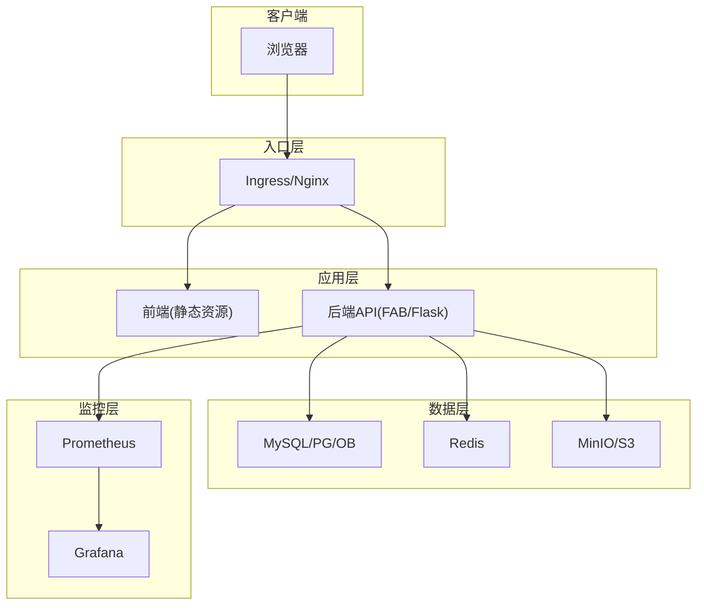
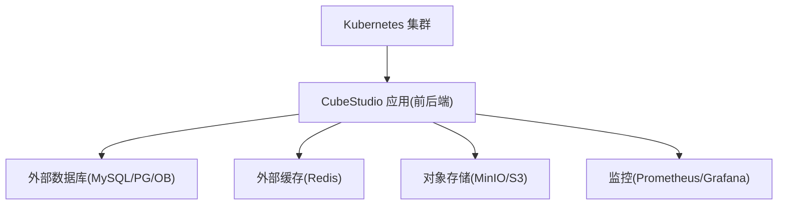
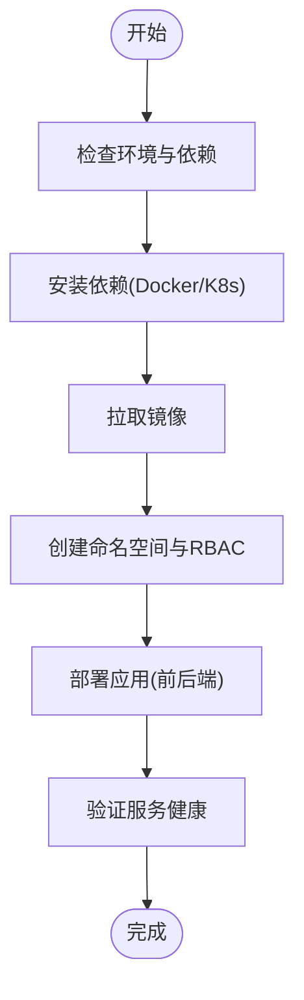
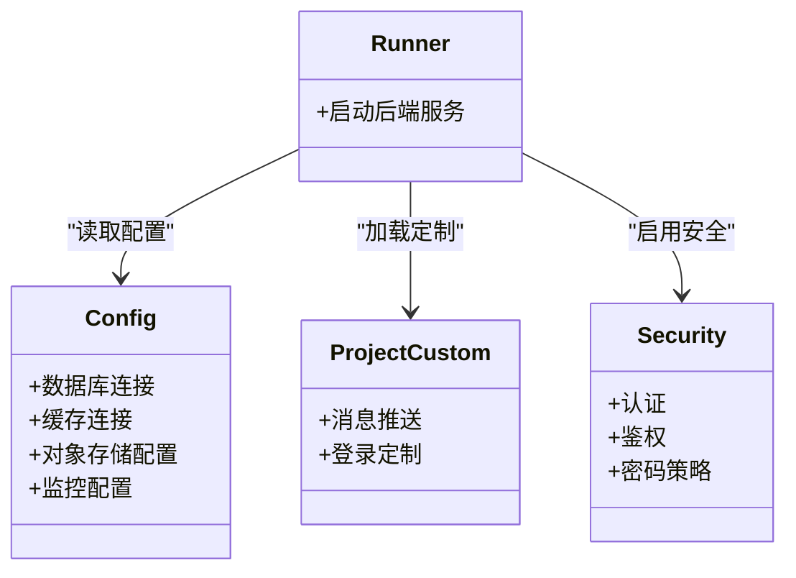
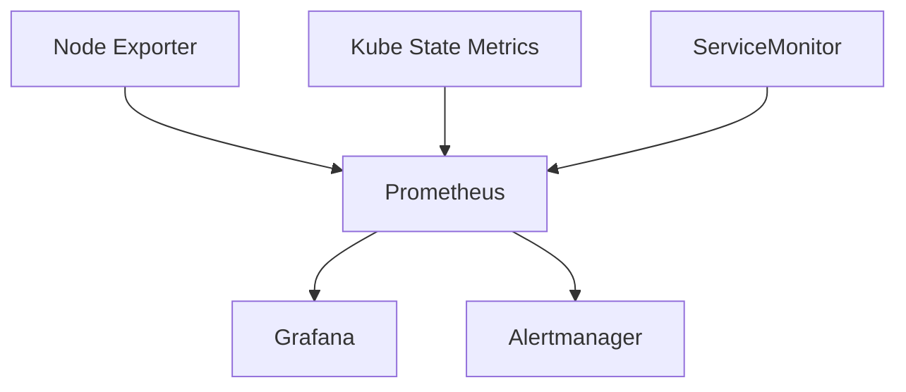
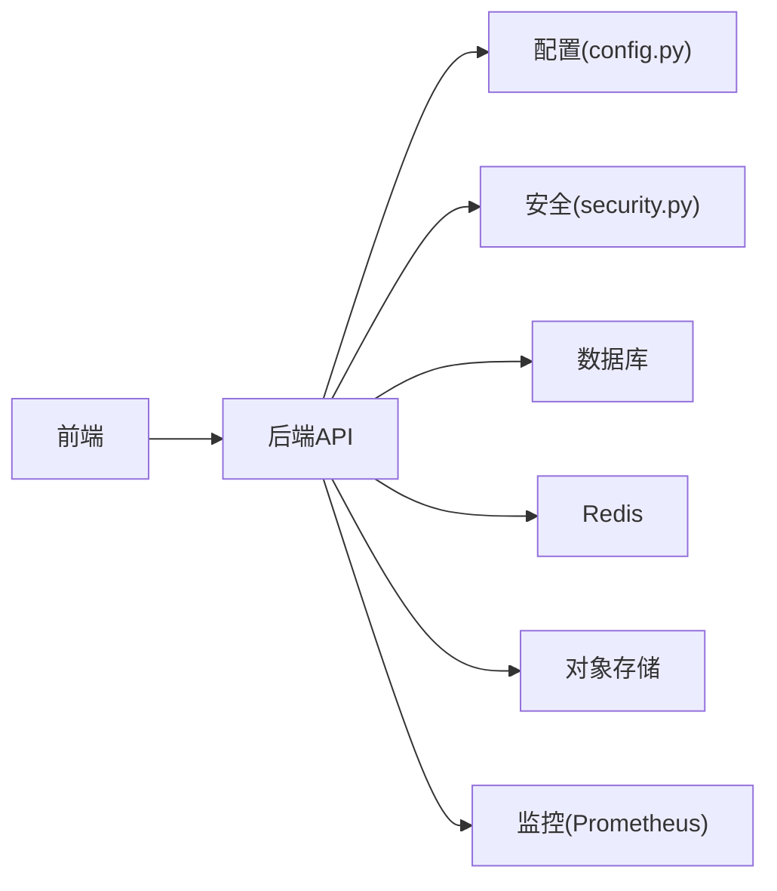
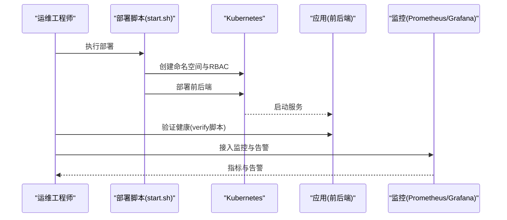
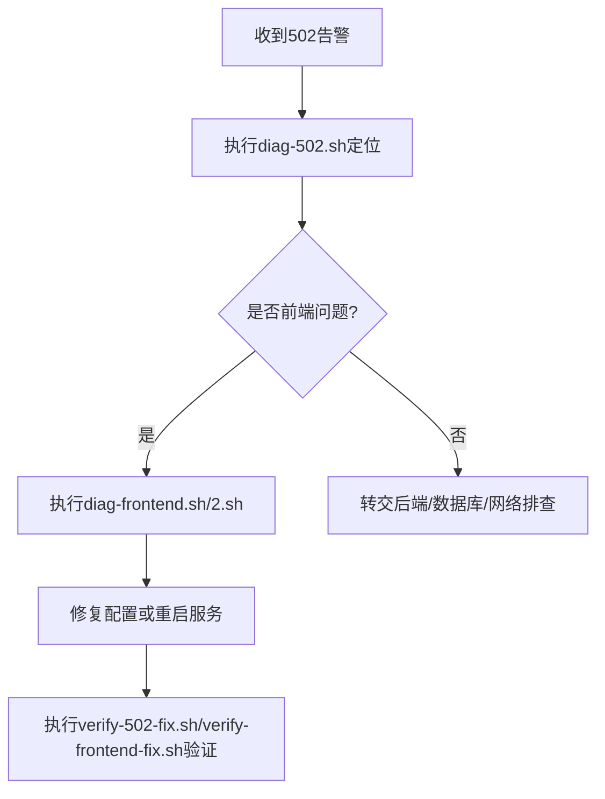

# 运维手册

<cite>
**本文引用的文件**   
- [README.md](file://README.md)
- [install/docker/README.md](file://install/docker/README.md)
- [install/docker/docker-compose.yml](file://install/docker/docker-compose.yml)
- [install/docker/deploy-web.sh](file://install/docker/deploy-web.sh)
- [install/docker/diag-502.sh](file://install/docker/diag-502.sh)
- [install/docker/diag-ext-db.sh](file://install/docker/diag-ext-db.sh)
- [install/docker/diag-frontend.sh](file://install/docker/diag-frontend.sh)
- [install/docker/diag-mysql-110.sh](file://install/docker/diag-mysql-110.sh)
- [install/docker/diag-mysql-recheck.sh](file://install/docker/diag-mysql-recheck.sh)
- [install/docker/diag-mysql-retry.sh](file://install/docker/diag-mysql-retry.sh)
- [install/docker/diag-pymysql-100.sh](file://install/docker/diag-pymysql-100.sh)
- [install/docker/verify-502-fix.sh](file://install/docker/verify-502-fix.sh)
- [install/docker/verify-ext-mysql.sh](file://install/docker/verify-ext-mysql.sh)
- [install/docker/verify-ext-redis.sh](file://install/docker/verify-ext-redis.sh)
- [install/docker/verify-frontend-fix.sh](file://install/docker/verify-frontend-fix.sh)
- [install/docker/verify-web.sh](file://install/docker/verify-web.sh)
- [install/kubernetes/start.sh](file://install/kubernetes/start.sh)
- [install/kubernetes/uninstall.sh](file://install/kubernetes/uninstall.sh)
- [install/kubernetes/init_node.sh](file://install/kubernetes/init_node.sh)
- [install/kubernetes/install_docker.sh](file://install/kubernetes/install_docker.sh)
- [install/kubernetes/pull_images_mini.sh](file://install/kubernetes/pull_images_mini.sh)
- [install/kubernetes/create_ns_secret.sh](file://install/kubernetes/create_ns_secret.sh)
- [install/kubernetes/gateway.yaml](file://install/kubernetes/gateway.yaml)
- [install/kubernetes/ingress.yaml](file://install/kubernetes/ingress.yaml)
- [install/kubernetes/sa-rbac.yaml](file://install/kubernetes/sa-rbac.yaml)
- [install/kubernetes/sa-rbac-cluster.yaml](file://install/kubernetes/sa-rbac-cluster.yaml)
- [install/kubernetes/prometheus/readme.md](file://install/kubernetes/prometheus/readme.md)
- [myapp/config.py](file://myapp/config.py)
- [myapp/project.py](file://myapp/project.py)
- [myapp/run.py](file://myapp/run.py)
- [myapp/security.py](file://myapp/security.py)
- [myapp/utils/core.py](file://myapp/utils/core.py)
</cite>

## 目录
1. [简介](#简介)
2. [项目结构](#项目结构)
3. [核心组件](#核心组件)
4. [架构总览](#架构总览)
5. [详细组件分析](#详细组件分析)
6. [依赖关系分析](#依赖关系分析)
7. [性能与容量规划](#性能与容量规划)
8. [监控与告警](#监控与告警)
9. [备份与恢复](#备份与恢复)
10. [安全加固](#安全加固)
11. [生产部署流程](#生产部署流程)
12. [自动化运维脚本](#自动化运维脚本)
13. [故障排查指南](#故障排查指南)
14. [高可用与灾难恢复](#高可用与灾难恢复)
15. [结论](#结论)

## 简介
本运维手册面向生产环境，覆盖 CubeStudio 的部署、监控、备份恢复、安全加固、性能调优、容量规划、高可用与灾难恢复等全链路实践。文档结合仓库中的 Docker/Kubernetes 部署脚本、诊断与验证脚本、平台配置与安全模块，提供可操作的步骤与排障路径，帮助运维团队快速落地并稳定运行平台。

## 项目结构
CubeStudio 的生产部署主要包含以下部分：
- 容器化部署：Docker Compose 用于本地调试与轻量部署；Kubernetes 清单与脚本用于生产集群部署。
- 平台后端与前端：后端 Python 应用（Flask/FAB）与前端静态资源打包后由 Nginx 或 Ingress 暴露。
- 外部依赖：MySQL/PostgreSQL/OceanBase 等元数据库、Redis 缓存、MinIO/S3 对象存储、Prometheus/Grafana 监控体系。
- 调度与编排：基于 Kubernetes 的任务执行、Pipeline 编排、推理服务发布与弹性伸缩。

图表来源
- [install/kubernetes/ingress.yaml](file://install/kubernetes/ingress.yaml)
- [install/docker/docker-compose.yml](file://install/docker/docker-compose.yml)

章节来源
- [README.md:145-163](file://README.md#L145-L163)
- [install/docker/README.md:50-110](file://install/docker/README.md#L50-L110)

## 核心组件
- 平台后端：负责用户权限、项目管理、任务编排、模型管理、推理服务等业务逻辑，通过 API 暴露能力。
- 平台前端：Web UI，提供可视化操作界面。
- 数据库与缓存：元数据持久化与热点数据缓存。
- 对象存储：训练数据、模型产物、日志等文件的分布式存储。
- 监控与告警：Prometheus + Grafana 采集主机、Pod、GPU、网络、QPS 等指标，统一告警推送。
- 调度与编排：Kubernetes 作为算力底座，支撑 Notebook、Pipeline、推理服务等多种工作负载。

章节来源
- [README.md:180-193](file://README.md#L180-L193)
- [README.md:352-361](file://README.md#L352-L361)

## 架构总览
CubeStudio 以 Kubernetes 为底座，向上提供多租户、任务编排、推理服务与监控能力。对外通过 Ingress 暴露前后端，内部通过 Service 访问后端 API，数据落盘至数据库与对象存储，监控数据汇聚到 Prometheus 并在 Grafana 展示。

图表来源
- [README.md:145-163](file://README.md#L145-L163)
- [install/kubernetes/start.sh](file://install/kubernetes/start.sh)

## 详细组件分析

### 部署与启动
- Docker Compose 方式：适用于本地调试与轻量部署，支持前后端热更新与快速迭代。
- Kubernetes 方式：适用于生产环境，使用 start.sh 一键拉起，uninstall.sh 清理资源。

关键脚本与清单
- 启动与卸载：start.sh、uninstall.sh
- 节点初始化与依赖安装：init_node.sh、install_docker.sh
- 镜像拉取：pull_images_mini.sh
- 命名空间与 RBAC：create_ns_secret.sh、sa-rbac.yaml、sa-rbac-cluster.yaml
- 网关与入口：gateway.yaml、ingress.yaml

图表来源
- [install/kubernetes/start.sh](file://install/kubernetes/start.sh)
- [install/kubernetes/init_node.sh](file://install/kubernetes/init_node.sh)
- [install/kubernetes/install_docker.sh](file://install/kubernetes/install_docker.sh)
- [install/kubernetes/pull_images_mini.sh](file://install/kubernetes/pull_images_mini.sh)
- [install/kubernetes/create_ns_secret.sh](file://install/kubernetes/create_ns_secret.sh)

章节来源
- [install/docker/README.md:50-110](file://install/docker/README.md#L50-L110)
- [install/kubernetes/start.sh](file://install/kubernetes/start.sh)
- [install/kubernetes/uninstall.sh](file://install/kubernetes/uninstall.sh)

### 平台配置与安全
- 平台配置：config.py 集中管理数据库、缓存、对象存储、监控等连接参数。
- 项目级定制：project.py 用于消息推送、登录等可定制逻辑。
- 安全模块：security.py 实现认证、鉴权、密码策略等。
- 运行时入口：run.py 启动后端服务。

图表来源
- [myapp/config.py](file://myapp/config.py)
- [myapp/project.py](file://myapp/project.py)
- [myapp/security.py](file://myapp/security.py)
- [myapp/run.py](file://myapp/run.py)

章节来源
- [install/docker/README.md:75-84](file://install/docker/README.md#L75-L84)
- [myapp/config.py](file://myapp/config.py)
- [myapp/project.py](file://myapp/project.py)
- [myapp/security.py](file://myapp/security.py)
- [myapp/run.py](file://myapp/run.py)

### 监控与告警
- 监控采集：Prometheus Operator、Node Exporter、Kube State Metrics、Service Monitor 等。
- 可视化：Grafana 仪表盘聚合主机、Pod、GPU、网络、QPS 等指标。
- 告警：Alertmanager 统一告警，支持邮件、企业微信、钉钉、飞书等渠道。

图表来源
- [install/kubernetes/prometheus/readme.md](file://install/kubernetes/prometheus/readme.md)

章节来源
- [README.md:352-361](file://README.md#L352-L361)
- [install/kubernetes/prometheus/readme.md](file://install/kubernetes/prometheus/readme.md)

## 依赖关系分析
- 外部依赖：数据库、缓存、对象存储、监控体系。
- 内部依赖：前后端之间的接口契约、配置中心、安全模块。
- 调度依赖：Kubernetes 资源对象（Deployment、Service、Ingress、PVC、ConfigMap、Secret）。

图表来源
- [myapp/config.py](file://myapp/config.py)
- [myapp/security.py](file://myapp/security.py)
- [install/docker/docker-compose.yml](file://install/docker/docker-compose.yml)

章节来源
- [install/docker/docker-compose.yml](file://install/docker/docker-compose.yml)
- [myapp/config.py](file://myapp/config.py)

## 性能与容量规划
- CPU/内存/GPU 配额：按项目、用户、任务多级限额，结合数据大屏观察 Pod 分布与资源使用率。
- 存储容量：根据数据集规模、模型产物增长趋势规划 PVC/HostPath/分布式存储容量。
- 网络带宽：分布式训练与大数据处理需评估 IB/RoCE/RDMA 与网络吞吐。
- 弹性伸缩：推理服务支持定时伸缩容与自动扩缩容，结合 QPS/延迟指标优化成本与性能。

建议
- 建立容量基线：以历史峰值为基准，预留 30%-50% 冗余。
- 分区分层：将在线开发、训练、推理隔离在不同资源组与命名空间。
- 压测与演练：定期压测关键链路，验证扩容与回滚流程。

章节来源
- [README.md:203-210](file://README.md#L203-L210)
- [README.md:342-350](file://README.md#L342-L350)

## 监控与告警
- 指标采集：主机 CPU/内存/磁盘 IO/网络 IO、Pod 资源使用、GPU/NPU 利用率、服务 QPS/吞吐/延迟。
- 告警规则：定义阈值与组合条件，避免误报与漏报。
- 通知渠道：邮件、企业微信、钉钉、飞书与统一 Webhook。

操作步骤
- 部署 Prometheus/Grafana/Alertmanager。
- 配置 ServiceMonitor 抓取应用指标。
- 在 Grafana 中导入仪表盘，设置告警规则与通知。

章节来源
- [README.md:352-361](file://README.md#L352-L361)
- [install/kubernetes/prometheus/readme.md](file://install/kubernetes/prometheus/readme.md)

## 备份与恢复
- 元数据备份：对 MySQL/PostgreSQL/OceanBase 进行定期逻辑或物理备份。
- 对象存储备份：对 MinIO/S3 数据进行跨地域复制与版本控制。
- 恢复演练：定期演练恢复流程，确保 RTO/RPO 满足业务要求。

建议
- 备份策略：全量+增量，保留周期与副本数符合合规要求。
- 自动化：通过 CronJob 或外部备份工具实现定时备份与校验。
- 监控：备份成功/失败告警，异常及时修复。

[本节为通用实践说明，不直接分析具体文件]

## 安全加固
- 认证与授权：启用 SSO/LDAP/远程用户登录，配置强密码策略与登录频率限制。
- 访问控制：RBAC 权限体系，菜单与接口访问控制，只读角色与审计记录。
- 传输安全：HTTPS 与反向代理，密钥与敏感信息通过 Secret 管理。
- 服务安全：推理服务 JWT 认证、限流、黑白名单、Token 限额。

操作步骤
- 配置 config.py 与 project.py 的安全参数。
- 启用 security.py 相关功能。
- 在 Ingress 层配置 TLS 与访问控制。

章节来源
- [README.md:195-202](file://README.md#L195-L202)
- [myapp/config.py](file://myapp/config.py)
- [myapp/project.py](file://myapp/project.py)
- [myapp/security.py](file://myapp/security.py)

## 生产部署流程
推荐流程
- 准备环境：安装 Docker/Kubernetes，拉取镜像。
- 初始化集群：创建命名空间、RBAC、Secret。
- 部署应用：前后端部署，配置数据库、缓存、对象存储。
- 配置入口：Ingress/Gateway 暴露服务。
- 验证健康：调用 verify 脚本检查服务状态。
- 上线监控：接入 Prometheus/Grafana，配置告警。

图表来源
- [install/kubernetes/start.sh](file://install/kubernetes/start.sh)
- [install/docker/verify-web.sh](file://install/docker/verify-web.sh)

章节来源
- [install/docker/README.md:50-110](file://install/docker/README.md#L50-L110)
- [install/kubernetes/start.sh](file://install/kubernetes/start.sh)

## 自动化运维脚本
常用脚本分类
- 部署与卸载：start.sh、uninstall.sh
- 节点与环境：init_node.sh、install_docker.sh
- 镜像管理：pull_images_mini.sh
- 安全与权限：create_ns_secret.sh
- 入口与网关：gateway.yaml、ingress.yaml
- 诊断与验证：diag-*.sh、verify-*.sh

示例：前端 502 问题诊断与修复
- 诊断：diag-502.sh、diag-frontend.sh、diag-frontend2.sh
- 修复验证：verify-502-fix.sh、verify-frontend-fix.sh

图表来源
- [install/docker/diag-502.sh](file://install/docker/diag-502.sh)
- [install/docker/diag-frontend.sh](file://install/docker/diag-frontend.sh)
- [install/docker/diag-frontend2.sh](file://install/docker/diag-frontend2.sh)
- [install/docker/verify-502-fix.sh](file://install/docker/verify-502-fix.sh)
- [install/docker/verify-frontend-fix.sh](file://install/docker/verify-frontend-fix.sh)

章节来源
- [install/docker/diag-502.sh](file://install/docker/diag-502.sh)
- [install/docker/diag-frontend.sh](file://install/docker/diag-frontend.sh)
- [install/docker/diag-frontend2.sh](file://install/docker/diag-frontend2.sh)
- [install/docker/verify-502-fix.sh](file://install/docker/verify-502-fix.sh)
- [install/docker/verify-frontend-fix.sh](file://install/docker/verify-frontend-fix.sh)

## 故障排查指南
常见问题与处理
- 前端 502：检查 Ingress/Nginx 配置与后端服务健康，使用 diag-502.sh 与 verify-502-fix.sh。
- 外部数据库连接失败：使用 diag-ext-db.sh、diag-mysql-110.sh、diag-mysql-recheck.sh、diag-mysql-retry.sh、verify-ext-mysql.sh。
- PyMySQL 连接错误：使用 diag-pymysql-100.sh。
- Redis 连通性：使用 verify-ext-redis.sh。
- Web 服务整体健康：使用 verify-web.sh。

排查步骤
- 收集日志：查看 Pod 日志、事件、Ingress 访问日志。
- 复现问题：最小化场景复现，确认影响范围。
- 定位根因：依据诊断脚本输出，逐步缩小问题域。
- 修复与验证：执行修复命令，使用验证脚本确认恢复。

章节来源
- [install/docker/diag-ext-db.sh](file://install/docker/diag-ext-db.sh)
- [install/docker/diag-mysql-110.sh](file://install/docker/diag-mysql-110.sh)
- [install/docker/diag-mysql-recheck.sh](file://install/docker/diag-mysql-recheck.sh)
- [install/docker/diag-mysql-retry.sh](file://install/docker/diag-mysql-retry.sh)
- [install/docker/diag-pymysql-100.sh](file://install/docker/diag-pymysql-100.sh)
- [install/docker/verify-ext-mysql.sh](file://install/docker/verify-ext-mysql.sh)
- [install/docker/verify-ext-redis.sh](file://install/docker/verify-ext-redis.sh)
- [install/docker/verify-web.sh](file://install/docker/verify-web.sh)

## 高可用与灾难恢复
- 多集群与多资源组：支持多 K8s 集群与边缘集群模式，实现跨区域高可用。
- 存储高可用：对象存储跨地域复制，数据库主从/集群模式。
- 服务高可用：推理服务多副本、滚动升级与回滚，负载均衡与流量治理。
- 灾难恢复：制定 RTO/RPO 目标，定期演练恢复流程，确保数据一致性与服务可用性。

建议
- 架构设计：关键组件双活或多活，避免单点故障。
- 容量规划：预留冗余资源，支持突发流量与故障切换。
- 演练与复盘：定期进行故障演练与复盘，持续优化预案。

章节来源
- [README.md:212-220](file://README.md#L212-L220)
- [README.md:342-350](file://README.md#L342-L350)

## 结论
本手册围绕 CubeStudio 的生产部署、监控告警、备份恢复、安全加固、性能调优与高可用灾备提供了系统化实践。结合仓库中的部署脚本、诊断与验证脚本以及平台配置与安全模块，运维团队可按步骤落地并持续优化平台稳定性与效率。建议在实施过程中结合业务特性进行容量规划与压测演练，确保系统在高负载与故障场景下的稳健运行。