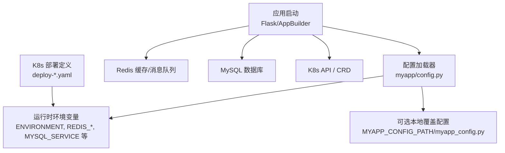
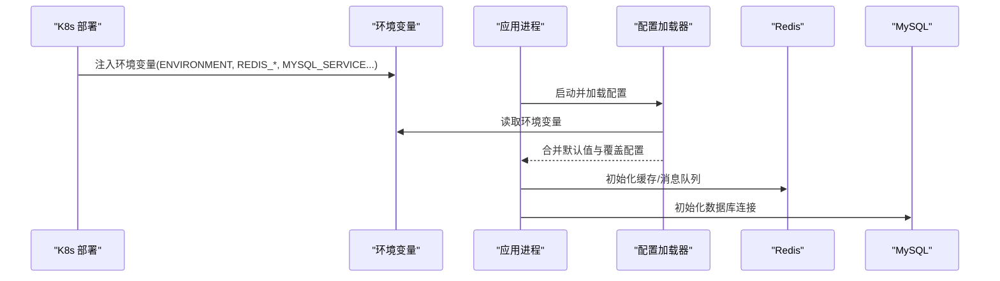
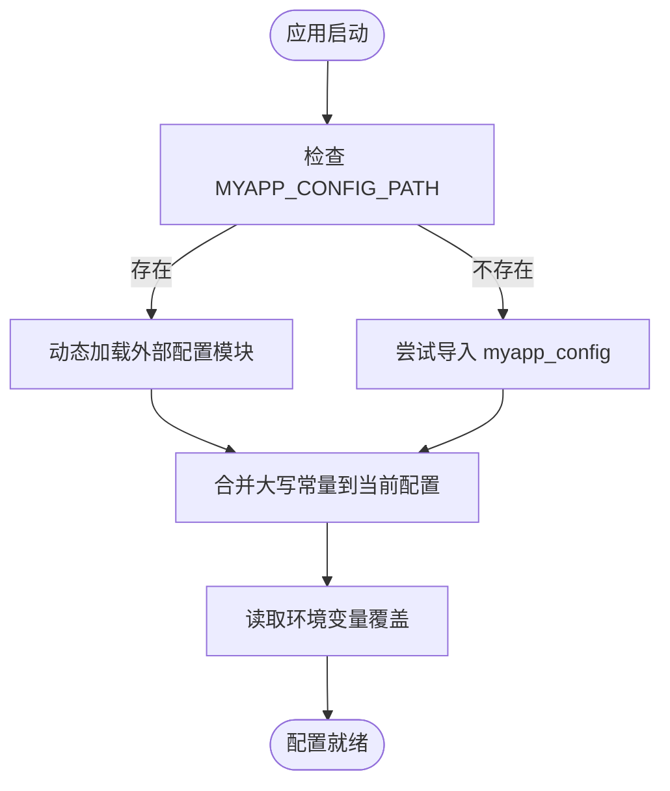
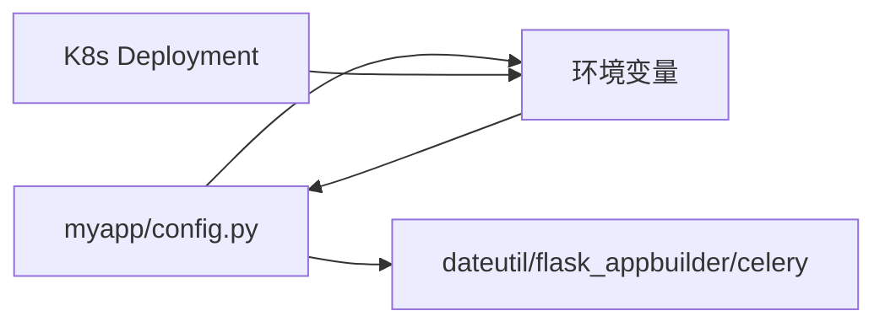

# 配置管理

<cite>
**本文引用的文件**   
- [myapp/config.py](file://myapp/config.py)
- [install/kubernetes/cube/overlays/config/config.py](file://install/kubernetes/cube/overlays/config/config.py)
- [install/kubernetes/cube/base/deploy-backend.yaml](file://install/kubernetes/cube/base/deploy-backend.yaml)
- [install/kubernetes/cube/base/deploy-worker.yaml](file://install/kubernetes/cube/base/deploy-worker.yaml)
- [install/kubernetes/cube/base/deploy-schedule.yaml](file://install/kubernetes/cube/base/deploy-schedule.yaml)
- [job-template/job/dataset/launcher.py](file://job-template/job/dataset/launcher.py)
</cite>

## 目录
1. [简介](#简介)
2. [项目结构](#项目结构)
3. [核心组件](#核心组件)
4. [架构总览](#架构总览)
5. [详细组件分析](#详细组件分析)
6. [依赖关系分析](#依赖关系分析)
7. [性能与容量规划](#性能与容量规划)
8. [故障排查指南](#故障排查指南)
9. [结论](#结论)
10. [附录：配置项清单与示例](#附录配置项清单与示例)

## 简介
本文件系统性梳理 CubeStudio 的配置体系，覆盖应用配置中心、环境变量管理与动态配置机制。重点说明各类配置项的作用、默认值与生效范围，给出不同部署环境的配置差异与最佳实践，并提供扩展新配置项与验证规则的方法论。同时涵盖配置安全、热更新与审计的实践建议。

## 项目结构
CubeStudio 的后端采用 Python Flask + AppBuilder 架构，配置集中在后端配置模块中；Kubernetes 部署通过 YAML 注入环境变量到各 Pod（后端、Worker、定时任务等），从而形成“代码默认值 + 外部化环境变量”的分层配置模型。

**图表来源**
- [myapp/config.py:308-333](file://myapp/config.py#L308-L333)
- [myapp/config.py:336-367](file://myapp/config.py#L336-L367)
- [install/kubernetes/cube/base/deploy-backend.yaml](file://install/kubernetes/cube/base/deploy-backend.yaml)
- [install/kubernetes/cube/base/deploy-worker.yaml](file://install/kubernetes/cube/base/deploy-worker.yaml)
- [install/kubernetes/cube/base/deploy-schedule.yaml](file://install/kubernetes/cube/base/deploy-schedule.yaml)

**章节来源**
- [myapp/config.py:1-120](file://myapp/config.py#L1-L120)
- [install/kubernetes/cube/base/deploy-backend.yaml](file://install/kubernetes/cube/base/deploy-backend.yaml)
- [install/kubernetes/cube/base/deploy-worker.yaml](file://install/kubernetes/cube/base/deploy-worker.yaml)
- [install/kubernetes/cube/base/deploy-schedule.yaml](file://install/kubernetes/cube/base/deploy-schedule.yaml)

## 核心组件
- 应用配置中心：由 myapp/config.py 提供默认配置，并通过环境变量和可选的本地覆盖文件进行增强。
- 环境变量管理：统一通过 os.getenv/os.environ 读取，关键键包括 ENVIRONMENT、REDIS_*、MYSQL_SERVICE、LOCALE、FLASK_ENV 等。
- 动态配置机制：支持在启动时通过 MYAPP_CONFIG_PATH 指向外部配置文件，实现运行期可替换的配置集；部分功能开关可通过 DEFAULT_FEATURE_FLAGS 与 GET_FEATURE_FLAGS_FUNC 扩展。

**章节来源**
- [myapp/config.py:308-333](file://myapp/config.py#L308-L333)
- [myapp/config.py:336-367](file://myapp/config.py#L336-L367)
- [myapp/config.py:110-133](file://myapp/config.py#L110-L133)

## 架构总览
下图展示配置从 K8s 到应用的加载路径，以及 Redis/MySQL 等依赖的连接方式。

**图表来源**
- [myapp/config.py:336-367](file://myapp/config.py#L336-L367)
- [myapp/config.py:372-390](file://myapp/config.py#L372-L390)
- [install/kubernetes/cube/base/deploy-backend.yaml](file://install/kubernetes/cube/base/deploy-backend.yaml)

## 详细组件分析

### 配置加载流程与优先级
- 默认配置：myapp/config.py 定义所有默认值。
- 环境变量覆盖：通过 get_env_variable 或 os.getenv 读取，如 ENVIRONMENT、REDIS_HOST/PORT/PASSWORD、MYSQL_SERVICE、LOCALE、FLASK_ENV。
- 本地覆盖配置：若设置 MYAPP_CONFIG_PATH，则动态加载该路径下的 Python 模块，将其大写常量属性覆盖到当前配置模块；否则尝试导入 myapp_config 模块作为覆盖。
- 注意：Kubernetes overlay 中的 config.py 与 myapp/config.py 存在重复逻辑，实际以部署镜像内最终加载的为准。

**图表来源**
- [myapp/config.py:308-333](file://myapp/config.py#L308-L333)
- [myapp/config.py:336-367](file://myapp/config.py#L336-L367)

**章节来源**
- [myapp/config.py:308-333](file://myapp/config.py#L308-L333)
- [myapp/config.py:336-367](file://myapp/config.py#L336-L367)

### 环境变量与关键配置项
- 环境与调试
  - ENVIRONMENT：当前控制器所在集群环境，默认 DEV。
  - FLASK_ENV：控制 DEBUG 模式。
  - LOCALE：默认语言，默认 zh。
- 数据与缓存
  - MYSQL_SERVICE：数据库连接 URI。
  - REDIS_HOST/PORT/PASSWORD/DB：Redis 连接与库号。
  - CACHE_DEFAULT_TIMEOUT/CACHE_CONFIG：缓存超时与 Redis 缓存配置。
- 异步任务
  - CELERY_CONFIG：Celery 类配置，包含 broker_url/result_backend/task_annotations/beat_schedule 等。
- 存储与对象存储
  - MINIO_HOST/ACCESS_KEY/SECRET_KEY：MinIO 对象存储。
  - DATASET_SAVEPATH/STORE_TYPE/STORE_CONFIG：数据集存储路径与云存储配置。
- 命名空间与工作区
  - PIPELINE_NAMESPACE/SERVICE_NAMESPACE/AUTOML_NAMESPACE/NOTEBOOK_NAMESPACE/AIHUB_NAMESPACE：各业务命名空间。
  - WORKSPACE_HOST_PATH/ARCHIVES_HOST_PATH：工作区与归档目录。
- 镜像与容器
  - USER_IMAGE/NOTEBOOK_IMAGES/INFERNENCE_IMAGES/DOCKER_IMAGES/NERDCTL_IMAGES/IMAGE_PULL_POLICY：镜像与拉取策略。
- 监控与链接
  - PROMETHEUS/GRAFANA_*_PATH：监控地址。
  - ALL_LINKS：导航菜单链接。

**章节来源**
- [myapp/config.py:336-367](file://myapp/config.py#L336-L367)
- [myapp/config.py:372-390](file://myapp/config.py#L372-L390)
- [myapp/config.py:721-750](file://myapp/config.py#L721-L750)
- [myapp/config.py:781-800](file://myapp/config.py#L781-L800)
- [myapp/config.py:801-847](file://myapp/config.py#L801-L847)

### Kubernetes 部署与环境变量注入
- deploy-backend.yaml：后端 Web 服务 Pod，通常注入 ENVIRONMENT、REDIS_*、MYSQL_SERVICE、LOCALE、FLASK_ENV 等。
- deploy-worker.yaml：Celery Worker，继承相同的环境变量，确保与后端一致的 Redis/DB 配置。
- deploy-schedule.yaml：Celery Beat 定时调度，同样依赖 Redis 与数据库。

建议在 K8s 中使用 ConfigMap/Secret 集中管理敏感信息（如 REDIS_PASSWORD、MYSQL_SERVICE），并在 Deployment 中以环境变量形式注入。

**章节来源**
- [install/kubernetes/cube/base/deploy-backend.yaml](file://install/kubernetes/cube/base/deploy-backend.yaml)
- [install/kubernetes/cube/base/deploy-worker.yaml](file://install/kubernetes/cube/base/deploy-worker.yaml)
- [install/kubernetes/cube/base/deploy-schedule.yaml](file://install/kubernetes/cube/base/deploy-schedule.yaml)

### 动态配置与特性开关
- 动态配置：通过 MYAPP_CONFIG_PATH 指定外部 Python 配置模块，启动时动态加载并覆盖默认配置。
- 特性开关：DEFAULT_FEATURE_FLAGS 定义默认开关，GET_FEATURE_FLAGS_FUNC 可在运行时根据用户/请求上下文调整开关。

**章节来源**
- [myapp/config.py:308-333](file://myapp/config.py#L308-L333)
- [myapp/config.py:110-133](file://myapp/config.py#L110-L133)

### 作业模板与任务环境变量
- job-template/job/dataset/launcher.py 使用 KFJ_* 系列环境变量（如 KFJ_CREATOR、KFJ_TASK_PROJECT_NAME、HOST/KFJ_MODEL_REPO_API_URL）来驱动作业执行。
- 这些变量通常在 Pipeline 运行时由平台注入，属于“任务级动态配置”。

**章节来源**
- [job-template/job/dataset/launcher.py:15-19](file://job-template/job/dataset/launcher.py#L15-L19)

## 依赖关系分析
- 配置模块对系统环境变量的强依赖：缺少必要变量（如 MYSQL_SERVICE、REDIS_HOST）会导致启动失败。
- 配置模块对第三方库的依赖：dateutil、flask_appbuilder、celery.schedules 等。
- 部署层对 K8s 资源的依赖：ConfigMap/Secret 与 Deployment 的资源编排。

**图表来源**
- [myapp/config.py:1-12](file://myapp/config.py#L1-L12)
- [myapp/config.py:336-367](file://myapp/config.py#L336-L367)

**章节来源**
- [myapp/config.py:1-12](file://myapp/config.py#L1-L12)
- [myapp/config.py:336-367](file://myapp/config.py#L336-L367)

## 性能与容量规划
- Redis 连接池与库号：通过 REDIS_DB 区分 Celery、Cache、SocketIO 的库号，避免冲突。
- 缓存超时：CACHE_DEFAULT_TIMEOUT 默认 24 小时，可根据业务热点数据调整。
- Celery 并发与限制：worker_prefetch_multiplier、task_annotations 中的 rate_limit/soft_time_limit/expires 等需按负载调优。
- 日志轮转：ENABLE_TIME_ROTATE/TIME_ROTATE_LOG_LEVEL/BACKUP_COUNT 控制日志大小与保留策略。

[本节为通用指导，不直接分析具体文件]

## 故障排查指南
- 环境变量缺失：get_env_variable 会在缺少必填变量时抛出异常，检查 ENVIRONMENT、MYSQL_SERVICE、REDIS_HOST/PORT 等是否已正确注入。
- Redis 连接失败：确认 REDIS_PASSWORD/REDIS_HOST/REDIS_PORT/REDIS_DB 与 K8s Secret/ConfigMap 一致。
- MySQL 连接失败：检查 MYSQL_SERVICE 是否正确，网络连通性与账号权限。
- 特性开关未生效：确认 DEFAULT_FEATURE_FLAGS 与 GET_FEATURE_FLAGS_FUNC 的实现是否符合预期。
- 日志问题：调整 LOG_LEVEL/ENABLE_TIME_ROTATE，查看 FILENAME 路径权限。

**章节来源**
- [myapp/config.py:336-346](file://myapp/config.py#L336-L346)
- [myapp/config.py:357-367](file://myapp/config.py#L357-L367)
- [myapp/config.py:186-208](file://myapp/config.py#L186-L208)

## 结论
CubeStudio 的配置体系以“默认配置 + 环境变量 + 可选外部覆盖”为核心，结合 K8s 部署将敏感信息与运行参数外置，既保证了灵活性又提升了安全性。通过合理的特性开关与动态配置机制，可以在不同环境中快速切换行为。生产环境应严格管理环境变量与外部配置文件的访问权限，并结合监控与审计保障配置变更的可追溯性。

[本节为总结性内容，不直接分析具体文件]

## 附录：配置项清单与示例

### 关键配置项与作用
- 环境与调试
  - ENVIRONMENT：集群环境标识，默认 DEV。
  - FLASK_ENV：启用开发模式（development）。
  - LOCALE：默认语言，默认 zh。
- 数据库与缓存
  - MYSQL_SERVICE：数据库连接 URI。
  - REDIS_HOST/PORT/PASSWORD/DB：Redis 连接与库号。
  - CACHE_DEFAULT_TIMEOUT/CACHE_CONFIG：缓存超时与 Redis 缓存配置。
- 异步任务
  - CELERY_CONFIG：Celery 类配置，含 broker_url/result_backend/task_annotations/beat_schedule。
- 存储与对象存储
  - MINIO_HOST/ACCESS_KEY/SECRET_KEY：MinIO 对象存储。
  - DATASET_SAVEPATH/STORE_TYPE/STORE_CONFIG：数据集存储路径与云存储配置。
- 命名空间与工作区
  - PIPELINE_NAMESPACE/SERVICE_NAMESPACE/AUTOML_NAMESPACE/NOTEBOOK_NAMESPACE/AIHUB_NAMESPACE：各业务命名空间。
  - WORKSPACE_HOST_PATH/ARCHIVES_HOST_PATH：工作区与归档目录。
- 镜像与容器
  - USER_IMAGE/NOTEBOOK_IMAGES/INFERNENCE_IMAGES/DOCKER_IMAGES/NERDCTL_IMAGES/IMAGE_PULL_POLICY：镜像与拉取策略。
- 监控与链接
  - PROMETHEUS/GRAFANA_*_PATH：监控地址。
  - ALL_LINKS：导航菜单链接。

**章节来源**
- [myapp/config.py:336-367](file://myapp/config.py#L336-L367)
- [myapp/config.py:372-390](file://myapp/config.py#L372-L390)
- [myapp/config.py:721-750](file://myapp/config.py#L721-L750)
- [myapp/config.py:781-800](file://myapp/config.py#L781-L800)
- [myapp/config.py:801-847](file://myapp/config.py#L801-L847)

### 不同部署环境的配置差异
- 开发环境
  - FLASK_ENV=development，DEBUG=True。
  - REDIS_HOST/PORT 指向本地或测试 Redis。
  - MYSQL_SERVICE 指向开发数据库。
- 预发布/生产环境
  - FLASK_ENV 不设置为 development，关闭 DEBUG。
  - REDIS_PASSWORD 使用 Secret 注入，REDIS_DB 划分不同库号。
  - MYSQL_SERVICE 指向生产数据库，开启连接池与超时重连。
  - 镜像拉取策略 IMAGE_PULL_POLICY 按需设置为 Always/IfNotPresent。

**章节来源**
- [myapp/config.py:52-54](file://myapp/config.py#L52-L54)
- [myapp/config.py:357-367](file://myapp/config.py#L357-L367)
- [myapp/config.py:793-800](file://myapp/config.py#L793-L800)

### 扩展新配置项与验证规则
- 新增配置项
  - 在 myapp/config.py 中添加新的大写常量，并提供合理默认值。
  - 如需从环境变量注入，使用 os.getenv/get_env_variable 读取。
- 配置验证
  - 在启动阶段对必填变量进行校验，缺失则抛出异常。
  - 对敏感配置（如密码、密钥）进行最小权限与脱敏处理。
- 动态覆盖
  - 通过 MYAPP_CONFIG_PATH 指向外部配置模块，仅覆盖需要变更的配置项。
  - 使用 DEFAULT_FEATURE_FLAGS 与 GET_FEATURE_FLAGS_FUNC 实现特性开关的动态控制。

**章节来源**
- [myapp/config.py:308-333](file://myapp/config.py#L308-L333)
- [myapp/config.py:336-346](file://myapp/config.py#L336-L346)
- [myapp/config.py:110-133](file://myapp/config.py#L110-L133)

### 配置安全、热更新与审计最佳实践
- 配置安全
  - 使用 K8s Secret 管理敏感信息（REDIS_PASSWORD、MYSQL_SERVICE 中的凭据）。
  - 限制外部配置文件的访问权限，避免泄露密钥。
  - 在生产环境关闭 SHOW_STACKTRACE 与 DEBUG。
- 热更新
  - 对于非敏感配置，可通过外部配置模块与重启进程实现热更新。
  - 对于特性开关，可利用 GET_FEATURE_FLAGS_FUNC 实现无重启的动态调整。
- 配置审计
  - 记录配置加载日志（如打印加载的外部配置路径）。
  - 对配置变更进行版本化管理（GitOps），并纳入 CI/CD 流水线审查。

**章节来源**
- [myapp/config.py:56-59](file://myapp/config.py#L56-L59)
- [myapp/config.py:308-333](file://myapp/config.py#L308-L333)
- [myapp/config.py:110-133](file://myapp/config.py#L110-L133)