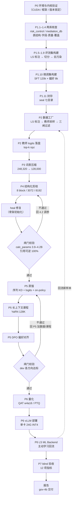

# Qwen3.8-27B → 4B 社会治理专用模型压缩实施方案

| 项 | 内容 |
|---|---|
| 文档版本 | v3.0（4B 正式版） |
| 适用模型 | Qwen3.8-27B（27B 稠密 VLM，64 层混合线性注意力，Apache 2.0） |
| 领域定位 | **社会治理专用模型**：社会治理事件预警、矛盾纠纷调解、政法委维稳数据 |
| 核心能力 | 辅助矛盾纠纷调解 / 社会事件分析 / 重点人、事、地点的分析与预警 / 智能生成事件处理方案 |
| 调度平台 | cube-studio（薄算子 + Pipeline） |
| 标注平台 | Label Studio（ML Backend 主动学习闭环） |
| 数据源 | ① 法律法条与类案；② `risk_control` 风险预警库；③ `mediation_db` 矛盾风险库（见 3.4） |
| 数据根目录 | `/mnt/legal`（沿用现有挂载，见 3.2） |
| 目标产物 | `gov-4b`（约 3.9–4.2B，社会治理专用，文本 + 长上下文，第一阶段不含视觉） |
| 压缩比 | 27B → 4B（约 6.75×，结构化剪枝给骨架 + 蒸馏重建能力） |
| 开发测试方案 | 教师 `qwen3.5-2b` → `gov-0.5b-dev`（0.45–0.55B，单卡 24G，见第 6 章） |
| 文档路径 | `docs/qwen3.8-27B-zip.md` |

> 本文档中的命令均给出**执行环境、参数说明、预期输出**。凡标注 `【P0 锁定】` 的版本号或接口名，必须在 Phase 0 实测确认后回填到第 3.3 节的版本表，再继续后续阶段。

---

## 0. 阅读前必读

### 0.1 四个默认决策（本方案的默认取值，可在开工前修改）

| 决策 | 默认 | 理由 | 若修改，影响的章节 |
|---|---|---|---|
| 领域定位 | **社会治理专用**（事件预警 / 矛盾纠纷调解 / 政法委维稳），不做通用法律问答 | 4B 容量仍有限，必须聚焦三方向 + RAG 承载知识 | 1.1、2.5、Phase 1 |
| 视觉能力 | **第一阶段不保留**，第二阶段再加 30–40M 小视觉塔 | 4B 预算里再塞视觉塔会挤压语言层；先跑通文本主链路 | Phase 3、4、6，第 2.2 节 |
| 词表 | **248,320 → 128,000** | 保全文表时 embedding 占 4B 的 19%，挤压有效层深；128k 兼顾法条整词覆盖与预算 | Phase 3，第 2.2 节 |
| 规模硬约束 | **4B 为硬指标**（3.9–4.2B） | 单卡 24G 可部署、训练成本可控，同时保留复杂研判与长文能力 | 第 2.3 节预算表、Phase 4 |

### 0.2 三条不可违背的工程结论

1. **量化不减少参数量**：27B 量化后仍是 27B 权重规模。达标只能靠结构化剪枝 + 重建。
2. **剪枝只给骨架，蒸馏才给能力**：6.75× 压缩后不做 heal（蒸馏修复）的模型不可评测。
3. **4B 仍无法完整“记住”法条**：知识必须由 RAG 承载，学生模型负责意图识别、检索词生成、引用组织、文书格式、拒答合规。

### 0.3 版本锁定原则

Qwen3.8 是 2026-08 发布的混合架构（Gated DeltaNet + Gated Attention），推理/量化/训练框架的适配仍在演进。**任何未在 Phase 0 实测通过的版本组合，不得进入 Phase 2 之后**。

---

## 1. 目标、非目标与验收

### 1.1 目标

- 产出 `gov-4b`：3.9–4.2B 参数，支持 128K 上下文，可 vLLM 部署，定位**社会治理领域专用模型**。
- 覆盖三大核心方向：
  1. **社会治理事件预警**：事件分类、态势摘要、风险等级建议、处置建议；
  2. **矛盾纠纷调解**：争议焦点识别、法条/类案支撑、调解方案生成、调解话术；
  3. **政法委维稳数据**：重点人/事/地点研判、关联分析、维稳态势报告。
- 实现四项核心能力：
  1. 辅助矛盾纠纷调解；
  2. 社会事件分析；
  3. 重点人、事、地点的分析与预警；
  4. 智能生成事件处理方案。
- 部署形态：INT4 权重约 2.2GB，单张 24G 卡可部署，边缘服务器可跑；事实性知识由检索承载，模型负责理解、研判、组织与生成。
- 输出一律为“辅助建议”：预警等级、处置方案须由业务人员确认后执行。

### 1.2 非目标

- 不追求 1M 上下文（教师支持 YaRN 扩展，学生只做 128K）。
- 不在 4B 内复现教师的全量法律与治理知识记忆（由 RAG 承载）。
- 第一阶段不做视觉（合同扫描件/证据照片）能力。
- **不输出执法决定、不替代人工审批**：预警等级、处置方案均标注“辅助建议”，处置动作由业务人员确认。
- 不做与业务无关的个人隐私画像扩散；不生成跨库拼接的个人信息档案。

### 1.3 验收指标

| 方向 | 指标 | 闸门 | 评测集 |
|---|---|---|---|
| 公共 | 法条/类案引用编造率 | < 2% | blind-* |
| 公共 | 引用完整性 P/R | P ≥ 0.90，R ≥ 0.85 | blind-* |
| 公共 | 越界/诱导拒答率 | ≥ 教师 | redteam |
| 公共 | 通用能力回放（C-Eval/MMLU 子集） | 掉点 ≤ 5% | general |
| 公共 | 量化后同集掉点 | ≤ 2% | blind-* |
| 事件预警 | 事件类型分类 macro-F1 | ≥ 教师 90% | blind-event |
| 事件预警 | 风险等级建议一致率 | ≥ 教师 85% | blind-event |
| 事件预警 | 处置建议要素完整率 | ≥ 85% | blind-event |
| 矛盾调解 | 争议焦点抽取 F1 | ≥ 教师 88% | blind-mediation |
| 矛盾调解 | 调解方案人工采纳率 | ≥ 70% | blind-mediation |
| 矛盾调解 | 法条/类案引用准确率 | ≥ 教师 85% | blind-mediation |
| 维稳分析 | 重点人/事/地点抽取 F1 | ≥ 教师 90% | blind-stability |
| 维稳分析 | 关联分析命中率 | ≥ 80% | blind-stability |
| 长文档 | 128K 上下文引用一致性 | ≥ 教师 85% | long |

---

## 2. 架构事实与压缩账

### 2.1 Qwen3.8-27B 结构（Phase 0 需实测复核）

| 项 | 值 |
|---|---|
| 参数 | 27B 稠密 + 视觉编码器 |
| 层数 / hidden / FFN | 64 / 5120 / 17408 |
| 混合布局 | 16 × [3 × (Gated DeltaNet → FFN) → 1 × (Gated Attention → FFN)] |
| Gated DeltaNet | 48 V 头 / 16 QK 头，head_dim 128 |
| Gated Attention | 24 Q 头 / 4 KV 头，head_dim 256 |
| 词表 | 248,320（padding 后） |
| 上下文 | 262,144，YaRN 可扩 1M |
| 思考模式 | 默认开启，可调 xhigh/medium/low |
| 其他 | MTP 训练；Apache 2.0 |

**关键约束**：混合层按 4 层一组（block）设计，**剪枝必须整 block 处理**，保持 3:1 的 DeltaNet/Attention 比例，否则线性注意力层的状态传递会断链。

### 2.2 剪枝规则表

| 组件 | 教师 | 学生 | 规则 |
|---|---|---|---|
| block 数 | 16 | **8（32 层）** | 保 block0、block15，其余按重要性取 top6 |
| hidden | 5120 | **3072** | 60% |
| FFN | 17408 | **8192** | 47% |
| Gated Attention | 24Q / 4KV | **16Q / 4KV** | head_dim 保持 256；4:1 GQA |
| Gated DeltaNet | 16 QK / 48 V | **12 QK / 36 V** | head_dim 保持 128 |
| 词表 | 248,320 | **128,000** | 词频 + 法条白名单 |
| 视觉塔 | 有 | **无（第一阶段）** | 第二阶段加 30–40M 小塔 |
| MTP 头 | 有 | **删除** | 学生不需要 |

> 学生训练采用 TP=1 + ZeRO-3 数据并行，头数按单卡切线即可整除；若改用张量并行，16Q/4KV 与 12QK/36V 需重新分配到 2/4 卡。

### 2.3 参数预算（估算，须用脚本实测核对）

| 组件 | 计算式 | 约值 |
|---|---|---|
| FFN | 3 × 3072 × 8192 × 32 层 | 2.42B |
| DeltaNet（24 层） | 每层约 41M | 0.98B |
| Gated Attention（8 层） | 每层约 31.5M | 0.25B |
| Embedding（tied, 128k） | 128,000 × 3072 | 0.39B |
| 其他（norm、gate、bias） | — | ~0.03B |
| **合计** | — | **约 4.07B** |

**硬性检查**：Phase 4 结束必须运行 `calc_params.py`，参数量落在 **3.9–4.2B**；超出则回第 2.2 节调 FFN 或 block 数。

**规模合理性（为什么是 4B）**：

- **能力与成本的平衡点**：压缩比从 33.7× 降到 6.75×，保留 32 层 / 3072 hidden，多步研判、长文书组织、引用对齐不再完全依赖 on-policy 修复；相比 0.8B，事件处置方案与调解话术的连贯性显著更好。
- **算力可承受**：4B 全参 bf16 训练（权重 + 梯度 + Adam + master）约 64GB，4 × 48G（ZeRO-3）或 2 × 80G 即可覆盖，教师仍复用 2 × 48G 的 27B 服务。
- **部署可落地**：INT4 权重约 2.2GB，单张 24G 卡可跑，适配区县级边缘服务器与现有政法专网 GPU 资源。
- **词表更从容**：128k 词表保留法条整词与数字/标点，引用可逆性与切分膨胀指标优于 64k，降低 RAG 引用回流与人工校对成本。
- **风险可控**：若 4B 指标不达标，可先加数据与长文课程，而不是立即改结构；0.8B 则需要重做骨架，返工成本高。

### 2.4 总体流水线

```
P0 环境与内核验证 ──► P1 数据源治理：两库核查 ─► 评测集/微调集构建 ─► 评测集封存
        │
P2 数据工厂：LS 标注 ─► 教师采样 ─► 三闸过滤 ─► 教师 logits 落盘
        │
P3 词表压缩(128k) ─► P4 结构化剪枝(8 block) ─► heal ─► 闸门校验
        │
P5 蒸馏(序列+logits+on-policy+DPO) ─► 长上下文课程 ─► 闸门校验
        │
P6 QAT/PTQ 量化 ─► vLLM 部署 ─► LS ML Backend ─► 主动学习回流
        │
P7 blind 验收 ─► 报告
```

**完整执行流程（Mermaid）**



**图例说明**：实线为主链路，菱形为质量闸门（不达标按虚线回退到对应阶段），`P6C → P2A` 的虚线表示主动学习把线上新样本回流到数据工厂，形成闭环。

### 2.5 能力—数据—指标映射

| 核心能力 | 主要数据源 | 关键字段/证据 | 对应指标 |
|---|---|---|---|
| 辅助矛盾纠纷调解 | `mediation_db`（纠纷、调解记录、当事人）+ 法条/类案 | 纠纷类型、诉求、争议焦点、调解结果、引用法条 | 焦点抽取 F1、方案采纳率、引用准确率 |
| 社会事件分析 | `risk_control`（事件、风险等级、处置记录） | 事件类型、时间地点、涉及人数、风险等级、处置动作 | 事件分类 F1、风险等级一致率 |
| 重点人/事/地点分析预警 | `risk_control` + `mediation_db`（仅按脱敏主体关联） | 主体哈希、关联事件、地域、频次、时间窗 | 实体抽取 F1、关联命中率、误报率 |
| 智能生成事件处理方案 | 两库处置记录 + 法规流程 | 处置步骤、责任部门、时限、法律依据 | 要素完整率、可执行性评分、合规率 |

> 跨库关联只允许使用脱敏后的主体哈希（`subject_hash`），**禁止以身份证号、手机号明文做跨库拼接**；关联结果需在数据字典中登记为“敏感衍生字段”。

### 2.6 相对原 0.8B 方案的调整明细

| 模块 | 原 0.8B 方案 | 新 4B 方案 | 调整影响 |
|---|---|---|---|
| 骨架 | 4 block / 16 层 / hidden 1792 / FFN 4864 / 7Q·2KV / 8QK·24V | **8 block / 32 层 / 3072 / 8192 / 16Q·4KV / 12QK·36V** | 有效深度翻倍，长文与多步研判显著增强 |
| 词表 | 64k，embedding 115M | **128k，embedding 393M** | 法条整词与引用可逆性提升，RAG 回流成本下降 |
| 训练数据 | 40,000 SFT + 3,000 偏好对 + 2,300 评测 | **120,000 SFT + 8,000 偏好对 + 3,000 评测** | 支撑更大容量，降低欠拟合 |
| 数据配比 | 调解 40% / 风险 35% / 法条 15% / 合成 10% | **调解 36% / 风险 32% / 法条 17% / 合成 15%** | 提高法条与合成难例占比，强化引用与推理 |
| 蒸馏 | 1–2 卡，ZeRO-2 | **4 卡，ZeRO-3** | 全参可训，保持 logits + on-policy |
| 长上下文 | 2 卡，128K | **4 卡（或 8 × 48G），128K** | 训练吞吐与显存满足 4B |
| 量化 | QAT 2 卡 | **QAT 4 卡** | w4a16 全参可跑 |
| 部署 | INT4 约 0.45GB | **INT4 约 2.2GB** | 仍可单张 24G 卡部署 |
| 验收阈值 | 第 1.3 节 | **不变** | 定位与能力要求不变，仅容量提升 |

**实施路径不变**：仍按 P0（环境与内核）→ P1（两库核查与数据集）→ P2（教师生成）→ P3（128k 词表）→ P4（8 block 剪枝）→ P5（蒸馏与长文）→ P6（QAT/PTQ 与部署）→ P7（blind 验收）推进，每阶段闸门见对应章节。

---

## 3. 前置准备

### 3.1 硬件清单

| 用途 | 最低配置 | 说明 |
|---|---|---|
| 教师推理（数据生成） | 2 × RTX 4090 48G（TP=2，bf16）或 1 × 80G | 27B bf16 权重约 54GB |
| 学生蒸馏（全参） | 4 × 4090 48G（ZeRO-3）或 2 × 80G | 4B 全参 + 8K 序列，训练态约 64GB |
| QAT / 长上下文训练 | 4 × 80G（或 8 × 48G，ZeRO-3） | 128K 序列需梯度检查点 |
| 量化与部署验证 | 1 × 24G 以上 | INT4 推理，权重约 2.2GB |

> 4B 全参训练不再适配单卡 48G；若只有 4 × 48G，必须开 ZeRO-3 + 梯度检查点，并把 micro-batch 降到 1–2。

### 3.2 存储与目录规范

所有算子只通过 `/mnt/legal` 传递数据，每个产出目录必须写 `manifest.json`（复用 `gov-manifest`）。

```text
/mnt/legal/
├── db/
│   ├── audit/v1/                 # 两库结构/字段/质量/覆盖核查报告
│   ├── raw/v1/                   # 抽取快照（脱敏前，仅核查节点可读）
│   └── schema/v1/                # 字段字典与 PII 标记
├── datasets/
│   ├── finetune/v1/              # 微调集（SFT + 偏好对 + prompts）
│   └── eval/v1/                  # 评测集（封存前）
├── models/
│   ├── Qwen3.8-27B/              # 教师原始权重（只读）
│   ├── gov-4b-init/            # 剪枝骨架（Phase 4 产出）
│   ├── gov-4b-sft/             # 蒸馏后（Phase 5）
│   └── gov-4b-w4/              # 量化后（Phase 6）
├── seeds/                        # 法条/类案种子 raw/clean/v1
├── labels/                       # Label Studio 导出与回流
├── distill/
│   ├── gen/v1/                   # 教师生成 raw.jsonl
│   ├── filtered/v1/              # 三闸过滤后 alpaca/sharegpt
│   ├── general/v1/               # 通用能力回放集（防灾难性遗忘）
│   ├── sft/v1/                   # 课程切分 stage1/2/3.jsonl（Phase 2 产出）
│   └── logits/v1/                # 教师 top-k logits（npz）
├── eval/
│   ├── dev/ blind-event/ blind-mediation/ blind-stability/
│   ├── long/ redteam/ general/
│   └── report/                   # 验收报告
├── runs/                         # 训练输出与 checkpoint
├── quant/                        # 量化中间产物
└── serving/                      # 部署参数包
```

### 3.3 软件版本矩阵（【P0 锁定】）

| 组件 | 建议版本 | 用途 | 验证命令 |
|---|---|---|---|
| Python | 3.11 | 全流程 | `python -V` |
| CUDA | ≥ 12.8 | 覆盖 sm_89 / sm_120 | `nvcc --version` |
| PyTorch | 2.8+cu128 | 训练 | `python -c "import torch;print(torch.__version__, torch.version.cuda)"` |
| transformers | ≥ 4.60（需支持 Qwen3.8 架构） | 加载/训练 | `python -c "from transformers import AutoConfig; print(AutoConfig.from_pretrained('/mnt/legal/models/Qwen3.8-27B', trust_remote_code=True))"` |
| flash-linear-attention | ≥ 0.3 | DeltaNet 内核 | `python -c "import fla; print(fla.__version__)"` |
| DeepSpeed | ≥ 0.16 | 4B 全参 ZeRO-3 训练 | `python -c "import deepspeed; print(deepspeed.__version__)"` |
| vLLM | ≥ 0.11（需支持 Qwen3.8） | 教师/学生推理 | `vllm --version` |
| modelscope | 最新 | 模型下载 | `modelscope --version` |
| tokenizers | 与 transformers 匹配 | 词表重建 | `python -c "import tokenizers; print(tokenizers.__version__)"` |
| Label Studio | 1.21+ | 标注 | `curl -s $LS_URL/health` |
| psycopg2-binary | ≥ 2.9 | 两库抽取与核查 | `python -c "import psycopg2; print(psycopg2.__version__)"` |
| PostgreSQL JDBC | 42.7.x（Java 17） | 矛盾风险库 JDBC 直连（与业务系统同款） | `java -cp postgresql-42.7.5.jar TestConn` |

**锁定操作**（在算子镜像构建时执行）：

```bash
pip freeze > /mnt/legal/versions.lock
sha256sum /mnt/legal/versions.lock
```

**预期输出**：`versions.lock` 生成，哈希值写入 `manifest.json` 的 `env` 字段。

### 3.4 数据源接入与安全配置

三类数据源统一在 Phase 1 接入：

| 数据源 | 类型 | 连接配置 | 用途 | 访问方式 |
|---|---|---|---|---|
| 风险预警库 | PostgreSQL | `host=192.168.100.80 port=5432 dbname=risk_control user=postgres password=postgres@2026!` | 事件、风险等级、预警与处置记录 | psycopg2 / psql / JDBC |
| 矛盾风险库 | PostgreSQL | `jdbc:postgresql://192.168.100.80:5432/mediation_db?currentSchema=public&stringtype=unspecified`；用户 `postgres`，密码 `postgres@2026!`，驱动类 `org.postgresql.Driver` | 纠纷、调解、当事人（脱敏后使用） | JDBC；Python 侧等价 DSN 见下 |
| 法律法条/类案 | 文件 + SQLite 索引 | `/mnt/legal/seeds`、`law_index.sqlite`（Phase 2 生成） | 法条与类案依据 | 本地读取 |

**凭据落盘（权限 600）**

```bash
umask 077
mkdir -p /mnt/legal/db
cat > /mnt/legal/db/.env <<'ENV'
RISK_DB_HOST=192.168.100.80
RISK_DB_PORT=5432
RISK_DB_USER=postgres
RISK_DB_PASSWORD='postgres@2026!'
RISK_DB_NAME=risk_control

MEDIATION_DB_HOST=192.168.100.80
MEDIATION_DB_PORT=5432
MEDIATION_DB_USER=postgres
MEDIATION_DB_PASSWORD='postgres@2026!'
MEDIATION_DB_NAME=mediation_db
MEDIATION_DB_URL='jdbc:postgresql://192.168.100.80:5432/mediation_db?currentSchema=public&stringtype=unspecified'
MEDIATION_DB_SCHEMA=public
MEDIATION_JDBC_DRIVER=org.postgresql.Driver
ENV
chmod 600 /mnt/legal/db/.env
ls -l /mnt/legal/db/.env
```

**参数说明**：原始连接配置为 `DB_HOST=192.168.100.80`、`DB_PORT=5432`、`DB_USER=postgres`、`DB_PASSWORD=postgres@2026!`、`DB_NAME=risk_control`（矛盾风险库同名）与 `jdbc:postgresql://192.168.100.80:5432/mediation_db?currentSchema=public&stringtype=unspecified`、驱动类 `org.postgresql.Driver`；落盘时分别加 `RISK_` / `MEDIATION_` 前缀以区分两库，字段与原始配置一一对应。`MEDIATION_DB_URL` 保留 JDBC 原始串，供 Java 服务使用；**含 `&`、`!` 的值必须加单引号**，否则 `source` 时会被 shell 解释为后台运算符或历史展开；Python 侧用拆分后的 `MEDIATION_DB_*` 字段组 DSN（`python-dotenv` 会自动去掉引号）。
**预期输出**：`-rw------- 1 root root ... /mnt/legal/db/.env`。

> **凭据安全**：`.env` 严禁提交 Git；本文档中的口令为联调样例，生产环境用 K8s Secret 注入同名环境变量并轮换；数据库侧为数据抽取分配**只读账号**，限制来源 IP 白名单、最大连接数 5、`statement_timeout=30s`。

**连通性验证（psql）**

```bash
set -a; source /mnt/legal/db/.env; set +a
PGPASSWORD="$RISK_DB_PASSWORD" psql -h "$RISK_DB_HOST" -p "$RISK_DB_PORT" \
  -U "$RISK_DB_USER" -d "$RISK_DB_NAME" -c "select current_database(), current_user, version();"
```

**预期输出**：`risk_control | postgres | PostgreSQL 16.x ...`（版本号以实际为准）。

**连通性验证（Python / psycopg2）**

```bash
python - <<'PY'
import os, psycopg2
from dotenv import load_dotenv
load_dotenv("/mnt/legal/db/.env")

def connect(prefix):
    return psycopg2.connect(
        host=os.environ[f"{prefix}_DB_HOST"], port=os.environ[f"{prefix}_DB_PORT"],
        user=os.environ[f"{prefix}_DB_USER"], password=os.environ[f"{prefix}_DB_PASSWORD"],
        dbname=os.environ[f"{prefix}_DB_NAME"], connect_timeout=5)

for p in ("RISK", "MEDIATION"):
    with connect(p) as c, c.cursor() as cur:
        cur.execute("select current_database(), current_schema(), version()")
        print(p, cur.fetchone())
PY
```

**参数说明**：两库连接串仅前缀不同；`connect_timeout=5` 避免网络不通时长时间挂起。
**预期输出**：两行，分别为 `RISK ('risk_control', 'public', 'PostgreSQL ...')`、`MEDIATION ('mediation_db', 'public', 'PostgreSQL ...')`。

**连通性验证（JDBC，与业务系统同款驱动）**

```java
// TestConn.java
import java.sql.*;
public class TestConn {
  public static void main(String[] args) throws Exception {
    String url = System.getenv("MEDIATION_DB_URL");
    Class.forName("org.postgresql.Driver");
    try (Connection c = DriverManager.getConnection(url,
             System.getenv("MEDIATION_DB_USER"), System.getenv("MEDIATION_DB_PASSWORD"));
         Statement s = c.createStatement();
         ResultSet r = s.executeQuery("select current_database(), current_schema(), version()")) {
      r.next();
      System.out.println(r.getString(1) + " | " + r.getString(2) + " | " + r.getString(3));
    }
  }
}
```

```bash
set -a; source /mnt/legal/db/.env; set +a
javac -cp postgresql-42.7.5.jar TestConn.java
java -cp ".:postgresql-42.7.5.jar" TestConn
```

**参数说明**：`stringtype=unspecified` 让 JDBC 以 unknown 类型发送字符串参数，避免写入 `json/jsonb`、枚举列时的类型不匹配；Windows 下 classpath 分隔符改为 `;`。
**预期输出**：`mediation_db | public | PostgreSQL ...`。

> **Python 侧等价处理**：psycopg2 没有 `stringtype=unspecified`，读取 `json/jsonb` 前必须注册适配器，否则字段会以字符串返回或报类型错：
> ```python
> from psycopg2.extras import register_default_json, register_default_jsonb
> register_default_json(); register_default_jsonb()
> ```

### 3.5 cube-studio 平台配置

**执行环境**：cube-studio Web 控制台（管理员账号）

步骤：

1. **镜像管理 → 新建镜像**：登记第 3.7 节构建的 7 个镜像，填写 `镜像地址`、`启动命令`（统一 `python start.py`）。
2. **模板自定义 → 新建任务模板**：类型选 `dataSet`（数据类算子）或 `train`（训练类），`args` 键一律以 `--` 开头，参数与第 4 节各算子的 `args` 对齐。
3. **存储卷**：新建 PVC `gov-nfs`，挂载到容器 `/mnt`，确保 `/mnt/legal` 可读写、`/mnt/legal/models/Qwen3.8-27B` 只读。
4. **Pipeline → 导入**：导入附录 B 的 JSON；导入前先用校验器：

```bash
python scripts/validate_pipelines.py /mnt/legal/pipelines/gov-p1-setup.json
```

**参数说明**：`validate_pipelines.py` 校验 `pipeline.dag_json` 与 `tasks[].name` 一一对应、`upstream` 无环、`job_templete` 已登记。
**预期输出**：`OK: 0 error(s)`，退出码 0。

### 3.6 Label Studio 配置

**执行环境**：标注服务器（可访问 `/mnt/legal` 的 NFS 挂载点）

```bash
export LS_URL="http://10.0.0.10:8080"
export LS_TOKEN="<在 Label Studio 右上角 Account & Settings → Access Token 获取>"

curl -s -H "Authorization: Token $LS_TOKEN" "$LS_URL/api/projects/?page_size=1"
```

**参数说明**：`LS_TOKEN` 为个人访问令牌；`/api/projects/` 用于连通性验证。
**预期输出**：HTTP 200，返回 `{"count": N, "results": [...]}`；失败返回 401 时检查 Token 是否带 `Token ` 前缀。

### 3.7 算子镜像构建

**执行环境**：可访问镜像仓库的构建机（需 docker + nvidia-container-toolkit）

```bash
cd /path/to/gov-llm/ops/gov-kd
docker build -t registry.local/gov-kd:v0.1.0 .
docker push registry.local/gov-kd:v0.1.0
```

**参数说明**：镜像需预装第 3.3 节依赖；设置 `ENV TORCH_CUDA_ARCH_LIST="8.9;12.0"`、基础镜像 CUDA ≥ 12.8；入口 `ENTRYPOINT ["python", "start.py"]`。
**预期输出**：`Successfully tagged ...` 与 `pushed`；`docker run --rm registry.local/gov-kd:v0.1.0 --help` 返回参数帮助、退出码 0。

需要构建的 7 个镜像（其余复用现有 `gov-*`）：

| 镜像 | 算子 | 用途 |
|---|---|---|
| `gov-db-audit` | `gov-db-audit` | 两库表结构/字段/质量/覆盖核查 |
| `gov-dataset` | `gov-dataset-build` | 评测集/微调集构建、脱敏、切分 |
| `gov-vocab` | `gov-vocab-shrink` | 词表裁剪 + embedding 投影 |
| `gov-prune` | `gov-prune-hybrid` | block/宽度剪枝 |
| `gov-kd` | `gov-kd-hybrid` | 蒸馏训练 |
| `gov-quant` | `gov-quant-hybrid` | QAT/PTQ/GGUF |
| `gov-ls-sync` | `gov-ls-sync` | Label Studio 同步与预标注 |

---

## 4. 分步操作

> 每个 Phase 结束必须通过“阶段验收”，否则不得进入下一 Phase。

### Phase 0：模型落盘与内核可行性验证

#### 0.1 下载教师模型

**执行环境**：模型节点（CPU 亦可，磁盘 ≥ 80GB）

```bash
pip install -U modelscope
modelscope download --model Qwen/Qwen3.8-27B --local_dir /mnt/legal/models/Qwen3.8-27B
```

**参数说明**：`--model` 为 ModelScope 模型 ID；`--local_dir` 必须与后续所有脚本的 `--teacher` 一致。
**预期输出**：进度条结束后目录内出现 `config.json`、`tokenizer.json`、`*.safetensors`、`model.safetensors.index.json`。

#### 0.2 完整性校验

**执行环境**：模型节点

```bash
du -sh /mnt/legal/models/Qwen3.8-27B
ls /mnt/legal/models/Qwen3.8-27B/*.safetensors | wc -l
python - <<'PY'
import json, os
root = "/mnt/legal/models/Qwen3.8-27B"
idx = json.load(open(os.path.join(root, "model.safetensors.index.json")))
missing = [f for f in set(idx["weight_map"].values()) if not os.path.exists(os.path.join(root, f))]
print("shards:", len(set(idx["weight_map"].values())), "missing:", missing)
PY
```

**参数说明**：`weight_map` 列出所有分片文件名；检查是否全部落盘。
**预期输出**：体积约 `54G`；`missing: []`；分片数与 `weight_map` 一致。

#### 0.3 结构探查（必须记录输出）

**执行环境**：模型节点（内存 ≥ 64GB；`device_map="cpu"` 加载）

```bash
python - <<'PY'
import json, torch
from transformers import AutoConfig, AutoTokenizer, AutoModelForCausalLM
root = "/mnt/legal/models/Qwen3.8-27B"
cfg = AutoConfig.from_pretrained(root, trust_remote_code=True)
print("=== CONFIG ===")
print(json.dumps({k: v for k, v in cfg.to_dict().items() if not isinstance(v, dict)}, indent=2, ensure_ascii=False, default=str))
tok = AutoTokenizer.from_pretrained(root, trust_remote_code=True)
print("tokenizer len:", len(tok), "pad:", tok.pad_token, "eos:", tok.eos_token)
m = AutoModelForCausalLM.from_pretrained(root, trust_remote_code=True, torch_dtype=torch.bfloat16, low_cpu_mem_usage=True)
print("model class:", type(m).__name__)
for name, mod in m.named_modules():
    depth = name.count(".")
    if depth <= 2 and name:
        print(f"{name}: {type(mod).__name__}")
PY
```

**参数说明**：`trust_remote_code=True` 必须开启；`low_cpu_mem_usage=True` 避免峰值内存翻倍。
**预期输出**：`num_hidden_layers=64`、`hidden_size=5120`、`vocab_size=248320`；模型类名（可能形如 `Qwen3_5ForConditionalGeneration`，**以实测为准**）；层容器名称（如 `model.layers`、`model.language_model.layers`）。

> **将以下四项写入第 3.3 节版本表**：① 模型类名；② 层容器路径；③ 每个 block 内 DeltaNet/Attention 模块名；④ 视觉塔模块名。

#### 0.4 教师服务冒烟

**执行环境**：GPU 节点（2 × 48G，`vllm serve`）

```bash
vllm serve /mnt/legal/models/Qwen3.8-27B \
  --served-model-name qwen38-27b \
  --tensor-parallel-size 2 \
  --max-model-len 32768 \
  --gpu-memory-utilization 0.90 \
  --trust-remote-code \
  --port 8000
```

**参数说明**：`--tensor-parallel-size` 与卡数一致；`--max-model-len` 先取 32K 降低 KV 压力（数据生成不需要 262K）；`--gpu-memory-utilization` 4090 取 0.90，32G 卡取 0.85。
**预期输出**：日志出现 `Application startup complete` 与 `Uvicorn running on http://0.0.0.0:8000`。

另开终端：

```bash
curl -s http://127.0.0.1:8000/v1/chat/completions \
  -H "Content-Type: application/json" \
  -d '{"model":"qwen38-27b","messages":[{"role":"user","content":"《民法典》第三十七条讲什么？请引用条文。"}],"max_tokens":256,"temperature":0}'
```

**预期输出**：HTTP 200，`choices[0].message.content` 含法条内容；若报 `unsupported architecture`，记录报错并锁定可用的 vLLM 版本或改用 transformers 推理。

#### 0.5 量化与内核可行性 spike（决定 P6 形态）

**执行环境**：GPU 节点

```bash
python - <<'PY'
import importlib, json
report = {}
for mod in ["torch", "transformers", "vllm", "fla", "autoawq", "gptqmodel", "torchao"]:
    try:
        m = importlib.import_module(mod)
        report[mod] = getattr(m, "__version__", "installed")
    except Exception as e:
        report[mod] = f"MISSING: {type(e).__name__}"
print(json.dumps(report, indent=2, ensure_ascii=False))
PY
```

**参数说明**：一次性探测训练/量化/推理依赖；`fla` 为 flash-linear-attention。
**预期输出**：各包版本；缺失项需在镜像中补齐或确认可替代。

量化可用性判定（逐项记录 yes/no）：

| 项 | 验证方式 | 不支持时的退路 |
|---|---|---|
| vLLM 加载 Qwen3.8 | 0.4 已通过 | 用 transformers + FastAPI 自建服务 |
| AWQ/GPTQ 对 DeltaNet | 用 1B 以下同架构小模型试量化并推理 | 只量化 FFN，注意力/DeltaNet 保 bf16 |
| GGUF 导出 | llama.cpp `convert_hf_to_gguf.py` 成功 | 放弃边缘 GGUF，交付 ONNX/INT4 |
| MTP 头可剥离 | 删除 MTP 模块后 forward 正常 | 保留但导出时置零 |

**阶段验收（Phase 0）**：

- [ ] 模型 5 个分片齐全、`missing: []`
- [ ] 结构探查输出已记录（类名/层路径/模块名）
- [ ] 教师服务 200 响应且法条引用合理
- [ ] 量化可用性表 4 项均有结论
- [ ] `versions.lock` 生成并登记 `manifest.json`

---

### Phase 1：数据源治理与数据集构建

> 本阶段产出两类数据集：**评测集**（只读、封存）与**微调集**（脱敏后可训练）。两者从同一批核查结果派生，但必须物理隔离、分别登记血缘。

#### 1.1 表结构核查（两库全量）

**执行环境**：可访问两库的核查节点（`gov-db-audit` 镜像或等价环境）

```bash
python start.py --mode inventory \
  --env /mnt/legal/db/.env \
  --sources RISK,MEDIATION \
  --out /mnt/legal/db/audit/v1 \
  --sample-rows 100 --include-system-schema false
```

**参数说明**：`--sample-rows` 为每表抽样的样例行数（仅用于字段样例，不做统计）；`--include-system-schema false` 排除 `pg_catalog`、`information_schema`；`RISK/MEDIATION` 对应 3.4 的两组前缀。
**预期输出**：`inventory.json`、`inventory.md`；日志 `tables: N, views: M, est_rows: X, size: Y MB`。核查口径 SQL：

```sql
SELECT n.nspname AS schema_name, c.relname AS table_name,
       c.reltuples::bigint AS est_rows,
       pg_total_relation_size(c.oid) AS size_bytes,
       obj_description(c.oid) AS table_comment
FROM pg_class c JOIN pg_namespace n ON n.oid = c.relnamespace
WHERE c.relkind = 'r' AND n.nspname NOT IN ('pg_catalog','information_schema')
ORDER BY size_bytes DESC;
```

> `est_rows` 来自统计信息，是估算值；需要精确行数时对单表执行 `select count(*)`，大表（>5000 万行）按 1% 抽样并在报告中记录误差。

#### 1.2 字段含义与数据字典

**执行环境**：同上

```bash
python start.py --mode dictionary \
  --inventory /mnt/legal/db/audit/v1/inventory.json \
  --env /mnt/legal/db/.env \
  --pii-rules /mnt/legal/db/pii_rules.yaml \
  --out /mnt/legal/db/schema/v1
```

**参数说明**：`pii_rules.yaml` 定义姓名、身份证、手机号、住址、车牌、亲属关系、健康等敏感字段识别规则；库中 `obj_description/col_description` 为空且无业务文档的字段标记 `need_business_confirm: true`。
**预期输出**：`field_dict.json`（逐字段：类型、可空、默认值、注释、业务含义、是否主键、是否 PII）、`pii_fields.csv`。字段字典 SQL：

```sql
SELECT c.table_name, c.column_name, c.data_type, c.is_nullable, c.column_default,
       col_description((c.table_schema||'.'||c.table_name)::regclass::oid, c.ordinal_position) AS comment
FROM information_schema.columns c
WHERE c.table_schema = 'public'
ORDER BY c.table_name, c.ordinal_position;
```

**闸门**：`need_business_confirm` 必须清零（由业务方补齐字段含义）后才能进入 1.5。

#### 1.3 数据质量核查

**执行环境**：同上

```bash
python start.py --mode quality \
  --inventory /mnt/legal/db/audit/v1/inventory.json \
  --env /mnt/legal/db/.env \
  --checks null,dup,encoding,time-range,enum-domain,pii-density \
  --null-sample 0.1 \
  --out /mnt/legal/db/audit/v1/quality
```

**参数说明**：`--null-sample 0.1` 为逐表抽样比例（大表不扫全量）；`--checks` 六项分别对应空值、重复、编码、时间范围、枚举漂移、PII 密度。
**预期输出**：`quality_report.json`，逐表输出主键唯一率、关键字段空值率、重复率、编码非法率、时间范围、枚举漂移值、PII 密度。

| 检查项 | 闸门 |
|---|---|
| 主键/唯一键 | 唯一率 100% |
| 关键字段空值 | ≤ 5%（按字段字典定义的关键字段） |
| 编码 | 非法率 0（统一 UTF-8） |
| 时间字段 | 事件类覆盖近 24 个月、调解类近 36 个月；不足须在报告说明 |
| 枚举 | 所有漂移值登记到 `enum_drift.csv` |
| PII | 命中字段 100% 已标记，未标记视为不通过 |

#### 1.4 数据覆盖核查

**执行环境**：同上

```bash
python start.py --mode coverage \
  --inventory /mnt/legal/db/audit/v1/inventory.json \
  --env /mnt/legal/db/.env \
  --dimensions time,region,event_type,dispute_type,risk_level \
  --out /mnt/legal/db/audit/v1/coverage
```

**参数说明**：`--dimensions` 为覆盖维度；区域字段按字典中的行政区划字段自动识别。
**预期输出**：`coverage.json`、`coverage.md`（每维度分布、缺失区间、三方向可用样本数）。示例闸门（**需业务方确认后固化为阈值**）：事件类近 12 个月 ≥ 5,000 条、调解类 ≥ 5,000 条、维稳关联 ≥ 2,000 条；不达标的方向在后续采样中降低权重并在报告标注。

#### 1.5 创建标注项目（评测集）

**执行环境**：任意可访问 LS 的终端

```bash
curl -s -X POST "$LS_URL/api/projects/" \
  -H "Authorization: Token $LS_TOKEN" \
  -H "Content-Type: application/json" \
  -d '{"title":"gov-eval-all-v1","description":"社会治理三方向评测集（事件/调解/维稳）","label_config":"<View><Text name=\"question\" value=\"$question\"/><TextArea name=\"answer\" toName=\"question\"/></View>"}' \
  | python -c "import sys,json; d=json.load(sys.stdin); print(d['id'])"
```

**参数说明**：`title` 唯一；`label_config` 先用占位，1.6 再更新为完整模板。
**预期输出**：打印项目 ID（记作 `$PID`）。

#### 1.6 写入标注模板（评测集）

**执行环境**：同上

```bash
curl -s -X PATCH "$LS_URL/api/projects/$PID" \
  -H "Authorization: Token $LS_TOKEN" -H "Content-Type: application/json" \
  -d '{"label_config":"<View><Text name=\"case_text\" value=\"$case_text\"/><Text name=\"context\" value=\"$context\"/><Choices name=\"direction\" toName=\"case_text\"><Choice value=\"事件预警\"/><Choice value=\"矛盾调解\"/><Choice value=\"维稳分析\"/><Choice value=\"拒答越界\"/></Choices><Choices name=\"event_type\" toName=\"case_text\"><Choice value=\"治安\"/><Choice value=\"信访\"/><Choice value=\"邻里纠纷\"/><Choice value=\"劳资纠纷\"/><Choice value=\"婚恋家庭\"/><Choice value=\"涉众风险\"/><Choice value=\"其他\"/></Choices><TextArea name=\"focus\" toName=\"case_text\" placeholder=\"争议焦点/事件要素\"/><TextArea name=\"gold\" toName=\"case_text\" placeholder=\"参考结论或处置方案\"/><TextArea name=\"citations\" toName=\"case_text\" placeholder=\"每行一条：法规名 第X条\"/><Choices name=\"quality\" toName=\"case_text\"><Choice value=\"可直接用\"/><Choice value=\"需修改\"/><Choice value=\"拒答正确\"/></Choices></View>"}'
```

**参数说明**：`case_text` 为案情/事件原文；`direction` 对应三大方向 + 拒答；`focus` 承载争议焦点或事件要素；`gold` 承载参考结论/处置方案；`citations` 受控为“每行一条”，便于计算引用 P/R；`quality` 用于分层抽样与仲裁。
**预期输出**：HTTP 200，项目页可正常渲染表单；若返回 400，检查 XML 中所有 `toName` 是否指向存在的对象。

#### 1.7 导入任务（评测集）

**执行环境**：数据准备机（生成 `tasks.json`）

```bash
python - <<'PY'
import json
rows = [
    {"case_text": "某小区连续三晚因停车位爆发争吵，双方各执一词，物业调解未果。", "context": ""},
    {"case_text": "某企业拖欠 32 名员工工资两月，员工聚集要求说法。", "context": ""}
]
json.dump(rows, open("/mnt/legal/labels/tasks-eval-v1.json", "w"), ensure_ascii=False)
print("tasks:", len(rows))
PY

curl -s -X POST "$LS_URL/api/projects/$PID/import" \
  -H "Authorization: Token $LS_TOKEN" \
  -F "file=@/mnt/legal/labels/tasks-eval-v1.json"
```

**参数说明**：字段名必须与模板中 `value="$case_text"` 一致；`context` 用于放检索到的法条/类案片段。
**预期输出**：`{"task_count": N, "annotation_count": 0}`；条数与文件行数一致。

#### 1.8 导出标注结果

**执行环境**：同上

```bash
curl -s -H "Authorization: Token $LS_TOKEN" \
  "$LS_URL/api/projects/$PID/export?exportType=JSON" \
  -o /mnt/legal/labels/eval-raw-v1.json
python -c "import json;d=json.load(open('/mnt/legal/labels/eval-raw-v1.json'));print('exported:',len(d))"
```

**参数说明**：`exportType=JSON` 为原生格式，保留全部标注字段；需要对话格式时用 `JSON_MINIMAL`。
**预期输出**：`exported: N`，且 `N` 等于已标注任务数；未标注任务不会出现。

#### 1.9 切分与去污染

**执行环境**：CPU 节点（算子 `gov-dataset-build`）

```bash
python start.py \
  --raw /mnt/legal/labels/eval-raw-v1.json \
  --out-dir /mnt/legal/eval \
  --split dev:300,blind-event:600,blind-mediation:600,blind-stability:500,long:300,redteam:300,general:400 \
  --n-gram 13 \
  --corpus /mnt/legal/seeds/v1 \
  --seed 20261123
```

**参数说明**：`--split` 按方向切分，合计 3,000 条（含 dev 300）；`--n-gram 13` 与训练语料做 13-gram 重叠检测，命中即剔除；`--seed` 固定保证可复现。
**预期输出**：`/mnt/legal/eval/{dev,blind-event,blind-mediation,blind-stability,long,redteam,general}/v1/*.jsonl`；日志打印 `dropped_contaminated: K`（若 > 5% 需回查数据来源）。

#### 1.10 微调集构建（脱敏后）

**执行环境**：CPU 节点（算子 `gov-dataset-build`）

```bash
python start.py \
  --mode build-finetune \
  --audit /mnt/legal/db/audit/v1 \
  --raw /mnt/legal/db/raw/v1 \
  --seeds /mnt/legal/seeds/v1 \
  --out /mnt/legal/datasets/finetune/v1 \
  --ratio mediation:0.36,risk:0.32,law:0.17,synthetic:0.15 \
  --target 120000 --pref 8000 \
  --pii mask --dedup 13gram \
  --exclude /mnt/legal/eval/blind-event,/mnt/legal/eval/blind-mediation,/mnt/legal/eval/blind-stability \
  --seed 20261123
```

**参数说明**：`--ratio` 为令牌占比（矛盾调解 36%、风险预警 32%、法条类案 17%、合成 15%）；`--target/--pref` 为 SFT 与偏好对目标量；`--pii mask` 执行脱敏（姓名→化名、身份证→前 6 后 4、手机→`138****0000`、住址→到区县）；`--exclude` 显式排除三个 blind 集，防止泄漏。
**预期输出**：`train.jsonl`、`pref/pairs.jsonl`、`prompts.jsonl`、`stats.json`、`leakage.json`（与评测集 13-gram 交集必须为 0）。

**两类数据集规范**

| 项 | 评测集 | 微调集 |
|---|---|---|
| 规模 | 3,000 条（dev 300 + blind 1,700 + long/redteam/general 1,000） | 120,000 SFT + 8,000 偏好对 |
| 方向配比 | event 600 / mediation 600 / stability 500 / long 300 / redteam 300 / general 400 | 调解 36% / 风险 32% / 法条 17% / 合成 15% |
| 标注标准 | 双人独立标注 + 第三人仲裁；事件类型 Cohen's κ ≥ 0.75、争议焦点 κ ≥ 0.70，不达标重标 | 沿用评测标注规范；教师生成样本抽检 ≥ 10%，引用必须回链校验 |
| 字段规范 | `id, direction, case_text, context, gold, focus, citations, labelers, kappa, sealed` | `messages, meta{source, source_pk_hash, direction, sensitivity, snapshot_id}` |
| 使用边界 | blind 只读、不训练、不喂教师；报告只出聚合指标 | 仅用于训练/蒸馏；脱敏后才可出域；快照留存并登记访问审计 |

#### 1.11 封存

**执行环境**：同上

```bash
for d in dev blind-event blind-mediation blind-stability long redteam general; do
  python -m gov_manifest seal --path "/mnt/legal/eval/$d/v1" --mode readonly
done
python -m gov_manifest verify --path /mnt/legal/eval/blind-event/v1
```

**参数说明**：七个目录全部封存；`seal` 写 `manifest.json` 与 `self_digest`，`verify` 抽查其中一个即可（其余随 seal 完成自校验）。
**预期输出**：每个目录 `sealed: <digest>`；`verify: OK`。此后任何训练脚本**不得**读取这些目录。

**阶段验收（Phase 1）**：

- [ ] 两库 `inventory.json` / `field_dict.json` / `quality_report.json` / `coverage.json` 齐全，`need_business_confirm=0`
- [ ] 质量六项全部过闸，PII 字段 100% 标记
- [ ] 评测集 3,000 条，七个子集齐全并已封存
- [ ] 微调集 120,000 SFT + 8,000 偏好对，PII 全部脱敏，`stats.json` 记录配比
- [ ] `leakage.json` 显示评测集与微调集 13-gram 交集为 0

---

### Phase 2：数据工厂

#### 2.1 教师批量生成（含思维链）

**执行环境**：cube-studio 任务（算子 `gov-distill-gen`，GPU 0，只调 HTTP）

```bash
python start.py \
  --input /mnt/legal/seeds/v1/seeds.jsonl,/mnt/legal/datasets/finetune/v1/prompts.jsonl \
  --out /mnt/legal/distill/gen/v1/raw.jsonl \
  --endpoint http://serve-teacher-svc:8000/v1 \
  --model qwen38-27b \
  --n 4 --temperature 0.7 --top-p 0.95 \
  --max-tokens 2048 --thinking medium \
  --concurrency 32 --resume
```

**参数说明**：输入由 1.10 产出的 `prompts.jsonl`（两库字段映射后的业务场景题）与法条种子共同组成；`--n 4` 每题采 4 候选（供偏好蒸馏排序）；`--thinking medium` 只造中档推理（xhigh 轨迹过长，4B 学生难以学全）；`--resume` 断点续跑，按 `prompt_id` 去重。
**预期输出**：`done: N prompts, M samples, failed: 0`；`raw.jsonl` 每行含 `prompt_id / prompt / response / thinking / meta`。

#### 2.2 三闸过滤

**执行环境**：CPU 任务（算子 `gov-distill-filter`）

```bash
python start.py \
  --in /mnt/legal/distill/gen/v1/raw.jsonl \
  --out-dir /mnt/legal/distill/filtered/v1 \
  --format alpaca,sharegpt \
  --gate-citation /mnt/legal/seeds/law_index.sqlite \
  --gate-self-consistency --gate-dedup --min-char 80 --max-char 8192
```

**参数说明**：`--gate-citation` 用法条索引校验引用是否真实存在；`--gate-self-consistency` 对同题多候选做一致性筛选；`--gate-dedup` 13-gram 去重。
**预期输出**：`kept: A / total: B (citation_fail=X, inconsistent=Y, dup=Z)`；引用校验失败率 > 10% 时必须先修教师提示词或索引，不得直接训练。

#### 2.3 配比与课程

**执行环境**：CPU 任务

```bash
python start.py \
  --legal /mnt/legal/distill/filtered/v1/sharegpt \
  --general /mnt/legal/distill/general/v1/sharegpt \
  --out /mnt/legal/distill/sft/v1 \
  --ratio mediation:0.30,risk:0.28,law:0.14,general:0.18,format:0.10 \
  --curriculum short,medium,long \
  --seed 20261123
```

**参数说明**：`ratio` 按样本 `meta.direction` 分组统计令牌占比（mediation/risk/law/general/format）；`--general` 指向通用回放集（由 Phase 1 的微调集构建在 `datasets/finetune/v1` 中同步导出的通用分片，可先软链到 `distill/general/v1`），若尚未构建则该参数可省略，课程仅含治理方向；`curriculum` 生成三阶段采样清单（短问答 → 检索 → 长文书）。
**预期输出**：`train.jsonl / stage1.jsonl / stage2.jsonl / stage3.jsonl` 与 `stats.json`（各阶段 token 数、引用覆盖率）。

#### 2.4 教师 logits 离线生成

**执行环境**：GPU 任务（教师服务同机或同网）

```bash
python start.py \
  --input /mnt/legal/distill/sft/v1/stage1.jsonl \
  --out-dir /mnt/legal/distill/logits/v1 \
  --endpoint http://serve-teacher-svc:8000/v1 \
  --top-k 64 --chunk 4096 --resume
```

**参数说明**：只保存 top-64 token 的 id 与 logprob，体积可控；`--chunk` 控制并发批次。
**预期输出**：`*.npz` 数量与样本数一致；抽查：

```bash
python -c "import numpy as np;d=np.load('/mnt/legal/distill/logits/v1/000001.npz');print(d.files, d['ids'].shape, d['logprobs'].shape)"
```

预期 `['ids','logprobs'] (T, 64) (T, 64)`。

**阶段验收（Phase 2）**：引用校验失败率 ≤ 10%、课程三阶段样本非空、logits 与样本一一对应。

---

### Phase 3：词表压缩（248,320 → 128,000）

> 目的：把 embedding 从占 4B 预算的 19% 降到 10% 以内，同时保留法条整词与引用可逆性。**此阶段只处理词表与 embedding，不改层结构。**

#### 3.1 词频统计

**执行环境**：CPU（内存 ≥ 32GB）

```bash
python start.py \
  --mode freq \
  --corpus /mnt/legal/seeds/v1,/mnt/legal/distill/sft/v1/stage1.jsonl \
  --tokenizer /mnt/legal/models/Qwen3.8-27B \
  --out /mnt/legal/models/vocab-freq.json
```

**参数说明**：用**教师 tokenizer** 统计，保证频率与原始切分一致；语料需覆盖法律、通用、英文、数字。
**预期输出**：`vocab-freq.json`（token → count），日志 `unique_tokens: N`。

#### 3.2 选词与白名单

**执行环境**：CPU

```bash
python start.py \
  --mode select \
  --freq /mnt/legal/models/vocab-freq.json \
  --target 128000 \
  --whitelist /mnt/legal/seeds/legal_terms.txt \
  --must-keep-digits-punct-ascii \
  --out /mnt/legal/models/vocab-keep.json
```

**参数说明**：`--target` 为目标词表；`--whitelist` 含“民法典”“第三十七条”“违约金”等必须整词保留的条目；`--must-keep-digits-punct-ascii` 强制保留 0-9、标点、ASCII 单字。
**预期输出**：`kept: 128000 (whitelist_hit: W, forced: F)`；`vocab-keep.json` 为保留的 token 字符串列表。

#### 3.3 重建 tokenizer（保 merge 子集）

**执行环境**：CPU

```bash
python start.py \
  --mode rebuild \
  --tokenizer /mnt/legal/models/Qwen3.8-27B \
  --keep /mnt/legal/models/vocab-keep.json \
  --out /mnt/legal/models/tokenizer-128k \
  --verify-file /mnt/legal/seeds/legal_citation_samples.txt
```

**实现要点（必须检查算子日志）**：
1. 从原 `tokenizer.json` 读取 `model.vocab` 与 `model.merges`；
2. 仅保留「合并结果 token 在 keep 列表中，且两个子 token 也在 keep 列表」的 merge；
3. 按原顺序重新编号，特殊 token（`<|im_start|>` 等）保留并映射新 id；
4. 复制原 `normalizer / pre_tokenizer / decoder`，避免切分规则漂移。

**参数说明**：`--verify-file` 为 1,000 条法条引用样本，用于计算“切分膨胀率”。
**预期输出**：`new_vocab: 128000, merges_kept: M`；`inflation_ratio: 1.0x`（阈值 **≤ 1.05**，超过则回 3.2 提高 `--target`）。

#### 3.4 Embedding 投影初始化

**执行环境**：CPU（内存 ≥ 64GB，需加载 1.27B 的 embedding 矩阵）

```bash
python start.py \
  --mode embed-project \
  --teacher /mnt/legal/models/Qwen3.8-27B \
  --tokenizer-new /mnt/legal/models/tokenizer-128k \
  --keep /mnt/legal/models/vocab-keep.json \
  --hidden 3072 \
  --method svd \
  --out /mnt/legal/models/embed-init.safetensors
```

**参数说明**：`--method svd` 对保留行的 embedding 做截断 SVD（5120→3072），保留语义邻域；不要用随机初始化。
**预期输出**：`embed: [128000, 3072]`；保存的 safetensors 约 `786MB`（bf16）。

#### 3.5 验证

**执行环境**：CPU

```bash
python start.py \
  --mode verify \
  --tokenizer-old /mnt/legal/models/Qwen3.8-27B \
  --tokenizer-new /mnt/legal/models/tokenizer-128k \
  --embed-old /mnt/legal/models/Qwen3.8-27B \
  --embed-new /mnt/legal/models/embed-init.safetensors \
  --samples /mnt/legal/seeds/legal_citation_samples.txt \
  --out /mnt/legal/models/vocab-verify.json
```

**验证项与闸门**：

| 项 | 方法 | 闸门 |
|---|---|---|
| 引用可逆 | 1,000 条法条串 encode→decode 完全一致 | 100% |
| 切分膨胀 | new_tokens / old_tokens 均值 | ≤ 1.05 |
| 语义邻域 | 随机 1,000 token 的 top-10 近邻重合度 | ≥ 0.80 |
| 特殊 token | `<|im_start|>` 等 id 映射正确 | 100% |

**预期输出**：`vocab-verify.json` 中四项全部 `pass: true`，否则回退调整 3.2/3.4。

---

### Phase 4：结构化剪枝（27B → 4B 骨架）

#### 4.1 block 重要性评估

**执行环境**：GPU（教师权重，bf16，单卡 80G 或 TP=2）

```bash
python start.py \
  --mode block-importance \
  --teacher /mnt/legal/models/Qwen3.8-27B \
  --calib /mnt/legal/eval/dev/v1/eval.jsonl \
  --max-samples 200 \
  --out /mnt/legal/models/block-importance.json
```

**参数说明**：逐 block 做前向扰动（置零该 block 输出），计算 dev 集 loss 增量；200 条足以稳定排序。
**预期输出**：`block-importance.json`，16 个 block 的分数；日志打印 `keep: [0, 15, ...]`（首末 block 固定保留，其余取 top6，共 8 个 block）。

#### 4.2 生成剪枝配置

**执行环境**：CPU

```bash
python start.py \
  --mode make-config \
  --teacher-config /mnt/legal/models/Qwen3.8-27B/config.json \
  --importance /mnt/legal/models/block-importance.json \
  --hidden 3072 --ffn 8192 \
  --attn-heads 16 --attn-kv-heads 4 \
  --dn-qk-heads 12 --dn-v-heads 36 \
  --vocab 128000 --drop-mtp --drop-vision \
  --out /mnt/legal/models/gov-4b-config
```

**参数说明**：`--attn-heads/--attn-kv-heads` 保持 head_dim=256；`--dn-*` 保持 head_dim=128；`--drop-vision` 第一阶段移除视觉塔；`--drop-mtp` 去 MTP 头。
**预期输出**：`gov-4b-config/config.json`，其中 `num_hidden_layers=32`、`hidden_size=3072`、`vocab_size=128000`。

#### 4.3 执行剪枝与权重继承

**执行环境**：CPU/GPU（内存 ≥ 128GB；仅需读教师权重）

```bash
python start.py \
  --mode prune \
  --teacher /mnt/legal/models/Qwen3.8-27B \
  --student-config /mnt/legal/models/gov-4b-config \
  --tokenizer /mnt/legal/models/tokenizer-128k \
  --embed-init /mnt/legal/models/embed-init.safetensors \
  --copy-blocks 0,15 \
  --out /mnt/legal/models/gov-4b-init
```

**实现要点**：
1. 按 block 复制权重（DeltaNet 的 `conv1d / A_log / dt_bias / beta·gate` 必须与对应头索引一起切片）；
2. Linear 层按 in/out 维切片；RMSNorm 按 hidden 切片；
3. 学生层内残留宽度用教师对应维度做“等距抽样”，禁止直接取前 N 维（会丢语义）；
4. 保存后写 `prune_report.json`（各层切片索引），便于复现。

**参数说明**：`--copy-blocks` 与 4.1 结果一致。
**预期输出**：`gov-4b-init/` 内 `*.safetensors` 约 `8.1GB`；`prune_report.json` 完整。

#### 4.4 参数量核对（硬闸门）

**执行环境**：CPU

```bash
python start.py --mode calc-params --model /mnt/legal/models/gov-4b-init
```

**预期输出**：`total_params: 4.07e9 (4.07B)`，落在 **3.9–4.2B**；若超出，回 4.2 调 `--ffn` 或 block 数后重跑 4.3。

#### 4.5 前向冒烟

**执行环境**：GPU（单卡）

```bash
python start.py --mode smoke \
  --model /mnt/legal/models/gov-4b-init \
  --samples /mnt/legal/eval/dev/v1/eval.jsonl \
  --max-samples 8 --max-new-tokens 64 \
  --out /mnt/legal/models/smoke-init.json
```

**参数说明**：只验证“能前向、能生成、loss 有限”，不要求质量。
**预期输出**：`forward_ok: 8/8, loss: <finite>`；出现 `NaN` 或 shape 报错必须回到 4.3 修切片逻辑，**不得进入 Phase 5**。

**阶段验收（Phase 4）**：参数量 3.9–4.2B、8/8 前向成功、`prune_report.json` 已归档。

---

### Phase 5：蒸馏（heal + 主训练）

#### 5.1 数据格式

`stage1.jsonl` 每行（sharegpt 风格）：

```json
{"messages":[{"role":"system","content":"你是社会治理辅助助手，覆盖事件预警、矛盾调解、维稳分析；引用法条/类案必须准确，无检索依据时明确说明；输出为辅助建议，处置决定须由业务人员确认。"},{"role":"user","content":"..."},{"role":"assistant","content":"..."}],"meta":{"citations":["民法典 第三十七条"],"direction":"mediation","stage":"short"}}
```

#### 5.2 主蒸馏训练

**执行环境**：GPU 节点（4 卡，ZeRO-3），镜像 `gov-kd`

```bash
torchrun --nproc_per_node=4 train_kd.py \
  --student /mnt/legal/models/gov-4b-init \
  --train /mnt/legal/distill/sft/v1/stage1.jsonl \
  --logits-dir /mnt/legal/distill/logits/v1 \
  --seq-len 8192 --micro-batch 2 --grad-accum 8 \
  --lr 8e-5 --warmup-ratio 0.03 --epochs 3 \
  --kd-weight 0.25 --kd-temp 2.0 --kd-topk 64 \
  --seq-kd-weight 0.60 --onpolicy-weight 0.15 \
  --bf16 --grad-checkpointing --deepspeed ds_zero3.json \
  --output /mnt/legal/runs/kd-v1 \
  --resume auto
```

**参数说明**：
- `--seq-kd-weight 0.60`：教师回答做 SFT，主力项；
- `--kd-weight 0.25`：top-64 logits 蒸馏，**教师 id 需映射到学生 128k 词表，OOV 丢弃后重新归一化**；
- `--onpolicy-weight 0.15`：学生自采样、教师打分（GKD），需教师服务在线；
- `--deepspeed ds_zero3.json`：4B 全参必须 ZeRO-3 分片，配合 `--grad-checkpointing` 才能放进 4 × 48G；
- `--resume auto`：自动读取 `output/latest` 断点。

**训练策略**：全局 batch = 4 卡 × 2 × 8 = 64 条（约 52 万 token/步），cosine 衰减 + 3% warmup；每 500 步在 dev 上跑一次快速评测，连续两次不升则回滚到上一个 checkpoint。

**预期输出**：日志每 10 步打印 `step / loss / kd_loss / seq_loss / lr / grad_norm`；`grad_norm` 必须为有限值且 < 10；`runs/kd-v1/checkpoint-*` 定期落盘。

#### 5.3 长上下文课程

**执行环境**：GPU 节点（4 × 80G，需梯度检查点）

```bash
torchrun --nproc_per_node=4 train_kd.py \
  --student /mnt/legal/runs/kd-v1/best \
  --train /mnt/legal/distill/sft/v1/stage3.jsonl \
  --seq-len 131072 --micro-batch 1 --grad-accum 16 \
  --lr 5e-5 --epochs 1 --rope-scaling yarn --rope-factor 4.0 \
  --bf16 --grad-checkpointing --deepspeed ds_zero3.json \
  --output /mnt/legal/runs/kd-long-v1 --resume auto
```

**参数说明**：`--rope-scaling yarn --rope-factor 4.0` 把 32K 训练上下文扩到 128K；长样本按文档边界打包，禁止跨文档拼接；4 × 48G 环境可改用 8 卡 ZeRO-3。
**预期输出**：`max_seq_len=131072` 生效日志；OOM 时先降 `--micro-batch 1` 与开启 `--grad-checkpointing`，不要改 `--seq-len`。

#### 5.4 偏好蒸馏（DPO）

**执行环境**：GPU 节点（4 卡，ZeRO-3；策略模型与参考模型分片）

```bash
torchrun --nproc_per_node=4 train_dpo.py \
  --model /mnt/legal/runs/kd-long-v1/best \
  --data /mnt/legal/distill/pref/v1/pairs.jsonl \
  --beta 0.1 --lr 5e-6 --epochs 1 \
  --bf16 --grad-checkpointing --deepspeed ds_zero3.json \
  --output /mnt/legal/runs/dpo-v1
```

**参数说明**：`pairs.jsonl` 由 2.1 的同题 4 候选经教师排序生成（胜/负对）。
**预期输出**：`reward_accuracy` 上升且 `loss` 稳定；若 `reward_accuracy` 连续下降，停止并检查偏好对是否噪声过大。

#### 5.5 合并、导出与冒烟

**执行环境**：GPU 节点

```bash
python start.py --mode export \
  --model /mnt/legal/runs/dpo-v1/best \
  --tokenizer /mnt/legal/models/tokenizer-128k \
  --out /mnt/legal/models/gov-4b-sft

vllm serve /mnt/legal/models/gov-4b-sft \
  --served-model-name gov-4b --max-model-len 131072 --port 8001
```

**预期输出**：`export done: /mnt/legal/models/gov-4b-sft`；服务 `Application startup complete`；对 dev 集抽样 20 题，引用格式符合模板。

**阶段验收（Phase 5）**：dev 集各方向指标达到第 1.3 节闸门的 **dev 预演值**（正式以 blind 为准）。

---

### Phase 6：量化与部署

#### 6.1 QAT（推荐先做）

**执行环境**：GPU 节点（4 卡，ZeRO-3）

```bash
torchrun --nproc_per_node=4 train_qat.py \
  --model /mnt/legal/models/gov-4b-sft \
  --train /mnt/legal/distill/sft/v1/stage1.jsonl \
  --qat w4a16 --qat-group-size 128 \
  --lr 2e-5 --epochs 1 --seq-len 4096 \
  --bf16 --grad-checkpointing --deepspeed ds_zero3.json \
  --output /mnt/legal/runs/qat-v1
```

**参数说明**：`--qat w4a16` 仅量化权重、激活保持 16bit；若 DeltaNet 内核不支持伪量化，改用 6.2 的 PTQ 或只量化 FFN。
**预期输出**：`qat done`；导出 `gov-4b-w4`，体积约 `2.2GB`。

#### 6.2 PTQ 兜底

**执行环境**：GPU 节点（1 × 48G）

```bash
python -m gptqmodel --model /mnt/legal/models/gov-4b-sft \
  --bits 4 --group-size 128 --damp 0.01 \
  --dataset /mnt/legal/eval/dev/v1/eval.jsonl \
  --output /mnt/legal/models/gov-4b-w4
```

**参数说明**：校准集必须来自 dev（不得用 blind）；若工具报不支持该架构，按 Phase 0 结论改为“仅 FFN 量化”。
**预期输出**：`quantized: gov-4b-w4`；`python -c "import os;print(sum(os.path.getsize(...)))"` 体积约 2.2GB。

#### 6.3 GGUF（可选，边缘）

**执行环境**：CPU 构建机（llama.cpp）

```bash
python convert_hf_to_gguf.py /mnt/legal/models/gov-4b-sft \
  --outfile /mnt/legal/quant/gov-4b-f16.gguf --outtype f16
./llama-quantize /mnt/legal/quant/gov-4b-f16.gguf /mnt/legal/quant/gov-4b-q4_k_m.gguf Q4_K_M
```

**参数说明**：若 Phase 0 判定不支持混合架构，跳过本节并在交付说明中声明。
**预期输出**：`llama-quantize: quantize done`；加载运行一条社会治理问答题无乱码。

#### 6.4 部署与压测

**执行环境**：GPU 推理节点

```bash
vllm serve /mnt/legal/models/gov-4b-w4 \
  --served-model-name gov-4b \
  --max-model-len 131072 --gpu-memory-utilization 0.85 \
  --port 8001
```

```bash
python /mnt/legal/scripts/bench.py \
  --endpoint http://127.0.0.1:8001/v1 --model gov-4b \
  --concurrency 8 --requests 100 --input-len 2048 --output-len 256
```

**预期输出**：`p50 / p95 latency`、`tokens/s` 写入 `serving/bench.json`；单卡 24G、INT4 4B、输入 2K/输出 256 时，单请求解码 ≥ 25 tokens/s、8 并发总吞吐 ≥ 150 tokens/s（P0 实测回填）；p95 超过业务 SLA 时优先降 `--max-model-len` 或启用 KV INT8。

#### 6.5 Label Studio ML Backend 接入

**执行环境**：推理节点（与 LS 同网）

```bash
docker run -d --name gov-ml-backend -p 9090:9090 \
  -e MODEL_ENDPOINT=http://127.0.0.1:8001/v1 \
  -e MODEL_NAME=gov-4b \
  registry.local/gov-ls-sync:v0.1.0
```

```bash
curl -s -X POST "$LS_URL/api/ml" \
  -H "Authorization: Token $LS_TOKEN" -H "Content-Type: application/json" \
  -d '{"project":'"$PID"',"url":"http://10.0.0.20:9090","title":"gov-4b","description":"预标注+主动学习"}'

curl -s -X POST "$LS_URL/api/ml/<ML_ID>/train" -H "Authorization: Token $LS_TOKEN"
```

**参数说明**：`<ML_ID>` 为创建返回的 id；`train` 触发一次全量预标注。
**预期输出**：`{"status":"ok"}`；项目页出现预标注，低置信样本标记 `uncertain`。

#### 6.6 主动学习回流

**执行环境**：CPU 任务（算子 `gov-ls-sync`）

```bash
python start.py --mode pull-lowconf \
  --ls-url "$LS_URL" --ls-token "$LS_TOKEN" --project "$PID" \
  --threshold 0.6 --out /mnt/legal/labels/lowconf-v1.jsonl

python start.py --mode merge \
  --base /mnt/legal/distill/sft/v1 \
  --new /mnt/legal/labels/lowconf-v1.jsonl \
  --out /mnt/legal/distill/sft/v2 --dedup 13gram
```

**参数说明**：`--threshold 0.6` 为置信度阈值；回流数据必须重新过三闸过滤再入训练。
**预期输出**：`pulled: N`、`merged: M (dup: D)`；`stats.json` 更新。

**阶段验收（Phase 6）**：量化掉点 ≤ 2%、压测达标、LS 预标注可用、回流闭环跑通一次。

---

### Phase 7：blind 验收

#### 7.1 评测

**执行环境**：GPU 推理节点 + 评测任务

```bash
python start.py --mode eval \
  --model /mnt/legal/models/gov-4b-w4 \
  --tokenizer /mnt/legal/models/tokenizer-128k \
  --eval-root /mnt/legal/eval \
  --split blind-event,blind-mediation,blind-stability,long,redteam,general \
  --citation-index /mnt/legal/seeds/law_index.sqlite \
  --out /mnt/legal/eval/report/v1
```

**参数说明**：`blind` 只读；`citation-index` 用于校验引用真实性（编造率）。
**预期输出**：`report/v1/{blind-event,blind-mediation,blind-stability,long,redteam,general}.json` 与 `summary.md`；对照第 1.3 节逐项判定 pass/fail。

#### 7.2 验收清单

- [ ] 事件类型分类 macro-F1 ≥ 教师 90%
- [ ] 风险等级建议一致率 ≥ 教师 85%
- [ ] 处置建议要素完整率 ≥ 85%
- [ ] 争议焦点抽取 F1 ≥ 教师 88%
- [ ] 调解方案人工采纳率 ≥ 70%
- [ ] 法条/类案引用准确率 ≥ 教师 85%
- [ ] 重点人/事/地点抽取 F1 ≥ 教师 90%
- [ ] 关联分析命中率 ≥ 80%
- [ ] 引用编造率 < 2%，引用 P ≥ 0.90 / R ≥ 0.85
- [ ] 128K 长文档引用一致性 ≥ 教师 85%
- [ ] 越界拒答率 ≥ 教师，通用掉点 ≤ 5%，量化掉点 ≤ 2%
- [ ] 参数量 3.9–4.2B，体积约 2.2GB

任一项 fail：回到对应 Phase（知识类回 P5 加数据；引用类回 P2 修数据与提示；长文回 P5.3；量化回 P6.1）。

---

## 5. 注意事项

### 5.1 合规

- **数据授权与分级**：两库数据按业务方数据分级标准处理；抽取前取得书面授权，入库留凭证；`risk_control` 与 `mediation_db` 的原始快照仅限核查节点访问。
- **个人信息保护**：按最小必要原则只取业务必需字段；训练前完成脱敏（姓名、身份证、手机号、住址、车牌、亲属关系）；跨库关联仅用 `subject_hash`，禁止明文身份拼接。
- **政法数据安全**：遵守数据不出域、专网专用、访问审计、账号最小权限；抽取账号只读，连接数与时窗受限。
- **等保与审计**：平台按等保要求部署；所有数据集访问写审计日志；模型与数据访问可追溯到 `snapshot_id`。
- **生成内容标识**：对外服务按《人工智能生成合成内容标识办法》加显式/隐式标识。
- **服务合规**：按《生成式人工智能服务管理暂行办法》做安全评估与备案。
- **免责与人工复核**：输出必须带“辅助建议、需人工复核、不作为执法依据”的固定声明，写进 system prompt 与评测项。
- **禁止事项**：不得基于模型输出直接作出行政处罚、限制人身自由等决定；不得生成针对特定个人的负面画像扩散内容。

### 5.2 常见故障

| 现象 | 可能原因 | 处理 |
|---|---|---|
| `unsupported architecture` | 框架版本不支持 Qwen3.8 | 升级 transformers/vLLM；不行则 transformers 自建服务 |
| 剪枝后 forward NaN | DeltaNet 头/通道切片错位 | 检查 `prune_report.json`，按 head 边界整块切 |
| 蒸馏 loss 不降 | 词表映射 OOV 过多 | 提高词表目标到 160k 或只做序列级 KD |
| 4B 全参 OOM | ZeRO-3 未开或 micro-batch 过大 | 启用 `ds_zero3.json` + 梯度检查点，micro-batch 降到 1–2 |
| 长文 OOM | 激活显存 | 降 micro-batch、开梯度检查点、缩短到 64K |
| 量化后引用错乱 | 注意力层量化敏感 | 只量化 FFN，注意力/DeltaNet 保 bf16 |
| blind 指标异常高 | 数据污染 | 重跑 13-gram 去污染，检查合成数据是否含评测题 |
| 连接超时/拒绝连接 | 网段未通、白名单未加 | `psql` 加 `connect_timeout=5` 复测；确认来源 IP 与 5432 放行 |
| `password authentication failed` | 口令含特殊字符未转义或已轮换 | 用 `.env` 注入避免 shell 转义；向 DBA 确认当前口令 |
| 中文乱码 | 客户端编码非 UTF-8 | 设 `PGCLIENTENCODING=UTF8`；用 `select pg_encoding_to_char(encoding) from pg_database` 核对 |
| `column is of type json but expression is of type character varying` | 缺少 `stringtype=unspecified` 或 psycopg2 未注册适配器 | JDBC 保留该参数；Python 调用 `register_default_jsonb()` |
| 时间字段差 8 小时 | 库内 UTC、应用按本地时间解析 | 统一 `timestamptz`，会话 `SET TIME ZONE 'Asia/Shanghai'`，ETL 显式转换 |
| 大表抽取超时 | 全表扫描 | 按主键 keyset 分页；`statement_timeout=30s` 只用于核查查询 |
| 枚举值漂移 | 业务新增状态码 | 以 `enum_drift.csv` 更新字段字典；未知值映射 `other` 并记录 |
| LS 预标注 401 | Token 缺失 `Token ` 前缀 | 修正 Header |
| 训练卡在数据加载 | NFS 小文件过多 | 先打包 webdataset 再训练 |

### 5.3 回滚

| 层级 | 回滚方式 |
|---|---|
| 单个 Phase | 保留上一版目录（v1/v2），改 Pipeline 参数指回旧版本 |
| 模型 | `gov-4b-{init,sft,w4}` 全量保留，禁止原地覆盖 |
| 数据 | `manifest.json` 血缘可追溯，按 `parents[].digest` 重放 |
| 平台 | Pipeline JSON 纳入 Git，按 commit 回退导入 |

---

## 6. 开发测试版本方案

> 本章与第 1–4 章的正式方案**并列**：同一套流程在低配机器上的缩小版，教师换 `qwen3.5-2b`、目标换 `gov-0.5b-dev`。只用于流程联调、算子冒烟与超参预筛，**产物不得进入正式验收或上线**。

### 6.1 参数对照（正式方案 vs 开发测试）

| 维度 | 正式方案（第 1–4 章） | 开发测试（本章） |
|---|---|---|
| 教师模型 | Qwen3.8-27B | **qwen3.5-2b**（`Qwen/Qwen3.5-2B`） |
| 目标模型 | `gov-4b`（3.9–4.2B） | **`gov-0.5b-dev`（0.45–0.55B）** |
| 训练硬件 | 4 × 4090 48G（ZeRO-3）或 2 × 80G | 1 × RTX 4090 24G（或 3090 24G） |
| 词表 | 248,320 → 128,000 | 教师词表 → **32,000** |
| 层数 | 16 block → 8 block（32 层） | 教师 block → **保留 1/4** |
| 微调集 | 120,000 SFT + 8,000 偏好对 | **6,000 SFT + 500 偏好对** |
| 评测集 | 3,000（dev + 6 个子集） | **600**（dev 100 / event 150 / mediation 150 / stability 100 / redteam 100） |
| 蒸馏 | 序列 + top-64 logits + on-policy + DPO | 序列 + **top-32 logits**（不做 on-policy/DPO） |
| 上下文 | 128K（YaRN 4.0） | **8K**（不扩） |
| 量化 | QAT w4a16 优先，PTQ 兜底 | **仅 PTQ**（AWQ/GPTQ w4a16） |
| 用途 | 交付验收 | 联调、冒烟、超参预筛 |

### 6.2 硬件、软件与目录

| 用途 | 配置 | 说明 |
|---|---|---|
| 教师推理 + 学生训练 | 1 × RTX 4090 24G | 2B bf16 约 4GB；0.5B 全参 + 8K 序列 |
| CPU / 内存 / 磁盘 | 16C / 64G / ≥ 300G SSD | 不跑长上下文课程与 QAT |
| 软件版本 | 同 3.3 | `qwen3.5` 架构支持需 Phase 0 实测【P0 锁定】 |

开发测试使用**独立目录**，避免与正式产物混用：

```text
/mnt/legal-dev/
├── db/raw-dev/v1/                # 两库 10% 抽样快照（脱敏前）
├── models/
│   ├── Qwen3.5-2B/               # 教师（只读）
│   ├── gov-0.5b-dev-init/        # 剪枝骨架
│   ├── gov-0.5b-dev-sft/         # 蒸馏后
│   └── gov-0.5b-dev-w4/          # 量化后
├── datasets/
│   ├── finetune-dev/v1/
│   └── eval-dev/v1/
├── distill/{gen,filtered,logits}/v1/   # 教师生成与 top-k logits（复用 Phase 2 算子）
├── eval/{dev,blind-event,blind-mediation,blind-stability,redteam}/
└── runs/ quant/ serving/
```

> 单盘环境可用软链把 `/mnt/legal-dev` 指到 `/mnt/legal/dev`；封存、血缘、只读规则与正式方案一致。

### 6.3 参数预算（0.5B）

| 组件 | 目标占比 | 约值 | 说明 |
|---|---|---|---|
| FFN | 62% | ~300M | 教师 `intermediate_size` 等比缩到 0.50 |
| 注意力/线性层 | 26% | ~125M | 按 block 整块保留，头数成比例缩减 |
| Embedding（tied, 32k） | 10% | ~48M | 32,000 × hidden |
| 其他（norm/gate/bias） | 2% | ~10M | — |
| **合计** | 100% | **约 0.48B** | 目标区间 0.45–0.55B |

**硬闸门**：Phase 4 结束运行 `calc_params.py`，只有落在 **0.45–0.55B** 才可进入蒸馏；超出先调 6.4.4 的 `--ffn-ratio`，其次减少 block。

### 6.4 分步操作（复用正式流程，仅替换参数）

除下列差异外，Phase 0–7 的步骤、闸门与命令形态与第 4 章完全一致。

#### 6.4.1 教师落盘与结构探查

**执行环境**：CPU/GPU 节点

```bash
modelscope download --model Qwen/Qwen3.5-2B --local_dir /mnt/legal-dev/models/Qwen3.5-2B
python -c "from transformers import AutoConfig; c=AutoConfig.from_pretrained('/mnt/legal-dev/models/Qwen3.5-2B', trust_remote_code=True); print(c)"
```

**参数说明**：必须记录 `num_hidden_layers / hidden_size / intermediate_size / vocab_size / layer_types`，回填 6.3 预算表。
**预期输出**：权重约 4GB；`config.json` 正常打印。若 `layer_types` 为混合结构，按 4 层一组整 block 剪枝；纯 Transformer 同样按 4 层一组。

#### 6.4.2 数据集（缩量版）

**执行环境**：CPU 节点（算子 `gov-dataset-build`）

```bash
# 评测集：600 条
python start.py \
  --raw /mnt/legal-dev/labels/eval-raw-v1.json \
  --out-dir /mnt/legal-dev/eval \
  --split dev:100,blind-event:150,blind-mediation:150,blind-stability:100,redteam:100 \
  --n-gram 13 --corpus /mnt/legal/seeds/v1 --seed 20261123

# 微调集：6,000 SFT + 500 偏好对
python start.py \
  --mode build-finetune \
  --audit /mnt/legal/db/audit/v1 \
  --raw /mnt/legal-dev/db/raw-dev/v1 \
  --seeds /mnt/legal/seeds/v1 \
  --out /mnt/legal-dev/datasets/finetune-dev/v1 \
  --ratio mediation:0.45,risk:0.40,law:0.10,synthetic:0.05 \
  --target 6000 --pref 500 \
  --pii mask --dedup 13gram \
  --exclude /mnt/legal-dev/eval/blind-event,/mnt/legal-dev/eval/blind-mediation,/mnt/legal-dev/eval/blind-stability \
  --seed 20261123
```

**参数说明**：表结构/字段/质量三份核查报告直接复用正式 Phase 1 的 `/mnt/legal/db/audit/v1`；`raw-dev` 为两库 10% 抽样快照；`--target` 直接截断采样，无需新增参数。
**预期输出**：五个评测子集共 600 条；`train.jsonl` 6,000 条、`pref/pairs.jsonl` 500 对；`leakage.json` 交集为 0。

#### 6.4.3 词表压缩（→ 32,000）

**执行环境**：CPU

```bash
python start.py --mode freq \
  --corpus /mnt/legal-dev/datasets/finetune-dev/v1,/mnt/legal/seeds/v1 \
  --tokenizer /mnt/legal-dev/models/Qwen3.5-2B \
  --out /mnt/legal-dev/models/vocab-freq.json

python start.py --mode select \
  --freq /mnt/legal-dev/models/vocab-freq.json --target 32000 \
  --whitelist /mnt/legal/seeds/legal_terms.txt --must-keep-digits-punct-ascii \
  --out /mnt/legal-dev/models/vocab-keep.json

python start.py --mode rebuild \
  --tokenizer /mnt/legal-dev/models/Qwen3.5-2B \
  --keep /mnt/legal-dev/models/vocab-keep.json \
  --out /mnt/legal-dev/models/tokenizer-32k \
  --verify-file /mnt/legal/seeds/legal_citation_samples.txt

python start.py --mode embed-project \
  --teacher /mnt/legal-dev/models/Qwen3.5-2B \
  --tokenizer-new /mnt/legal-dev/models/tokenizer-32k \
  --keep /mnt/legal-dev/models/vocab-keep.json \
  --hidden 1536 --method svd \
  --out /mnt/legal-dev/models/embed-init.safetensors
```

**参数说明**：`--target 32000` 与 6.3 的 embedding 预算对应；`--hidden 1536` 取教师 hidden 的等比缩放值，若实测偏差可微调。
**预期输出**：`new_vocab: 32000, inflation_ratio ≤ 1.05`；`embed: [32000, 1536]`。

#### 6.4.4 剪枝到 0.5B

**执行环境**：CPU/GPU（仅需读教师权重）

```bash
python start.py --mode make-config \
  --teacher-config /mnt/legal-dev/models/Qwen3.5-2B/config.json \
  --importance /mnt/legal-dev/models/block-importance.json \
  --hidden-ratio 0.55 --ffn-ratio 0.50 \
  --vocab 32000 --drop-mtp \
  --out /mnt/legal-dev/models/gov-0.5b-dev-config

python start.py --mode prune \
  --teacher /mnt/legal-dev/models/Qwen3.5-2B \
  --student-config /mnt/legal-dev/models/gov-0.5b-dev-config \
  --tokenizer /mnt/legal-dev/models/tokenizer-32k \
  --embed-init /mnt/legal-dev/models/embed-init.safetensors \
  --copy-blocks 0,-1 \
  --out /mnt/legal-dev/models/gov-0.5b-dev-init

python start.py --mode calc-params --model /mnt/legal-dev/models/gov-0.5b-dev-init
```

**参数说明**：`--hidden-ratio/--ffn-ratio` 相对教师宽度等比缩放（保持头维度对齐）；`--copy-blocks 0,-1` 固定保留首末 block，中间按 `block-importance.json` 取；`--drop-mtp` 去多 token 预测头。
**预期输出**：`total_params: 4.8e8 (0.48B)`，落在 0.45–0.55B；`prune_report.json` 完整。

#### 6.4.5 蒸馏（单卡）

**执行环境**：GPU 节点（1 卡），镜像 `gov-kd`

```bash
torchrun --nproc_per_node=1 train_kd.py \
  --student /mnt/legal-dev/models/gov-0.5b-dev-init \
  --train /mnt/legal-dev/datasets/finetune-dev/v1/train.jsonl \
  --logits-dir /mnt/legal-dev/distill/logits/v1 \
  --seq-len 8192 --micro-batch 4 --grad-accum 8 \
  --lr 1e-4 --warmup-ratio 0.03 --epochs 2 \
  --seq-kd-weight 0.70 --kd-weight 0.30 --kd-temp 2.0 --kd-topk 32 \
  --bf16 --grad-checkpointing \
  --output /mnt/legal-dev/runs/kd-dev-v1 --resume auto
```

**参数说明**：不启 DeepSpeed / on-policy / DPO；`--kd-topk 32` 覆盖 2B 教师的主要概率质量，OOV 丢弃后重归一化；教师 logits 由 Phase 2.4 换 `/mnt/legal-dev` 路径重跑生成，**若暂未生成则去掉 `--kd-weight` 与 `--logits-dir`，只做序列级 KD**。
**预期输出**：`loss / seq_loss / kd_loss / grad_norm` 每 10 步打印，`grad_norm` 有限且 < 10；`checkpoint-*` 落盘。

#### 6.4.6 量化

**执行环境**：GPU 节点

```bash
python -m gptqmodel --model /mnt/legal-dev/models/gov-0.5b-dev-sft \
  --bits 4 --group-size 128 --damp 0.01 \
  --dataset /mnt/legal-dev/eval/dev/v1/eval.jsonl \
  --output /mnt/legal-dev/models/gov-0.5b-dev-w4
```

**参数说明**：校准集只用 dev，不得用 blind；不做 QAT；若量化后掉点 > 5%，改为只量化 FFN。
**预期输出**：`quantized: gov-0.5b-dev-w4`，体积约 `0.3GB`。

#### 6.4.7 验收（放宽闸门）

**执行环境**：GPU 节点（镜像 `gov-eval`）

```bash
python start.py --mode eval \
  --model /mnt/legal-dev/models/gov-0.5b-dev-w4 \
  --tokenizer /mnt/legal-dev/models/tokenizer-32k \
  --eval-root /mnt/legal-dev/eval \
  --split dev,blind-event,blind-mediation,blind-stability,redteam \
  --citation-index /mnt/legal/seeds/law_index.sqlite \
  --out /mnt/legal-dev/eval/report/dev-v1
```

| 指标 | 正式闸门 | 开发测试闸门 |
|---|---|---|
| 法条引用编造率 | < 2% | < 5%（仅观察） |
| 事件分类 macro-F1 | ≥ 教师 90% | ≥ 教师 75% |
| 争议焦点抽取 F1 | ≥ 教师 88% | ≥ 教师 72% |
| 重点实体抽取 F1 | ≥ 教师 90% | ≥ 教师 75% |
| 越界拒答率 | ≥ 教师 | 抽检 50 条人工确认 |
| 量化后同集掉点 | ≤ 2% | ≤ 5% |

**结论口径**：只记录“链路是否跑通、指标是否随数据量改善”，不产出交付报告。

### 6.5 使用边界

- **目录隔离**：`/mnt/legal-dev` 与 `/mnt/legal` 严格分离，dev 数据不得进入正式评测或训练。
- **不交付**：`gov-0.5b-dev` 仅用于联调与超参预筛，正式验收以 `gov-4b` 为准。
- **合规不变**：两库抽样同样遵守 5.1 的授权、脱敏、`subject_hash` 关联与审计要求。
- **结论需复跑**：开发测试上有效的剪枝比例、课程配比、量化方案，必须在正式方案用同参数复跑确认。

---

## 7. 附录

### 附录 A：目录树（交付时对照）

```text
/mnt/legal/
├── db/{.env, pii_rules.yaml, audit/v1, raw/v1, schema/v1}
├── datasets/{finetune/v1, eval/v1}
├── models/{Qwen3.8-27B, gov-4b-config, gov-4b-init, gov-4b-sft, gov-4b-w4}
├── seeds/{raw,clean,v1, law_index.sqlite, legal_terms.txt}
├── labels/{eval-raw-v1.json, lowconf-v1.jsonl}
├── distill/{gen,filtered,general,sft,logits}
├── eval/{dev,blind-event,blind-mediation,blind-stability,long,redteam,general,report}
├── runs/{kd-v1,kd-long-v1,dpo-v1,qat-v1}
├── quant/, serving/{args.json,bench.json}
└── versions.lock
```

### 附录 B：Pipeline JSON 模板（导入 cube-studio）

```json
{
  "pipeline": {
    "name": "gov-p3-zip-line",
    "describe": "社会治理模型压缩主线：两库治理→词表压缩→剪枝→蒸馏→量化→验收",
    "project": "社会治理",
    "parameter": {},
    "dag_json": {
      "db-audit": {},
      "dataset-build": {"upstream": ["db-audit"]},
      "vocab-shrink": {"upstream": ["dataset-build"]},
      "prune-hybrid": {"upstream": ["vocab-shrink"]},
      "kd-train": {"upstream": ["prune-hybrid"]},
      "kd-long": {"upstream": ["kd-train"]},
      "quant": {"upstream": ["kd-long"]},
      "eval-gate": {"upstream": ["quant"]}
    },
    "global_env": "DATA_ROOT=/mnt/legal",
    "expand": [
      {"id": "db-audit", "type": "dataSet", "position": {"x": 20, "y": 200}, "data": {"info": {"describe": "两库结构/质量/覆盖核查"}, "name": "db-audit", "label": "两库核查"}},
      {"id": "dataset-build", "type": "dataSet", "position": {"x": 110, "y": 200}, "data": {"info": {"describe": "评测集+微调集构建与脱敏"}, "name": "dataset-build", "label": "数据集构建"}},
      {"id": "vocab-shrink", "type": "dataSet", "position": {"x": 200, "y": 200}, "data": {"info": {"describe": "词表压缩至 128k"}, "name": "vocab-shrink", "label": "词表压缩"}},
      {"id": "prune-hybrid", "type": "dataSet", "position": {"x": 400, "y": 200}, "data": {"info": {"describe": "8 block/3072/8192 结构化剪枝"}, "name": "prune-hybrid", "label": "结构剪枝"}},
      {"id": "kd-train", "type": "train", "position": {"x": 600, "y": 200}, "data": {"info": {"describe": "序列+logits+on-policy 蒸馏"}, "name": "kd-train", "label": "蒸馏训练"}},
      {"id": "kd-long", "type": "train", "position": {"x": 800, "y": 200}, "data": {"info": {"describe": "128K 长上下文课程"}, "name": "kd-long", "label": "长文训练"}},
      {"id": "quant", "type": "dataSet", "position": {"x": 1000, "y": 200}, "data": {"info": {"describe": "QAT/PTQ W4A16"}, "name": "quant", "label": "量化"}},
      {"id": "eval-gate", "type": "dataSet", "position": {"x": 1200, "y": 200}, "data": {"info": {"describe": "blind 闸门"}, "name": "eval-gate", "label": "验收闸门"}}
    ]
  },
  "tasks": [
    {"job_templete": "gov-db-audit", "name": "db-audit", "label": "两库核查", "volume_mount": "gov-nfs(pvc):/mnt", "resource_memory": "8G", "resource_cpu": "4", "resource_gpu": "0", "args": {"--env": "/mnt/legal/db/.env", "--sources": "RISK,MEDIATION", "--out": "/mnt/legal/db/audit/v1"}},
    {"job_templete": "gov-dataset-build", "name": "dataset-build", "label": "数据集构建", "volume_mount": "gov-nfs(pvc):/mnt", "resource_memory": "32G", "resource_cpu": "8", "resource_gpu": "0", "args": {"--audit": "/mnt/legal/db/audit/v1", "--out": "/mnt/legal", "--ratio": "mediation:0.36,risk:0.32,law:0.17,synthetic:0.15", "--target": "120000", "--pref": "8000"}},
    {"job_templete": "gov-vocab-shrink", "name": "vocab-shrink", "label": "词表压缩", "volume_mount": "gov-nfs(pvc):/mnt", "resource_memory": "64G", "resource_cpu": "8", "resource_gpu": "0", "args": {"--teacher": "/mnt/legal/models/Qwen3.8-27B", "--target": "128000", "--out": "/mnt/legal/models/tokenizer-128k"}},
    {"job_templete": "gov-prune-hybrid", "name": "prune-hybrid", "label": "结构剪枝", "volume_mount": "gov-nfs(pvc):/mnt", "resource_memory": "192G", "resource_cpu": "8", "resource_gpu": "0", "args": {"--teacher": "/mnt/legal/models/Qwen3.8-27B", "--hidden": "3072", "--ffn": "8192", "--attn-heads": "16", "--attn-kv-heads": "4", "--dn-qk-heads": "12", "--dn-v-heads": "36", "--vocab": "128000", "--out": "/mnt/legal/models/gov-4b-init"}},
    {"job_templete": "gov-kd-hybrid", "name": "kd-train", "label": "蒸馏训练", "volume_mount": "gov-nfs(pvc):/mnt", "resource_memory": "128G", "resource_cpu": "16", "resource_gpu": "4", "args": {"--student": "/mnt/legal/models/gov-4b-init", "--train": "/mnt/legal/distill/sft/v1/stage1.jsonl", "--seq-len": "8192", "--epochs": "3", "--output": "/mnt/legal/runs/kd-v1"}},
    {"job_templete": "gov-kd-hybrid", "name": "kd-long", "label": "长文训练", "volume_mount": "gov-nfs(pvc):/mnt", "resource_memory": "128G", "resource_cpu": "16", "resource_gpu": "4", "args": {"--student": "/mnt/legal/runs/kd-v1/best", "--train": "/mnt/legal/distill/sft/v1/stage3.jsonl", "--seq-len": "131072", "--output": "/mnt/legal/runs/kd-long-v1"}},
    {"job_templete": "gov-quant-hybrid", "name": "quant", "label": "量化", "volume_mount": "gov-nfs(pvc):/mnt", "resource_memory": "64G", "resource_cpu": "8", "resource_gpu": "1", "args": {"--model": "/mnt/legal/models/gov-4b-sft", "--bits": "4", "--out": "/mnt/legal/models/gov-4b-w4"}},
    {"job_templete": "gov-eval", "name": "eval-gate", "label": "验收闸门", "volume_mount": "gov-nfs(pvc):/mnt", "resource_memory": "32G", "resource_cpu": "8", "resource_gpu": "1", "args": {"--mode": "blind", "--model": "/mnt/legal/models/gov-4b-w4", "--eval-root": "/mnt/legal/eval", "--out": "/mnt/legal/eval/report/v1"}}
  ]
}
```

### 附录 C：关键超参速查

| 阶段 | 参数 | 取值 |
|---|---|---|
| 数据接入 | connect_timeout / statement_timeout / 抽样比例 | 5s / 30s / 10% |
| 数据集 | SFT / 偏好对 / 评测集 | 120,000 / 8,000 / 3,000 |
| 教师采样 | n / temperature / top_p / max_tokens | 4 / 0.7 / 0.95 / 2048 |
| 主蒸馏 | lr / epochs / seq_len / micro_batch / grad_accum | 8e-5 / 3 / 8192 / 2 / 8 |
| KD 权重 | seq / logits / on-policy | 0.60 / 0.25 / 0.15 |
| 长文 | lr / epochs / seq_len / rope_factor | 5e-5 / 1 / 131072 / 4.0 |
| DPO | beta / lr / epochs | 0.1 / 5e-6 / 1 |
| QAT | qat / group_size / lr | w4a16 / 128 / 2e-5 |

### 附录 D：术语

| 术语 | 含义 |
|---|---|
| block | 4 层一组（3 DeltaNet + 1 Gated Attention），剪枝最小单位 |
| 压缩比 | 教师参数量 ÷ 学生参数量，本方案约 6.75×（27B → 4B） |
| heal | 剪枝后用蒸馏恢复能力的训练阶段 |
| 三闸过滤 | 引用校验 / 自洽性 / 去重 |
| 闸门 | 每个 Phase 的硬性验收条件 |
| OOV | 学生词表中不存在的教师 token，logits 蒸馏时需丢弃并重归一化 |
| 三方向 | 社会治理事件预警、矛盾纠纷调解、政法委维稳数据 |
| 重点人/事/地点 | 需重点关注的主体、事件与场所，研判对象的最小单元 |
| 维稳态势 | 特定时空范围内的风险分布、事件趋势与处置进展的综合描述 |
| subject_hash | 主体脱敏哈希，跨库关联唯一允许的连接键，禁止明文证件号/手机号拼接 |
| 等保 | 网络安全等级保护，政法数据须满足等保三级及以上要求 |
